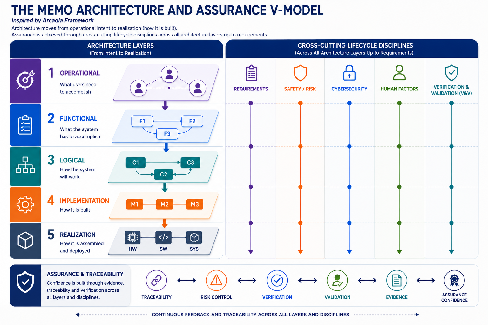

# MEMO architecture guide

Use this page to navigate the ontology by engineering question: which elements
belong in each perspective, how they connect, and which disciplines cut across
them. It is a practical index of the current ontology, not a required sequence
of project phases or a substitute for the package source.

{ .memo-zoomable aria-label="Open the architecture and assurance V-model" }

## Jump to a perspective

- [Operational: context, workflows, and scenarios](#operational)
- [Use-case kinds](#use-case-kinds)
- [Functional: capabilities, functions, and flows](#functional)
- [Logical: responsibilities, channels, and interfaces](#logical)
- [Implementation: software, hardware, and physical realization](#implementation)
- [Cross-cutting disciplines](#cross-cutting-disciplines)
- [Relationship backbone](#relationship-backbone)

## Operational

The operational perspective answers **why, for whom, and in what context**.
[Operational](../ontology/operational.md) teaches it line by line.

| Element | Use it to record | Key relationships |
| --- | --- | --- |
| `User`, `MemoActor`, `OperationalEntity` | Who uses the device; another person or thing in the setting | native `actor` on a use case; `perform` |
| `IntendedUse`, `ReasonablyForeseeableMisuse`, `UseContext`, `Need` | Purpose, foreseeable misuse, setting, and what users need | `Motivates`, `HeldBy`, `DerivesFrom` |
| `ClinicalUseCase`, `SystemUseCase`, with `useCaseKind` | A care, service, manufacturing, or development goal | native `actor` and `subject`; `Motivates`, `Validates` |
| `ClinicalWorkflow`, `SystemWorkflow` | Reusable organization of work | `RealizesUseCase` |
| `OperativeScenario` (`scenarioKind`: nominal, alternate) | One path through a workflow, nested in it | `#refinement` to its use case; native `perform` and `first … then` |
| `OperativeAction` | Work performed along a path; a critical task is one whose `criticality` is high | native `perform` of a system function; `CommitsUseError`, `Validates` |

**Core split:** `UseCase → workflow → OperativeScenario → OperativeAction →
SystemFunction`. A scenario owns the activity and action flow for its path; it
is not a copy of the workflow.

## Use-case kinds

A use case stores the goal statement, trigger, preconditions, outcomes,
participants, context, and supporting system. `useCaseKind` records the domain
of the goal:

| `useCaseKind` | Use it when the goal concerns… | Example |
| --- | --- | --- |
| `care` | patient care or clinical operation | Deliver patient-controlled analgesia |
| `service` | installation, maintenance, repair, calibration, or support | Calibrate a pressure sensor |
| `manufacturing` | producing, assembling, inspecting, packaging, or releasing a product | Inspect a sterile barrier seal |
| `development` | design, analysis, verification, change, or release work | Verify an alarm latency requirement |

The goal stays one use case; the value records its domain.

## Functional

The functional perspective answers **what the system must do**, independently
of a software, electronics, or mechanical choice.
[Functional](../ontology/functional.md) teaches it line by line.

| Element | Use it to record | Key relationships |
| --- | --- | --- |
| `SystemFunction` | A technology-independent responsibility of the system | native `allocate`, `satisfy`, and a verification case's `subject` |
| `ComponentFunction` | The responsibility of exactly one component | native `allocate` to that component |
| `FunctionalFlow` | A reusable route through functions; a step is `action <step> :> <function>` nested in the flow | native `flow` and `first … then` |
| `FunctionalTransfer` | Typed command, measurement, alarm, material, or energy transfer | a named `flow` from one function's `out` parameter to another's `in` |
| `StateMachine`, `ModeConfiguration` | Modes and the selection made at a choice point | native `state` and `transition` |

A function can be allocated to software, hardware, a mechanical part, or a
human procedure. Do not create a software component merely because a function
exists.

## Logical

The logical perspective answers **how the solution is organized while still
technology-independent**. [Logical](../ontology/logical.md) teaches it line by
line.

| Element | Use it to record | Key relationships |
| --- | --- | --- |
| `System`, `Subsystem`, `LogicalComponent` | Responsibility structure | nesting; native `allocate` from functions |
| `LogicalComponent` with `channelRole` | Primary, redundant, monitor, watchdog, interlock, or protection role | `IndependentOf` with its basis |
| `LogicalComponent` with `componentRole` | Control, storage, user-interface, or external-system responsibility | allocation and interface links |
| `LogicalPort`, `ComponentExchange` | Where components meet, and the exchange between two ports | `interface … connect`, native `flow` |
| `IsolationBoundary`, `FaultContainmentRegion` | Required separation and containment | not yet relatable to what they enclose; see [Logical](../ontology/logical.md) |

Use native `allocate` to say which component is responsible for a function.
Use an `IndependentOf` relationship with its stated basis, not duplicated
components, to make a redundancy or independence claim.

## Implementation

The implementation perspective answers **how the design is realized**.
[Implementation](../ontology/implementation.md) and
[Realization](../ontology/realization.md) teach it line by line.

| Element group | Examples | Key relationships |
| --- | --- | --- |
| Software structure | `SoftwareSystem`, `SoftwareModule`, `SOUPSoftwareModule`, `SoftwareBillOfMaterials`, `SBOMEntry` | `RealizedBy` from a logical component; `BuildsInto`; `DependsOnSoup` |
| Runtime structure | `SoftwareComponent` with `runtimeKind` (process, thread, task, service, container, partition…) | `#refinement` to the module it runs; `MemoryBinding` |
| Deployment | `SoftwareDeploymentUnit`, `ProcessingNode`, `RuntimeEnvironment`, `MemoryDevice` | `DeploysTo`, `HostedBy`, `ProvidesEnvironment` |
| Hardware | `HardwareAssembly`, `HardwareComponent`, `Sensor`, `Actuator` | `RealizedBy` from a logical component; nesting |
| Physical boundaries | `PhysicalPort`, `PhysicalInterface` | `interface … connect`, native `flow`, `ConnectionBinding` |

An IBD shows parts, ports, and directed exchanges. A BDD shows definitions and
containment. Use behavior views for actions and state.

## Cross-cutting disciplines

These disciplines own their assurance elements and connect them to architecture
elements through typed relationships; they do not duplicate architecture
elements.

| Discipline | Core elements | Principal relationships |
| --- | --- | --- |
| Requirements | `Need` (with `needKind`), `Requirement` (with `requirementType`: system, software, hardware, ifu) | `DerivesFrom`, `HeldBy`, native `satisfy` |
| Safety and risk | `SafetyRelatedCharacteristic`, `HazardCause`, `Hazard`, `SequenceOfEvents`, `HazardousSituation`, `Harm`, `Risk`, `RiskControlMeasure`, `ResidualRisk`, `Benefit`, FMEA/FTA elements | `TracesRisk`, `Mitigates`, `ControlImplementedBy`, `HasFailureMode` |
| Cybersecurity | `CybersecurityAsset`, `Threat`, `Vulnerability`, `CyberMitigation` | `ThreatenedBy`, `Exploits`, `Mitigates` |
| Human factors | `UseError`, with the `OperativeAction` and `UIElement` it involves | `CommitsUseError`, `ErrorAtElement`, `Causes` |
| Verification and validation | `VerificationCase`, `ValidationCase`, `MemoEvidence` | the case's native `subject`, `Validates`, `ProducesEvidence` |

FMEA analyzes how a function or component can fail and identifies hazards. It
does not turn a hazard into a successor of the function. Unit tests verify
implemented units; system and validation cases verify claims and use context.

## Relationship backbone

| From | Relationship | To | Review question |
| --- | --- | --- | --- |
| `Need` | `Motivates` | use case | Why does this goal matter? |
| workflow | `RealizesUseCase` | use case | How is work organized? |
| `OperativeScenario` | nested in, and `#refinement` to | workflow, use case | Which path is considered? |
| `OperativeAction` | native `perform` | `SystemFunction` | What carries out the work? |
| function | native `allocate` | `LogicalComponent` | Who is responsible? |
| `LogicalComponent` | `RealizedBy` | software or hardware | How is it realized? |
| `Requirement` | native `satisfy … by` | design element | What meets it? |
| `VerificationCase` | native `subject` | requirement, function, or component | How is it checked? |
| `VerificationCase` | `ProducesEvidence` | `MemoEvidence` | What result supports it? |

The backbone is a graph: one element can participate in several paths. See
[Elements](../modeling/elements.md) and [Relationships](../modeling/relationships.md)
for selection guidance and source/target examples.

## Repository boundary

MEMO is deliberately separated into three products. This repository contains
the portable content layer; it has no user interface and no command-line
implementation. A model can use it in any conformant SysML v2 environment.

| Layer | What it defines | Where it lives |
|---|---|---|
| **Ontology** | Typed SysML v2 elements, Arcadia-inspired architecture layers, semantic links, and closure rules — what each element *means* | This repository |
| **Methodology** | Profiles, viewpoints, workflow stages, quality gates, and project bindings — how teams *apply* the ontology | This repository |
| **Tools** | Parser, semantic model, validation, and the `memo` CLI that checks the model and generates documents | [memo-tools](https://github.com/memoarchitect/memo-tools) |
| **Architect** | A visual workbench for diagrams, traceability, and DHF review over the same model | [memo-architect](https://github.com/memoarchitect/memo-architect) |

This repository is the **content layer**: pure SysML v2 and KerML source. The
Tools and Architect products consume that content; neither owns or duplicates
its engineering meaning.

Two principles keep the stack honest:

1. **The model is the single source of truth.** Tools and Architect read the
   same text-first source; neither adds meaning of its own.
2. **No content knowledge in the engine.** Package names, templates,
   archetypes, and scaffold layouts all come from this repository's
   [manifest](repository.md#the-manifest), never from hardcoded strings in
   TypeScript.

## Source layout and history

- [The memo:: Namespace](namespace.md) — how the SysML packages build bottom-up
  from core semantics to a worked example.
- [Repository and Packaging](repository.md) — how the directories map to the
  public library surface and the four logical packages inside it.
- [Layer Map](../layers/index.md) — the layer vocabulary and typed
  relationships that connect a model vertically.
