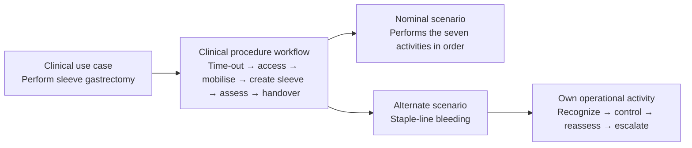

# Surgical workflow modelling: sleeve gastrectomy

This tutorial models one illustrative operation end to end: a laparoscopic
sleeve gastrectomy. It is a modelling example, not a clinical protocol. The
point is to make the clinical work explicit before a device, software item, or
architecture is selected.



The code below is included from the example's source, so it is the model as it
compiles.

## The clinical goal and setting

The use case records the operation's goal, people, and operating-room context.
It is one `ClinicalUseCase`: its actors are native `actor` features, its
setting is the `useContext` it references, and a need `Motivates` it.

```sysml
--8<-- "examples/surgical-closure-workflow/model/catalog/surgical_closure_workflow.sysml:use-case"
```

## A critical task inside the operation

Sizing and creating the sleeve contains the task where the risk sits:
`taskCreateStapleLine` is an `OperativeAction` with `criticality` high, which
is what makes it a critical task. It states its goal, the harm if it fails, and
how serious that is, and its four steps are ordered with native `first … then`
successions: confirm anatomy, create the staple line, inspect for bleeding,
assess integrity.

```sysml
--8<-- "examples/surgical-closure-workflow/model/catalog/surgical_closure_workflow.sysml:critical-task"
```

## The workflow and its scenarios

`wfSleeveGastrectomy` is a `ClinicalProcedureWorkflow`, from the clinical
extension. It owns two scenarios. The nominal scenario performs the seven
procedure activities and orders them with successions. The recovery scenario is
an `alternate` path for staple-line bleeding, and it owns its own activity:
recognize, control, reassess, then escalate if needed. It is not a copy of the
full surgical workflow.

```sysml
--8<-- "examples/surgical-closure-workflow/model/catalog/surgical_closure_workflow.sysml:workflow"
```

Each scenario refines the use case it is a path of, and the workflow realizes
it:

```sysml
--8<-- "examples/surgical-closure-workflow/model/catalog/surgical_closure_workflow.sysml:refines"
```

## What this example deliberately does not model

This is an operational surgical-workflow model. It stops at clinical work,
tasks, workflow steps, scenarios, and action flows. A later model may trace a
selected scenario to functions, devices, requirements, hazards, or evidence;
those elements should be added only when there is a real review question.

Open the [source model](https://github.com/memoarchitect/memo/tree/main/examples/surgical-closure-workflow)
to inspect the full workflow and both scenario paths.

<!-- memo:reinforce -->

## Where this sits in MEMO

Every tutorial is one slice of the same structure. This example uses these definitions, by the part of the ontology they come from:

| Part of the ontology | Definitions it uses | Reference |
| --- | --- | --- |
| Operational | `ClinicalUseCase`, `OperativeAction`, `OperativeScenario`, `UseContext`, `User` | [Operational](../ontology/operational.md) |
| Logical | `System` | [Logical](../ontology/logical.md) |
| Requirements | `Need` | [Requirements](../ontology/requirements.md) |
| Verification and validation | `ValidationCase` | [Verification and validation](../ontology/verification-validation.md) |
| Views and methodology | `MemoDiagramView`, `ModelMethodBinding` | [Views and methodology](../reference/areas/viewpoints.md) |

**MEMO relationships it uses:** `HeldBy`, `Motivates`, `RealizesUseCase`, `Validates`. See [Relationships](../reference/building-blocks.md#relationships) for what each one claims and which ends are legal.

**Native SysML relationships it uses:** `actor`, `subject`, `perform`, `dependency`, `#refinement`, succession (`first … then`), `expose`.

**Architecture layers it does not populate:** functional, implementation, realization. A MEMO project includes only the layers selected by its methodology. For a device modelled all the way through, see the [GPCA Pump case study](../case-studies/gpca/index.md).

**Narrative treatment:** [Context and Use](../layers/context.md) · [Risk, Cybersecurity, and Assurance](../layers/risk-assurance.md).

**Source model:** [`examples/surgical-closure-workflow`](https://github.com/memoarchitect/memo/tree/main/examples/surgical-closure-workflow)
