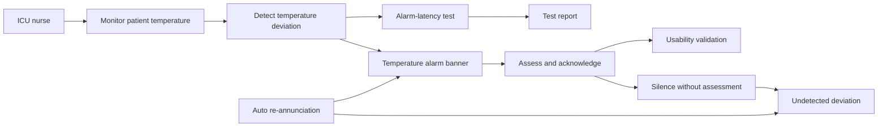

# Temperature Alarm: a small, complete model

This page explains the Temperature Alarm SysML model. It is not a list of
things to model. Follow the code and the relationships to see the whole safety
argument: a nurse monitors a patient, the device detects a deviation, the
alarm supports a critical task, a foreseeable use error creates a hazard, and
a design control is checked with evidence.

| File | Role |
| --- | --- |
| `model/catalog/temperature_alarm.sysml` | model elements and relationships |
| `model/catalog/viewpoints/logical/views/temperature_alarm_overview.sysml` | view of the catalog |
| `model/methodology/project.sysml` | the project's entrypoint and its methodology |

The code below is included from those files, so it is the model as it compiles.



## Clinical purpose and human work

The use case states the clinical goal once, and the nurse is its `actor`, the
native SysML way to say who pursues a use case. The acknowledgement activity
contains the task where the risk sits: `taskAckAlarm` is an `OperativeAction`
with `criticality` high, and it states its goal, the harm if it fails, and how
serious that harm is. A critical task is an operative action marked that way,
not a separate kind of element.

```sysml
--8<-- "examples/temperature-alarm/model/catalog/temperature_alarm.sysml:operational"
```

## System responsibility and logical channel

`fnDetectDeviation` is the technology-independent responsibility. It is
allocated with native `allocate` to `chMonitor`, a logical channel whose role
is to monitor. The monitor states that it fails independently of the primary
measurement channel, and why (`IndependentOf`, with its basis). The model can
later realize the channel in software or hardware without changing the
functional claim.

```sysml
--8<-- "examples/temperature-alarm/model/catalog/temperature_alarm.sysml:functional"
```

```sysml
--8<-- "examples/temperature-alarm/model/catalog/temperature_alarm.sysml:logical"
```

## Alarm interaction and safety control

The alarm banner is an element of the bedside display. It triggers the
acknowledge action, and the display supports the nurse's task with a native
`dependency`. The connections that follow form the safety argument: the task
is where a use error is committed (`CommitsUseError`), the use error causes the
hazard (`Causes`), the risk control mitigates it (`Mitigates`), and the control
is implemented by the banner (`ControlImplementedBy`).

```sysml
--8<-- "examples/temperature-alarm/model/catalog/temperature_alarm.sysml:implementation"
```

```sysml
--8<-- "examples/temperature-alarm/model/catalog/temperature_alarm.sysml:risk-chain"
```

## Evidence is separate from the design

The latency test checks the detection function: it is a `VerificationCase`
whose `subject` is the function and which performs a latency scenario. The
summative usability test checks the nurse's task: it is a `ValidationCase` that
the task `Validates`. They are different claims, so they are different
elements, and each `ProducesEvidence`: a `MemoEvidence` whose `evidenceKind`
says what it is.

```sysml
--8<-- "examples/temperature-alarm/model/catalog/temperature_alarm.sysml:verification-validation"
```

## The viewpoint does not duplicate the model

The overview view exposes the catalog. It selects and presents existing
elements; it does not introduce a second temperature-alarm architecture.

```sysml
--8<-- "examples/temperature-alarm/model/catalog/viewpoints/logical/views/temperature_alarm_overview.sysml"
```

The [full catalog source](https://github.com/memoarchitect/memo/tree/main/examples/temperature-alarm/model/catalog)
also holds the illustrative requirement, hazardous situation, harm and second
verification case, which these excerpts leave out.

<!-- memo:reinforce -->

## Where this sits in MEMO

Every tutorial is one slice of the same structure. This example uses these definitions, by the part of the ontology they come from:

| Part of the ontology | Definitions it uses | Reference |
| --- | --- | --- |
| Operational | `OperativeAction`, `OperativeScenario`, `SystemUseCase`, `User` | [Operational](../ontology/operational.md) |
| Functional | `SystemFunction` | [Functional](../ontology/functional.md) |
| Logical | `LogicalComponent`, `System` | [Logical](../ontology/logical.md) |
| Implementation | `UIAction`, `UIElement`, `UserInterface` | [Implementation](../ontology/implementation.md) |
| Requirements | `Requirement` | [Requirements](../ontology/requirements.md) |
| Safety and risk | `Harm`, `Hazard`, `HazardousSituation`, `RiskControlMeasure` | [Safety and risk](../ontology/safety-risk.md) |
| Human factors | `UseError` | [Human factors](../ontology/human-factors.md) |
| Verification and validation | `ValidationCase`, `VerificationCase` | [Verification and validation](../ontology/verification-validation.md) |
| Core | `MemoEvidence` | [Core](../reference/areas/core.md) |
| Views and methodology | `MemoDiagramView`, `ModelMethodBinding` | [Views and methodology](../reference/areas/viewpoints.md) |

**MEMO relationships it uses:** `Causes`, `CommitsUseError`, `ControlImplementedBy`, `DerivesFrom`, `ElementTriggersAction`, `IndependentOf`, `Mitigates`, `ProducesEvidence`, `TracesRisk`, `Validates`. See [Relationships](../reference/building-blocks.md#relationships) for what each one claims and which ends are legal.

**Native SysML relationships it uses:** `actor`, `subject`, `perform`, `allocate`, `satisfy`, `dependency`, `expose`.

**Architecture layers it does not populate:** realization. A MEMO project includes only the layers selected by its methodology. For a device modelled all the way through, see the [GPCA Pump case study](../case-studies/gpca/index.md).

**Narrative treatment:** [Context and Use](../layers/context.md) · [Functional Analysis](../layers/operations-system.md) · [Requirements and Architecture](../layers/requirements-architecture.md) · [Risk, Cybersecurity, and Assurance](../layers/risk-assurance.md).

**Source model:** [`examples/temperature-alarm`](https://github.com/memoarchitect/memo/tree/main/examples/temperature-alarm)
