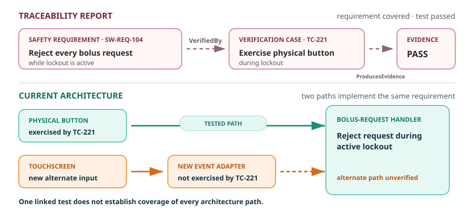
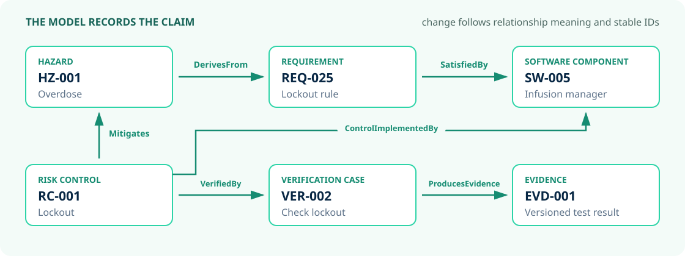

Medical Engineering Modeling Ontology

# MEMO

A domain model for medical-device engineering, based on SysML v2, that keeps
architecture, risk, verification, and evidence connected as the design changes.

!!! warning "0.14.0 is an experimental release"
    0.14.0 adds support for the OpenSysML compiler alongside SysIDE. The OpenSysML
    path is new and has had less use, and some of what it enables (such as the
    compact transport form) is not switched on yet. The next version will be more
    stable. Pin an exact version.

!!! warning "Experimental before 1.0"
    Until MEMO reaches version 1.0, the ontology and its public API are
    experimental. Namespaces, definitions, relationships, and imports may
    change as feedback is incorporated. Use a [tagged release](https://github.com/memoarchitect/memo/releases)
    or an exact npm version rather than `main` for reproducible project work.

## What MEMO is

MEMO is a domain model for medical-device engineering, built on SysML v2. It
describes a device in **one model**: what the device is for, what it does, how
it is organised and built, and the argument that it is safe and effective.
Typed relationships connect those facts, so a change can be followed through
the model, and a reviewer can challenge each claim.

MEMO is importable SysML v2 source. Projects and SysML v2 modeling environments
use it as a library.

## The model at a glance

MEMO organises the model on two axes.

**The architecture layers** explain the device, from purpose to deployed
hardware. Each layer answers one question.

### [Operational](ontology/operational.md)

Why does the device exist, for whom, and in what setting? Users, use cases,
intended use, context, workflows.

### [Functional](ontology/functional.md)

What must the system do? System and component functions, exchanges, behaviour.

### [Logical](ontology/logical.md)

How is the solution organised, before choosing a technology? Components,
channels, interfaces, boundaries.

### [Implementation](ontology/implementation.md) and [Realization](ontology/realization.md)

What is it built from, and where does it run? Software, hardware, user
interface, deployment.

**The assurance disciplines** test that explanation across every layer:
[Requirements](ontology/requirements.md),
[Safety and risk](ontology/safety-risk.md),
[Cybersecurity](ontology/cybersecurity.md),
[Human factors](ontology/human-factors.md), and
[Verification and validation](ontology/verification-validation.md).

[Read **MEMO in a nutshell** →](ontology/index.md): the layers, how they
connect, and one example traced through all of them.

## Problem statement

Medical devices can combine clinical workflows, configurable behavior,
software, electronics, mechanics, interfaces, and connected services. Safety
depends on how the whole system behaves in its intended and foreseeable use.

[Read **Why MEMO** →](why/index.md)

The assurance case, however, is split across teams and artifacts:

- Requirements are traced to tests, but not always to the behavior being tested.
- Hazards and controls are recorded, but controls may not be anchored to the design.
- Threats are listed, but may not be tied to the interfaces they threaten.
- Architecture is documented, but can drift from the implementation.

The artifacts are linked, but the links often stop at IDs. They do not capture
the engineering meaning of the claim. When the design changes, the links still
resolve even when the evidence behind them has become stale.

## Solution

MEMO supplies a shared, architecture-backed model that assurance activities
can use.

### One engineering model

Clinical intent, behavior, architecture, requirements, risk, verification, and
evidence are modeled together.

### Relationship definitions

Relationship definitions state the engineering claim, direction, and accepted
endpoint roles.

### Architecture and assurance

Risk controls, interfaces, behavior, implementation, and evidence remain tied
to the design they describe.

### Rules and viewpoints

Completeness checks, change-impact analysis, and assurance views can be derived
from the model.

The result is one version-controlled engineering model whose meaning can be
reviewed and checked as the design evolves.

## Introducing MEMO

SysML v2 provides the language substrate: packages, parts, requirements,
actions, interfaces, relationships, and typed model structure. MEMO adds the
medical-device semantic layer:

- **Typed elements** for clinical use, medical products, architecture,
  requirements, hazards, controls, verification, and evidence.
- **Relationship definitions** with direction, meaning, and declared endpoint
  roles.
- **Closure rules** that express completeness and consistency questions as
  model constraints.

In this model, the requirement exists because of a known hazard, the component
satisfies that requirement and implements the lockout control, the control
mitigates the hazard, and the verification case produces evidence. A change can
therefore follow the meaning of the model instead of stopping at a list of IDs.

## Project links

- [MEMO Ontology GitHub repository](https://github.com/memoarchitect/memo)
- [MEMO Tools documentation](https://memoarchitect.com/memo-tools/) · [GitHub repository](https://github.com/memoarchitect/memo-tools)
- [MEMO Architect documentation](https://memoarchitect.com/memo-architect/) · [GitHub repository](https://github.com/memoarchitect/memo-architect)
- [MEMO product website](https://memoarchitect.com/)

---

`memo::` · open source · SysML v2 · ISO 14971 · IEC 62304 · ISO/IEC/IEEE 42010
