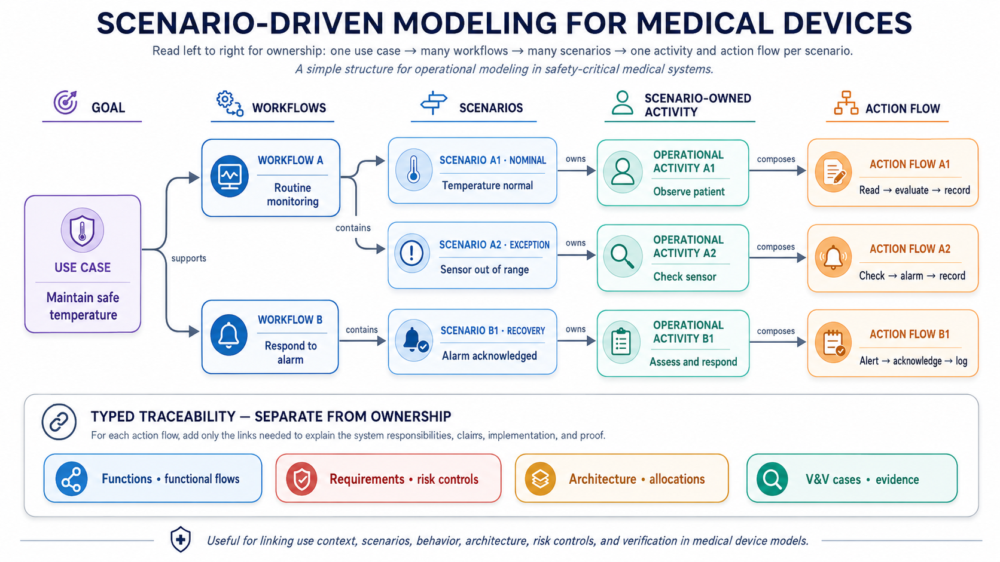

# Layer 3 — Workflows and scenarios

!!! abstract "Running example"

    The **GPCA infusion pump**, continued from
    [Layer 2 — Use cases](use-cases.md).

## The question this layer answers

*How is the goal pursued, and what paths can the work take?*

The use case established the goal: deliver patient-controlled analgesia within
prescribed limits. It did not describe the work required to achieve that goal
or what happens when conditions depart from the nominal path.

This layer adds that missing behavior without assigning responsibility to
software, hardware, or mechanics yet.

## Use case, workflow, scenario

Three elements, each with one job:

| Element | What it is | IEC 62366-1 |
| --- | --- | --- |
| **Use case** | The user's goal. | — |
| **Workflow** | The analysis of one body of work that pursues the goal: who does it, where, with what equipment, between which entry and completion conditions, and what is needed and not yet met. It holds no steps. | The use specification (5.1) for that body of work, drawing on the user interface characteristics related to safety (5.2) and the known use-related hazards (5.3). |
| **Scenario** | The stepwise actions that complete the workflow, with pre- and post-conditions. | The use scenario: a sequence of tasks by a user in a use environment, and the device's responses. |

The standard has no "workflow"; MEMO's workflow is the use specification scoped to one body of work.

## From one goal to several workflows

A use case can be supported by more than one workflow. The GPCA model separates
the therapy into three bodies of work:

| Workflow | Entry | Completion |
| --- | --- | --- |
| `wfPrepareAndStartTherapy` | A valid prescription and prepared reservoir are available | Therapy starts with confirmed prescription limits |
| `wfManageActiveTherapy` | Basal therapy is active | A bolus is handled or therapy continues safely |
| `wfRespondToTherapyAlarm` | An alarm or degraded condition is detected | The pump is safe and the clinician has resolved or escalated the condition |

The separation matters. Preparing therapy, managing active delivery, and
responding to an alarm have different actors, preconditions, and success
criteria. Combining them into one large flow would hide those boundaries.

Each workflow is an `OperationalWorkflow` part. Its analysis is modelled, not
written as prose: the use context and environment are `UseContext` and
`UseEnvironment` references, the equipment is its own `WorkflowResource` parts,
and a `Need` names the workflow it arises in, with `metByCurrentPractice` false
for an unmet need. The users are whoever performs its scenarios' steps.

## A scenario is the steps

A workflow analyses the work. A **scenario** is that work done, step by step,
under stated conditions. An **occurrence** is one actual execution of a
scenario.

{ .memo-zoomable aria-label="Open the scenario-driven modeling diagram" }

The GPCA model has six scenarios:

| Scenario | Kind | What changes the path |
| --- | --- | --- |
| `osNominalTherapy` | Nominal | Therapy completes within configured limits |
| `osLockoutBolus` | Alternate | The patient requests a bolus while lockout is active |
| `osOcclusionAlarm` | Exception | A downstream occlusion is detected |
| `osAirInLine` | Exception | Air is detected in the tubing |
| `osEmptyReservoir` | Exception | The reservoir reaches its empty threshold |
| `osPowerLoss` | Recovery | Mains power is lost and therapy transfers or recovers safely |

Each is nested in its workflow and records its trigger, precondition, steps,
postcondition and expected outcome. A step that occurs in several scenarios is
one action definition used in each, never a copy.

## The lockout path

`osLockoutBolus` makes the safety situation concrete:

1. Basal infusion is active and the lockout interval is running.
2. The patient presses the bolus button.
3. The pump checks the lockout state.
4. The request is rejected and logged.
5. Basal delivery continues without additional drug.

The scenario is the shared situation that later requirements, hazards,
controls, functions, and verification cases refer to. Without it, “prevent
overdose” remains a statement detached from the user action and device state
that create the risk.

## What this layer hands to the next

Functional analysis takes each selected scenario and asks what the system must
do on that path. For the lockout scenario, it must at least:

- accept the bolus request;
- determine whether lockout is active;
- prevent additional delivery when the request is ineligible;
- preserve basal therapy; and
- record the rejected request.

Those are system responsibilities, not implementation decisions. The next
layer turns them into functions and functional flows before any component is
chosen.

[Next: Functional Analysis](operations-system.md)
