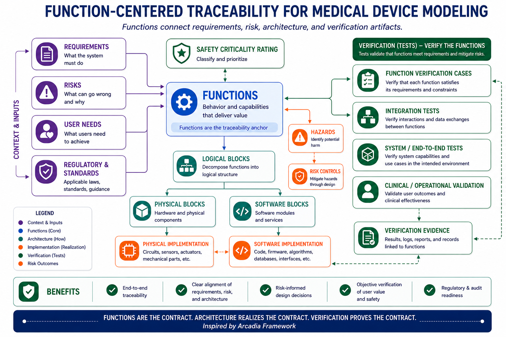
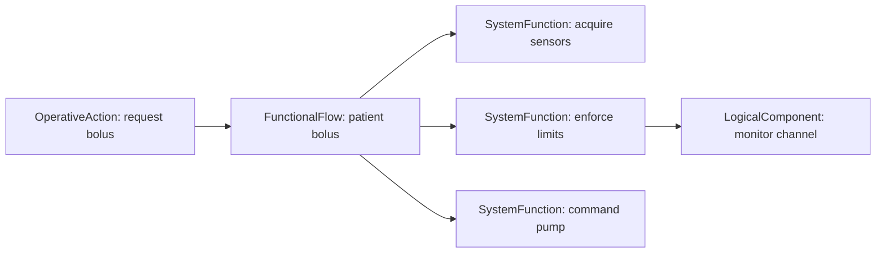

# Functional Analysis

The functional layer answers *what the system must do* without saying how.
This separation is what lets one functional architecture survive a technology
change — and what stops every function from silently becoming software. A
`SystemFunction` may be realized by human action, mechanics, electronics,
software, or a combination; the allocation decision is explicit and comes
later.

## Keep these meanings distinct

The vocabulary here earns its size by preventing one recurring confusion —
work, responsibility, behavior, organization, and path are different claims:

| Element | Meaning |
|---|---|
| `OperativeAction` | A step of the work in the operational world, performed by a person or by the system |
| `SystemFunction` | Technology-independent responsibility of the system |
| `FunctionalFlow` | Reusable organization of functions; each step is an action nested in the flow that subsets the function it performs |

`FunctionalExchange` is a typed transfer (measurement, command, alarm, …)
between functions. It is a `flow def`, and an exchange is a named flow from
one function's `out` parameter to another's `in`, carrying its latency,
staleness and integrity attributes in its body:

```sysml
flow lfFlowCommand : FunctionalExchange
    from fnManageInfusion.flowCommandOut to fnCommandPump.flowCommandIn {
    attribute :>> latencyBudgetMs = 20.0;
}
```

The flow is the exchange — there is no separate element beside it — and its
qualified name is what `allocate lfFlowCommand to exFlowCommand;` names. An
action flow may call a function, but it is diagram behaviour rather than
another functional-architecture element.

## From an activity to a function

The operational layer has two levels (see [Workflows and scenarios](operational-world.md)).
A level-1 step says what must happen to the patient and names no product. A level-2
activity is one variant's way of doing it, and it is where the system's share begins: an
activity the system performs `perform`s the `SystemFunction` that carries it out, written
inside the activity. This is the only link from the operational world to a function, so a
function is performed from a level-2 activity or from a step of a `FunctionalFlow`, and never
from a level-1 step. The roll-ups of time, cost and success stop at the `perform`: what the
function does is how the system does its share, not more time.

## Core relationships

| Write (native SysML) | Reads as |
|---|---|
| `perform` | This action or flow carries out that function; an activity the system performs `perform`s the function that carries it out |
| nesting | This function or flow is made of these sub-functions and steps |
| `#refinement dependency <realizing> to <realized>` | This element realises that one |
| `allocate` | This function is the responsibility of that logical component |

[](../assets/function-centered-traceability.png){ .memo-zoomable aria-label="Open the function-centered traceability diagram" }

Functions provide a useful traceability anchor: requirements and risk controls
constrain them, architecture elements take responsibility for them, and
verification cases produce evidence about them. The source model remains the
authority for the exact relationship types and their endpoints.

## Example thread



In the GPCA example, `gpca_behavior_subsystems.sysml` defines the functions
and exchanges, and `gpca_system.sysml` organizes them into flows whose steps
carry typed references to functions and exchanged items — follow `FCS-001`
through `FCS-005` for the complete bolus path.

## Continue the story

Next, read [Requirements and Architecture](requirements-architecture.md). It
connects the claims that constrain a function to the logical and implemented
parts responsible for it.
