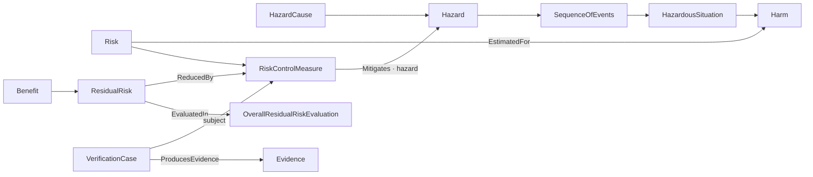

# Risk, Cybersecurity, and Assurance

Risk and assurance are cross-cutting arguments. They connect to context,
requirements, design, and evidence rather than sitting in isolated registers —
and in MEMO they claim existing elements through typed relationships instead
of copying them into a "safety model."

## Safety-risk chain (ISO 14971)

| Element | Question |
|---|---|
| `IntendedUse` / `ReasonablyForeseeableMisuse` | What use and foreseeable misuse bound the analysis? |
| `SafetyRelatedCharacteristic` | Which device characteristic can affect safety? |
| `HazardCause` | What initiating or contributing cause is being analyzed? |
| `Hazard` | What is the potential source of harm? |
| `SequenceOfEvents` | What reasonably foreseeable sequence or combination of events can create exposure? |
| `HazardousSituation` | When is someone exposed to the hazard? |
| `Harm` | What injury or damage may result? |
| `Risk` | What are the probability of occurrence of harm and its severity before control? |
| `RiskControlMeasure` | What measure reduces probability or severity? |
| `ResidualRisk` | What risk remains after the control measures? |
| `Benefit` | What positive outcome supports a benefit-risk determination? |
| `OverallResidualRiskEvaluation` | Is the combined residual risk acceptable? |

These are dedicated ontology elements. Do not replace `SequenceOfEvents` with
an `OperativeScenario`, or merge `HazardCause` with the FMEA-specific
`FailureCause`. Risk-management plans, reports, matrices, and benefit-risk
documents are artifact views over these elements.

## Human factors (IEC 62366-1, FDA HF guidance)

The usability chain runs from the operational world into risk: a task (an
`OperativeAction` a `User` performs) can commit a `UseError`
(`CommitsUseError`); a safety-relevant use error must trace to a `Hazard`
(`Causes`); a critical task, one with high `criticality`, must be validated by a
summative usability test, a `ValidationCase` (`Validates`). Formative and
summative results are `MemoEvidence`, with `evidenceKind` `formativeEvaluation`
or `usabilityValidation`. A risk control implemented in the UI (a confirmation dialog, a
guarded control, alarm re-annunciation) is linked to the implementing
`UIElement` with `ControlImplementedBy` — the `temperature-alarm` example
walks the entire chain.

## Cybersecurity chain

Use `CybersecurityAsset`, `AttackSurface`, `Threat`, `Vulnerability`, an
`OperativeScenario` that realises the threat (`RealizedByScenario`),
`CyberRisk`, `CyberMitigation`, `SecurityRequirement`, `TrustBoundary`, and
security claims as `MemoEvidence` with `evidenceKind = securityClaim`. Interfaces that cross a trust boundary
say so (`CrossesTrustBoundary`); see `connected-patient-monitor`.

Safety and security are connected. Use `ImpactsSafety` when a cyber condition
can affect a safety claim; do not duplicate the same risk independently in two
registers.

## V&V and evidence

| Element | Role |
|---|---|
| `VerificationCase` | Shows a design output meets a specified input; it names what it checks as its `subject` and `perform`s the `OperativeScenario` it exercises |
| `ValidationCase` | Shows the device meets user needs and intended use — `Validates` closes the loop to the operational world; a summative usability test is one |
| `MemoEvidence` | Reviewable support for a claim; `evidenceKind` says test artifact, usability validation, security claim, … |

The V-model is a **view over these relationships**, not an ontology hierarchy:
each definition-side layer is validated or verified by the matching
integration-side activity (see [The layers](index.md)). Coverage rules keep
the graph honest: safety-critical functions must trace to verification, and
critical tasks to usability validation.

Connect evidence to the claim it supports. A file path alone is not a complete
assurance argument; record the verification case, acceptance basis, result,
and the evidence artifact.

## Continue the story

Next, read [Elements](../modeling/elements.md) and
[Relationships](../modeling/relationships.md) for the practical choices used
to write this connected model.
