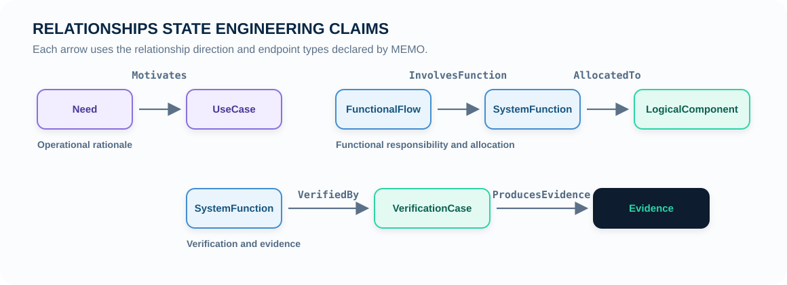
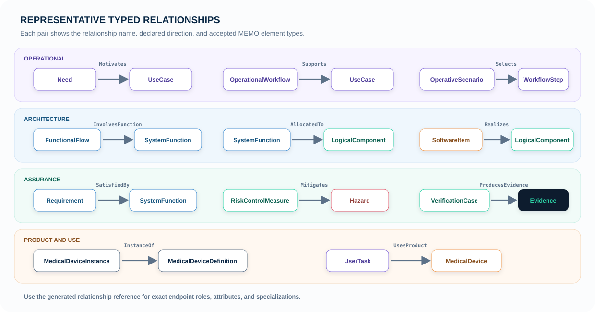

# Relationships

Relationships make the model navigable and testable. The reasoning: a model
element on its own is a note; a typed relationship is a claim a reviewer can
challenge. Select the narrowest relationship whose meaning and endpoint
direction match what you are asserting.



## Relationship families

MEMO defines typed relationships across operational, architecture, assurance,
and product domains. The chart shows representative pairs in the direction
declared by the ontology:



## High-value traceability links

Most links between architecture layers are **native SysML v2**. MEMO adds its own
typed relationship only where the native form would lose meaning a
medical-device argument needs. Each layer page of
[the ontology](../ontology/index.md) lists every relationship that touches it,
generated from the source.

| Write | From | To | Use it to say… |
|---|---|---|---|
| `actor` (native) | User | UseCase | This user pursues the goal |
| `Motivates` | Need | UseCase | This need is why the goal exists |
| `RealizesUseCase` | OperationalWorkflow | UseCase | This organised work realises the goal |
| `perform` (native) | Action or UI action | Function or scenario | This action carries out that behaviour |
| `allocate` (native) | Function | Component | This component is responsible for this behaviour |
| `#refinement dependency` (native) | Realizing element | Realized element | This implementation realises that design element |
| `allocation … : BuildsInto` / `: DeploysTo` / `: HostedBy` | Module / unit / node | Unit / node / board | The deployment chain |
| `DerivesFrom` | Need, risk, threat, or other driver | Requirement | This requirement exists because of this driver |
| `satisfy` (native) | Requirement | Design element | This design element satisfies the obligation |
| `Mitigates` | Risk control | Hazard or vulnerability | This control reduces this risk item (`mitigationKind`) |
| `ControlImplementedBy` | Risk control | Design element | This element implements the control |
| `CommitsUseError` / `Causes` | Task / use error | Use error / hazard | The use-related risk path |
| `subject` (native) / `Validates` | Verification case / claim, use case, or task | What it checks / validation case | This case checks the claim |
| `ProducesEvidence` | Verification or validation case | Evidence | This activity produced this evidence |

The ontology includes more specialized links for cybersecurity, FMEA, fault
trees, lifecycle change, interaction, and document views. Each is a
`connection def`, or an `allocation def` for the deployment chain, specializing
`MemoRelationship` with typed ends, so the full inventory is discoverable in
`src/core/relationships` and each domain package.

Before you reach for a new `connection def`, check that SysML v2 does not
already supply the construct: many relationships (`flow`, `bind`, `actor`,
`succession`, nesting) are native, and a reinvented edge suppresses the checking
the native one performs. See
[Naming and native constructs](../reference/naming-and-native-constructs.md) for
the corpus-first rule, the native-construct lookup table, and the
`allocation … : DeploysTo allocate …` extension pattern.

## Direction matters

Write the relationship so its endpoint roles read as a sentence:

```sysml
connection : Mitigates
    connect control ::> rcReAnnunciate
    to mitigatedElement ::> hzUndetectedDeviation;
```

This reads: “`rcReAnnunciate` mitigates `hzUndetectedDeviation`.” A connection
binds its ends by position, so the source end comes first.

## Typed references

Where an element holds a reference—a flow's start function, an exchange's
endpoints, an instance's definition—MEMO uses typed `ref`s. The tool resolves
the reference, and the conformance rules (`rules/ontology`) can check it.
Path-like labels (`sourcePortPath`) serve as descriptive annotations for
external tool round-trips.

## Prefer semantic links over generic traces

A generic trace only says two records are related. A semantic relationship
says how they are related and enables stronger validation. Use a generic trace
only when no stable, more precise relationship exists, and record the
rationale.
