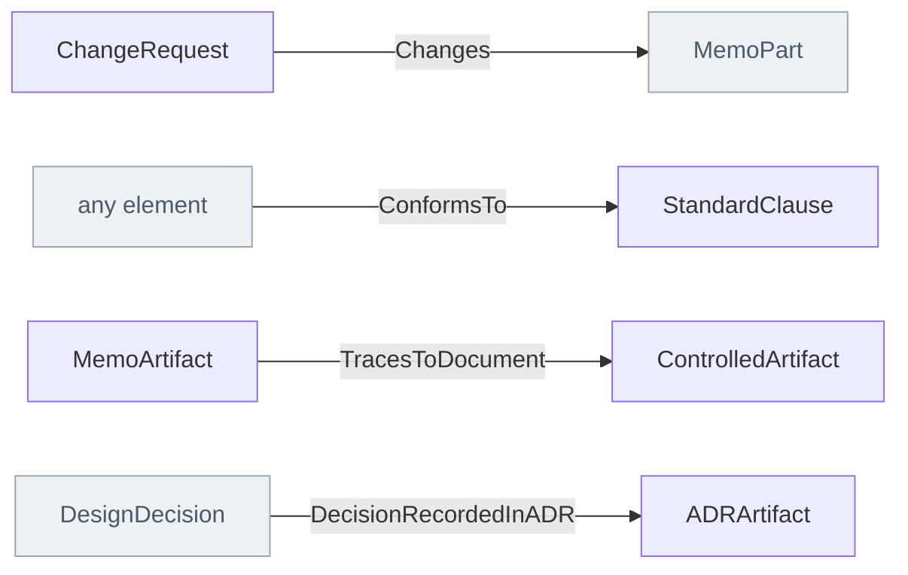

<!-- Generated by scripts/generate-sysml-api.mjs from src/artifacts/. Do not edit. -->

### Elements

**Configuration management**

| Element | SysML kind | What it is |
| --- | --- | --- |
| [`ChangeRequest`](../sysml-api/artifacts/configuration_management/memo_configuration_management.md#changerequest) | `part def` | Change request definition specializing `MemoPart`. |
| [`ConfigurationItem`](../sysml-api/artifacts/configuration_management/memo_configuration_management.md#configurationitem) | `part def` | Configuration item definition specializing `MemoPart`. |
| [`ReleaseRecord`](../sysml-api/artifacts/configuration_management/memo_configuration_management.md#releaserecord) | `part def` | Release record definition specializing `MemoPart`. |
| [`ReleaseOf`](../sysml-api/artifacts/configuration_management/memo_configuration_management.md#releaseof) | `metadata def` | `#ReleaseOf dependency from <record> to <item definition>;` The record is a release of this item. One record, one item. |
| [`Contains`](../sysml-api/artifacts/configuration_management/memo_configuration_management.md#contains) | `metadata def` | `#Contains dependency from <record> to <record>, <record>;` The release pins these releases: a system of systems version its systems, a system release its components. |
| [`Implements`](../sysml-api/artifacts/configuration_management/memo_configuration_management.md#implements) | `metadata def` | `#Implements dependency from <record> to <interface record>;` The release implements this revision of an interface. |
| [`VerifiedByCase`](../sysml-api/artifacts/configuration_management/memo_configuration_management.md#verifiedbycase) | `metadata def` | `#VerifiedByCase dependency from <record> to <verification case>;` The case that verified, or for a system of systems version validated, this release. `verifiedBy` is taken by the native relation from a requirement to its case. |
| [`AffectsRelease`](../sysml-api/artifacts/configuration_management/memo_configuration_management.md#affectsrelease) | `metadata def` | `#AffectsRelease dependency from <change request> to <record>;` The release a change request is raised against. |
| [`RegulatedDevice`](../sysml-api/artifacts/configuration_management/memo_configuration_management.md#regulateddevice) | `part def` | Regulated device definition specializing `MemoPart`. |
| [`Covers`](../sysml-api/artifacts/configuration_management/memo_configuration_management.md#covers) | `metadata def` | `#Covers dependency from <device>, to <record>, <record>;` The approval covers these system releases. |

**Core**

| Element | SysML kind | What it is |
| --- | --- | --- |
| [`MemoArtifact`](../sysml-api/artifacts/core/memo_controlled_artifacts.md#memoartifact) *(abstract)* | `part def` | An artifact is a part: a document, a standard, a clause of one. A relationship end typed MemoArtifact (TracesToDocument) takes all of them. |
| [`ControlledArtifact`](../sysml-api/artifacts/core/memo_controlled_artifacts.md#controlledartifact) | `part def` | Controlled artifact definition specializing `MemoArtifact`. |
| [`ModelOwnedArtifact`](../sysml-api/artifacts/core/memo_controlled_artifacts.md#modelownedartifact) | `part def` | Model owned artifact definition specializing `ControlledArtifact`. |
| [`ADRArtifact`](../sysml-api/artifacts/core/memo_controlled_artifacts.md#adrartifact) | `part def` | Adrartifact definition specializing `ModelOwnedArtifact`. |
| [`MarkdownDocumentSource`](../sysml-api/artifacts/core/memo_controlled_artifacts.md#markdowndocumentsource) | `part def` | Markdown document source definition specializing `ModelOwnedArtifact`. |
| [`ModelQueryScript`](../sysml-api/artifacts/core/memo_controlled_artifacts.md#modelqueryscript) | `part def` | Model query script definition specializing `ModelOwnedArtifact`. |
| [`AnalysisNotebook`](../sysml-api/artifacts/core/memo_controlled_artifacts.md#analysisnotebook) | `part def` | Analysis notebook definition specializing `ModelOwnedArtifact`. |
| [`ModelDataset`](../sysml-api/artifacts/core/memo_controlled_artifacts.md#modeldataset) | `part def` | Model dataset definition specializing `ModelOwnedArtifact`. |
| [`GeneratedReport`](../sysml-api/artifacts/core/memo_controlled_artifacts.md#generatedreport) | `part def` | Generated report definition specializing `ModelOwnedArtifact`. |

**Definitions**

| Element | SysML kind | What it is |
| --- | --- | --- |
| [`ArtifactKindDef`](../sysml-api/artifacts/definitions/memo_artifact_definitions.md#artifactkinddef) | `part def` | Artifact kind def definition specializing `MemoPart`. |

**Documents**

| Element | SysML kind | What it is |
| --- | --- | --- |
| [`RiskManagementFile`](../sysml-api/artifacts/documents/risk_management/memo_risk_management.md#riskmanagementfile) | `part def` | Risk management file definition specializing `ModelOwnedArtifact`. |

**Standards**

| Element | SysML kind | What it is |
| --- | --- | --- |
| [`RegulatoryStandard`](../sysml-api/artifacts/standards/memo_artifacts_standards_traceability.md#regulatorystandard) | `part def` | A regulatory or consensus standard a project claims conformance to, identified by its full designation including edition and amendments (e.g. "IEC 62366-1:2015+AMD1:2020").… |
| [`StandardClause`](../sysml-api/artifacts/standards/memo_artifacts_standards_traceability.md#standardclause) | `part def` | One normative clause of a RegulatoryStandard, at the depth at which the standard makes a distinct requirement a MEMO document actually claims.… |
| [`EnforcesClause`](../sysml-api/artifacts/standards/memo_artifacts_standards_traceability.md#enforcesclause) | `metadata def` | A rule's trace to the clause it enforces: `#EnforcesClause dependency from <Rule> to <clause>, <clause>;`. A rule may trace to several clauses, from several standards, or to none (a rule MEMO or a user holds for its own reasons).… |

### Connections at a glance

Each arrow is one relationship, from its source end to its target end. A grey box belongs to another layer.

### Relationships declared here

| Relationship | From | To | What it says |
| --- | --- | --- | --- |
| [`Changes`](../sysml-api/artifacts/configuration_management/memo_configuration_management.md#changes) | [`ChangeRequest`](../sysml-api/artifacts/configuration_management/memo_configuration_management.md#changerequest) | [`MemoPart`](../sysml-api/core/common/memo_common.md#memopart) | Typed relationship from `ChangeRequest` to `MemoPart`. |
| [`ConformsTo`](../sysml-api/artifacts/standards/memo_artifacts_standards_traceability.md#conformsto) | *any element* | [`StandardClause`](../sysml-api/artifacts/standards/memo_artifacts_standards_traceability.md#standardclause) | Any model element claims conformance to a standard clause. This is the edge the standards traceability matrix and the clause coverage report are computed over. |
| [`TracesToDocument`](../sysml-api/artifacts/standards/memo_artifacts_standards_traceability.md#tracestodocument) | [`MemoArtifact`](../sysml-api/artifacts/core/memo_controlled_artifacts.md#memoartifact) | [`ControlledArtifact`](../sysml-api/artifacts/core/memo_controlled_artifacts.md#controlledartifact) | Where the evidence for a clause claim is written down. The target is the existing controlled-artifact type — MEMO does not model a separate Document/DocumentSection family, because ControlledArtifact / ModelOwnedArtifact / MarkdownDocumentSource already carry version, owner an… |

### Relationships from elsewhere that reach this layer

| Relationship | Declared in | From | To | What it says |
| --- | --- | --- | --- | --- |
| [`DecisionRecordedInADR`](../sysml-api/architecture/decisions/memo_decisions.md#decisionrecordedinadr) | decisions | [`DesignDecision`](../sysml-api/architecture/decisions/memo_decisions.md#designdecision) | [`ADRArtifact`](../sysml-api/artifacts/core/memo_controlled_artifacts.md#adrartifact) | Typed relationship from `DesignDecision` to `ADRArtifact`. |
