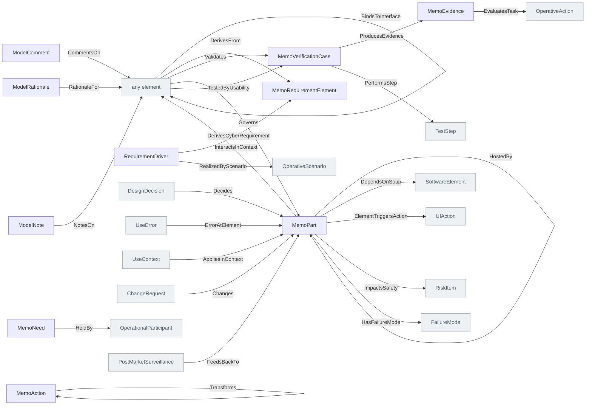

<!-- Generated by scripts/generate-sysml-api.mjs from src/core/. Do not edit. -->

### Elements

**Annotations**

| Element | SysML kind | What it is |
| --- | --- | --- |
| [`ModelAnnotation`](../sysml-api/core/annotations/memo_annotations.md#modelannotation) *(abstract)* | `part def` | Model annotation definition specializing `MemoPart`. |
| [`ModelComment`](../sysml-api/core/annotations/memo_annotations.md#modelcomment) | `part def` | Model comment definition specializing `ModelAnnotation`. |
| [`ModelRationale`](../sysml-api/core/annotations/memo_annotations.md#modelrationale) | `part def` | Model rationale definition specializing `ModelAnnotation`. |
| [`ModelNote`](../sysml-api/core/annotations/memo_annotations.md#modelnote) | `part def` | Model note definition specializing `ModelAnnotation`. |

**Common**

| Element | SysML kind | What it is |
| --- | --- | --- |
| [`MemoIdentity`](../sysml-api/core/common/memo_common.md#memoidentity) | `metadata def` | Memo identity definition. |
| [`MemoPart`](../sysml-api/core/common/memo_common.md#memopart) *(abstract)* | `part def` | Memo part definition. |
| [`RequirementDriver`](../sysml-api/core/common/memo_common.md#requirementdriver) | `part def` | Requirement driver definition specializing `MemoPart`. |
| [`VerifiableElement`](../sysml-api/core/common/memo_common.md#verifiableelement) *(abstract)* | `part def` | Verifiable element definition specializing `MemoPart`. |
| [`InterfaceElement`](../sysml-api/core/common/memo_common.md#interfaceelement) | `part def` | Interface element definition specializing `MemoPart`. |
| [`MemoEvidence`](../sysml-api/core/common/memo_common.md#memoevidence) | `part def` | Memo evidence definition specializing `MemoPart`. |
| [`AnalysisArtifact`](../sysml-api/core/common/memo_common.md#analysisartifact) *(abstract)* | `part def` | Analysis artifact definition specializing `MemoPart`. |
| [`MemoAction`](../sysml-api/core/common/memo_common.md#memoaction) | `action def` | Behavioral foundation: operational activities, tasks, system actions, and interaction steps specialize MemoAction. |
| [`MemoPort`](../sysml-api/core/common/memo_common.md#memoport) | `port def` | Boundary feature foundation for typed ports. |
| [`MemoItem`](../sysml-api/core/common/memo_common.md#memoitem) *(abstract)* | `item def` | Single item foundation. Standards, hazards, stored software data, and message payloads are all item-native concepts. Whether an item is exchanged is expressed by its use in a port or flow, not by a second ontology root. |
| [`MemoUseCase`](../sysml-api/core/common/memo_common.md#memousecase) *(abstract)* | `use case def` | Memo use case definition. |
| [`MemoRequirementElement`](../sysml-api/core/common/memo_common.md#memorequirementelement) *(abstract)* | `requirement def` | Memo requirement element definition. |
| [`MemoNeed`](../sysml-api/core/common/memo_common.md#memoneed) | `requirement def` | Memo need definition specializing `MemoRequirementElement`. |
| [`MemoRequirement`](../sysml-api/core/common/memo_common.md#memorequirement) | `requirement def` | Memo requirement definition specializing `MemoRequirementElement`. |
| [`MemoMission`](../sysml-api/core/common/memo_common.md#memomission) *(abstract)* | `requirement def` | Memo mission definition specializing `MemoRequirementElement`. |
| [`MemoVerificationCase`](../sysml-api/core/common/memo_common.md#memoverificationcase) | `verification def` | Memo verification case definition. |
| [`MemoState`](../sysml-api/core/common/memo_common.md#memostate) | `state def` | Memo state definition. |
| [`Citation`](../sysml-api/core/common/memo_common.md#citation) | `part def` | Citation definition specializing `MemoPart`. |

**Consistency rules**

| Element | SysML kind | What it is |
| --- | --- | --- |
| [`ConsistencyRule`](../sysml-api/core/consistency_rules/consistency_rules.md#consistencyrule) | `part def` | Consistency rule definition specializing `MemoPart`. |
| [`RelationshipConsistencyRule`](../sysml-api/core/consistency_rules/consistency_rules.md#relationshipconsistencyrule) | `part def` | Relationship consistency rule definition specializing `ConsistencyRule`. |
| [`AttributeConsistencyRule`](../sysml-api/core/consistency_rules/consistency_rules.md#attributeconsistencyrule) | `part def` | Attribute consistency rule definition specializing `ConsistencyRule`. |
| [`ConditionalConsistencyRule`](../sysml-api/core/consistency_rules/consistency_rules.md#conditionalconsistencyrule) | `part def` | Conditional consistency rule definition specializing `RelationshipConsistencyRule`. |
| [`CoverageConsistencyRule`](../sysml-api/core/consistency_rules/consistency_rules.md#coverageconsistencyrule) | `part def` | Coverage consistency rule definition specializing `ConsistencyRule`. |

**Dimensions**

| Element | SysML kind | What it is |
| --- | --- | --- |
| [`RealizationClassification`](../sysml-api/core/dimensions/dimensions.md#realizationclassification) | `metadata def` | Metadata carriers for tagging non-part constructs (actions, ports, interfaces, items, views) with the orthogonal dimensions. Part-based elements carry these directly as attributes of MemoPart. Axis ownership is never tagged here — it is the construct's owning package. |
| [`CrossCuttingClassification`](../sysml-api/core/dimensions/dimensions.md#crosscuttingclassification) | `metadata def` | Cross cutting classification definition. |

**Methodology scope**

| Element | SysML kind | What it is |
| --- | --- | --- |
| [`ElementKindAlias`](../sysml-api/core/methodology_scope/methodology_scope.md#elementkindalias) | `part def` | Element kind alias definition specializing `MemoPart`. |

**Semantics**

| Element | SysML kind | What it is |
| --- | --- | --- |
| [`StandardReference`](../sysml-api/core/semantics/semantics.md#standardreference) | `metadata def` | Tags an element with the regulatory standard it derives from (e.g. ISO 14971, IEC 62304, ISO/IEC/IEEE 42010). |
| [`Provenance`](../sysml-api/core/semantics/semantics.md#provenance) | `metadata def` | Marks an element as the rationale/provenance carrier for a decision. |

**Terminology**

| Element | SysML kind | What it is |
| --- | --- | --- |
| [`TerminologyCode`](../sysml-api/core/terminology/terminology.md#terminologycode) | `attribute def` | One coding of a concept in one code system. Mirrors the FHIR Coding datatype (system/version/code/display) so FHIR mappings stay lossless. |
| [`UdiCarrier`](../sysml-api/core/terminology/terminology.md#udicarrier) | `attribute def` | A device-identity carrier per IMDRF UDI guidance: the DI portion belongs to the device definition, PI portions to the instance. |
| [`ExternalReference`](../sysml-api/core/terminology/terminology.md#externalreference) | `attribute def` | A reference into an external registry or document (regulatory listing, standard clause, catalog page) with enough context to resolve it. |

### Connections at a glance

Each arrow is one relationship, from its source end to its target end. A grey box belongs to another layer.

### Relationships declared here

| Relationship | From | To | What it says |
| --- | --- | --- | --- |
| [`CommentsOn`](../sysml-api/core/annotations/memo_annotations.md#commentson) | [`ModelComment`](../sysml-api/core/annotations/memo_annotations.md#modelcomment) | *any element* | Replies form a thread through the ordinary Composes relation (parent comment → reply), so CR-ONT-001's acyclicity invariant already covers comment threads and no thread-specific relation is needed.… |
| [`RationaleFor`](../sysml-api/core/annotations/memo_annotations.md#rationalefor) | [`ModelRationale`](../sysml-api/core/annotations/memo_annotations.md#modelrationale) | *any element* | Typed relationship from `ModelRationale` to `any element`. |
| [`NotesOn`](../sysml-api/core/annotations/memo_annotations.md#noteson) | [`ModelNote`](../sysml-api/core/annotations/memo_annotations.md#modelnote) | *any element* | Typed relationship from `ModelNote` to `any element`. |
| [`MemoInterface`](../sysml-api/core/common/memo_common.md#memointerface) | *any element* | *any element* | Interaction-contract foundation for interface definitions between ports. |
| [`MemoRelationship`](../sysml-api/core/relationships/memo_relationships.md#memorelationship) | *any element* | *any element* | Typed relationship for memo relationship. |
| [`DerivesFrom`](../sysml-api/core/relationships/memo_relationships.md#derivesfrom) | *any element* | [`MemoRequirementElement`](../sysml-api/core/common/memo_common.md#memorequirementelement) | Typed relationship from `any element` to `MemoRequirementElement`. |
| [`ProducesEvidence`](../sysml-api/core/relationships/memo_relationships.md#producesevidence) | [`MemoVerificationCase`](../sysml-api/core/common/memo_common.md#memoverificationcase) | [`MemoEvidence`](../sysml-api/core/common/memo_common.md#memoevidence) | Typed relationship from `MemoVerificationCase` to `MemoEvidence`. |
| [`DerivesCyberRequirement`](../sysml-api/core/relationships/memo_relationships.md#derivescyberrequirement) | [`RequirementDriver`](../sysml-api/core/common/memo_common.md#requirementdriver) | [`MemoRequirementElement`](../sysml-api/core/common/memo_common.md#memorequirementelement) | Typed relationship from `RequirementDriver` to `MemoRequirementElement`. |
| [`CrossesTrustBoundary`](../sysml-api/core/relationships/memo_relationships.md#crossestrustboundary) | *any element* | *any element* | Typed relationship from `any element` to `any element`. |
| [`Validates`](../sysml-api/core/relationships/memo_relationships.md#validates) | *any element* | [`MemoVerificationCase`](../sysml-api/core/common/memo_common.md#memoverificationcase) | Typed relationship from `any element` to `MemoVerificationCase`. |
| [`HostedBy`](../sysml-api/core/relationships/memo_relationships.md#hostedby) | [`MemoPart`](../sysml-api/core/common/memo_common.md#memopart) | [`MemoPart`](../sysml-api/core/common/memo_common.md#memopart) | A processing node hosted by an assembly is allocated to it. The end NAMES were already right; two of the three usages wrote them in reverse order, and the builder binds by position, so those two edges pointed the wrong way. See the reversed-end-name lint in memo-tools. |
| [`BindsToInterface`](../sysml-api/core/relationships/memo_relationships.md#bindstointerface) | *any element* | *any element* | Typed relationship from `any element` to `any element`. |

### Relationships from elsewhere that reach this layer

| Relationship | Declared in | From | To | What it says |
| --- | --- | --- | --- | --- |
| [`Decides`](../sysml-api/architecture/decisions/memo_decisions.md#decides) | decisions | [`DesignDecision`](../sysml-api/architecture/decisions/memo_decisions.md#designdecision) | [`MemoPart`](../sysml-api/core/common/memo_common.md#memopart) | Typed relationship from `DesignDecision` to `MemoPart`. |
| [`DependsOnSoup`](../sysml-api/architecture/implementation/software/structure/memo_software_structure.md#dependsonsoup) | implementation | [`MemoPart`](../sysml-api/core/common/memo_common.md#memopart) | [`SoftwareElement`](../sysml-api/architecture/implementation/software/structure/memo_software_structure.md#softwareelement) | Typed relationship from `MemoPart` to `SoftwareElement`. |
| [`ElementTriggersAction`](../sysml-api/architecture/implementation/ui/memo_ui.md#elementtriggersaction) | implementation | [`MemoPart`](../sysml-api/core/common/memo_common.md#memopart) | [`UIAction`](../sysml-api/architecture/implementation/ui/memo_ui.md#uiaction) | Typed relationship from `MemoPart` to `UIAction`. |
| [`ErrorAtElement`](../sysml-api/architecture/implementation/ui/memo_ui.md#erroratelement) | implementation | [`UseError`](../sysml-api/assurance/human_factors/memo_human_factors.md#useerror) | [`MemoPart`](../sysml-api/core/common/memo_common.md#memopart) | Typed relationship from `UseError` to `MemoPart`. |
| [`Governs`](../sysml-api/architecture/operational/context/stakeholders/memo_stakeholders.md#governs) | operational | *any element* | [`MemoPart`](../sysml-api/core/common/memo_common.md#memopart) | Typed relationship from `any element` to `MemoPart`. |
| [`InteractsInContext`](../sysml-api/architecture/operational/context/use_context/memo_use_context.md#interactsincontext) | operational | [`MemoPart`](../sysml-api/core/common/memo_common.md#memopart) | *any element* | The single relation a system context view draws. A context diagram labels its edges with open-ended verbs — "directs procedure", "electrical power", "fluid supply", "environmental conditions".… |
| [`AppliesInContext`](../sysml-api/architecture/operational/context/use_context/memo_use_context.md#appliesincontext) | operational | [`UseContext`](../sysml-api/architecture/operational/context/use_context/memo_use_context.md#usecontext) | [`MemoPart`](../sysml-api/core/common/memo_common.md#memopart) | Typed relationship from `UseContext` to `MemoPart`. |
| [`Transforms`](../sysml-api/architecture/operational/workflows/memo_workflows.md#transforms) | operational | [`MemoAction`](../sysml-api/core/common/memo_common.md#memoaction) | [`MemoAction`](../sysml-api/core/common/memo_common.md#memoaction) | Typed relationship from `MemoAction` to `MemoAction`. |
| [`Changes`](../sysml-api/artifacts/configuration_management/memo_configuration_management.md#changes) | artifacts | [`ChangeRequest`](../sysml-api/artifacts/configuration_management/memo_configuration_management.md#changerequest) | [`MemoPart`](../sysml-api/core/common/memo_common.md#memopart) | Typed relationship from `ChangeRequest` to `MemoPart`. |
| [`RealizedByScenario`](../sysml-api/assurance/cybersecurity/memo_cybersecurity.md#realizedbyscenario) | cybersecurity | [`RequirementDriver`](../sysml-api/core/common/memo_common.md#requirementdriver) | [`OperativeScenario`](../sysml-api/architecture/operational/scenarios/memo_scenarios.md#operativescenario) | Typed relationship from `RequirementDriver` to `OperativeScenario`. |
| [`ImpactsSafety`](../sysml-api/assurance/cybersecurity/memo_cybersecurity.md#impactssafety) | cybersecurity | [`MemoPart`](../sysml-api/core/common/memo_common.md#memopart) | [`RiskItem`](../sysml-api/assurance/safety_risk/memo_risk.md#riskitem) | Typed relationship from `MemoPart` to `RiskItem`. |
| [`EvaluatesTask`](../sysml-api/assurance/human_factors/memo_human_factors.md#evaluatestask) | human-factors | [`MemoEvidence`](../sysml-api/core/common/memo_common.md#memoevidence) | [`OperativeAction`](../sysml-api/architecture/operational/activities/memo_activities.md#operativeaction) | Typed relationship from `MemoEvidence` to `OperativeAction`. |
| [`TestedByUsability`](../sysml-api/assurance/human_factors/memo_human_factors.md#testedbyusability) | human-factors | *any element* | [`MemoVerificationCase`](../sysml-api/core/common/memo_common.md#memoverificationcase) | Typed relationship from `any element` to `MemoVerificationCase`. |
| [`HeldBy`](../sysml-api/assurance/requirements/needs/memo_needs.md#heldby) | requirements | [`MemoNeed`](../sysml-api/core/common/memo_common.md#memoneed) | [`OperationalParticipant`](../sysml-api/architecture/operational/context/actors/memo_actors.md#operationalparticipant) | Whose need this is. The holder is a modelled participant — a User, with the profile IEC 62366-1 asks for, or another operational participant — so "which users does this need serve" is a question the model answers rather than a sentence a reader interprets. |
| [`HasFailureMode`](../sysml-api/assurance/safety_risk/analysis/memo_fmea.md#hasfailuremode) | safety-risk | [`MemoPart`](../sysml-api/core/common/memo_common.md#memopart) | [`FailureMode`](../sysml-api/assurance/safety_risk/analysis/memo_fmea.md#failuremode) | Typed relationship from `MemoPart` to `FailureMode`. |
| [`FeedsBackTo`](../sysml-api/assurance/safety_risk/postmarket_surveillance/memo_postmarket_surveillance.md#feedsbackto) | safety-risk | [`PostMarketSurveillance`](../sysml-api/assurance/safety_risk/postmarket_surveillance/memo_postmarket_surveillance.md#postmarketsurveillance) | [`MemoPart`](../sysml-api/core/common/memo_common.md#memopart) | Typed relationship from `PostMarketSurveillance` to `MemoPart`. |
| [`PerformsStep`](../sysml-api/assurance/verification_validation/memo_assurance.md#performsstep) | verification-validation | [`MemoVerificationCase`](../sysml-api/core/common/memo_common.md#memoverificationcase) | [`TestStep`](../sysml-api/assurance/verification_validation/memo_assurance.md#teststep) | Typed relationship from `MemoVerificationCase` to `TestStep`. |

### Enumerations

| Enumeration | Values |
| --- | --- |
| [`EvidenceKind`](../sysml-api/core/common/memo_common.md#evidencekind) | `testArtifact` |
| [`StateKind`](../sysml-api/core/common/memo_common.md#statekind) | `mode` |
| [`RealizationStageKind`](../sysml-api/core/dimensions/dimensions.md#realizationstagekind) | `proposed`, `specified`, `designed`, `built`, `configured`, `assembled`, `deployed`, `operated`, `retired` |
| [`CrossCuttingConcernKind`](../sysml-api/core/dimensions/dimensions.md#crosscuttingconcernkind) | `evidence`, `traceability`, `configurationManagement`, `changeControl`, `regulatoryCompliance`, `clinicalPerformance` |
| [`ElementStatusKind`](../sysml-api/core/dimensions/dimensions.md#elementstatuskind) | `proposed`, `draft`, `inReview`, `approved`, `released`, `deprecated`, `retired` |
| [`LegendSourceKind`](../sysml-api/core/enumerations/memo_enumerations.md#legendsourcekind) | `hierarchyDepth`, `elementKind` |
| [`LegendScopeKind`](../sysml-api/core/enumerations/memo_enumerations.md#legendscopekind) | `parts`, `items`, `ports`, `actions`, `connections` |
| [`ConcernKind`](../sysml-api/core/enumerations/memo_enumerations.md#concernkind) | `safety`, `usability`, `cybersecurity`, `performance`, `interoperability`, `reliability`, `privacy`, `regulatory`, `clinical` |
| [`RequirementSourceKind`](../sysml-api/core/enumerations/memo_enumerations.md#requirementsourcekind) | `stakeholderNeed`, `risk`, `designDecision`, `changeRequest`, `sourceDocument`, `extension` |
| [`NotificationPriorityKind`](../sysml-api/core/enumerations/memo_enumerations.md#notificationprioritykind) | `high`, `medium`, `low` |
| [`RequirementNotationKind`](../sysml-api/core/enumerations/memo_enumerations.md#requirementnotationkind) | `freeText`, `ears`, `sophist`, `formalConstraint` |
| [`EarsPatternKind`](../sysml-api/core/enumerations/memo_enumerations.md#earspatternkind) | `ubiquitous`, `eventDriven`, `stateDriven`, `optionalFeature`, `unwantedBehavior`, `complex` |
| [`ObligationKind`](../sysml-api/core/enumerations/memo_enumerations.md#obligationkind) | `shall`, `should`, `will` |
| [`InterfaceKind`](../sysml-api/core/enumerations/memo_enumerations.md#interfacekind) | `data`, `control`, `analogSignal`, `digitalSignal`, `power`, `network`, `api`, `userInteraction`, `notification`, `logging`, `mechanical`, `fluidic` |
| [`PortCategoryKind`](../sysml-api/core/enumerations/memo_enumerations.md#portcategorykind) | `data`, `eventData` |
| [`FlowKind`](../sysml-api/core/enumerations/memo_enumerations.md#flowkind) | `information`, `command`, `status`, `telemetry`, `alarm`, `configuration`, `measurement`, `audit`, `power` |
| [`DirectionKind`](../sysml-api/core/enumerations/memo_enumerations.md#directionkind) | `input`, `output`, `inputOutput` |
| [`CriticalityKind`](../sysml-api/core/enumerations/memo_enumerations.md#criticalitykind) | `low`, `medium`, `high`, `catastrophic` |
| [`SafetyClassKind`](../sysml-api/core/enumerations/memo_enumerations.md#safetyclasskind) | `none`, `A`, `B`, `C` |
| [`ComplexityKind`](../sysml-api/core/enumerations/memo_enumerations.md#complexitykind) | `low`, `medium`, `high`, `complex` |
| [`LifecycleStateKind`](../sysml-api/core/enumerations/memo_enumerations.md#lifecyclestatekind) | `concept`, `development`, `released`, `maintenance`, `obsolete` |
| [`MemoVerificationMethodKind`](../sysml-api/core/enumerations/memo_enumerations.md#memoverificationmethodkind) | `inspection`, `analytical`, `demonstration`, `test`, `simulation`, `formalProof`, `modelChecking` |
| [`RegulatoryRegimeKind`](../sysml-api/core/enumerations/memo_enumerations.md#regulatoryregimekind) | `CE`, `MDR`, `UKCA`, `FDA_510k`, `FDA_PMA` |
| [`ArtifactKind`](../sysml-api/core/enumerations/memo_enumerations.md#artifactkind) | `plan`, `requirementSpecification`, `architectureDescription`, `softwareDesignDescription`, `riskRecord`, `traceMatrix`, `testProtocol`, `testReport`, `evidenceRecord`, `cybersecurityAssessment`, `threatModel`, `usabilityEngineeringReport`, `clinicalSafetyReport`, `failureModeEffectsAnalysis`, `soupList`, `designInputPlan`, `designOutputPlan`, `softwareDevelopmentPlan`, `labelingSpecification`, `designHistoryFileIndex`, `designChangeLog` |
| [`RiskControlKind`](../sysml-api/core/enumerations/memo_enumerations.md#riskcontrolkind) | `inherentSafeDesign`, `protectiveMeasure`, `informationForSafety`, `alarm`, `interlock`, `monitoring`, `plausibilityCheck` |
| [`HazardTypeKind`](../sysml-api/core/enumerations/memo_enumerations.md#hazardtypekind) | `drugDeliveryError`, `energyExposure`, `informationError`, `mechanicalFailure`, `biologicalContamination`, `softwareAnomaly`, `useError`, `environmentalHazard` |
| [`CauseSourceKind`](../sysml-api/core/enumerations/memo_enumerations.md#causesourcekind) | `operational`, `environmental`, `electrical`, `hardware`, `software`, `mechanical`, `biologicalChemical`, `usageCause` |
| [`PortDisplayKind`](../sysml-api/core/enumerations/memo_enumerations.md#portdisplaykind) | `everything`, `ports`, `hidden` |
| [`ConnectionDisplayKind`](../sysml-api/core/enumerations/memo_enumerations.md#connectiondisplaykind) | `summary`, `everything`, `hidden` |
| [`DiagramViewKind`](../sysml-api/core/enumerations/memo_enumerations.md#diagramviewkind) | `general`, `interconnection`, `actionflow`, `statetransition`, `sequence`, `grid`, `browser`, `geometry` |
| [`DocumentViewKind`](../sysml-api/core/enumerations/memo_enumerations.md#documentviewkind) | `DHF`, `SDD`, `RMF`, `VV`, `architectureDescription`, `cybersecurityAssessment`, `threatModel`, `clinical`, `usability` |
| [`SchedulingPolicyKind`](../sysml-api/core/enumerations/memo_enumerations.md#schedulingpolicykind) | `nonRealTime`, `roundRobin`, `fixedPriorityPreemptive`, `rateMonotonic`, `deadlineMonotonic`, `EDF` |
| [`BehaviorPropertyKind`](../sysml-api/core/enumerations/memo_enumerations.md#behaviorpropertykind) | `stateInvariant`, `transitionRule`, `temporalProperty`, `safetyProperty`, `livenessProperty`, `assumption`, `guarantee` |
| [`InterfaceItemKind`](../sysml-api/core/enumerations/memo_enumerations.md#interfaceitemkind) | `data`, `command`, `signal`, `material`, `energy`, `fluid`, `mechanicalForce` |
| [`PropertyLanguageKind`](../sysml-api/core/enumerations/memo_enumerations.md#propertylanguagekind) | `naturalLanguage`, `pseudoFormal`, `agreeLike`, `ltlLike`, `ctlLike` |
| [`RuleStrengthKind`](../sysml-api/core/enumerations/memo_enumerations.md#rulestrengthkind) | `optional`, `recommended`, `required`, `forbidden` |
| [`RulePredicateKind`](../sysml-api/core/enumerations/memo_enumerations.md#rulepredicatekind) | `requireRelationship`, `conditionalRequireRelationship`, `requireAttribute`, `uniqueAttribute`, `cardinalityCheck`, `coverageCheck` |
| [`RuleSeverityKind`](../sysml-api/core/enumerations/memo_enumerations.md#ruleseveritykind) | `error`, `warning`, `info` |
| [`RuleCategoryKind`](../sysml-api/core/enumerations/memo_enumerations.md#rulecategorykind) | `closure`, `coverage`, `lifecycle`, `crossLayer`, `quantitative` |
| [`RuleTailoringKind`](../sysml-api/core/enumerations/memo_enumerations.md#ruletailoringkind) | `invariant`, `assurance`, `methodology` |
| [`RuleDomainKind`](../sysml-api/core/enumerations/memo_enumerations.md#ruledomainkind) | `modelling`, `medicalDevice`, `organisation` |
| [`RuleDispositionKind`](../sysml-api/core/enumerations/memo_enumerations.md#ruledispositionkind) | `enabled`, `disabled`, `replaced` |
| [`ScopeModeKind`](../sysml-api/core/enumerations/memo_enumerations.md#scopemodekind) | `allAvailable`, `explicit` |
| [`WorkflowStageKind`](../sysml-api/core/enumerations/memo_enumerations.md#workflowstagekind) | `context`, `requirements`, `behavior`, `architecture`, `interfaces`, `risk`, `verificationStage`, `evidence`, `documents` |
| [`ThreatCategoryKind`](../sysml-api/core/enumerations/memo_enumerations.md#threatcategorykind) | `spoofing`, `tampering`, `repudiation`, `informationDisclosure`, `denialOfService`, `elevationOfPrivilege`, `privacyLoss`, `supplyChain` |
| [`CyberControlKind`](../sysml-api/core/enumerations/memo_enumerations.md#cybercontrolkind) | `prevent`, `detect`, `respond`, `recover`, `hardening`, `monitoring`, `authentication`, `authorization`, `encryption`, `integrityProtection`, `audit`, `updateMechanism` |
| [`AssetKind`](../sysml-api/core/enumerations/memo_enumerations.md#assetkind) | `data`, `credential`, `configuration`, `software`, `hardware`, `networkConnection`, `auditRecord`, `safetyCriticalFunction` |
| [`SecurityNeedKind`](../sysml-api/core/enumerations/memo_enumerations.md#securityneedkind) | `low`, `medium`, `high`, `veryHigh` |
| [`ViewOutputKind`](../sysml-api/core/enumerations/memo_enumerations.md#viewoutputkind) | `diagram`, `table`, `matrix`, `documentSection`, `dashboard` |
| [`PresentationKind`](../sysml-api/core/enumerations/memo_enumerations.md#presentationkind) | `blockDiagram`, `internalDiagram`, `activityDiagram`, `stateDiagram`, `riskTable`, `traceMatrix`, `narrativeSection`, `screenLayout`, `custom` |
| [`DeploymentKind`](../sysml-api/core/enumerations/memo_enumerations.md#deploymentkind) | `native`, `containerized`, `cloudHosted`, `embedded`, `partitioned` |
| [`ContextSideKind`](../sysml-api/core/enumerations/memo_enumerations.md#contextsidekind) | `externalSystem`, `environment` |
| [`ActorKind`](../sysml-api/core/enumerations/memo_enumerations.md#actorkind) | `patient`, `clinician`, `caregiver`, `technician`, `administrator` |
| [`ValidationMethodKind`](../sysml-api/core/enumerations/memo_enumerations.md#validationmethodkind) | `clinicalTrial`, `summativeUsabilityTest`, `comparativeStudy`, `benchmarkTest`, `simulatedUse` |
| [`SOUPClassificationKind`](../sysml-api/core/enumerations/memo_enumerations.md#soupclassificationkind) | `classA`, `classB`, `classC`, `unclassified` |
| [`OperationalEntityKind`](../sysml-api/core/enumerations/memo_enumerations.md#operationalentitykind) | `human`, `externalSystem`, `environmentalEntity`, `regulatoryBody`, `device`, `informationArtifact` |
| [`FunctionalFlowKind`](../sysml-api/core/enumerations/memo_enumerations.md#functionalflowkind) | `nominal`, `error`, `degraded`, `alarm`, `startup`, `shutdown`, `calibration` |
| [`ProcessingNodeKind`](../sysml-api/core/enumerations/memo_enumerations.md#processingnodekind) | `microcontroller`, `FPGA`, `SoC`, `gateway`, `cloudServer`, `edgeDevice`, `DSP` |
| [`FailureModeKind`](../sysml-api/core/enumerations/memo_enumerations.md#failuremodekind) | `lossOfFunction`, `degradedFunction`, `unintendedFunction`, `intermittentFunction`, `prematureFunction`, `delayedFunction` |
| [`FailureEffectLevelKind`](../sysml-api/core/enumerations/memo_enumerations.md#failureeffectlevelkind) | `local`, `nextHigher`, `endEffect` |
| [`FailureCauseCategoryKind`](../sysml-api/core/enumerations/memo_enumerations.md#failurecausecategorykind) | `design`, `manufacturing`, `material`, `wear`, `misuse`, `environmental`, `software` |
| [`SeverityKind`](../sysml-api/core/enumerations/memo_enumerations.md#severitykind) | `negligible`, `minor`, `serious`, `critical`, `catastrophic` |
| [`ProbabilityKind`](../sysml-api/core/enumerations/memo_enumerations.md#probabilitykind) | `incredible`, `improbable`, `remote`, `occasional`, `probable`, `frequent` |
| [`DetectionKind`](../sysml-api/core/enumerations/memo_enumerations.md#detectionkind) | `high`, `moderate`, `low`, `none` |
| [`RiskAcceptabilityKind`](../sysml-api/core/enumerations/memo_enumerations.md#riskacceptabilitykind) | `acceptable`, `alarp`, `unacceptable` |
| [`DetectionMethodKind`](../sysml-api/core/enumerations/memo_enumerations.md#detectionmethodkind) | `inspection`, `testing`, `monitoring`, `alarm`, `userReport`, `selfDiagnostic`, `periodicMaintenance` |
| [`FMEAActionKind`](../sysml-api/core/enumerations/memo_enumerations.md#fmeaactionkind) | `designChange`, `processChange`, `verificationActivity`, `labeling`, `training`, `monitoring` |
| [`FaultTreeEventKind`](../sysml-api/core/enumerations/memo_enumerations.md#faulttreeeventkind) | `topEvent`, `intermediateEvent`, `basicEvent`, `undevelopedEvent`, `houseEvent`, `externalEvent`, `conditionalEvent` |
| [`FaultTreeGateKind`](../sysml-api/core/enumerations/memo_enumerations.md#faulttreegatekind) | `andGate`, `orGate`, `kOfNGate`, `xorGate`, `inhibitGate`, `priorityAndGate` |
| [`DesignDecisionStatusKind`](../sysml-api/core/enumerations/memo_enumerations.md#designdecisionstatuskind) | `proposed`, `accepted`, `superseded`, `rejected` |
| [`RiskControlImplementationKind`](../sysml-api/core/enumerations/memo_enumerations.md#riskcontrolimplementationkind) | `hardwareDesign`, `softwareDesign`, `labeling`, `training`, `proceduralControl` |
| [`ActionKind`](../sysml-api/core/enumerations/memo_enumerations.md#actionkind) | `transform`, `validate`, `route`, `store`, `present`, `actuate`, `sense`, `compute`, `filtering`, `encrypt`, `authenticate` |
| [`ActivityFlowKind`](../sysml-api/core/enumerations/memo_enumerations.md#activityflowkind) | `controlFlow`, `objectFlow`, `exceptionFlow` |
| [`MessageKind`](../sysml-api/core/enumerations/memo_enumerations.md#messagekind) | `synchronous`, `asynchronous`, `reply`, `create`, `destroy`, `timeout` |
| [`TimingConstraintKind`](../sysml-api/core/enumerations/memo_enumerations.md#timingconstraintkind) | `deadline`, `period`, `jitter`, `latency`, `separation`, `burstInterval` |
| [`HAZOPGuideWordKind`](../sysml-api/core/enumerations/memo_enumerations.md#hazopguidewordkind) | `no`, `more`, `less`, `asWellAs`, `partOf`, `reverse`, `other`, `early`, `late`, `before`, `subsequent` |
| [`ChangeTypeKind`](../sysml-api/core/enumerations/memo_enumerations.md#changetypekind) | `corrective`, `preventive`, `enhancement`, `regulatoryDriven` |
| [`UseErrorCategoryKind`](../sysml-api/core/enumerations/memo_enumerations.md#useerrorcategorykind) | `perception`, `cognition`, `actionCategory`, `memoryRecall` |
| [`CommentStatusKind`](../sysml-api/core/enumerations/memo_enumerations.md#commentstatuskind) | `open`, `acknowledged`, `addressed`, `resolved`, `rejected` |
