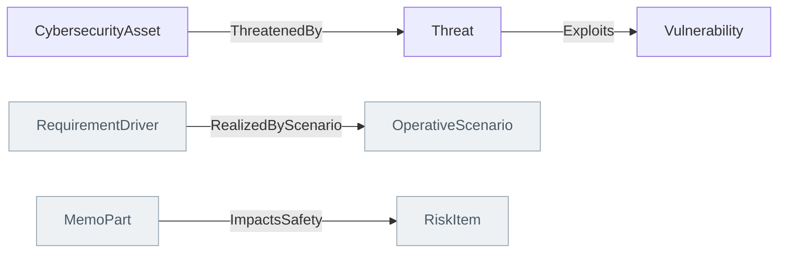

<!-- Generated by scripts/generate-sysml-api.mjs from src/assurance/cybersecurity/. Do not edit. -->

### Elements

**Core concepts**

| Element | SysML kind | What it is |
| --- | --- | --- |
| [`CybersecurityAsset`](../sysml-api/assurance/cybersecurity/memo_cybersecurity.md#cybersecurityasset) | `part def` | Cybersecurity asset definition specializing `MemoPart`. |
| [`AttackSurface`](../sysml-api/assurance/cybersecurity/memo_cybersecurity.md#attacksurface) | `part def` | Attack surface definition specializing `MemoPart`. |
| [`Threat`](../sysml-api/assurance/cybersecurity/memo_cybersecurity.md#threat) | `part def` | Threat definition specializing `RiskDriver`. |
| [`Vulnerability`](../sysml-api/assurance/cybersecurity/memo_cybersecurity.md#vulnerability) | `item def` | Vulnerability definition specializing `RiskItem`. |
| [`CyberHazard`](../sysml-api/assurance/cybersecurity/memo_cybersecurity.md#cyberhazard) | `item def` | Cyber hazard definition specializing `Hazard`. |
| [`CyberRisk`](../sysml-api/assurance/cybersecurity/memo_cybersecurity.md#cyberrisk) | `part def` | Cyber risk definition specializing `Risk`. |
| [`CyberMitigation`](../sysml-api/assurance/cybersecurity/memo_cybersecurity.md#cybermitigation) | `part def` | Cyber mitigation definition specializing `RiskControlMeasure`. |
| [`SecurityRequirement`](../sysml-api/assurance/cybersecurity/memo_cybersecurity.md#securityrequirement) | `requirement def` | Security requirement definition specializing `Requirement`. |
| [`TrustBoundary`](../sysml-api/assurance/cybersecurity/memo_cybersecurity.md#trustboundary) | `part def` | Trust boundary definition specializing `InterfaceElement`. |

### Connections at a glance

Each arrow is one relationship, from its source end to its target end. A grey box belongs to another layer.

### Relationships declared here

| Relationship | From | To | What it says |
| --- | --- | --- | --- |
| [`ThreatenedBy`](../sysml-api/assurance/cybersecurity/memo_cybersecurity.md#threatenedby) | [`CybersecurityAsset`](../sysml-api/assurance/cybersecurity/memo_cybersecurity.md#cybersecurityasset) | [`Threat`](../sysml-api/assurance/cybersecurity/memo_cybersecurity.md#threat) | Typed relationship from `CybersecurityAsset` to `Threat`. |
| [`Exploits`](../sysml-api/assurance/cybersecurity/memo_cybersecurity.md#exploits) | [`Threat`](../sysml-api/assurance/cybersecurity/memo_cybersecurity.md#threat) | [`Vulnerability`](../sysml-api/assurance/cybersecurity/memo_cybersecurity.md#vulnerability) | Typed relationship from `Threat` to `Vulnerability`. |
| [`RealizedByScenario`](../sysml-api/assurance/cybersecurity/memo_cybersecurity.md#realizedbyscenario) | [`RequirementDriver`](../sysml-api/core/common/memo_common.md#requirementdriver) | [`OperativeScenario`](../sysml-api/architecture/operational/scenarios/memo_scenarios.md#operativescenario) | Typed relationship from `RequirementDriver` to `OperativeScenario`. |
| [`ImpactsSafety`](../sysml-api/assurance/cybersecurity/memo_cybersecurity.md#impactssafety) | [`MemoPart`](../sysml-api/core/common/memo_common.md#memopart) | [`RiskItem`](../sysml-api/assurance/safety_risk/memo_risk.md#riskitem) | Typed relationship from `MemoPart` to `RiskItem`. |

### Relationships from elsewhere that reach this layer

_None with an end typed in this layer._
