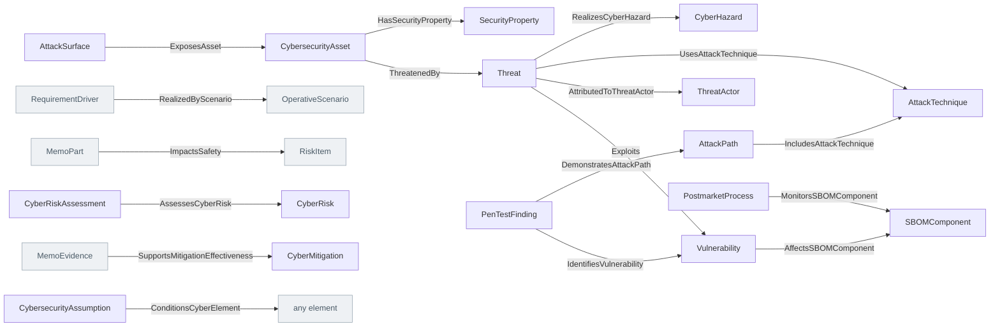

<!-- Generated by scripts/generate-sysml-api.mjs from src/assurance/cybersecurity/. Do not edit. -->

### Elements

**Core concepts**

| Element | SysML kind | What it is |
| --- | --- | --- |
| [`CybersecurityAsset`](../sysml-api/assurance/cybersecurity/memo_cybersecurity.md#cybersecurityasset) | `part def` | Cybersecurity asset definition specializing `MemoPart`. |
| [`AttackSurface`](../sysml-api/assurance/cybersecurity/memo_cybersecurity.md#attacksurface) | `part def` | Attack surface definition specializing `MemoPart`. |
| [`Threat`](../sysml-api/assurance/cybersecurity/memo_cybersecurity.md#threat) | `part def` | Threat definition specializing `RiskDriver`. |
| [`Vulnerability`](../sysml-api/assurance/cybersecurity/memo_cybersecurity.md#vulnerability) | `item def` | Vulnerability definition specializing `RiskItem`. |
| [`CyberHazard`](../sysml-api/assurance/cybersecurity/memo_cybersecurity.md#cyberhazard) | `item def` | Cyber hazard definition specializing `Hazard`. |
| [`CyberRisk`](../sysml-api/assurance/cybersecurity/memo_cybersecurity.md#cyberrisk) | `part def` | Cyber risk definition specializing `Risk`. |
| [`CyberMitigation`](../sysml-api/assurance/cybersecurity/memo_cybersecurity.md#cybermitigation) | `part def` | Cyber mitigation definition specializing `RiskControlMeasure`. |
| [`SecurityRequirement`](../sysml-api/assurance/cybersecurity/memo_cybersecurity.md#securityrequirement) | `requirement def` | Security requirement definition specializing `Requirement`. |
| [`TrustBoundary`](../sysml-api/assurance/cybersecurity/memo_cybersecurity.md#trustboundary) | `part def` | Trust boundary definition specializing `InterfaceElement`. |
| [`ThreatActor`](../sysml-api/assurance/cybersecurity/memo_cybersecurity.md#threatactor) | `part def` | Threat actor definition specializing `MemoPart`. |
| [`AttackTechnique`](../sysml-api/assurance/cybersecurity/memo_cybersecurity.md#attacktechnique) | `part def` | Attack technique definition specializing `MemoPart`. |
| [`SecurityProperty`](../sysml-api/assurance/cybersecurity/memo_cybersecurity.md#securityproperty) | `part def` | Security property definition specializing `MemoPart`. |
| [`CybersecurityAssumption`](../sysml-api/assurance/cybersecurity/memo_cybersecurity.md#cybersecurityassumption) | `part def` | Cybersecurity assumption definition specializing `MemoPart`. |
| [`SBOMComponent`](../sysml-api/assurance/cybersecurity/memo_cybersecurity.md#sbomcomponent) | `part def` | Sbomcomponent definition specializing `MemoPart`. |
| [`AttackPath`](../sysml-api/assurance/cybersecurity/memo_cybersecurity.md#attackpath) | `action def` | The path's narrative is the inherited `pathSummary`. |
| [`PenTestFinding`](../sysml-api/assurance/cybersecurity/memo_cybersecurity.md#pentestfinding) | `part def` | Pen test finding definition specializing `MemoEvidence`. |
| [`PostmarketProcess`](../sysml-api/assurance/cybersecurity/memo_cybersecurity.md#postmarketprocess) | `action def` | Postmarket process definition specializing `MemoAction`. |
| [`CyberRiskAssessment`](../sysml-api/assurance/cybersecurity/memo_cybersecurity.md#cyberriskassessment) | `part def` | Cyber risk assessment definition specializing `MemoPart`. |

### Connections at a glance

Each arrow is one relationship, from its source end to its target end. A grey box belongs to another layer.

### Relationships declared here

| Relationship | From | To | What it says |
| --- | --- | --- | --- |
| [`ThreatenedBy`](../sysml-api/assurance/cybersecurity/memo_cybersecurity.md#threatenedby) | [`CybersecurityAsset`](../sysml-api/assurance/cybersecurity/memo_cybersecurity.md#cybersecurityasset) | [`Threat`](../sysml-api/assurance/cybersecurity/memo_cybersecurity.md#threat) | Typed relationship from `CybersecurityAsset` to `Threat`. |
| [`Exploits`](../sysml-api/assurance/cybersecurity/memo_cybersecurity.md#exploits) | [`Threat`](../sysml-api/assurance/cybersecurity/memo_cybersecurity.md#threat) | [`Vulnerability`](../sysml-api/assurance/cybersecurity/memo_cybersecurity.md#vulnerability) | Typed relationship from `Threat` to `Vulnerability`. |
| [`RealizedByScenario`](../sysml-api/assurance/cybersecurity/memo_cybersecurity.md#realizedbyscenario) | [`RequirementDriver`](../sysml-api/core/common/memo_common.md#requirementdriver) | [`OperativeScenario`](../sysml-api/architecture/operational/scenarios/memo_scenarios.md#operativescenario) | Typed relationship from `RequirementDriver` to `OperativeScenario`. |
| [`ImpactsSafety`](../sysml-api/assurance/cybersecurity/memo_cybersecurity.md#impactssafety) | [`MemoPart`](../sysml-api/core/common/memo_common.md#memopart) | [`RiskItem`](../sysml-api/assurance/safety_risk/memo_risk.md#riskitem) | Typed relationship from `MemoPart` to `RiskItem`. |
| [`HasSecurityProperty`](../sysml-api/assurance/cybersecurity/memo_cybersecurity.md#hassecurityproperty) | [`CybersecurityAsset`](../sysml-api/assurance/cybersecurity/memo_cybersecurity.md#cybersecurityasset) | [`SecurityProperty`](../sysml-api/assurance/cybersecurity/memo_cybersecurity.md#securityproperty) | Typed relationship from `CybersecurityAsset` to `SecurityProperty`. |
| [`ExposesAsset`](../sysml-api/assurance/cybersecurity/memo_cybersecurity.md#exposesasset) | [`AttackSurface`](../sysml-api/assurance/cybersecurity/memo_cybersecurity.md#attacksurface) | [`CybersecurityAsset`](../sysml-api/assurance/cybersecurity/memo_cybersecurity.md#cybersecurityasset) | Typed relationship from `AttackSurface` to `CybersecurityAsset`. |
| [`AttributedToThreatActor`](../sysml-api/assurance/cybersecurity/memo_cybersecurity.md#attributedtothreatactor) | [`Threat`](../sysml-api/assurance/cybersecurity/memo_cybersecurity.md#threat) | [`ThreatActor`](../sysml-api/assurance/cybersecurity/memo_cybersecurity.md#threatactor) | Typed relationship from `Threat` to `ThreatActor`. |
| [`UsesAttackTechnique`](../sysml-api/assurance/cybersecurity/memo_cybersecurity.md#usesattacktechnique) | [`Threat`](../sysml-api/assurance/cybersecurity/memo_cybersecurity.md#threat) | [`AttackTechnique`](../sysml-api/assurance/cybersecurity/memo_cybersecurity.md#attacktechnique) | Typed relationship from `Threat` to `AttackTechnique`. |
| [`IncludesAttackTechnique`](../sysml-api/assurance/cybersecurity/memo_cybersecurity.md#includesattacktechnique) | [`AttackPath`](../sysml-api/assurance/cybersecurity/memo_cybersecurity.md#attackpath) | [`AttackTechnique`](../sysml-api/assurance/cybersecurity/memo_cybersecurity.md#attacktechnique) | Typed relationship from `AttackPath` to `AttackTechnique`. |
| [`RealizesCyberHazard`](../sysml-api/assurance/cybersecurity/memo_cybersecurity.md#realizescyberhazard) | [`Threat`](../sysml-api/assurance/cybersecurity/memo_cybersecurity.md#threat) | [`CyberHazard`](../sysml-api/assurance/cybersecurity/memo_cybersecurity.md#cyberhazard) | Typed relationship from `Threat` to `CyberHazard`. |
| [`AssessesCyberRisk`](../sysml-api/assurance/cybersecurity/memo_cybersecurity.md#assessescyberrisk) | [`CyberRiskAssessment`](../sysml-api/assurance/cybersecurity/memo_cybersecurity.md#cyberriskassessment) | [`CyberRisk`](../sysml-api/assurance/cybersecurity/memo_cybersecurity.md#cyberrisk) | Typed relationship from `CyberRiskAssessment` to `CyberRisk`. |
| [`IdentifiesVulnerability`](../sysml-api/assurance/cybersecurity/memo_cybersecurity.md#identifiesvulnerability) | [`PenTestFinding`](../sysml-api/assurance/cybersecurity/memo_cybersecurity.md#pentestfinding) | [`Vulnerability`](../sysml-api/assurance/cybersecurity/memo_cybersecurity.md#vulnerability) | Typed relationship from `PenTestFinding` to `Vulnerability`. |
| [`AffectsSBOMComponent`](../sysml-api/assurance/cybersecurity/memo_cybersecurity.md#affectssbomcomponent) | [`Vulnerability`](../sysml-api/assurance/cybersecurity/memo_cybersecurity.md#vulnerability) | [`SBOMComponent`](../sysml-api/assurance/cybersecurity/memo_cybersecurity.md#sbomcomponent) | Typed relationship from `Vulnerability` to `SBOMComponent`. |
| [`DemonstratesAttackPath`](../sysml-api/assurance/cybersecurity/memo_cybersecurity.md#demonstratesattackpath) | [`PenTestFinding`](../sysml-api/assurance/cybersecurity/memo_cybersecurity.md#pentestfinding) | [`AttackPath`](../sysml-api/assurance/cybersecurity/memo_cybersecurity.md#attackpath) | Typed relationship from `PenTestFinding` to `AttackPath`. |
| [`SupportsMitigationEffectiveness`](../sysml-api/assurance/cybersecurity/memo_cybersecurity.md#supportsmitigationeffectiveness) | [`MemoEvidence`](../sysml-api/core/common/memo_common.md#memoevidence) | [`CyberMitigation`](../sysml-api/assurance/cybersecurity/memo_cybersecurity.md#cybermitigation) | Typed relationship from `MemoEvidence` to `CyberMitigation`. |
| [`ConditionsCyberElement`](../sysml-api/assurance/cybersecurity/memo_cybersecurity.md#conditionscyberelement) | [`CybersecurityAssumption`](../sysml-api/assurance/cybersecurity/memo_cybersecurity.md#cybersecurityassumption) | *any element* | Typed relationship from `CybersecurityAssumption` to `any element`. |
| [`MonitorsSBOMComponent`](../sysml-api/assurance/cybersecurity/memo_cybersecurity.md#monitorssbomcomponent) | [`PostmarketProcess`](../sysml-api/assurance/cybersecurity/memo_cybersecurity.md#postmarketprocess) | [`SBOMComponent`](../sysml-api/assurance/cybersecurity/memo_cybersecurity.md#sbomcomponent) | Typed relationship from `PostmarketProcess` to `SBOMComponent`. |

### Relationships from elsewhere that reach this layer

_None with an end typed in this layer._

### Enumerations

| Enumeration | Values |
| --- | --- |
| [`ThreatActorKind`](../sysml-api/assurance/cybersecurity/memo_cybersecurity.md#threatactorkind) | `insider`, `serviceTechnician`, `opportunistic`, `cybercriminal`, `nationState`, `supplyChain` |
| [`ThreatCapabilityKind`](../sysml-api/assurance/cybersecurity/memo_cybersecurity.md#threatcapabilitykind) | `low`, `moderate`, `high`, `advanced` |
| [`ThreatAccessKind`](../sysml-api/assurance/cybersecurity/memo_cybersecurity.md#threataccesskind) | `physical`, `local`, `network`, `remote`, `supplyChain` |
| [`AttackTechniqueFrameworkKind`](../sysml-api/assurance/cybersecurity/memo_cybersecurity.md#attacktechniqueframeworkkind) | `mitreAttackIcs`, `mitreEmb3d`, `capec`, `other` |
| [`SecurityObjectiveKind`](../sysml-api/assurance/cybersecurity/memo_cybersecurity.md#securityobjectivekind) | `confidentiality`, `integrity`, `availability`, `authenticity`, `accountability`, `privacy`, `safety` |
| [`CyberAssumptionValidityKind`](../sysml-api/assurance/cybersecurity/memo_cybersecurity.md#cyberassumptionvaliditykind) | `valid`, `reviewDue`, `invalid`, `retired` |
| [`SbomFormatKind`](../sysml-api/assurance/cybersecurity/memo_cybersecurity.md#sbomformatkind) | `spdx`, `cycloneDx`, `other` |
| [`VulnerabilityDispositionKind`](../sysml-api/assurance/cybersecurity/memo_cybersecurity.md#vulnerabilitydispositionkind) | `open`, `mitigated`, `accepted`, `closed` |
| [`PenTestFindingStatusKind`](../sysml-api/assurance/cybersecurity/memo_cybersecurity.md#pentestfindingstatuskind) | `open`, `inRemediation`, `accepted`, `closed` |
| [`PostmarketProcessKind`](../sysml-api/assurance/cybersecurity/memo_cybersecurity.md#postmarketprocesskind) | `monitoring`, `vulnerabilityDisclosure`, `patching`, `incidentResponse` |
| [`CyberRiskAssessmentStageKind`](../sysml-api/assurance/cybersecurity/memo_cybersecurity.md#cyberriskassessmentstagekind) | `inherent`, `residual` |
