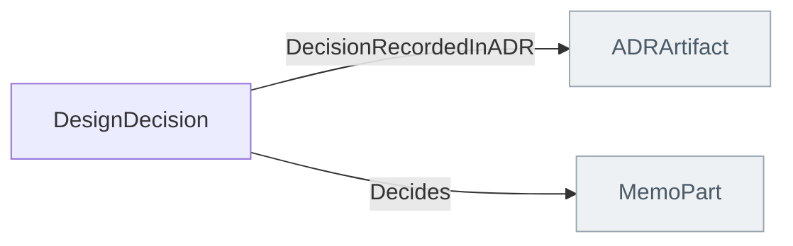

<!-- Generated by scripts/generate-sysml-api.mjs from src/architecture/decisions/. Do not edit. -->

### Elements

**Core concepts**

| Element | SysML kind | What it is |
| --- | --- | --- |
| [`DesignDecision`](../sysml-api/architecture/decisions/memo_decisions.md#designdecision) | `part def` | Design decision definition specializing `MemoPart`. |
| [`Alternative`](../sysml-api/architecture/decisions/memo_decisions.md#alternative) | `metadata def` | Alternative definition specializing `MemoTypedDependency`. |
| [`Selected`](../sysml-api/architecture/decisions/memo_decisions.md#selected) | `metadata def` | Selected definition specializing `MemoTypedDependency`. |

### Connections at a glance

Each arrow is one relationship, from its source end to its target end. A grey box belongs to another layer.

### Relationships declared here

| Relationship | From | To | What it says |
| --- | --- | --- | --- |
| [`DecisionRecordedInADR`](../sysml-api/architecture/decisions/memo_decisions.md#decisionrecordedinadr) | [`DesignDecision`](../sysml-api/architecture/decisions/memo_decisions.md#designdecision) | [`ADRArtifact`](../sysml-api/artifacts/core/memo_controlled_artifacts.md#adrartifact) | Typed relationship from `DesignDecision` to `ADRArtifact`. |
| [`Decides`](../sysml-api/architecture/decisions/memo_decisions.md#decides) | [`DesignDecision`](../sysml-api/architecture/decisions/memo_decisions.md#designdecision) | [`MemoPart`](../sysml-api/core/common/memo_common.md#memopart) | Typed relationship from `DesignDecision` to `MemoPart`. |

### Relationships from elsewhere that reach this layer

_None with an end typed in this layer._
