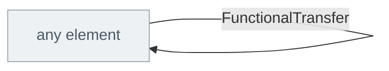

<!-- Generated by scripts/generate-sysml-api.mjs from src/architecture/functional/. Do not edit. -->

### Elements

**Behavior**

| Element | SysML kind | What it is |
| --- | --- | --- |
| [`FunctionalAction`](../sysml-api/architecture/functional/behavior/memo_behavior.md#functionalaction) *(abstract)* | `action def` | Functional action definition specializing `MemoAction`. |
| [`StateMachine`](../sysml-api/architecture/functional/behavior/memo_behavior.md#statemachine) | `state def` | State machines and their mode states are SysML v2 states (behaviours), so they derive from the MemoState foundation, not the part-based MemoPart family. Transitions stay part-based (below) to keep their traceable safety attributes.… |
| [`ModeConfiguration`](../sysml-api/architecture/functional/behavior/memo_behavior.md#modeconfiguration) | `part def` | A configuration is the concrete selection made at a `variation` choice point. It remains separate from a mode state: it says which mode and elements are active in one selectable arrangement.… |
| [`TransitionRecord`](../sysml-api/architecture/functional/behavior/memo_behavior.md#transitionrecord) | `metadata def` | Transitions are native SysML v2 `transition` usages inside the owning state — there is no `part def Transition`, and its `transition` keyword collision is why.… |
| [`BehaviorProperty`](../sysml-api/architecture/functional/behavior/memo_behavior.md#behaviorproperty) | `requirement def` | Behavior property definition specializing `MemoRequirementElement`. |
| [`Contract`](../sysml-api/architecture/functional/behavior/memo_behavior.md#contract) | `requirement def` | Contract definition specializing `MemoRequirementElement`. |
| [`ActivityAction`](../sysml-api/architecture/functional/behavior/memo_behavior.md#activityaction) | `action def` | Activity action definition specializing `FunctionalAction`. |
| [`ActivityFlow`](../sysml-api/architecture/functional/behavior/memo_behavior.md#activityflow) | `action def` | Activity flow definition specializing `MemoAction`. |
| [`TimingConstraint`](../sysml-api/architecture/functional/behavior/memo_behavior.md#timingconstraint) | `requirement def` | Timing constraint definition specializing `MemoRequirementElement`. |

**Functions**

| Element | SysML kind | What it is |
| --- | --- | --- |
| [`MemoFunction`](../sysml-api/architecture/functional/functions/memo_functions.md#memofunction) *(abstract)* | `action def` | Memo function definition specializing `MemoAction`. |
| [`SystemFunction`](../sysml-api/architecture/functional/functions/memo_functions.md#systemfunction) | `action def` | A responsibility of the system as a whole. Allocation is optional: a system function that no single component owns is a normal intermediate state of the functional chain, not a defect. |
| [`ComponentFunction`](../sysml-api/architecture/functional/functions/memo_functions.md#componentfunction) | `action def` | A responsibility of exactly one component. `AllocatedTo` names that component; CR-ONT-074 requires it. A component function that reaches no component is a responsibility nobody has accepted. |
| [`FunctionalFlow`](../sysml-api/architecture/functional/functions/memo_functions.md#functionalflow) | `action def` | Functional flow definition specializing `MemoAction`. |

### Connections at a glance

Each arrow is one relationship, from its source end to its target end. A grey box belongs to another layer.

### Relationships declared here

| Relationship | From | To | What it says |
| --- | --- | --- | --- |
| [`FunctionalExchange`](../sysml-api/architecture/functional/functions/memo_functions.md#functionalexchange) | *any element* | *any element* | Typed relationship for functional exchange. |
| [`FunctionalTransfer`](../sysml-api/architecture/functional/functions/memo_functions.md#functionaltransfer) | *any element* | *any element* | The concrete exchange. A concrete `flow def` must declare its two ends, so this is the member of the family a model types its flows by; the ends are left untyped, as an exchange runs from an `out` parameter of one function to an `in` parameter of another (or between ports). |

### Relationships from elsewhere that reach this layer

_None with an end typed in this layer._
