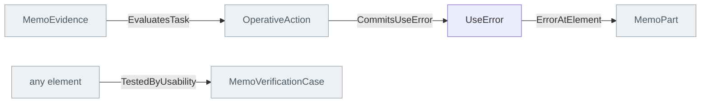

<!-- Generated by scripts/generate-sysml-api.mjs from src/assurance/human_factors/. Do not edit. -->

### Elements

**Core concepts**

| Element | SysML kind | What it is |
| --- | --- | --- |
| [`UseError`](../sysml-api/assurance/human_factors/memo_human_factors.md#useerror) | `part def` | Use error definition specializing `MemoPart`. |

### Connections at a glance

Each arrow is one relationship, from its source end to its target end. A grey box belongs to another layer.

### Relationships declared here

| Relationship | From | To | What it says |
| --- | --- | --- | --- |
| [`CommitsUseError`](../sysml-api/assurance/human_factors/memo_human_factors.md#commitsuseerror) | [`OperativeAction`](../sysml-api/architecture/operational/activities/memo_activities.md#operativeaction) | [`UseError`](../sysml-api/assurance/human_factors/memo_human_factors.md#useerror) | Typed relationship from `OperativeAction` to `UseError`. |
| [`EvaluatesTask`](../sysml-api/assurance/human_factors/memo_human_factors.md#evaluatestask) | [`MemoEvidence`](../sysml-api/core/common/memo_common.md#memoevidence) | [`OperativeAction`](../sysml-api/architecture/operational/activities/memo_activities.md#operativeaction) | Typed relationship from `MemoEvidence` to `OperativeAction`. |
| [`TestedByUsability`](../sysml-api/assurance/human_factors/memo_human_factors.md#testedbyusability) | *any element* | [`MemoVerificationCase`](../sysml-api/core/common/memo_common.md#memoverificationcase) | Typed relationship from `any element` to `MemoVerificationCase`. |

### Relationships from elsewhere that reach this layer

| Relationship | Declared in | From | To | What it says |
| --- | --- | --- | --- | --- |
| [`ErrorAtElement`](../sysml-api/architecture/implementation/ui/memo_ui.md#erroratelement) | implementation | [`UseError`](../sysml-api/assurance/human_factors/memo_human_factors.md#useerror) | [`MemoPart`](../sysml-api/core/common/memo_common.md#memopart) | Typed relationship from `UseError` to `MemoPart`. |
