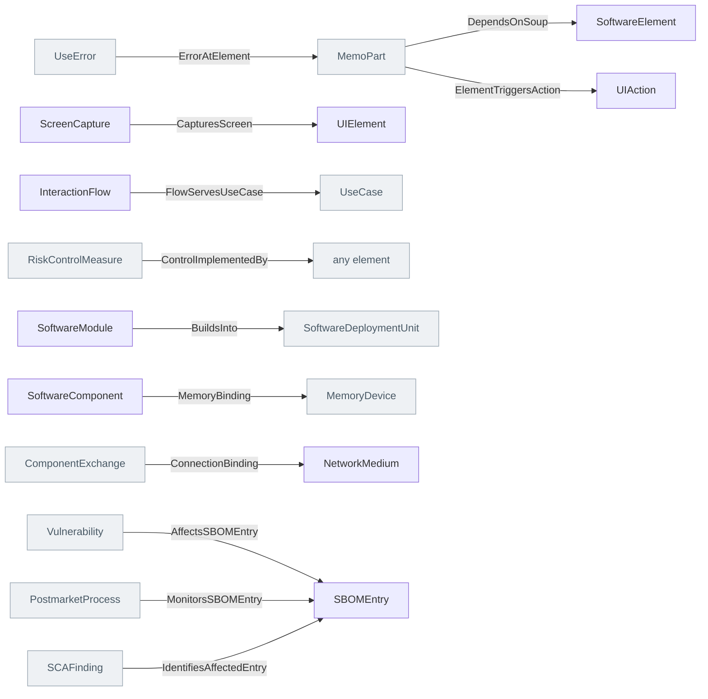

<!-- Generated by scripts/generate-sysml-api.mjs from src/architecture/implementation/. Do not edit. -->

### Elements

**Hardware**

| Element | SysML kind | What it is |
| --- | --- | --- |
| [`PhysicalElement`](../sysml-api/architecture/implementation/hardware/common/memo_hardware_common.md#physicalelement) *(abstract)* | `part def` | Physical element definition specializing `MemoPart`. |
| [`PhysicalAssembly`](../sysml-api/architecture/implementation/hardware/common/memo_hardware_common.md#physicalassembly) | `part def` | Physical assembly definition specializing `PhysicalElement`. |
| [`PhysicalSubassembly`](../sysml-api/architecture/implementation/hardware/common/memo_hardware_common.md#physicalsubassembly) | `part def` | Physical subassembly definition specializing `PhysicalAssembly`. |
| [`HardwareAssembly`](../sysml-api/architecture/implementation/hardware/common/memo_hardware_common.md#hardwareassembly) | `part def` | Hardware assembly definition specializing `PhysicalAssembly`. |
| [`PhysicalComponent`](../sysml-api/architecture/implementation/hardware/common/memo_hardware_common.md#physicalcomponent) | `part def` | Physical component definition specializing `PhysicalElement`. |
| [`HardwareComponent`](../sysml-api/architecture/implementation/hardware/common/memo_hardware_common.md#hardwarecomponent) | `part def` | Hardware component definition specializing `PhysicalComponent`. |
| [`AcousticComponent`](../sysml-api/architecture/implementation/hardware/common/memo_hardware_common.md#acousticcomponent) | `part def` | Acoustic component definition specializing `PhysicalComponent`. |
| [`ThermalComponent`](../sysml-api/architecture/implementation/hardware/common/memo_hardware_common.md#thermalcomponent) | `part def` | Thermal component definition specializing `PhysicalComponent`. |
| [`ElectricalComponent`](../sysml-api/architecture/implementation/hardware/electrical/memo_hardware_electrical.md#electricalcomponent) | `part def` | Electrical component definition specializing `PhysicalComponent`. |
| [`ElectronicComponent`](../sysml-api/architecture/implementation/hardware/electrical/memo_hardware_electrical.md#electroniccomponent) | `part def` | Electronic component definition specializing `PhysicalComponent`. |
| [`PowerSupply`](../sysml-api/architecture/implementation/hardware/electrical/memo_hardware_electrical.md#powersupply) | `part def` | Power supply definition specializing `ElectricalComponent`. |
| [`Battery`](../sysml-api/architecture/implementation/hardware/electrical/memo_hardware_electrical.md#battery) | `part def` | Battery definition specializing `ElectricalComponent`. |
| [`Cable`](../sysml-api/architecture/implementation/hardware/electrical/memo_hardware_electrical.md#cable) | `part def` | Cable definition specializing `PhysicalComponent`. |
| [`PhysicalConnectorPart`](../sysml-api/architecture/implementation/hardware/electrical/memo_hardware_electrical.md#physicalconnectorpart) | `part def` | Physical connector part definition specializing `PhysicalComponent`. |
| [`NetworkMedium`](../sysml-api/architecture/implementation/hardware/electrical/memo_hardware_electrical.md#networkmedium) | `part def` | Network medium definition specializing `PhysicalComponent`. |
| [`FluidicComponent`](../sysml-api/architecture/implementation/hardware/fluidic/memo_hardware_fluidic.md#fluidiccomponent) | `part def` | Fluidic component definition specializing `PhysicalComponent`. |
| [`PneumaticComponent`](../sysml-api/architecture/implementation/hardware/fluidic/memo_hardware_fluidic.md#pneumaticcomponent) | `part def` | Pneumatic component definition specializing `PhysicalComponent`. |
| [`MechanicalPart`](../sysml-api/architecture/implementation/hardware/mechanical/memo_hardware_mechanical.md#mechanicalpart) | `part def` | Mechanical part definition specializing `PhysicalComponent`. |
| [`Enclosure`](../sysml-api/architecture/implementation/hardware/mechanical/memo_hardware_mechanical.md#enclosure) | `part def` | Enclosure definition specializing `MechanicalPart`. |
| [`OpticalComponent`](../sysml-api/architecture/implementation/hardware/optical/memo_hardware_optical.md#opticalcomponent) | `part def` | Optical component definition specializing `PhysicalComponent`. |
| [`Sensor`](../sysml-api/architecture/implementation/hardware/sensing/memo_hardware_sensing.md#sensor) | `part def` | Sensor definition specializing `PhysicalComponent`. |
| [`Actuator`](../sysml-api/architecture/implementation/hardware/sensing/memo_hardware_sensing.md#actuator) | `part def` | Actuator definition specializing `PhysicalComponent`. |

**Software**

| Element | SysML kind | What it is |
| --- | --- | --- |
| [`SoftwareComponent`](../sysml-api/architecture/implementation/software/runtime/memo_software_runtime.md#softwarecomponent) | `part def` | Software component definition specializing `SoftwareElement`. |
| [`OTSSoftwareComponent`](../sysml-api/architecture/implementation/software/runtime/memo_software_runtime.md#otssoftwarecomponent) | `part def` | A runtime service or process that exists only because an OTS module is deployed. Optional: a library the product links normally needs only the module. |
| [`SoftwareElement`](../sysml-api/architecture/implementation/software/structure/memo_software_structure.md#softwareelement) *(abstract)* | `part def` | Software element definition specializing `MemoPart`. |
| [`SoftwareSystem`](../sysml-api/architecture/implementation/software/structure/memo_software_structure.md#softwaresystem) | `part def` | Software system definition specializing `SoftwareElement`. |
| [`SoftwareModule`](../sysml-api/architecture/implementation/software/structure/memo_software_structure.md#softwaremodule) | `part def` | Software module definition specializing `SoftwareElement`. |
| [`Algorithm`](../sysml-api/architecture/implementation/software/structure/memo_software_structure.md#algorithm) | `part def` | Algorithm definition specializing `MemoPart`. |
| [`DataModel`](../sysml-api/architecture/implementation/software/structure/memo_software_structure.md#datamodel) | `part def` | Data model definition specializing `MemoPart`. |
| [`ConfigurationArtifact`](../sysml-api/architecture/implementation/software/structure/memo_software_structure.md#configurationartifact) | `part def` | Configuration artifact definition specializing `MemoPart`. |
| [`DataItem`](../sysml-api/architecture/implementation/software/structure/memo_software_structure.md#dataitem) *(abstract)* | `item def` | Data item definition specializing `MemoItem`. |
| [`OTSSoftwareModule`](../sysml-api/architecture/implementation/software/structure/memo_software_structure.md#otssoftwaremodule) | `part def` | Otssoftware module definition specializing `SoftwareModule`. |
| [`SOUPSoftwareModule`](../sysml-api/architecture/implementation/software/structure/memo_software_structure.md#soupsoftwaremodule) | `part def` | Soupsoftware module definition specializing `OTSSoftwareModule`. |
| [`SBOMEntry`](../sysml-api/architecture/implementation/software/structure/memo_software_structure.md#sbomentry) | `part def` | An SBOM is a document; its entries are inventory records. An entry names one software element and says what is known about it as shipped. Vulnerabilities, anomalies and risks are separate objects that point at the entry; they are not attributes of the document. |
| [`SoftwareBillOfMaterials`](../sysml-api/architecture/implementation/software/structure/memo_software_structure.md#softwarebillofmaterials) | `part def` | Software bill of materials definition specializing `MemoPart`. |

**Ui**

| Element | SysML kind | What it is |
| --- | --- | --- |
| [`RegionBounds`](../sysml-api/architecture/implementation/ui/memo_ui.md#regionbounds) | `attribute def` | Region bounds definition. |
| [`UserInterface`](../sysml-api/architecture/implementation/ui/memo_ui.md#userinterface) | `part def` | User interface definition specializing `MemoPart`. |
| [`UIElement`](../sysml-api/architecture/implementation/ui/memo_ui.md#uielement) | `part def` | Uielement definition specializing `SoftwareElement`. |
| [`OperatorInterfaceElement`](../sysml-api/architecture/implementation/ui/memo_ui.md#operatorinterfaceelement) | `part def` | Operator interface element definition specializing `PhysicalComponent`. |
| [`ScreenCapture`](../sysml-api/architecture/implementation/ui/memo_ui.md#screencapture) | `part def` | Screen capture definition specializing `MemoEvidence`. |
| [`UIState`](../sysml-api/architecture/implementation/ui/memo_ui.md#uistate) | `part def` | UI state is presentation state — distinct from system/device state. |
| [`UIEvent`](../sysml-api/architecture/implementation/ui/memo_ui.md#uievent) | `part def` | Uievent definition specializing `MemoPart`. |
| [`UIAction`](../sysml-api/architecture/implementation/ui/memo_ui.md#uiaction) | `action def` | Clicking a button IS an operative action: it has a trigger, a precondition, a criticality, a potential harm and a frequency of use, exactly as turning a knob does.… |
| [`InteractionFlow`](../sysml-api/architecture/implementation/ui/memo_ui.md#interactionflow) | `action def` | A reusable dialogue structure through the UI; a selected path through it is a OperativeScenario with scenarioKind `ui`. |

### Connections at a glance

Each arrow is one relationship, from its source end to its target end. A grey box belongs to another layer.

### Relationships declared here

| Relationship | From | To | What it says |
| --- | --- | --- | --- |
| [`DependsOnSoup`](../sysml-api/architecture/implementation/software/structure/memo_software_structure.md#dependsonsoup) | [`MemoPart`](../sysml-api/core/common/memo_common.md#memopart) | [`SoftwareElement`](../sysml-api/architecture/implementation/software/structure/memo_software_structure.md#softwareelement) | Typed relationship from `MemoPart` to `SoftwareElement`. |
| [`CapturesScreen`](../sysml-api/architecture/implementation/ui/memo_ui.md#capturesscreen) | [`ScreenCapture`](../sysml-api/architecture/implementation/ui/memo_ui.md#screencapture) | [`UIElement`](../sysml-api/architecture/implementation/ui/memo_ui.md#uielement) | Which modelled screen an image is a rendering of. |
| [`ElementTriggersAction`](../sysml-api/architecture/implementation/ui/memo_ui.md#elementtriggersaction) | [`MemoPart`](../sysml-api/core/common/memo_common.md#memopart) | [`UIAction`](../sysml-api/architecture/implementation/ui/memo_ui.md#uiaction) | Typed relationship from `MemoPart` to `UIAction`. |
| [`FlowServesUseCase`](../sysml-api/architecture/implementation/ui/memo_ui.md#flowservesusecase) | [`InteractionFlow`](../sysml-api/architecture/implementation/ui/memo_ui.md#interactionflow) | [`UseCase`](../sysml-api/architecture/operational/use_cases/memo_use_cases.md#usecase) | Typed relationship from `InteractionFlow` to `UseCase`. |
| [`ErrorAtElement`](../sysml-api/architecture/implementation/ui/memo_ui.md#erroratelement) | [`UseError`](../sysml-api/assurance/human_factors/memo_human_factors.md#useerror) | [`MemoPart`](../sysml-api/core/common/memo_common.md#memopart) | Typed relationship from `UseError` to `MemoPart`. |
| [`ControlImplementedBy`](../sysml-api/architecture/implementation/ui/memo_ui.md#controlimplementedby) | [`RiskControlMeasure`](../sysml-api/assurance/safety_risk/memo_risk.md#riskcontrolmeasure) | *any element* | A risk control implemented by a UI element or by task design (confirmation dialog, lockout, guarded control). |

### Relationships from elsewhere that reach this layer

| Relationship | Declared in | From | To | What it says |
| --- | --- | --- | --- | --- |
| [`BuildsInto`](../sysml-api/architecture/realization/deployment/memo_deployment.md#buildsinto) | realization | [`SoftwareModule`](../sysml-api/architecture/implementation/software/structure/memo_software_structure.md#softwaremodule) | [`SoftwareDeploymentUnit`](../sysml-api/architecture/realization/deployment/memo_deployment.md#softwaredeploymentunit) | Typed relationship from `SoftwareModule` to `SoftwareDeploymentUnit`. |
| [`MemoryBinding`](../sysml-api/architecture/realization/deployment/memo_deployment.md#memorybinding) | realization | [`SoftwareComponent`](../sysml-api/architecture/implementation/software/runtime/memo_software_runtime.md#softwarecomponent) | [`MemoryDevice`](../sysml-api/architecture/realization/physical/memo_physical_architecture.md#memorydevice) | AADL `actual_memory_binding`. Which memory a software component's code and data occupy — what makes a memory budget a claim about a device rather than a string. |
| [`ConnectionBinding`](../sysml-api/architecture/realization/deployment/memo_deployment.md#connectionbinding) | realization | [`ComponentExchange`](../sysml-api/architecture/logical/interfaces/memo_interfaces.md#componentexchange) | [`NetworkMedium`](../sysml-api/architecture/implementation/hardware/electrical/memo_hardware_electrical.md#networkmedium) | AADL `actual_connection_binding`. Which physical medium carries a component exchange. The source is the ComponentExchange rather than the `ComponentConnects` link, because the exchange is the ELEMENT that owns the budget (§19.3) and a link instance is not something the graph c… |
| [`AffectsSBOMEntry`](../sysml-api/assurance/cybersecurity/memo_cybersecurity.md#affectssbomentry) | cybersecurity | [`Vulnerability`](../sysml-api/assurance/cybersecurity/memo_cybersecurity.md#vulnerability) | [`SBOMEntry`](../sysml-api/architecture/implementation/software/structure/memo_software_structure.md#sbomentry) | Typed relationship from `Vulnerability` to `SBOMEntry`. |
| [`MonitorsSBOMEntry`](../sysml-api/assurance/cybersecurity/memo_cybersecurity.md#monitorssbomentry) | cybersecurity | [`PostmarketProcess`](../sysml-api/assurance/cybersecurity/memo_cybersecurity.md#postmarketprocess) | [`SBOMEntry`](../sysml-api/architecture/implementation/software/structure/memo_software_structure.md#sbomentry) | Typed relationship from `PostmarketProcess` to `SBOMEntry`. |
| [`IdentifiesAffectedEntry`](../sysml-api/assurance/cybersecurity/memo_cybersecurity.md#identifiesaffectedentry) | cybersecurity | [`SCAFinding`](../sysml-api/assurance/cybersecurity/memo_cybersecurity.md#scafinding) | [`SBOMEntry`](../sysml-api/architecture/implementation/software/structure/memo_software_structure.md#sbomentry) | Typed relationship from `SCAFinding` to `SBOMEntry`. |

### Enumerations

| Enumeration | Values |
| --- | --- |
| [`RuntimeKind`](../sysml-api/architecture/implementation/software/runtime/memo_software_runtime.md#runtimekind) | `process`, `thread`, `task`, `service`, `container`, `partition`, `dataStore`, `messageBroker` |
| [`ModuleKind`](../sysml-api/architecture/implementation/software/structure/memo_software_structure.md#modulekind) | `unit`, `code`, `firmware`, `soup` |
| [`SbomFormatKind`](../sysml-api/architecture/implementation/software/structure/memo_software_structure.md#sbomformatkind) | `spdx`, `cycloneDx`, `other` |
| [`UIElementFormKind`](../sysml-api/architecture/implementation/ui/memo_ui.md#uielementformkind) | `screen`, `dialog`, `panel`, `menu`, `tab`, `drawer`, `wizardStep`, `button`, `field`, `selector`, `slider`, `table`, `chart`, `icon`, `textMessage`, `decoration` |
| [`UIDisclosureKind`](../sysml-api/architecture/implementation/ui/memo_ui.md#uidisclosurekind) | `inline`, `overlay`, `transient`, `scrolled`, `conditional` |
| [`BoundsDetectionKind`](../sysml-api/architecture/implementation/ui/memo_ui.md#boundsdetectionkind) | `manual`, `automatic`, `automaticConfirmed`, `imported` |
| [`InteractionIntentKind`](../sysml-api/architecture/implementation/ui/memo_ui.md#interactionintentkind) | `userInput`, `feedback`, `navigation`, `confirmation`, `inputValidation`, `errorMessage`, `alarmAnnunciation`, `acknowledgement`, `cancellation`, `timeout`, `lockout`, `correction`, `recovery` |
| [`OperatorInterfaceFormKind`](../sysml-api/architecture/implementation/ui/memo_ui.md#operatorinterfaceformkind) | `knob`, `dial`, `pushButton`, `toggleSwitch`, `rockerSwitch`, `lever`, `physicalSlider`, `keypad`, `footPedal`, `touchSurface`, `indicatorLamp`, `gauge`, `audibleIndicator`, `hapticIndicator`, `printedMarking` |
