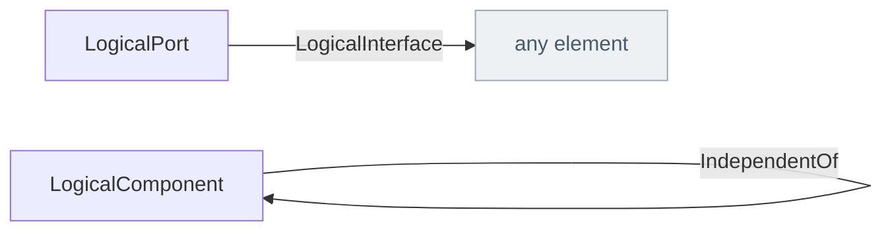

<!-- Generated by scripts/generate-sysml-api.mjs from src/architecture/logical/. Do not edit. -->

### Elements

**Interfaces**

| Element | SysML kind | What it is |
| --- | --- | --- |
| [`InterfaceItem`](../sysml-api/architecture/logical/interfaces/memo_interfaces.md#interfaceitem) | `item def` | A typed thing exchanged at a boundary. Concrete items such as AlarmSignal and FlowCommand specialize this type; they are neither functions nor generic action-flow notation.… |
| [`DataPort`](../sysml-api/architecture/logical/interfaces/memo_interfaces.md#dataport) | `port def` | Data port definition specializing `MemoPort`. |
| [`SensorPort`](../sysml-api/architecture/logical/interfaces/memo_interfaces.md#sensorport) | `port def` | Sensor port definition specializing `DataPort`. |
| [`CommandPort`](../sysml-api/architecture/logical/interfaces/memo_interfaces.md#commandport) | `port def` | Command port definition specializing `DataPort`. |
| [`SoftwarePort`](../sysml-api/architecture/logical/interfaces/memo_interfaces.md#softwareport) | `port def` | Software port definition specializing `MemoPort`. |

**Structure**

| Element | SysML kind | What it is |
| --- | --- | --- |
| [`SystemOfSystems`](../sysml-api/architecture/logical/structure/memo_logical_structure.md#systemofsystems) | `part def` | Three types rather than three role values, because they differ in what they may CONTAIN — and containment legality cannot live on an attribute. The allowed children are declared as typed part features, which is how SysML v2 already states "what may be contained".… |
| [`System`](../sysml-api/architecture/logical/structure/memo_logical_structure.md#system) | `part def` | System definition specializing `LogicalComponent`. |
| [`Subsystem`](../sysml-api/architecture/logical/structure/memo_logical_structure.md#subsystem) | `part def` | Subsystem definition specializing `LogicalComponent`. |
| [`LogicalComponent`](../sysml-api/architecture/logical/structure/memo_logical_structure.md#logicalcomponent) | `part def` | Logical component definition specializing `MemoPart`. |
| [`LogicalPort`](../sysml-api/architecture/logical/structure/memo_logical_structure.md#logicalport) | `port def` | Boundary features and contracts. |
| [`LogicalExchangeItem`](../sysml-api/architecture/logical/structure/memo_logical_structure.md#logicalexchangeitem) | `item def` | Logical exchange item definition specializing `MemoItem`. |
| [`LogicalBehavior`](../sysml-api/architecture/logical/structure/memo_logical_structure.md#logicalbehavior) | `part def` | States and modes of the logical solution (kept distinct from UI state and from physical device configuration). |
| [`IsolationBoundary`](../sysml-api/architecture/logical/structure/memo_logical_structure.md#isolationboundary) | `part def` | Isolation, fault containment, and trust boundaries (§10). |
| [`FaultContainmentRegion`](../sysml-api/architecture/logical/structure/memo_logical_structure.md#faultcontainmentregion) | `part def` | Fault containment region definition specializing `MemoPart`. |

### Connections at a glance

Each arrow is one relationship, from its source end to its target end. A grey box belongs to another layer.

### Relationships declared here

| Relationship | From | To | What it says |
| --- | --- | --- | --- |
| [`Interface`](../sysml-api/architecture/logical/interfaces/memo_interfaces.md#interface) | *any element* | *any element* | Typed relationship for interface. |
| [`SoftwareInterface`](../sysml-api/architecture/logical/interfaces/memo_interfaces.md#softwareinterface) | *any element* | *any element* | Software interaction contracts. Concrete technologies add their protocol roles and message flows; ports remain the endpoints that components actually own. |
| [`DataInterface`](../sysml-api/architecture/logical/interfaces/memo_interfaces.md#datainterface) | *any element* | *any element* | Typed relationship for data interface. |
| [`ComponentExchange`](../sysml-api/architecture/logical/interfaces/memo_interfaces.md#componentexchange) | *any element* | *any element* | Typed relationship for component exchange. |
| [`LogicalInterface`](../sysml-api/architecture/logical/structure/memo_logical_structure.md#logicalinterface) | [`LogicalPort`](../sysml-api/architecture/logical/structure/memo_logical_structure.md#logicalport) | *any element* | Typed relationship from `LogicalPort` to `any element`. |
| [`LogicalConnector`](../sysml-api/architecture/logical/structure/memo_logical_structure.md#logicalconnector) | [`LogicalComponent`](../sysml-api/architecture/logical/structure/memo_logical_structure.md#logicalcomponent) | [`LogicalComponent`](../sysml-api/architecture/logical/structure/memo_logical_structure.md#logicalcomponent) | A typed logical connection between two components' ports. |
| [`LogicalExchange`](../sysml-api/architecture/logical/structure/memo_logical_structure.md#logicalexchange) | *any element* | *any element* | Typed relationship for logical exchange. |
| [`IndependentOf`](../sysml-api/architecture/logical/structure/memo_logical_structure.md#independentof) | [`LogicalComponent`](../sysml-api/architecture/logical/structure/memo_logical_structure.md#logicalcomponent) | [`LogicalComponent`](../sysml-api/architecture/logical/structure/memo_logical_structure.md#logicalcomponent) | Claimed independence between channels (common-cause defense). |

### Relationships from elsewhere that reach this layer

_None with an end typed in this layer._

### Enumerations

| Enumeration | Values |
| --- | --- |
| [`FlowContentKind`](../sysml-api/architecture/logical/structure/memo_logical_structure.md#flowcontentkind) | `information`, `command`, `status`, `measurement`, `alarm`, `configuration`, `energy`, `material`, `fluid`, `mechanicalForce` |
| [`ChannelRoleKind`](../sysml-api/architecture/logical/structure/memo_logical_structure.md#channelrolekind) | `primary`, `secondary`, `redundant`, `diverse`, `monitor`, `watchdog`, `interlock`, `independentProtection` |
| [`ComponentRoleKind`](../sysml-api/architecture/logical/structure/memo_logical_structure.md#componentrolekind) | `channel`, `dataStore`, `controlElement`, `userInterface`, `externalSystem`, `generic` |
| [`SystemTypeKind`](../sysml-api/architecture/logical/structure/memo_logical_structure.md#systemtypekind) | `logical`, `software`, `hardware` |
