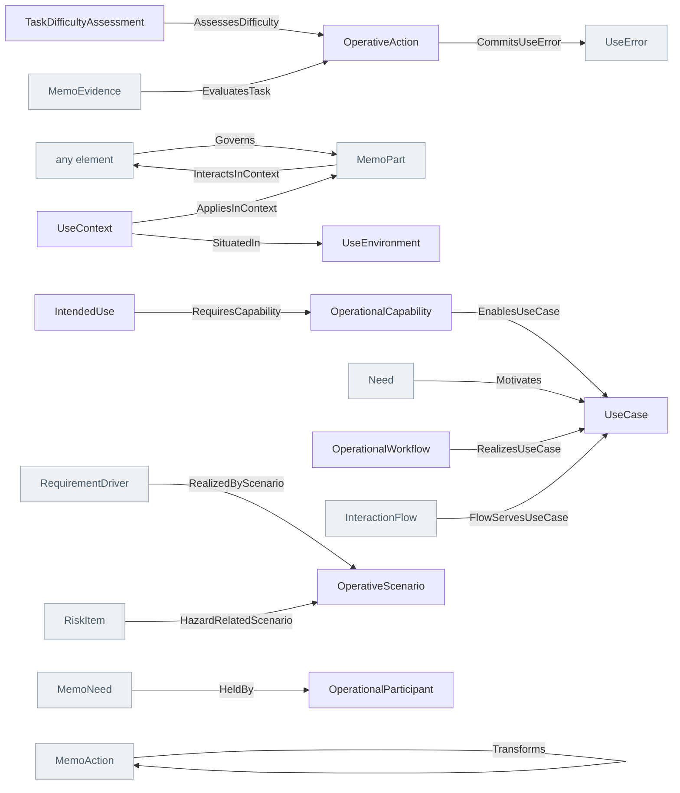

<!-- Generated by scripts/generate-sysml-api.mjs from src/architecture/operational/. Do not edit. -->

### Elements

**Activities**

| Element | SysML kind | What it is |
| --- | --- | --- |
| [`OperativeAction`](../sysml-api/architecture/operational/activities/memo_activities.md#operativeaction) | `action def` | Operative action definition specializing `MemoAction`. |
| [`TaskDifficultyAssessment`](../sysml-api/architecture/operational/activities/memo_activities.md#taskdifficultyassessment) | `part def` | Difficulty of a task in a particular context (§17). Associated by typed references, not inheritance; assessments are evidence-bearing. |

**Context**

| Element | SysML kind | What it is |
| --- | --- | --- |
| [`OperationalParticipant`](../sysml-api/architecture/operational/context/actors/memo_actors.md#operationalparticipant) *(abstract)* | `part def` | Operational participant definition specializing `MemoPart`. |
| [`User`](../sysml-api/architecture/operational/context/actors/memo_actors.md#user) | `part def` | A human who interacts with the medical device (IEC 62366-1 intended user). User is the only human actor type: do not add an alternative type name. The human actor.… |
| [`ArchitectureDescription`](../sysml-api/architecture/operational/context/stakeholders/memo_stakeholders.md#architecturedescription) | `part def` | Architecture description definition specializing `MemoPart`. |
| [`ModelKind`](../sysml-api/architecture/operational/context/stakeholders/memo_stakeholders.md#modelkind) | `part def` | Model definition specializing `MemoPart`. |
| [`CorrespondenceRule`](../sysml-api/architecture/operational/context/stakeholders/memo_stakeholders.md#correspondencerule) | `part def` | Correspondence rule definition specializing `MemoPart`. |
| [`UseContext`](../sysml-api/architecture/operational/context/use_context/memo_use_context.md#usecontext) | `part def` | Use context definition specializing `MemoPart`. |
| [`UseEnvironment`](../sysml-api/architecture/operational/context/use_context/memo_use_context.md#useenvironment) | `part def` | The physical/organizational environment of use (IEC 62366-1 3.20), separable from the care-setting context so environments are reusable. |

**Scenarios**

| Element | SysML kind | What it is |
| --- | --- | --- |
| [`OperativeScenario`](../sysml-api/architecture/operational/scenarios/memo_scenarios.md#operativescenario) | `action def` | A scenario is a `MemoConstrainedOccurrence`: it carries the native `precondition` and `postcondition` constraints a function does, redefined with an expression (`constraint :>> precondition { level >= 0 }`).… |

**Structure**

| Element | SysML kind | What it is |
| --- | --- | --- |
| [`IntendedUse`](../sysml-api/architecture/operational/structure/memo_operational.md#intendeduse) | `requirement def` | Intended use definition specializing `MemoMission`. |
| [`OperationalEntity`](../sysml-api/architecture/operational/structure/memo_operational.md#operationalentity) | `part def` | Operational entity definition specializing `MemoPart`. |
| [`OperationalCapability`](../sysml-api/architecture/operational/structure/memo_operational.md#operationalcapability) | `part def` | Operational capability definition specializing `MemoPart`. |

**Use cases**

| Element | SysML kind | What it is |
| --- | --- | --- |
| [`UseCase`](../sysml-api/architecture/operational/use_cases/memo_use_cases.md#usecase) | `use case def` | Use case definition specializing `MemoUseCase`. |

**Workflows**

| Element | SysML kind | What it is |
| --- | --- | --- |
| [`OperationalWorkflow`](../sysml-api/architecture/operational/workflows/memo_workflows.md#operationalworkflow) | `part def` | Operational workflow definition specializing `MemoPart`. |
| [`WorkflowControlNode`](../sysml-api/architecture/operational/workflows/memo_workflows.md#workflowcontrolnode) | `action def` | A workflow control node. The role is given by controlKind; the kind-specific fields below are set only for the relevant controlKind. handoff = transfer of responsibility between roles (shift change, room-to-lab). |
| [`WorkflowResource`](../sysml-api/architecture/operational/workflows/memo_workflows.md#workflowresource) | `part def` | Resources a workflow requires: instruments, equipment, consumables, materials, information or space, by reference. Owned by the workflow as its parts. A staff member is not one: that is a `User`, which is a `MemoResource` of its own. |

### Connections at a glance

Each arrow is one relationship, from its source end to its target end. A grey box belongs to another layer.

### Relationships declared here

| Relationship | From | To | What it says |
| --- | --- | --- | --- |
| [`AssessesDifficulty`](../sysml-api/architecture/operational/activities/memo_activities.md#assessesdifficulty) | [`TaskDifficultyAssessment`](../sysml-api/architecture/operational/activities/memo_activities.md#taskdifficultyassessment) | [`OperativeAction`](../sysml-api/architecture/operational/activities/memo_activities.md#operativeaction) | Typed relationship from `TaskDifficultyAssessment` to `OperativeAction`. |
| [`Governs`](../sysml-api/architecture/operational/context/stakeholders/memo_stakeholders.md#governs) | *any element* | [`MemoPart`](../sysml-api/core/common/memo_common.md#memopart) | Typed relationship from `any element` to `MemoPart`. |
| [`InteractsInContext`](../sysml-api/architecture/operational/context/use_context/memo_use_context.md#interactsincontext) | [`MemoPart`](../sysml-api/core/common/memo_common.md#memopart) | *any element* | The single relation a system context view draws. A context diagram labels its edges with open-ended verbs — "directs procedure", "electrical power", "fluid supply", "environmental conditions".… |
| [`AppliesInContext`](../sysml-api/architecture/operational/context/use_context/memo_use_context.md#appliesincontext) | [`UseContext`](../sysml-api/architecture/operational/context/use_context/memo_use_context.md#usecontext) | [`MemoPart`](../sysml-api/core/common/memo_common.md#memopart) | Typed relationship from `UseContext` to `MemoPart`. |
| [`SituatedIn`](../sysml-api/architecture/operational/context/use_context/memo_use_context.md#situatedin) | [`UseContext`](../sysml-api/architecture/operational/context/use_context/memo_use_context.md#usecontext) | [`UseEnvironment`](../sysml-api/architecture/operational/context/use_context/memo_use_context.md#useenvironment) | Typed relationship from `UseContext` to `UseEnvironment`. |
| [`RequiresCapability`](../sysml-api/architecture/operational/structure/memo_operational.md#requirescapability) | [`IntendedUse`](../sysml-api/architecture/operational/structure/memo_operational.md#intendeduse) | [`OperationalCapability`](../sysml-api/architecture/operational/structure/memo_operational.md#operationalcapability) | The intended use requires these operational capabilities (ARCADIA: Mission Requires Capability). |
| [`EnablesUseCase`](../sysml-api/architecture/operational/structure/memo_operational.md#enablesusecase) | [`OperationalCapability`](../sysml-api/architecture/operational/structure/memo_operational.md#operationalcapability) | [`UseCase`](../sysml-api/architecture/operational/use_cases/memo_use_cases.md#usecase) | An operational capability enables a use case (the ability the actor draws on to accomplish the goal). Capability is tied to the use case, not to individual activities. |
| [`Motivates`](../sysml-api/architecture/operational/use_cases/memo_use_cases.md#motivates) | [`Need`](../sysml-api/assurance/requirements/needs/memo_needs.md#need) | [`UseCase`](../sysml-api/architecture/operational/use_cases/memo_use_cases.md#usecase) | Typed relationship from `Need` to `UseCase`. |
| [`RealizesUseCase`](../sysml-api/architecture/operational/workflows/memo_workflows.md#realizesusecase) | [`OperationalWorkflow`](../sysml-api/architecture/operational/workflows/memo_workflows.md#operationalworkflow) | [`UseCase`](../sysml-api/architecture/operational/use_cases/memo_use_cases.md#usecase) | The use case a workflow realizes. Many workflows may trace to one use case; the use case does not own its workflows (the trace points upward, workflow → use case). |
| [`Transforms`](../sysml-api/architecture/operational/workflows/memo_workflows.md#transforms) | [`MemoAction`](../sysml-api/core/common/memo_common.md#memoaction) | [`MemoAction`](../sysml-api/core/common/memo_common.md#memoaction) | Typed relationship from `MemoAction` to `MemoAction`. |

### Relationships from elsewhere that reach this layer

| Relationship | Declared in | From | To | What it says |
| --- | --- | --- | --- | --- |
| [`FlowServesUseCase`](../sysml-api/architecture/implementation/ui/memo_ui.md#flowservesusecase) | implementation | [`InteractionFlow`](../sysml-api/architecture/implementation/ui/memo_ui.md#interactionflow) | [`UseCase`](../sysml-api/architecture/operational/use_cases/memo_use_cases.md#usecase) | Typed relationship from `InteractionFlow` to `UseCase`. |
| [`RealizedByScenario`](../sysml-api/assurance/cybersecurity/memo_cybersecurity.md#realizedbyscenario) | cybersecurity | [`RequirementDriver`](../sysml-api/core/common/memo_common.md#requirementdriver) | [`OperativeScenario`](../sysml-api/architecture/operational/scenarios/memo_scenarios.md#operativescenario) | Typed relationship from `RequirementDriver` to `OperativeScenario`. |
| [`CommitsUseError`](../sysml-api/assurance/human_factors/memo_human_factors.md#commitsuseerror) | human-factors | [`OperativeAction`](../sysml-api/architecture/operational/activities/memo_activities.md#operativeaction) | [`UseError`](../sysml-api/assurance/human_factors/memo_human_factors.md#useerror) | Typed relationship from `OperativeAction` to `UseError`. |
| [`EvaluatesTask`](../sysml-api/assurance/human_factors/memo_human_factors.md#evaluatestask) | human-factors | [`MemoEvidence`](../sysml-api/core/common/memo_common.md#memoevidence) | [`OperativeAction`](../sysml-api/architecture/operational/activities/memo_activities.md#operativeaction) | Typed relationship from `MemoEvidence` to `OperativeAction`. |
| [`HeldBy`](../sysml-api/assurance/requirements/needs/memo_needs.md#heldby) | requirements | [`MemoNeed`](../sysml-api/core/common/memo_common.md#memoneed) | [`OperationalParticipant`](../sysml-api/architecture/operational/context/actors/memo_actors.md#operationalparticipant) | Whose need this is. The holder is a modelled participant — a User, with the profile IEC 62366-1 asks for, or another operational participant — so "which users does this need serve" is a question the model answers rather than a sentence a reader interprets. |
| [`HazardRelatedScenario`](../sysml-api/assurance/safety_risk/memo_risk.md#hazardrelatedscenario) | safety-risk | [`RiskItem`](../sysml-api/assurance/safety_risk/memo_risk.md#riskitem) | [`OperativeScenario`](../sysml-api/architecture/operational/scenarios/memo_scenarios.md#operativescenario) | Typed relationship from `RiskItem` to `OperativeScenario`. |

### Enumerations

| Enumeration | Values |
| --- | --- |
| [`DemandLevelKind`](../sysml-api/architecture/operational/activities/memo_activities.md#demandlevelkind) | `minimal`, `low`, `moderate`, `high`, `extreme` |
| [`GovernKind`](../sysml-api/architecture/operational/context/stakeholders/memo_stakeholders.md#governkind) | `correspondence` |
| [`ScenarioKind`](../sysml-api/architecture/operational/scenarios/memo_scenarios.md#scenariokind) | `nominal`, `alternate` |
| [`UseCaseKind`](../sysml-api/architecture/operational/use_cases/memo_use_cases.md#usecasekind) | `clinical`, `service`, `manufacturing`, `development` |
| [`WorkflowStateKind`](../sysml-api/architecture/operational/workflows/memo_workflows.md#workflowstatekind) | `asIs`, `toBe`, `contingency`, `deprecated` |
| [`StepTransformationKind`](../sysml-api/architecture/operational/workflows/memo_workflows.md#steptransformationkind) | `preserves`, `automates`, `augments`, `eliminates` |
| [`ControlNodeKind`](../sysml-api/architecture/operational/workflows/memo_workflows.md#controlnodekind) | `decision`, `handoff` |
| [`ResourceKind`](../sysml-api/architecture/operational/workflows/memo_workflows.md#resourcekind) | `instrument`, `equipment`, `consumable`, `material`, `information`, `space` |
| [`TransformKind`](../sysml-api/architecture/operational/workflows/memo_workflows.md#transformkind) | `step`, `workflow`, `replacesWorkflow` |
