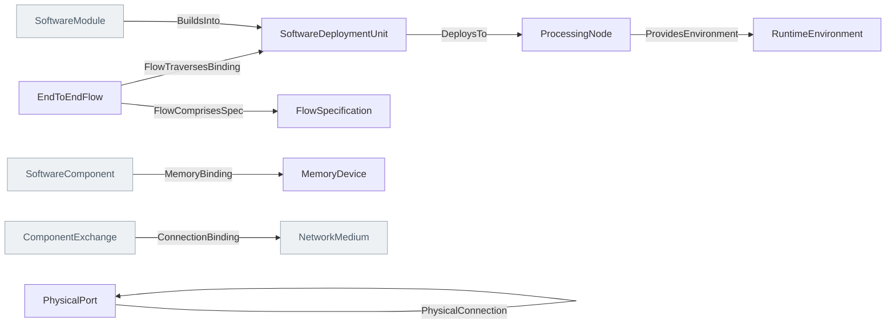

<!-- Generated by scripts/generate-sysml-api.mjs from src/architecture/realization/. Do not edit. -->

### Elements

**Deployment**

| Element | SysML kind | What it is |
| --- | --- | --- |
| [`SoftwareDeploymentUnit`](../sysml-api/architecture/realization/deployment/memo_deployment.md#softwaredeploymentunit) | `part def` | Software deployment unit definition specializing `MemoPart`. |
| [`RuntimeEnvironment`](../sysml-api/architecture/realization/deployment/memo_deployment.md#runtimeenvironment) | `part def` | Runtime environment definition specializing `MemoPart`. |
| [`FlowSpecification`](../sysml-api/architecture/realization/deployment/memo_deployment.md#flowspecification) | `part def` | A flow declared at a logical component boundary (in-port → out-port). |
| [`EndToEndFlow`](../sysml-api/architecture/realization/deployment/memo_deployment.md#endtoendflow) | `part def` | A complete source→sink flow traced across the layers and the software→ hardware binding it traverses. `latencyBudgetMs` and `analysisPurpose` (latency \| fault-propagation \| security) drive the AADL-style analysis. |

**Physical**

| Element | SysML kind | What it is |
| --- | --- | --- |
| [`ProcessingNode`](../sysml-api/architecture/realization/physical/memo_physical_architecture.md#processingnode) | `part def` | Processing node definition specializing `PhysicalElement`. |
| [`MemoryDevice`](../sysml-api/architecture/realization/physical/memo_physical_architecture.md#memorydevice) | `part def` | Memory device definition specializing `PhysicalElement`. |
| [`PhysicalPort`](../sysml-api/architecture/realization/physical/memo_physical_architecture.md#physicalport) | `port def` | Physical port definition specializing `MemoPort`. |

### Connections at a glance

Each arrow is one relationship, from its source end to its target end. A grey box belongs to another layer.

### Relationships declared here

| Relationship | From | To | What it says |
| --- | --- | --- | --- |
| [`BuildsInto`](../sysml-api/architecture/realization/deployment/memo_deployment.md#buildsinto) | [`SoftwareModule`](../sysml-api/architecture/implementation/software/structure/memo_software_structure.md#softwaremodule) | [`SoftwareDeploymentUnit`](../sysml-api/architecture/realization/deployment/memo_deployment.md#softwaredeploymentunit) | Typed relationship from `SoftwareModule` to `SoftwareDeploymentUnit`. |
| [`DeploysTo`](../sysml-api/architecture/realization/deployment/memo_deployment.md#deploysto) | [`SoftwareDeploymentUnit`](../sysml-api/architecture/realization/deployment/memo_deployment.md#softwaredeploymentunit) | [`ProcessingNode`](../sysml-api/architecture/realization/physical/memo_physical_architecture.md#processingnode) | Typed relationship from `SoftwareDeploymentUnit` to `ProcessingNode`. |
| [`ProvidesEnvironment`](../sysml-api/architecture/realization/deployment/memo_deployment.md#providesenvironment) | [`ProcessingNode`](../sysml-api/architecture/realization/physical/memo_physical_architecture.md#processingnode) | [`RuntimeEnvironment`](../sysml-api/architecture/realization/deployment/memo_deployment.md#runtimeenvironment) | Typed relationship from `ProcessingNode` to `RuntimeEnvironment`. |
| [`MemoryBinding`](../sysml-api/architecture/realization/deployment/memo_deployment.md#memorybinding) | [`SoftwareComponent`](../sysml-api/architecture/implementation/software/runtime/memo_software_runtime.md#softwarecomponent) | [`MemoryDevice`](../sysml-api/architecture/realization/physical/memo_physical_architecture.md#memorydevice) | AADL `actual_memory_binding`. Which memory a software component's code and data occupy — what makes a memory budget a claim about a device rather than a string. |
| [`ConnectionBinding`](../sysml-api/architecture/realization/deployment/memo_deployment.md#connectionbinding) | [`ComponentExchange`](../sysml-api/architecture/logical/interfaces/memo_interfaces.md#componentexchange) | [`NetworkMedium`](../sysml-api/architecture/implementation/hardware/electrical/memo_hardware_electrical.md#networkmedium) | AADL `actual_connection_binding`. Which physical medium carries a component exchange. The source is the ComponentExchange rather than the `ComponentConnects` link, because the exchange is the ELEMENT that owns the budget (§19.3) and a link instance is not something the graph c… |
| [`FlowComprisesSpec`](../sysml-api/architecture/realization/deployment/memo_deployment.md#flowcomprisesspec) | [`EndToEndFlow`](../sysml-api/architecture/realization/deployment/memo_deployment.md#endtoendflow) | [`FlowSpecification`](../sysml-api/architecture/realization/deployment/memo_deployment.md#flowspecification) | The end-to-end flow is realized by an ordered flow specification, one segment per traversed component boundary (AADL flow-spec → end-to-end). |
| [`FlowTraversesBinding`](../sysml-api/architecture/realization/deployment/memo_deployment.md#flowtraversesbinding) | [`EndToEndFlow`](../sysml-api/architecture/realization/deployment/memo_deployment.md#endtoendflow) | [`SoftwareDeploymentUnit`](../sysml-api/architecture/realization/deployment/memo_deployment.md#softwaredeploymentunit) | Typed relationship from `EndToEndFlow` to `SoftwareDeploymentUnit`. |
| [`PhysicalConnection`](../sysml-api/architecture/realization/physical/memo_physical_architecture.md#physicalconnection) | [`PhysicalPort`](../sysml-api/architecture/realization/physical/memo_physical_architecture.md#physicalport) | [`PhysicalPort`](../sysml-api/architecture/realization/physical/memo_physical_architecture.md#physicalport) | Typed relationship from `PhysicalPort` to `PhysicalPort`. |
| [`PhysicalFlow`](../sysml-api/architecture/realization/physical/memo_physical_architecture.md#physicalflow) | *any element* | *any element* | What crosses a physical connection: energy, signal, fluid, force. |

### Relationships from elsewhere that reach this layer

_None with an end typed in this layer._

### Enumerations

| Enumeration | Values |
| --- | --- |
| [`FlowSpecKind`](../sysml-api/architecture/realization/deployment/memo_deployment.md#flowspeckind) | `source`, `sink`, `path` |
