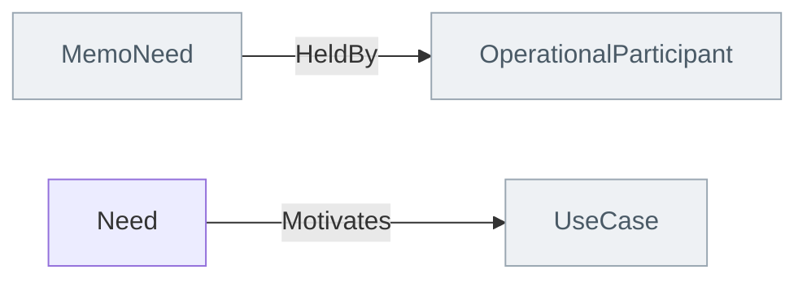

<!-- Generated by scripts/generate-sysml-api.mjs from src/assurance/requirements/. Do not edit. -->

### Elements

**Core concepts**

| Element | SysML kind | What it is |
| --- | --- | --- |
| [`RiskDriver`](../sysml-api/assurance/requirements/memo_requirements.md#riskdriver) | `part def` | Risk driver definition specializing `RequirementDriver`. |
| [`Requirement`](../sysml-api/assurance/requirements/memo_requirements.md#requirement) | `requirement def` | Requirement definition specializing `MemoRequirement`. |
| [`SystemConstant`](../sysml-api/assurance/requirements/memo_requirements.md#systemconstant) | `part def` | Named constant defined by a source requirements document (e.g. CriSys GPCA App. A.4) and referenced from requirement statements. |
| [`NotificationSpec`](../sysml-api/assurance/requirements/memo_requirements.md#notificationspec) | `part def` | One row of a notification/alarm action table (e.g. CriSys GPCA REQ 59): a named notification, its priority, and the actions the system must take. |

**Needs**

| Element | SysML kind | What it is |
| --- | --- | --- |
| [`Need`](../sysml-api/assurance/requirements/needs/memo_needs.md#need) | `requirement def` | Need definition specializing `MemoNeed`. |

### Connections at a glance

Each arrow is one relationship, from its source end to its target end. A grey box belongs to another layer.

### Relationships declared here

| Relationship | From | To | What it says |
| --- | --- | --- | --- |
| [`HeldBy`](../sysml-api/assurance/requirements/needs/memo_needs.md#heldby) | [`MemoNeed`](../sysml-api/core/common/memo_common.md#memoneed) | [`OperationalParticipant`](../sysml-api/architecture/operational/context/actors/memo_actors.md#operationalparticipant) | Whose need this is. The holder is a modelled participant — a User, with the profile IEC 62366-1 asks for, or another operational participant — so "which users does this need serve" is a question the model answers rather than a sentence a reader interprets. |

### Relationships from elsewhere that reach this layer

| Relationship | Declared in | From | To | What it says |
| --- | --- | --- | --- | --- |
| [`Motivates`](../sysml-api/architecture/operational/use_cases/memo_use_cases.md#motivates) | operational | [`Need`](../sysml-api/assurance/requirements/needs/memo_needs.md#need) | [`UseCase`](../sysml-api/architecture/operational/use_cases/memo_use_cases.md#usecase) | Typed relationship from `Need` to `UseCase`. |

### Enumerations

| Enumeration | Values |
| --- | --- |
| [`RequirementTypeKind`](../sysml-api/assurance/requirements/memo_requirements.md#requirementtypekind) | `system`, `software`, `hardware`, `ifu` |
| [`NeedKind`](../sysml-api/assurance/requirements/needs/memo_needs.md#needkind) | `user`, `clinicalUser`, `patientUser`, `business`, `service`, `regulatory`, `operational`, `designControl` |
