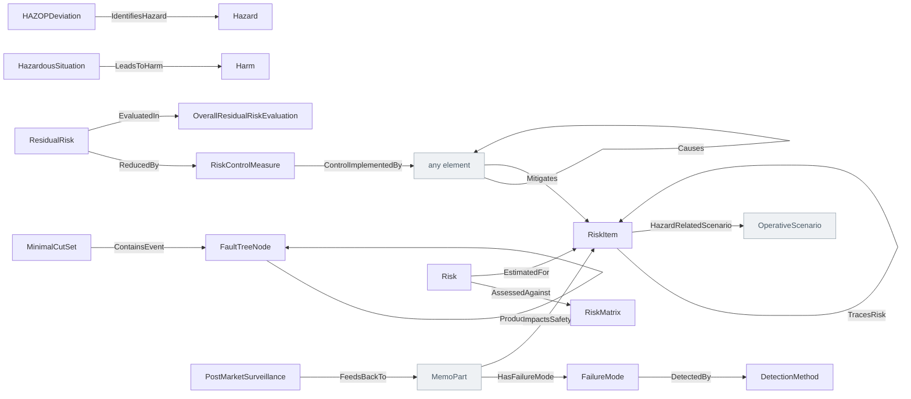

<!-- Generated by scripts/generate-sysml-api.mjs from src/assurance/safety_risk/. Do not edit. -->

### Elements

**Analysis**

| Element | SysML kind | What it is |
| --- | --- | --- |
| [`FMEAWorksheet`](../sysml-api/assurance/safety_risk/analysis/memo_fmea.md#fmeaworksheet) | `part def` | Fmeaworksheet definition specializing `AnalysisArtifact`. |
| [`FailureMode`](../sysml-api/assurance/safety_risk/analysis/memo_fmea.md#failuremode) | `item def` | Failure mode definition specializing `RiskItem`. |
| [`FailureEffect`](../sysml-api/assurance/safety_risk/analysis/memo_fmea.md#failureeffect) | `item def` | Failure effect definition specializing `RiskItem`. |
| [`FailureCause`](../sysml-api/assurance/safety_risk/analysis/memo_fmea.md#failurecause) | `item def` | Failure cause definition specializing `RiskItem`. |
| [`DetectionMethod`](../sysml-api/assurance/safety_risk/analysis/memo_fmea.md#detectionmethod) | `part def` | Detection method definition specializing `MemoPart`. |
| [`FMEAAction`](../sysml-api/assurance/safety_risk/analysis/memo_fmea.md#fmeaaction) | `part def` | Fmeaaction definition specializing `VerifiableElement`. |
| [`FaultTree`](../sysml-api/assurance/safety_risk/analysis/memo_fmea.md#faulttree) | `part def` | Fault tree definition specializing `AnalysisArtifact`. |
| [`FaultTreeNode`](../sysml-api/assurance/safety_risk/analysis/memo_fmea.md#faulttreenode) | `part def` | Fault tree node definition specializing `MemoPart`. |
| [`MinimalCutSet`](../sysml-api/assurance/safety_risk/analysis/memo_fmea.md#minimalcutset) | `item def` | Minimal cut set definition specializing `RiskItem`. |
| [`HAZOPStudy`](../sysml-api/assurance/safety_risk/analysis/memo_fmea.md#hazopstudy) | `part def` | Hazopstudy definition specializing `AnalysisArtifact`. |
| [`HAZOPNode`](../sysml-api/assurance/safety_risk/analysis/memo_fmea.md#hazopnode) | `part def` | Hazopnode definition specializing `MemoPart`. |
| [`HAZOPDeviation`](../sysml-api/assurance/safety_risk/analysis/memo_fmea.md#hazopdeviation) | `item def` | Hazopdeviation definition specializing `RiskItem`. |

**Core concepts**

| Element | SysML kind | What it is |
| --- | --- | --- |
| [`ReasonablyForeseeableMisuse`](../sysml-api/assurance/safety_risk/memo_risk.md#reasonablyforeseeablemisuse) | `part def` | ISO 14971 / IEC 62366-1 risk-analysis input. A model element so hazards, scenarios, requirements, and DHF records can trace to the foreseeable misuse that motivated them.… |
| [`Risk`](../sysml-api/assurance/safety_risk/memo_risk.md#risk) | `part def` | Risk definition specializing `RiskDriver`. |
| [`ResidualRisk`](../sysml-api/assurance/safety_risk/memo_risk.md#residualrisk) | `part def` | Residual risk definition specializing `Risk`. |
| [`RiskMatrix`](../sysml-api/assurance/safety_risk/memo_risk.md#riskmatrix) | `part def` | Risk matrix definition specializing `MemoPart`. |
| [`SafetyRelatedCharacteristic`](../sysml-api/assurance/safety_risk/memo_risk.md#safetyrelatedcharacteristic) | `part def` | Safety related characteristic definition specializing `MemoPart`. |
| [`RiskItem`](../sysml-api/assurance/safety_risk/memo_risk.md#riskitem) *(abstract)* | `item def` | Risk item definition specializing `MemoItem`. |
| [`Hazard`](../sysml-api/assurance/safety_risk/memo_risk.md#hazard) | `item def` | Hazard definition specializing `RiskItem`. |
| [`SequenceOfEvents`](../sysml-api/assurance/safety_risk/memo_risk.md#sequenceofevents) | `item def` | Sequence of events definition specializing `RiskItem`. |
| [`HazardCause`](../sysml-api/assurance/safety_risk/memo_risk.md#hazardcause) | `item def` | Hazard cause definition specializing `RiskItem`. |
| [`HazardousSituation`](../sysml-api/assurance/safety_risk/memo_risk.md#hazardoussituation) | `item def` | Hazardous situation definition specializing `RiskItem`. |
| [`Harm`](../sysml-api/assurance/safety_risk/memo_risk.md#harm) | `item def` | Harm definition specializing `RiskItem`. |
| [`RiskControlMeasure`](../sysml-api/assurance/safety_risk/memo_risk.md#riskcontrolmeasure) | `part def` | Risk control measure definition specializing `VerifiableElement`. |
| [`Benefit`](../sysml-api/assurance/safety_risk/memo_risk.md#benefit) | `part def` | Benefit definition specializing `MemoPart`. |
| [`OverallResidualRiskEvaluation`](../sysml-api/assurance/safety_risk/memo_risk.md#overallresidualriskevaluation) | `part def` | Overall residual risk evaluation definition specializing `MemoPart`. |

**Postmarket surveillance**

| Element | SysML kind | What it is |
| --- | --- | --- |
| [`PostMarketSurveillance`](../sysml-api/assurance/safety_risk/postmarket_surveillance/memo_postmarket_surveillance.md#postmarketsurveillance) | `part def` | Post market surveillance definition specializing `MemoPart`. |

### Connections at a glance

Each arrow is one relationship, from its source end to its target end. A grey box belongs to another layer.

### Relationships declared here

| Relationship | From | To | What it says |
| --- | --- | --- | --- |
| [`Causes`](../sysml-api/assurance/safety_risk/analysis/memo_fmea.md#causes) | *any element* | *any element* | Typed relationship from `any element` to `any element`. |
| [`DetectedBy`](../sysml-api/assurance/safety_risk/analysis/memo_fmea.md#detectedby) | [`FailureMode`](../sysml-api/assurance/safety_risk/analysis/memo_fmea.md#failuremode) | [`DetectionMethod`](../sysml-api/assurance/safety_risk/analysis/memo_fmea.md#detectionmethod) | Typed relationship from `FailureMode` to `DetectionMethod`. |
| [`InputToGate`](../sysml-api/assurance/safety_risk/analysis/memo_fmea.md#inputtogate) | [`FaultTreeNode`](../sysml-api/assurance/safety_risk/analysis/memo_fmea.md#faulttreenode) | [`FaultTreeNode`](../sysml-api/assurance/safety_risk/analysis/memo_fmea.md#faulttreenode) | Typed relationship from `FaultTreeNode` to `FaultTreeNode`. |
| [`ProducesEvent`](../sysml-api/assurance/safety_risk/analysis/memo_fmea.md#producesevent) | [`FaultTreeNode`](../sysml-api/assurance/safety_risk/analysis/memo_fmea.md#faulttreenode) | [`FaultTreeNode`](../sysml-api/assurance/safety_risk/analysis/memo_fmea.md#faulttreenode) | Typed relationship from `FaultTreeNode` to `FaultTreeNode`. |
| [`ContainsEvent`](../sysml-api/assurance/safety_risk/analysis/memo_fmea.md#containsevent) | [`MinimalCutSet`](../sysml-api/assurance/safety_risk/analysis/memo_fmea.md#minimalcutset) | [`FaultTreeNode`](../sysml-api/assurance/safety_risk/analysis/memo_fmea.md#faulttreenode) | Typed relationship from `MinimalCutSet` to `FaultTreeNode`. |
| [`IdentifiesHazard`](../sysml-api/assurance/safety_risk/analysis/memo_fmea.md#identifieshazard) | [`HAZOPDeviation`](../sysml-api/assurance/safety_risk/analysis/memo_fmea.md#hazopdeviation) | [`Hazard`](../sysml-api/assurance/safety_risk/memo_risk.md#hazard) | Typed relationship from `HAZOPDeviation` to `Hazard`. |
| [`HasFailureMode`](../sysml-api/assurance/safety_risk/analysis/memo_fmea.md#hasfailuremode) | [`MemoPart`](../sysml-api/core/common/memo_common.md#memopart) | [`FailureMode`](../sysml-api/assurance/safety_risk/analysis/memo_fmea.md#failuremode) | Typed relationship from `MemoPart` to `FailureMode`. |
| [`TracesRisk`](../sysml-api/assurance/safety_risk/memo_risk.md#tracesrisk) | [`RiskItem`](../sysml-api/assurance/safety_risk/memo_risk.md#riskitem) | [`RiskItem`](../sysml-api/assurance/safety_risk/memo_risk.md#riskitem) | Typed relationship from `RiskItem` to `RiskItem`. |
| [`LeadsToHarm`](../sysml-api/assurance/safety_risk/memo_risk.md#leadstoharm) | [`HazardousSituation`](../sysml-api/assurance/safety_risk/memo_risk.md#hazardoussituation) | [`Harm`](../sysml-api/assurance/safety_risk/memo_risk.md#harm) | The final ISO 14971 chain edge. P2 is the conditional probability that the hazardous situation results in the harm. |
| [`HazardRelatedScenario`](../sysml-api/assurance/safety_risk/memo_risk.md#hazardrelatedscenario) | [`RiskItem`](../sysml-api/assurance/safety_risk/memo_risk.md#riskitem) | [`OperativeScenario`](../sysml-api/architecture/operational/scenarios/memo_scenarios.md#operativescenario) | Typed relationship from `RiskItem` to `OperativeScenario`. |
| [`AssessedAgainst`](../sysml-api/assurance/safety_risk/memo_risk.md#assessedagainst) | [`Risk`](../sysml-api/assurance/safety_risk/memo_risk.md#risk) | [`RiskMatrix`](../sysml-api/assurance/safety_risk/memo_risk.md#riskmatrix) | Typed relationship from `Risk` to `RiskMatrix`. |
| [`EstimatedFor`](../sysml-api/assurance/safety_risk/memo_risk.md#estimatedfor) | [`Risk`](../sysml-api/assurance/safety_risk/memo_risk.md#risk) | [`RiskItem`](../sysml-api/assurance/safety_risk/memo_risk.md#riskitem) | Typed relationship from `Risk` to `RiskItem`. |
| [`ReducedBy`](../sysml-api/assurance/safety_risk/memo_risk.md#reducedby) | [`ResidualRisk`](../sysml-api/assurance/safety_risk/memo_risk.md#residualrisk) | [`RiskControlMeasure`](../sysml-api/assurance/safety_risk/memo_risk.md#riskcontrolmeasure) | Typed relationship from `ResidualRisk` to `RiskControlMeasure`. |
| [`EvaluatedIn`](../sysml-api/assurance/safety_risk/memo_risk.md#evaluatedin) | [`ResidualRisk`](../sysml-api/assurance/safety_risk/memo_risk.md#residualrisk) | [`OverallResidualRiskEvaluation`](../sysml-api/assurance/safety_risk/memo_risk.md#overallresidualriskevaluation) | Typed relationship from `ResidualRisk` to `OverallResidualRiskEvaluation`. |
| [`Mitigates`](../sysml-api/assurance/safety_risk/memo_risk.md#mitigates) | *any element* | [`RiskItem`](../sysml-api/assurance/safety_risk/memo_risk.md#riskitem) | Typed relationship from `any element` to `RiskItem`. |
| [`FeedsBackTo`](../sysml-api/assurance/safety_risk/postmarket_surveillance/memo_postmarket_surveillance.md#feedsbackto) | [`PostMarketSurveillance`](../sysml-api/assurance/safety_risk/postmarket_surveillance/memo_postmarket_surveillance.md#postmarketsurveillance) | [`MemoPart`](../sysml-api/core/common/memo_common.md#memopart) | Typed relationship from `PostMarketSurveillance` to `MemoPart`. |

### Relationships from elsewhere that reach this layer

| Relationship | Declared in | From | To | What it says |
| --- | --- | --- | --- | --- |
| [`ControlImplementedBy`](../sysml-api/architecture/implementation/ui/memo_ui.md#controlimplementedby) | implementation | [`RiskControlMeasure`](../sysml-api/assurance/safety_risk/memo_risk.md#riskcontrolmeasure) | *any element* | A risk control implemented by a UI element or by task design (confirmation dialog, lockout, guarded control). |
| [`ImpactsSafety`](../sysml-api/assurance/cybersecurity/memo_cybersecurity.md#impactssafety) | cybersecurity | [`MemoPart`](../sysml-api/core/common/memo_common.md#memopart) | [`RiskItem`](../sysml-api/assurance/safety_risk/memo_risk.md#riskitem) | Typed relationship from `MemoPart` to `RiskItem`. |

### Enumerations

| Enumeration | Values |
| --- | --- |
| [`CauseKind`](../sysml-api/assurance/safety_risk/analysis/memo_fmea.md#causekind) | `failureCausesEffect`, `failureCausedBy`, `contributesToHazard`, `leadsToHazard`, `originatesFrom`, `useErrorLeadsToHazard` |
| [`MitigationKind`](../sysml-api/assurance/safety_risk/memo_risk.md#mitigationkind) | `hazard`, `vulnerability`, `failureMode`, `cutSet`, `fmeaAction` |
