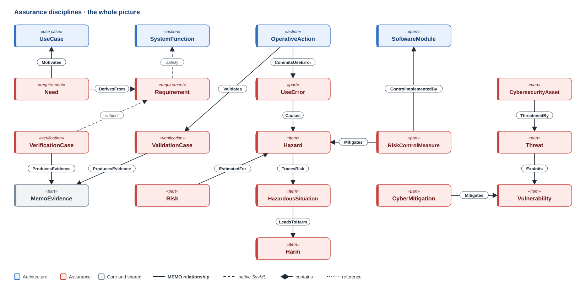
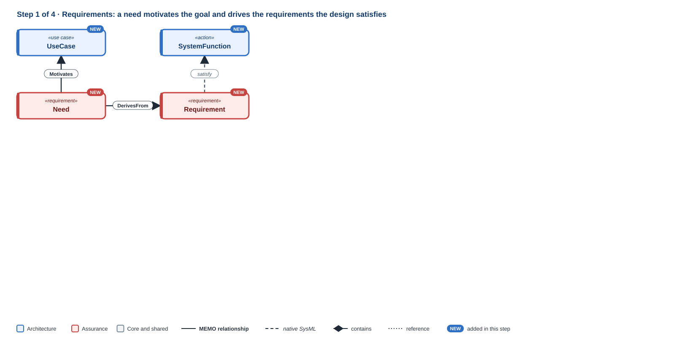
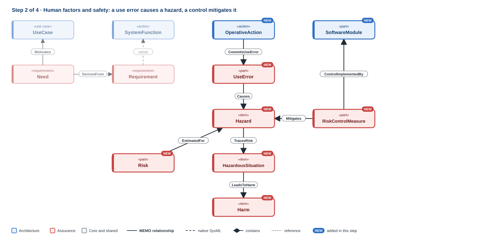
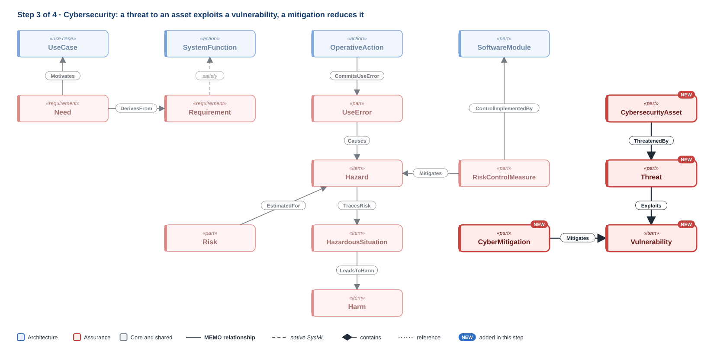
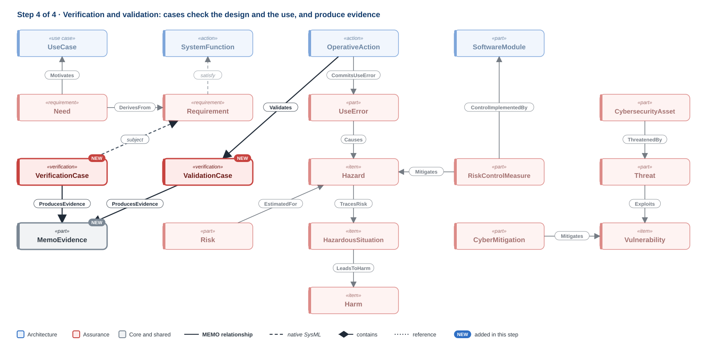

# Assurance disciplines

The assurance disciplines **test the explanation** the architecture layers give.
Each one asks a question of every layer: is the need captured, can use go wrong,
what could cause harm, what could an attacker do, and how do we know.

[{ .memo-presentation-graphic }](../../assets/ontology/assurance.svg){ title="Open full size" }

The blue boxes along the top are architecture elements, the red ones are
assurance, and the grey evidence record comes from Core. Colours and line
styles follow the
[key](../index.md#how-to-read-the-figures).

## Building it up

### Step 1 · Requirements

[{ .memo-presentation-graphic }](../../assets/ontology/assurance-step1.svg){ title="Open full size" }

A `Need` motivates a use case (`Motivates`), and requirements derive from it
(`DerivesFrom`). The design meets a requirement with native `satisfy`.

### Step 2 · Human factors and safety

[{ .memo-presentation-graphic }](../../assets/ontology/assurance-step2.svg){ title="Open full size" }

A task is where a `UseError` is committed (`CommitsUseError`), and a use error
can cause a `Hazard` (`Causes`). The hazard traces to a `HazardousSituation`
(`TracesRisk`), which leads to `Harm` (`LeadsToHarm`), the ISO 14971 chain. A
`Risk` is estimated for the hazard (`EstimatedFor`). A `RiskControlMeasure`
mitigates the hazard (`Mitigates`) and is implemented by a design element
(`ControlImplementedBy`), which is how the argument returns to the architecture.

### Step 3 · Cybersecurity

[{ .memo-presentation-graphic }](../../assets/ontology/assurance-step3.svg){ title="Open full size" }

A `CybersecurityAsset` is threatened by a `Threat` (`ThreatenedBy`), which
exploits a `Vulnerability` (`Exploits`). A `CyberMitigation` is a risk control
measure, so it mitigates the vulnerability with the same `Mitigates`
relationship safety uses.

### Step 4 · Verification and validation

[{ .memo-presentation-graphic }](../../assets/ontology/assurance-step4.svg){ title="Open full size" }

A `VerificationCase` names what it checks as its native `subject`: was the
system built right? A `ValidationCase` checks a use case or task (`Validates`):
was the right system built? Both produce `MemoEvidence` (`ProducesEvidence`),
the record a reviewer reads.

## The disciplines

Each discipline owns its own elements and connects them to the architecture
elements they are about. A hazard stays a hazard; a function stays a function.
A relationship between them says how they meet.

| Discipline | The question it answers | Key elements |
| --- | --- | --- |
| [Requirements](../requirements.md) | What must be true, and why? | `Need`, `Requirement`, `RiskDriver`, `SystemConstant` |
| [Safety and risk](../safety-risk.md) | What could cause harm, and what keeps the risk acceptable? | `Hazard`, `HazardousSituation`, `Harm`, `Risk`, `RiskControlMeasure`, `FailureMode`, `FaultTree` |
| [Cybersecurity](../cybersecurity.md) | What could an attacker do, and what stops them? | `CybersecurityAsset`, `Threat`, `Vulnerability`, `CyberRisk`, `CyberMitigation`, `TrustBoundary` |
| [Human factors](../human-factors.md) | Where can use go wrong? | `UseError`, and the tasks it is committed in |
| [Verification and validation](../verification-validation.md) | How do we know it works, and that it is the right device? | `VerificationCase`, `ValidationCase`, `TestStep`, `ClinicalEvaluation` |

## Why assurance uses MEMO's own relationships

The assurance disciplines mostly connect through MEMO's own relationships,
because they carry information the native forms do not. For example, `Causes`
records its kind of cause, and `Validates` keeps validation apart from
verification, as IEC 62304 does.

| MEMO relationship | Connects |
| --- | --- |
| `Motivates` | a need to the use case it motivates |
| `DerivesFrom` | a requirement to the need, hazard, threat or component it derives from |
| `CommitsUseError` | a task to a use error committed while performing it |
| `Causes` | a cause to its effect, such as a use error that leads to a hazard |
| `Mitigates` | a risk control to the hazard or vulnerability it reduces |
| `ControlImplementedBy` | a risk control to the design element that implements it |
| `Exploits`, `ThreatenedBy`, `ImpactsSafety` | threats to vulnerabilities, assets to threats, and security to safety |
| `Validates` | a use case, task or claim to the validation case that checks it |
| `ProducesEvidence` | a verification or validation case to the evidence it produced |
