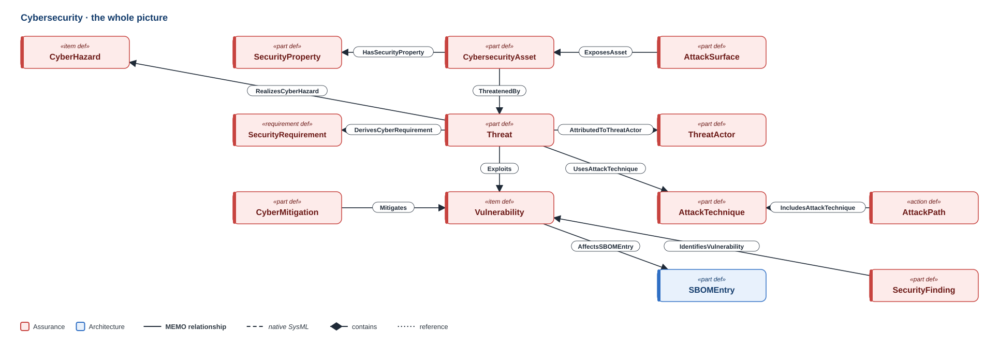
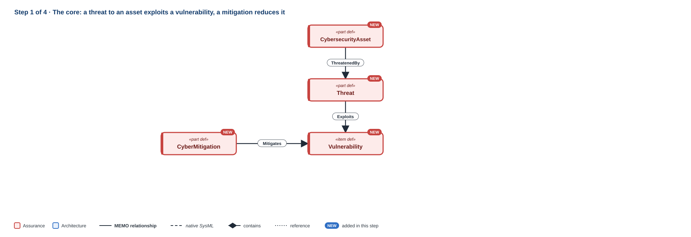
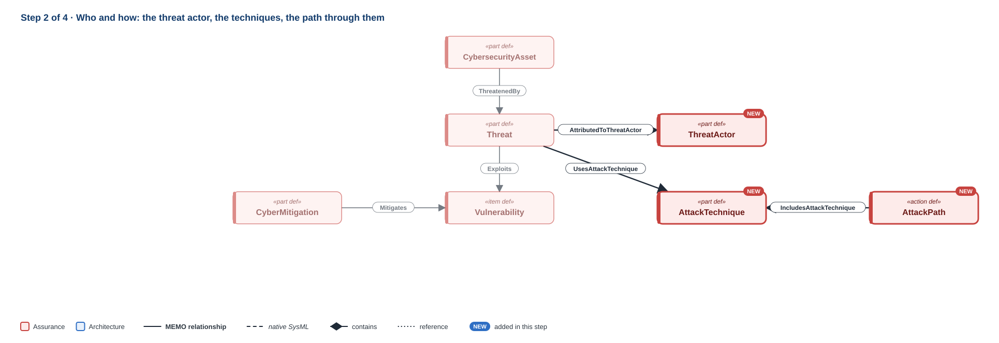
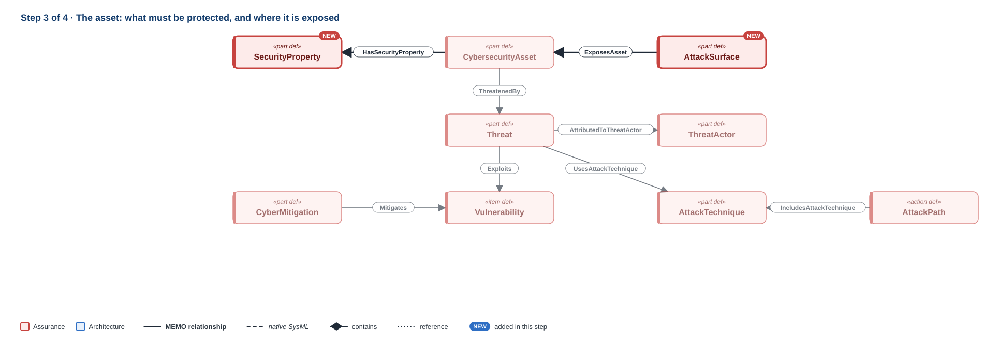
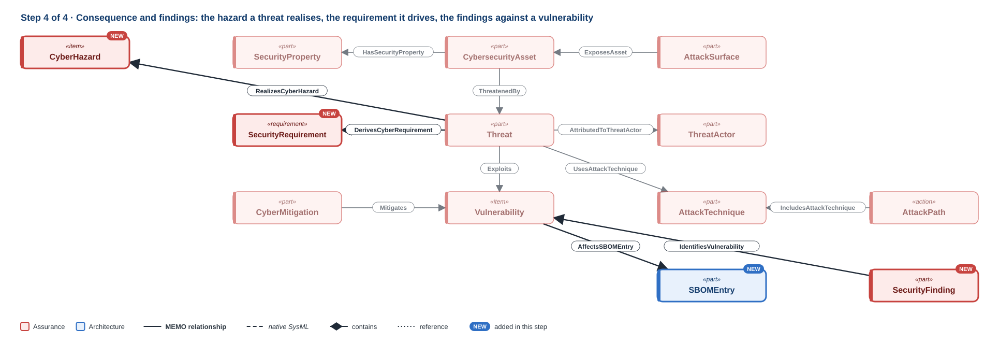

# Cybersecurity

!!! question "The question this discipline answers"
    **What could an attacker do, and what stops them?**

Cybersecurity asks what in the device is worth protecting, who could attack it and how, which weaknesses would let them, and what controls stand in the way. For a medical device the answer matters beyond the data: an attack that changes a therapy setting is a safety problem. MEMO therefore builds the security argument from the same kinds of element as the safety argument. A threat is a requirement driver, as a risk is; a vulnerability is a risk item, as a hazard is; a cyber mitigation is a risk control. Its heart is four elements: the **asset** worth protecting, the **threat** to it, the **vulnerability** the threat exploits, and the **mitigation** that reduces it.

**Namespace:** `memo::assurance::cybersecurity` · **Source:** `src/assurance/cybersecurity/`

[{ .memo-presentation-graphic }](../assets/ontology/cybersecurity.svg){ title="Open full size" }

The colours say which part of MEMO an element belongs to: **blue** is
architecture, **red** is assurance. A solid line is one of MEMO's own
relationships, a dashed line is native SysML, a diamond is containment, and a
dotted line is a reference. [How to read the figures](index.md#how-to-read-the-figures)

## Building it up

### Step 1 · The core

[{ .memo-presentation-graphic }](../assets/ontology/cybersecurity-step1.svg){ title="Open full size" }

A `CybersecurityAsset` is something worth protecting (data, a credential, a configuration, software, hardware) and states its confidentiality, integrity and availability needs. An asset is threatened (`ThreatenedBy`, in Core), and a `Threat` exploits a `Vulnerability` (`Exploits`). A threat has a category (STRIDE's six, plus privacy loss and supply chain), an attack vector, a source and preconditions. A vulnerability carries its CWE reference, CVSS v3.1 base score and vector, its CVE reference and a disposition (open, mitigated, accepted or closed). A `CyberMitigation` is a risk control, of a kind such as prevent, detect, respond, recover, hardening, authentication, authorisation, encryption, or integrity protection; it reduces a vulnerability with `Mitigates`.

### Step 2 · Who and how

[{ .memo-presentation-graphic }](../assets/ontology/cybersecurity-step2.svg){ title="Open full size" }

A `ThreatActor` is who attacks: an insider, a service technician, an opportunist, a cybercriminal, a nation state or a supply-chain party, with a motivation, a capability and the way they get access (`AttributedToThreatActor`). An `AttackTechnique` names a technique in an external framework (MITRE ATT&CK for ICS, EMB3D, CAPEC) by its identifier, so MEMO points at the framework instead of copying it (`UsesAttackTechnique`). An `AttackPath` is an operative scenario that chains techniques from an entry point to an attack goal (`IncludesAttackTechnique`).

### Step 3 · The asset: what it must keep, and where it is exposed

[{ .memo-presentation-graphic }](../assets/ontology/cybersecurity-step3.svg){ title="Open full size" }

A `SecurityProperty` is a security objective an asset must keep (confidentiality, integrity, availability, authenticity, accountability, privacy or safety) at an impact level (`HasSecurityProperty`). An `AttackSurface` is an entry point, with its exposure and whether authentication is expected (`ExposesAsset`). A `TrustBoundary` is a boundary between zones of different trust, stating the assumption made about each side and the constraint on crossing; a `CybersecurityAssumption` is a stated assumption with an owner, a review date and whether it still holds.

### Step 4 · Consequence, requirement and findings

[{ .memo-presentation-graphic }](../assets/ontology/cybersecurity-step4.svg){ title="Open full size" }

A threat realises a `CyberHazard`, a hazard with security, safety, privacy and operational impact (`RealizesCyberHazard`), and derives a `SecurityRequirement` (`DerivesCyberRequirement`, in Core). A `CyberRisk` stays the one identity of a risk; a `CyberRiskAssessment` records its state before controls (inherent) or after them (residual) without copying it (`AssessesCyberRisk`). A `SecurityAssessmentCase` (penetration test, SAST, DAST or SCA) produces a `SecurityAssessmentReport` holding `SecurityFinding`s; a finding identifies a vulnerability (`IdentifiesVulnerability`) and demonstrates an attack path (`DemonstratesAttackPath`). A vulnerability affects an `SBOMEntry` (`AffectsSBOMEntry`), which a `PostmarketProcess` monitors (`MonitorsSBOMEntry`).

## Where it leads

- **Operational:** a threat is realised by an operative scenario (`RealizedByScenario`) ([Operational](operational.md)).
- **Safety:** a security element can impact a safety risk item (`ImpactsSafety`) ([Safety and risk](safety-risk.md)).
- **Requirements:** a threat or risk derives a security requirement ([Requirements](requirements.md)).
- **Architecture:** a `TrustBoundary` is an interface element, and an element can cross one (`CrossesTrustBoundary`, in Core) ([Logical](logical.md)).

## In the running example

The temperature alarm has no security model, so this example comes from the
GPCA infusion pump. An unauthorised change to the therapy configuration through
the maintenance port is the threat. A shared default credential in service mode
is the vulnerability that enables it, and a tampered-configuration scenario is
how it plays out.

```sysml
--8<-- "examples/gpca-pump/model/catalog/gpca_cybersecurity.sysml:threat"
```

```sysml
--8<-- "examples/gpca-pump/model/catalog/gpca_cybersecurity.sysml:vulnerability"
```

```sysml
--8<-- "examples/gpca-pump/model/catalog/gpca_cybersecurity.sysml:chain"
```

<details markdown="1">
<summary><strong>Every element and relationship in this discipline</strong> (generated from <code>src/assurance/cybersecurity/</code>)</summary>

--8<-- "docs/ontology/_generated/cybersecurity.md"

</details>

<details markdown="1">
<summary><strong>The detail behind the steps</strong>: every attribute and kind the discipline defines</summary>

### Every element in detail

**What is protected.** A `CybersecurityAsset` is something worth protecting:
data, a credential, a configuration, software, hardware, and so on. It states
its confidentiality, integrity and availability needs, and whether it is
privacy- or safety-relevant.

**Where attacks enter.** An `AttackSurface` is an entry point, with its exposure
and whether authentication is expected. A `TrustBoundary` is a boundary between
zones of different trust. It states the assumption made about each side and the
constraint on crossing.

**Who attacks, and through what.** A `Threat` is a requirement driver with a
threat category. The categories are STRIDE's six (spoofing, tampering,
repudiation, information disclosure, denial of service, elevation of privilege),
plus privacy loss and supply chain. A threat also records its attack vector,
source and preconditions. A `Vulnerability` is a weakness, with its CWE
reference and CVSS v3.1 base score and vector.

**Risk and control.** A `CyberHazard` is a hazard with security, safety, privacy
and operational impact. A `CyberRisk` is a risk with exploitability, attack
complexity and patient-safety contribution. A `CyberMitigation` is a risk
control, of a kind such as prevent, detect, respond, recover, hardening,
authentication, authorisation, encryption, or integrity protection. A
`SecurityRequirement` is a requirement with a security objective.

**Product security and threat intelligence.** A `ThreatActor` is who attacks, a
`MemoActor` whose `threatActorKind` says which:
an insider, a service technician, an opportunist, a cybercriminal, a nation
state or a supply-chain party, with a motivation, a capability and the way they
get access. An `AttackTechnique` names a technique in an external framework
(MITRE ATT&CK for ICS, EMB3D, CAPEC) by its identifier, so MEMO points at the
framework instead of copying it. An `AttackPath` is an operative scenario that
chains techniques from an entry point to an attack goal. A `SecurityProperty`
is a security objective an asset must keep (confidentiality, integrity,
availability, authenticity, accountability, privacy or safety) at an impact
level. A `CybersecurityAssumption` is a stated assumption with an owner, a
review date and whether it still holds. An `SBOMEntry` is an inventory
record of the bill of materials (`SoftwareBillOfMaterials`) that points at the
software element it lists, with its supplier, license expression, checksum,
package URL and the SPDX or CycloneDX reference it came from. A
`SecurityAssessmentCase` is a verification case (penetration test, SAST, DAST or
SCA, stated once as its method) that produces a `SecurityAssessmentReport`
(`ProducesEvidence`); the report holds its `SecurityFinding`s, each with its
CVSS rating, its status and, where the method gives them, the weakness, source
location or tested endpoint. A
`PostmarketProcess` is a monitoring, disclosure, patching or incident-response
process and its cadence. A vulnerability also carries its CVE reference and a
disposition (open, mitigated, accepted or closed).

**Inherent and residual risk.** A `CyberRisk` stays the one identity of a risk.
A `CyberRiskAssessment` records its state before controls (inherent) or after
them (residual), with the probability and severity estimates, the resulting
level, whether it is acceptable, who assessed it and who approved it, without
copying the risk.

## How it connects

- **Assets are threatened** (`ThreatenedBy`, in Core), and a threat exploits a
  vulnerability (`Exploits`).
- **Threats play out in scenarios.** A threat is realised by an operative
  scenario (`RealizedByScenario`). See [Operational](operational.md).
- **Security meets safety.** A security element can impact a safety risk item
  (`ImpactsSafety`), and a mitigation reduces a vulnerability with `Mitigates`
  (`mitigationKind = vulnerability`). See [Safety and risk](safety-risk.md).
- **Threats drive requirements.** A threat or risk derives a security
  requirement (`DerivesCyberRequirement`, in Core). See
  [Requirements](requirements.md).
- **What is exposed and what it must keep.** An attack surface exposes an asset
  (`ExposesAsset`), and an asset has security properties (`HasSecurityProperty`).
- **Who, how and what follows.** A threat is attributed to an actor
  (`AttributedToThreatActor`), uses a technique (`UsesAttackTechnique`) and
  realises a cyber hazard (`RealizesCyberHazard`). An attack path includes the
  techniques it chains (`IncludesAttackTechnique`).
- **Findings and components.** A security finding identifies a
  vulnerability (`IdentifiesVulnerability`) and demonstrates an attack path
  (`DemonstratesAttackPath`). A vulnerability affects an SBOM entry
  (`AffectsSBOMEntry`), which a postmarket process monitors
  (`MonitorsSBOMEntry`).
- **Evidence and assumptions.** Evidence supports a mitigation's effectiveness
  (`SupportsMitigationEffectiveness`), an assessment assesses a cyber risk
  (`AssessesCyberRisk`), and an assumption conditions any cyber element
  (`ConditionsCyberElement`).
- **Trust boundaries sit on the architecture.** A `TrustBoundary` is an interface
  element, and an element can cross one (`CrossesTrustBoundary`, in Core). See
  [Logical](logical.md).

</details>

## Go deeper

- The GPCA infusion pump: [risk, cybersecurity, and assurance](../layers/risk-assurance.md).
- [The cybersecurity API](../sysml-api/index.md#assurance).
