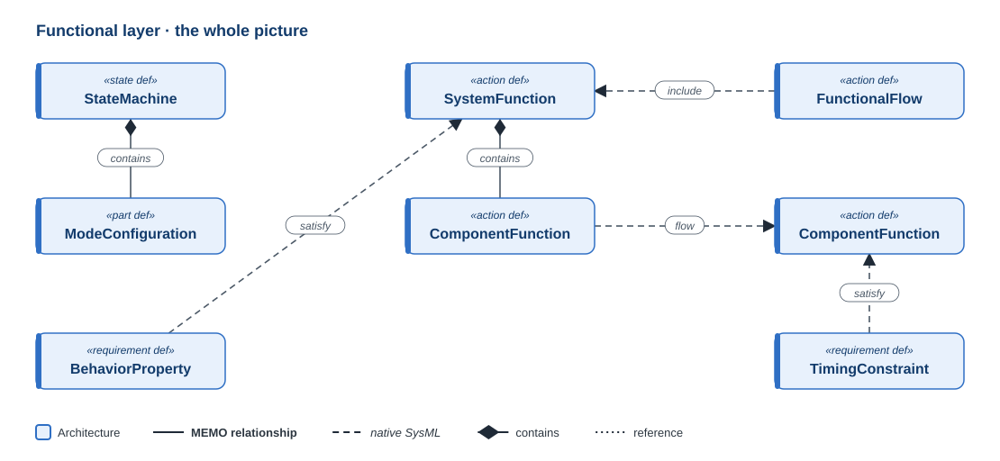
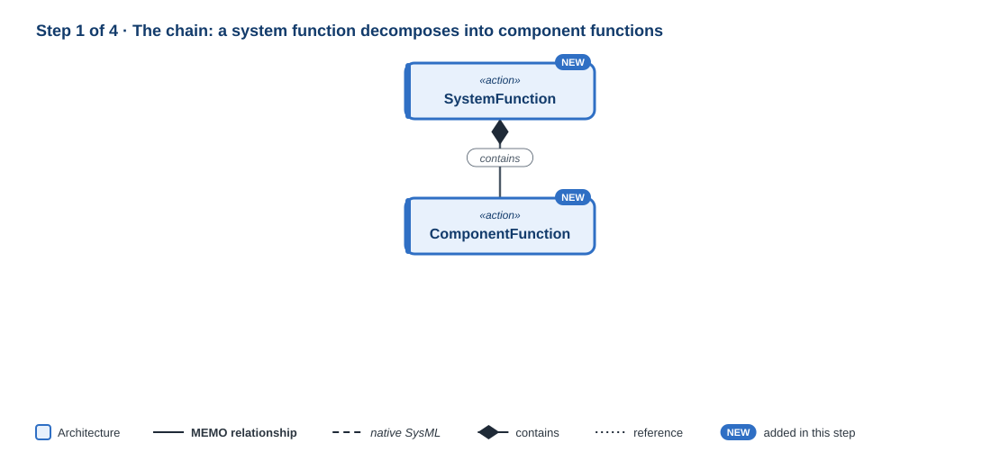
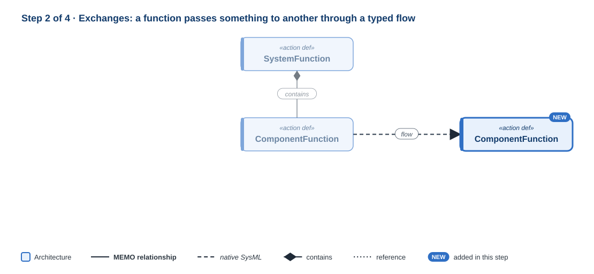
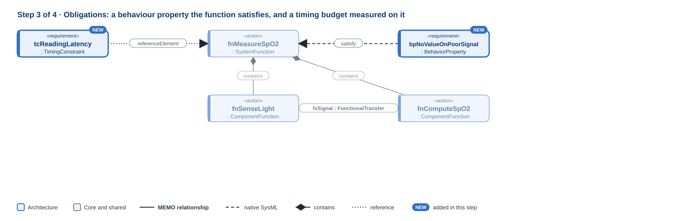
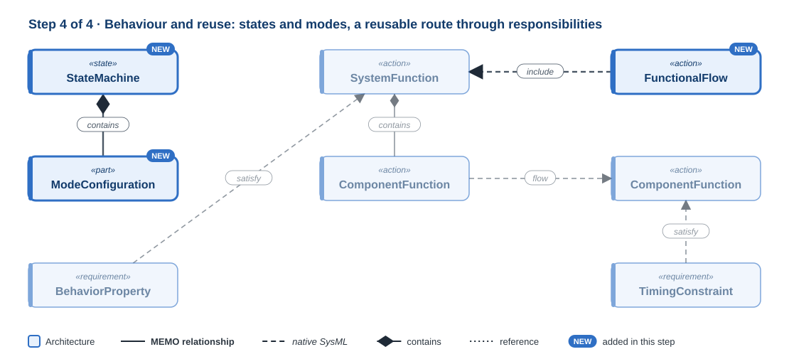

# Functional layer

!!! question "The question this layer answers"
    **What must the system do?**

The functional layer states the system's responsibilities without choosing how to meet them. A function here is technology-independent: software, electronics, mechanics or a human procedure may carry it out, and choosing which is a later layer's decision. Its heart is a chain: a **system function** (`SystemFunction`) decomposes into **component functions** (`ComponentFunction`), each the responsibility of exactly one component. Everything else on this page supports that chain.

**Namespace:** `memo::architecture::functional` · **Source:** `src/architecture/functional/`

[{ .memo-presentation-graphic }](../assets/ontology/functional.svg){ title="Open full size" }

The colours say which part of MEMO an element belongs to: **blue** is
architecture, **red** is assurance. A solid line is one of MEMO's own
relationships, a dashed line is native SysML, a diamond is containment, and a
dotted line is a reference. [How to read the figures](index.md#how-to-read-the-figures)

## How to read this page

Each step below introduces a few elements, then shows them in SysML and explains
every line: its **notation**, **what it says**, and **why** it is written that
way. One small example runs through all the steps: the functions of a pulse
oximeter that measure oxygen saturation. Each step's code adds to the previous
one, and every stage compiles and passes `memo validate`. The symbols are
collected in [Reading the notation](../tutorials/hardware/00-reading-the-notation.md);
the same ideas are built as a story in
[Model the functions, step by step](../tutorials/functional-flow/index.md).

## Building it up
### Step 1 · The chain

[{ .memo-presentation-graphic }](../assets/ontology/functional-step1.svg){ title="Open full size" }

A `SystemFunction` is a responsibility of the system as a whole. Allocating it is
optional: a system function that no single component owns is a normal
intermediate state, and it may be realised by several components, by a human, or
by a mechanism. A `ComponentFunction` is a responsibility of exactly one
component, so it must be allocated, and to one component only. A function
decomposes by native nesting: it owns its sub-functions. Both specialise
`MemoFunction`, which carries `actionKind` (the verb, such as sense, compute,
actuate or route) and `functionCategory` (the domain the project argues in, such
as therapy, alarm or protection).

#### Write it

The package, the system, two components to allocate to, and the chain:

```sysml
package layer_functional {
    private import memo::*;

    part def OximeterSystem specializes System;
    part oximeter : OximeterSystem {
        @MemoIdentity { :>> label = "Pulse oximeter"; }
    }
    part sensing : LogicalComponent {
        @MemoIdentity { :>> label = "Sensing channel"; }
    }
    part processing : LogicalComponent {
        @MemoIdentity { :>> label = "Processing channel"; }
    }

    action fnMeasureSpO2 : SystemFunction {
        @MemoIdentity { :>> providedId = "FN-1"; :>> label = "Measure oxygen saturation"; }
        attribute :>> functionCategory = "monitoring";

        action fnSenseLight : ComponentFunction {
            @MemoIdentity { :>> providedId = "FN-2"; :>> label = "Sense transmitted light"; }
            attribute :>> actionKind = ActionKind::sense;
        }
        action fnComputeSpO2 : ComponentFunction {
            @MemoIdentity { :>> providedId = "FN-3"; :>> label = "Compute SpO2"; }
            attribute :>> actionKind = ActionKind::compute;
        }
        first fnSenseLight then fnComputeSpO2;
    }
    allocate fnMeasureSpO2 to oximeter;
    allocate fnMeasureSpO2.fnSenseLight to sensing;
    allocate fnMeasureSpO2.fnComputeSpO2 to processing;
}
```

#### Line by line

```sysml
package layer_functional {
```

- **Notation.** `package` opens a namespace; everything up to its `}` belongs to it.
- **What it says.** A package for the functional model.

```sysml
private import memo::*;
```

- **Notation.** `import memo::*` makes every MEMO name usable here; `private` keeps them inside this package.
- **What it says.** MEMO's definitions can be written by short name.

```sysml
part def OximeterSystem specializes System;
```

- **Notation.** `part def` declares a definition; `specializes` makes it a kind of MEMO's `System`.
- **What it says.** The model is about a system, the pulse oximeter.
- **Why.** Every model names its system (CR-ONT-084).

```sysml
part oximeter : OximeterSystem {
    @MemoIdentity { :>> label = "Pulse oximeter"; }
}
```

- **Notation.** `part` declares a usage of the definition; `@MemoIdentity` attaches its label.
- **What it says.** There is the oximeter.
- **Why.** The system function is allocated to it below.

```sysml
part sensing : LogicalComponent {
    @MemoIdentity { :>> label = "Sensing channel"; }
}
part processing : LogicalComponent {
    @MemoIdentity { :>> label = "Processing channel"; }
}
```

- **Notation.** Two part usages typed by MEMO's `LogicalComponent`.
- **What it says.** There are two logical components: a sensing channel and a processing channel.
- **Why.** They belong to the [Logical](logical.md) layer and appear here only as the components the component functions are allocated to.

```sysml
action fnMeasureSpO2 : SystemFunction {
```

- **Notation.** `action` declares an action usage, a behaviour; `:` reads "defined by".
- **What it says.** The system has a function: measuring oxygen saturation.
- **Why.** A function is something the system does, so an `action`, never a `part`. `SystemFunction` because it is a responsibility of the whole system, before deciding which component does it.

```sysml
@MemoIdentity { :>> providedId = "FN-1"; :>> label = "Measure oxygen saturation"; }
```

- **Notation.** `@MemoIdentity { … }` attaches metadata to the element it sits in; `:>> label = "…";` gives a value to an attribute the metadata declares.
- **What it says.** Its id and display name.

```sysml
attribute :>> functionCategory = "monitoring";
```

- **Notation.** `attribute :>>` redefines an attribute the type declares and gives it a value.
- **What it says.** It belongs to the monitoring domain.
- **Why.** The category is the domain the project argues in (therapy, alarm, protection), which the safety case groups functions by. It is text, because each project names its own domains.

```sysml
action fnSenseLight : ComponentFunction {
```

- **Notation.** An action usage **inside** an action's body: one of its sub-functions.
- **What it says.** Measuring includes sensing the light that comes through the finger.
- **Why.** Nesting is decomposition, so no "decomposes into" relation is needed. `ComponentFunction` because exactly one component will own it.

```sysml
@MemoIdentity { :>> providedId = "FN-2"; :>> label = "Sense transmitted light"; }
```

- **Notation.** `@MemoIdentity { … }` attaches metadata to the element it sits in; `:>> label = "…";` gives a value to an attribute the metadata declares.
- **What it says.** Its id and display name.

```sysml
attribute :>> actionKind = ActionKind::sense;
```

- **Notation.** An enumeration value, written `EnumName::member`: `sense`, `compute`, `transform`, `validate`, `route`, `store`, `present`, `actuate`, …
- **What it says.** The verb of this function is *sense*.
- **Why.** The verb and the category are two separate axes: a function can be `sense` in the `protection` category, and a safety argument reasons about both.

```sysml
}
```

- **Notation.** Closes the sub-function.

```sysml
action fnComputeSpO2 : ComponentFunction {
    @MemoIdentity { :>> providedId = "FN-3"; :>> label = "Compute SpO2"; }
    attribute :>> actionKind = ActionKind::compute;
}
```

- **Notation.** As above.
- **What it says.** And computing the saturation.

```sysml
first fnSenseLight then fnComputeSpO2;
```

- **Notation.** `first a then b` is a succession.
- **What it says.** Computing starts after sensing ends.
- **Why.** A function that nothing triggers and nothing follows is unreachable behaviour; the succession puts both in the chain (CR-MED-023).

```sysml
}
```

- **Notation.** Closes the system function.

```sysml
allocate fnMeasureSpO2 to oximeter;
```

- **Notation.** `allocate a to b`: `b` carries out responsibility `a`.
- **What it says.** The oximeter carries out the system function.
- **Why.** Optional for a system function, but recommended (CR-MED-022, a warning).

```sysml
allocate fnMeasureSpO2.fnSenseLight to sensing;
allocate fnMeasureSpO2.fnComputeSpO2 to processing;
```

- **Notation.** Allocations; the dotted path reaches a sub-function (`.` is "the feature of").
- **What it says.** Each component function goes to one component.
- **Why.** A component function is allocated to exactly one component: none, or two, is an error (CR-ONT-074), because a responsibility nobody owns, or two components share, is one nobody answers for. Allocation is the line between the function tree and the component tree; never nest one in the other.

```sysml
}
```

- **Notation.** Closes the package.

### Step 2 · Exchanges

[{ .memo-presentation-graphic }](../assets/ontology/functional-step2.svg){ title="Open full size" }

Functions pass things to each other. What passes is an **item**, defined once.
Each function declares what it takes in and gives out as directed parameters
(`in item`, `out item`). An exchange (`FunctionalExchange`) is written as a
typed, named SysML `flow` from one function's `out` parameter to another's `in`
parameter, so the edge is the exchange, and it carries the budgets and
assurance attributes of the transfer.

#### Write it

Before `fnMeasureSpO2`:

```sysml
item def PhotoSignal specializes InterfaceItem {
    @MemoIdentity { :>> label = "Photodiode signal"; }
    attribute :>> itemKind = InterfaceItemKind::signal;
}
```

Inside `fnSenseLight` and inside `fnComputeSpO2`, after `actionKind`:

```sysml
out item photoSignal : PhotoSignal;
in item photoSignal : PhotoSignal;
```

Inside `fnMeasureSpO2`, after the succession:

```sysml
flow fxSignal : FunctionalTransfer from fnSenseLight.photoSignal to fnComputeSpO2.photoSignal {
    @MemoIdentity { :>> label = "Photodiode signal to computation"; }
    attribute :>> flowKind = FlowKind::measurement;
    attribute :>> latencyBudgetMs = 200 [milli*s];
}
```

#### Line by line

```sysml
item def PhotoSignal specializes InterfaceItem {
```

- **Notation.** `item def` declares an item definition, a kind of thing that can flow; `specializes` makes it a kind of `InterfaceItem`.
- **What it says.** A photodiode signal is a kind of interface item.
- **Why.** Defined once and used at both ends, so the compiler can check that what one function gives is what the other takes.

```sysml
@MemoIdentity { :>> label = "Photodiode signal"; }
```

- **Notation.** `@MemoIdentity { … }` attaches metadata to the element it sits in; `:>> label = "…";` gives a value to an attribute the metadata declares.
- **What it says.** Its display name.

```sysml
attribute :>> itemKind = InterfaceItemKind::signal;
```

- **Notation.** An enumeration value: `data`, `command`, `signal`, `material`, `energy`, `fluid`, `mechanicalForce`, …
- **What it says.** It is a signal.
- **Why.** The kind decides what can go wrong with it: a signal degrades, data is corrupted, a fluid leaks.

```sysml
}
```

- **Notation.** Closes the definition.

```sysml
out item photoSignal : PhotoSignal;
in item photoSignal : PhotoSignal;
```

- **Notation.** `out item` and `in item` declare directed parameters of the action they are written in. The first goes in `fnSenseLight`, the second in `fnComputeSpO2`.
- **What it says.** Sensing gives out a photodiode signal; computing takes one in.
- **Why.** Parameters are a function's contract: anything connected to it must supply or accept exactly this, and every place the function is used inherits it.

```sysml
flow fxSignal : FunctionalTransfer from fnSenseLight.photoSignal to fnComputeSpO2.photoSignal {
```

- **Notation.** `flow name : Type from a to b`. The ends are parameters: `fnSenseLight.photoSignal` is the `photoSignal` output of `fnSenseLight`.
- **What it says.** The signal passes from sensing to computing.
- **Why.** A flow, because something moves, from an `out` to an `in`. `FunctionalTransfer` is MEMO's concrete exchange type; its parent `FunctionalExchange` is abstract. Written inside `fnMeasureSpO2` because both ends are its sub-functions.

```sysml
@MemoIdentity { :>> label = "Photodiode signal to computation"; }
```

- **Notation.** `@MemoIdentity { … }` attaches metadata to the element it sits in; `:>> label = "…";` gives a value to an attribute the metadata declares.
- **What it says.** Its display name.
- **Why.** A named exchange has an id that allocations, requirements and tests can point at.

```sysml
attribute :>> flowKind = FlowKind::measurement;
```

- **Notation.** An enumeration value: `information`, `command`, `status`, `telemetry`, `alarm`, `configuration`, `measurement`, …
- **What it says.** What crosses is a measurement.
- **Why.** Commands, alarms and measurements fail differently and are budgeted differently.

```sysml
attribute :>> latencyBudgetMs = 200 [milli*s];
```

- **Notation.** `200 [milli*s]` is a quantity: 200 of the unit `milli*s`, the SI prefix times the second, which is how SysML writes milliseconds.
- **What it says.** The signal must reach the computation within 200 ms.
- **Why.** A budget is a duration, so a quantity with a unit that can be summed along a chain. The short symbol `[ms]` does not resolve.

```sysml
}
```

- **Notation.** Closes the exchange.

### Step 3 · Obligations

[{ .memo-presentation-graphic }](../assets/ontology/functional-step3.svg){ title="Open full size" }

A `BehaviorProperty` is a behavioural obligation: an invariant, a transition
rule, a temporal claim, an assumption or a guarantee. It is a `requirement def`,
so the design must meet it (native `satisfy`) and a verification case can check
it. `TimingConstraint` is a requirement of the same kind for a time budget, and
`Contract` gathers the assumptions and guarantees of one component (AGREE's
shape); it is not shown here.

#### Write it

After the allocations:

```sysml
requirement bpNoValueOnPoorSignal : BehaviorProperty {
    @MemoIdentity { :>> providedId = "BP-1"; :>> label = "No value shown on a poor signal"; }
    attribute :>> propertyKind = BehaviorPropertyKind::safetyProperty;
    attribute :>> languageKind = PropertyLanguageKind::naturalLanguage;
    attribute :>> formalExpression = "whenever the signal quality is below threshold, no SpO2 value is displayed";
}
satisfy bpNoValueOnPoorSignal by fnMeasureSpO2;

requirement tcReadingLatency : TimingConstraint {
    @MemoIdentity { :>> providedId = "TC-1"; :>> label = "Reading within one second"; }
    attribute :>> constraintKind = TimingConstraintKind::latency;
    attribute :>> maxMs = 1 [s];
    ref :>> referenceElement = fnMeasureSpO2;
    attribute :>> verificationMethod = MemoVerificationMethodKind::test;
}
```

#### Line by line

```sysml
requirement bpNoValueOnPoorSignal : BehaviorProperty {
```

- **Notation.** `requirement` declares a requirement usage.
- **What it says.** There is a behavioural obligation: no value on a poor signal.
- **Why.** A property of behaviour is a claim the design must meet and a test can check, which is exactly what a requirement is, so MEMO makes it one rather than a note on the function.

```sysml
@MemoIdentity { :>> providedId = "BP-1"; :>> label = "No value shown on a poor signal"; }
```

- **Notation.** `@MemoIdentity { … }` attaches metadata to the element it sits in; `:>> label = "…";` gives a value to an attribute the metadata declares.
- **What it says.** Its id and display name.

```sysml
attribute :>> propertyKind = BehaviorPropertyKind::safetyProperty;
```

- **Notation.** An enumeration value: `stateInvariant`, `transitionRule`, `temporalProperty`, `safetyProperty`, `livenessProperty`, `assumption` or `guarantee`.
- **What it says.** It is a safety property: something bad never happens.
- **Why.** Safety and liveness properties are checked by different techniques, so the kind is stated.

```sysml
attribute :>> languageKind = PropertyLanguageKind::naturalLanguage;
```

- **Notation.** An enumeration value: `naturalLanguage`, `pseudoFormal`, `agreeLike`, `ltlLike` or `ctlLike`.
- **What it says.** The property is written in plain language.
- **Why.** Temporal logic is not SysML's expression language, so the property is text and this says which language a tool should read it in.

```sysml
attribute :>> formalExpression = "whenever the signal quality is below threshold, no SpO2 value is displayed";
```

- **Notation.** A text value.
- **What it says.** The property itself.
- **Why.** A property that is a plain Boolean expression over features is written as a native `require constraint { … }` in the body instead.

```sysml
}
```

- **Notation.** Closes the property.

```sysml
satisfy bpNoValueOnPoorSignal by fnMeasureSpO2;
```

- **Notation.** `satisfy r by x` is SysML's satisfaction statement.
- **What it says.** The measuring function meets the property.
- **Why.** Satisfied by the function, so it holds whatever implements the function.

```sysml
requirement tcReadingLatency : TimingConstraint {
```

- **Notation.** A requirement usage.
- **What it says.** There is a timing constraint: a reading within one second.
- **Why.** A time budget is an obligation like any other, so a requirement.

```sysml
@MemoIdentity { :>> providedId = "TC-1"; :>> label = "Reading within one second"; }
```

- **Notation.** `@MemoIdentity { … }` attaches metadata to the element it sits in; `:>> label = "…";` gives a value to an attribute the metadata declares.
- **What it says.** Its id and display name.

```sysml
attribute :>> constraintKind = TimingConstraintKind::latency;
```

- **Notation.** An enumeration value: `deadline`, `period`, `jitter`, `latency`, `separation` or `burstInterval`.
- **What it says.** It limits latency.

```sysml
attribute :>> maxMs = 1 [s];
```

- **Notation.** A quantity: one second.
- **What it says.** At most one second.
- **Why.** The value is a duration with a unit; the `Ms` in the attribute name does not fix the unit.

```sysml
ref :>> referenceElement = fnMeasureSpO2;
```

- **Notation.** `ref` points at an element owned elsewhere; `:>>` redefines the reference `TimingConstraint` declares.
- **What it says.** The budget is measured on the measuring function.
- **Why.** A budget only means something against what it times; the reference may be a function, a flow or a port.

```sysml
attribute :>> verificationMethod = MemoVerificationMethodKind::test;
```

- **Notation.** An enumeration value.
- **What it says.** It will be verified by test.

```sysml
}
```

- **Notation.** Closes the constraint.

### Step 4 · Behaviour and reuse

[{ .memo-presentation-graphic }](../assets/ontology/functional-step4.svg){ title="Open full size" }

A `StateMachine` and its mode states are native SysML states, with native
`transition`s inside them. A `ModeConfiguration` is the selection made at a
`variation` choice point: which mode is active in one arrangement; it is not
shown here. A `FunctionalFlow` is a reusable route through several
responsibilities: each of its steps is one position of an existing function.

#### Write it

After the timing constraint:

```sysml
state oximeterModes : StateMachine {
    @MemoIdentity { :>> label = "Oximeter modes"; }
    state standby : MemoState {
        attribute :>> stateKind = StateKind::mode;
    }
    state measuring : MemoState {
        attribute :>> stateKind = StateKind::mode;
    }
    transition tStart first standby then measuring {
        @TransitionRecord { :>> trigger = "finger detected"; }
    }
    transition tStop first measuring then standby {
        @TransitionRecord { :>> trigger = "finger removed"; }
    }
}

action fcSpotReading : FunctionalFlow {
    @MemoIdentity { :>> providedId = "FF-1"; :>> label = "Produce a spot reading"; }
    attribute :>> flowCategory = FunctionalFlowKind::nominal;
    action sense :> fnMeasureSpO2.fnSenseLight;
    action compute :> fnMeasureSpO2.fnComputeSpO2;
    first sense then compute;
    flow senseToCompute : FunctionalTransfer from sense.photoSignal to compute.photoSignal {
        attribute :>> flowKind = FlowKind::measurement;
    }
}
```

#### Line by line

```sysml
state oximeterModes : StateMachine {
```

- **Notation.** `state` declares a state usage, SysML's own construct for behaviour by mode.
- **What it says.** The oximeter has a state machine of modes.
- **Why.** A state machine is a behaviour, so it is a `state`, not a part. `StateMachine` adds its execution semantics.

```sysml
@MemoIdentity { :>> label = "Oximeter modes"; }
```

- **Notation.** `@MemoIdentity { … }` attaches metadata to the element it sits in; `:>> label = "…";` gives a value to an attribute the metadata declares.
- **What it says.** Its display name.

```sysml
state standby : MemoState {
    attribute :>> stateKind = StateKind::mode;
}
```

- **Notation.** A state nested in the machine; `stateKind` is an enumeration, `mode` or `logical`.
- **What it says.** One mode is standby.
- **Why.** Nesting a state in the machine is what makes it one of its modes.

```sysml
state measuring : MemoState {
    attribute :>> stateKind = StateKind::mode;
}
```

- **Notation.** As above.
- **What it says.** The other mode is measuring.

```sysml
transition tStart first standby then measuring {
```

- **Notation.** `transition name first a then b` declares a transition from state `a` to state `b`, inside the machine whose states it connects.
- **What it says.** The oximeter goes from standby to measuring.
- **Why.** A native transition, so tools that simulate state machines can run it.

```sysml
@TransitionRecord { :>> trigger = "finger detected"; }
```

- **Notation.** `@TransitionRecord` is MEMO metadata on the transition.
- **What it says.** What triggers it, in words.
- **Why.** A transition has no MEMO type of its own to carry this, so a metadata record does. It is a summary; an executable trigger is a native `accept`.

```sysml
}
```

- **Notation.** Closes the transition.

```sysml
transition tStop first measuring then standby {
    @TransitionRecord { :>> trigger = "finger removed"; }
}
```

- **Notation.** As above.
- **What it says.** And back to standby when the finger is removed.

```sysml
}
```

- **Notation.** Closes the machine.

```sysml
action fcSpotReading : FunctionalFlow {
```

- **Notation.** An action usage typed by MEMO's `FunctionalFlow`.
- **What it says.** There is a functional route that produces a spot reading.
- **Why.** A route is reusable and named on its own: other routes (an alarm, start-up) can pass through some of the same functions.

```sysml
@MemoIdentity { :>> providedId = "FF-1"; :>> label = "Produce a spot reading"; }
```

- **Notation.** `@MemoIdentity { … }` attaches metadata to the element it sits in; `:>> label = "…";` gives a value to an attribute the metadata declares.
- **What it says.** Its id and display name.

```sysml
attribute :>> flowCategory = FunctionalFlowKind::nominal;
```

- **Notation.** An enumeration value: `nominal`, `error`, `degraded`, `alarm`, `startup`, `shutdown`, `calibration`, …
- **What it says.** This is the normal route.

```sysml
action sense :> fnMeasureSpO2.fnSenseLight;
action compute :> fnMeasureSpO2.fnComputeSpO2;
```

- **Notation.** `:>` on a usage means "subsets": each step is one occurrence of the function after it and inherits its parameters.
- **What it says.** The route senses, then computes.
- **Why.** A step is not a new function but a position of an existing one, so a test or a budget can name *this* position without being claimed for every place the function is used.

```sysml
first sense then compute;
```

- **Notation.** A succession.
- **What it says.** The order of the route.

```sysml
flow senseToCompute : FunctionalTransfer from sense.photoSignal to compute.photoSignal {
    attribute :>> flowKind = FlowKind::measurement;
}
```

- **Notation.** An exchange between the steps' parameters, as in step 2.
- **What it says.** Within this route, the signal passes from sensing to computing.
- **Why.** The exchange belongs to the route: another route through the same functions may exchange something else.

```sysml
}
```

- **Notation.** Closes the route.

## Where it leads

- **Up to [Operational](operational.md):** an operative action, or a UI action in the implementation layer, `perform`s a function. The operational layer asks the question; this one answers it.
- **Down to [Logical](logical.md):** functions are allocated to components with native `allocate`. A component function is allocated to exactly one.
- **Across to assurance:** requirements are satisfied by functions with native `satisfy` ([Requirements](requirements.md)), and a verification case names a function as its `subject` ([Verification and validation](verification-validation.md)).

## Rules that check this layer

Each was triggered deliberately on a model like this one to confirm `memo validate` reports it:

| Mistake | Rule |
|---|---|
| a component function allocated to two components | CR-ONT-074 |
| a high- or catastrophic-criticality function with no verification case | CR-ONT-040 |
| a function no succession, flow or performer reaches | CR-MED-023 |
| a system function performed from a level-1 operational step | CR-ONT-097 |

<details markdown="1">
<summary><strong>The whole example</strong> (all four steps; compiles and validates)</summary>

```sysml
package layer_functional {
    private import memo::*;

    part def OximeterSystem specializes System;
    part oximeter : OximeterSystem {
        @MemoIdentity { :>> label = "Pulse oximeter"; }
    }
    part sensing : LogicalComponent {
        @MemoIdentity { :>> label = "Sensing channel"; }
    }
    part processing : LogicalComponent {
        @MemoIdentity { :>> label = "Processing channel"; }
    }

    item def PhotoSignal specializes InterfaceItem {
        @MemoIdentity { :>> label = "Photodiode signal"; }
        attribute :>> itemKind = InterfaceItemKind::signal;
    }

    action fnMeasureSpO2 : SystemFunction {
        @MemoIdentity { :>> providedId = "FN-1"; :>> label = "Measure oxygen saturation"; }
        attribute :>> functionCategory = "monitoring";

        action fnSenseLight : ComponentFunction {
            @MemoIdentity { :>> providedId = "FN-2"; :>> label = "Sense transmitted light"; }
            attribute :>> actionKind = ActionKind::sense;
            out item photoSignal : PhotoSignal;
        }
        action fnComputeSpO2 : ComponentFunction {
            @MemoIdentity { :>> providedId = "FN-3"; :>> label = "Compute SpO2"; }
            attribute :>> actionKind = ActionKind::compute;
            in item photoSignal : PhotoSignal;
        }
        first fnSenseLight then fnComputeSpO2;

        flow fxSignal : FunctionalTransfer from fnSenseLight.photoSignal to fnComputeSpO2.photoSignal {
            @MemoIdentity { :>> label = "Photodiode signal to computation"; }
            attribute :>> flowKind = FlowKind::measurement;
            attribute :>> latencyBudgetMs = 200 [milli*s];
        }
    }
    allocate fnMeasureSpO2 to oximeter;
    allocate fnMeasureSpO2.fnSenseLight to sensing;
    allocate fnMeasureSpO2.fnComputeSpO2 to processing;

    requirement bpNoValueOnPoorSignal : BehaviorProperty {
        @MemoIdentity { :>> providedId = "BP-1"; :>> label = "No value shown on a poor signal"; }
        attribute :>> propertyKind = BehaviorPropertyKind::safetyProperty;
        attribute :>> languageKind = PropertyLanguageKind::naturalLanguage;
        attribute :>> formalExpression = "whenever the signal quality is below threshold, no SpO2 value is displayed";
    }
    satisfy bpNoValueOnPoorSignal by fnMeasureSpO2;

    requirement tcReadingLatency : TimingConstraint {
        @MemoIdentity { :>> providedId = "TC-1"; :>> label = "Reading within one second"; }
        attribute :>> constraintKind = TimingConstraintKind::latency;
        attribute :>> maxMs = 1 [s];
        ref :>> referenceElement = fnMeasureSpO2;
        attribute :>> verificationMethod = MemoVerificationMethodKind::test;
    }

    state oximeterModes : StateMachine {
        @MemoIdentity { :>> label = "Oximeter modes"; }
        state standby : MemoState {
            attribute :>> stateKind = StateKind::mode;
        }
        state measuring : MemoState {
            attribute :>> stateKind = StateKind::mode;
        }
        transition tStart first standby then measuring {
            @TransitionRecord { :>> trigger = "finger detected"; }
        }
        transition tStop first measuring then standby {
            @TransitionRecord { :>> trigger = "finger removed"; }
        }
    }

    action fcSpotReading : FunctionalFlow {
        @MemoIdentity { :>> providedId = "FF-1"; :>> label = "Produce a spot reading"; }
        attribute :>> flowCategory = FunctionalFlowKind::nominal;
        action sense :> fnMeasureSpO2.fnSenseLight;
        action compute :> fnMeasureSpO2.fnComputeSpO2;
        first sense then compute;
        flow senseToCompute : FunctionalTransfer from sense.photoSignal to compute.photoSignal {
            attribute :>> flowKind = FlowKind::measurement;
        }
    }
}
```

</details>

## In the running example

*Detect temperature deviation* is a high-criticality system function. The
comment in the example makes the layering explicit: the function's safety and
verification character are relationships to assurance elements, not tags on
the function.

```sysml
--8<-- "examples/temperature-alarm/model/catalog/temperature_alarm.sysml:functional"
```

<details markdown="1">
<summary><strong>Every element and relationship in this layer</strong> (generated from <code>src/architecture/functional/</code>)</summary>

--8<-- "docs/ontology/_generated/functional.md"

</details>

<details markdown="1">
<summary><strong>The detail behind the steps</strong>: every attribute and kind the layer defines</summary>

### Every element in detail

**Functions.** A `SystemFunction` is a responsibility of the system as a whole.
Allocating it is optional: a system function that no single component owns is a
normal intermediate state of the chain, and it may be realised by several
components, by a human, or by a mechanism. A `ComponentFunction` is a
responsibility of exactly one component, so it must be allocated, and to one
component only. Both specialise `MemoFunction`, which carries:

- `actionKind`, the verb, such as sense, compute, actuate or route;
- `functionCategory`, the domain the project argues in, such as therapy, alarm
  or protection.

**Exchanges and flows.** A `FunctionalExchange` is a transfer between two
functions. It is written as a typed, named SysML `flow` from one function's
`out` parameter to another's `in` parameter, so the edge is the exchange, and
it carries the budgets and assurance attributes of the transfer. A
`FunctionalFlow` is a reusable route through several responsibilities.

**Behaviour.** A `StateMachine` and its mode states are native SysML states.
Transitions are native `transition`s inside them. A `ModeConfiguration` is the
selection made at a `variation` choice point: which mode and elements are active
in one arrangement.

**Obligations on behaviour.** A `BehaviorProperty` is a behavioural obligation:
an invariant, a transition rule, a temporal claim, an assumption, or a
guarantee. It is a `requirement def`, so the design must meet it and a
verification case can check it. `Contract` and `TimingConstraint` are
requirement definitions of the same kind.

## How it connects

**Within the layer.** Functions decompose by native nesting: a function owns
its sub-functions. Exchanges connect function parameters with typed `flow`s.

**To other layers and disciplines:**

- **Operational work is carried out by functions.** An operative action, or a
  UI action in the implementation layer, `perform`s a function. See
  [Operational](operational.md).
- **Functions are allocated to components** with native `allocate`. A component
  function is allocated to exactly one. See [Logical](logical.md).
- **Requirements** are satisfied by functions with native `satisfy`, and a
  `BehaviorProperty` is itself a requirement. See [Requirements](requirements.md).
- **Verification** names a function as the `subject` of a verification case. See
  [Verification and validation](verification-validation.md).

</details>

## Go deeper

- The GPCA infusion pump: [functional analysis](../layers/operations-system.md).
- [Naming and native constructs](../reference/naming-and-native-constructs.md):
  why an exchange is a `flow`, and when a hop is a `binding` instead.
- [The functional API](../sysml-api/index.md#architecture).
