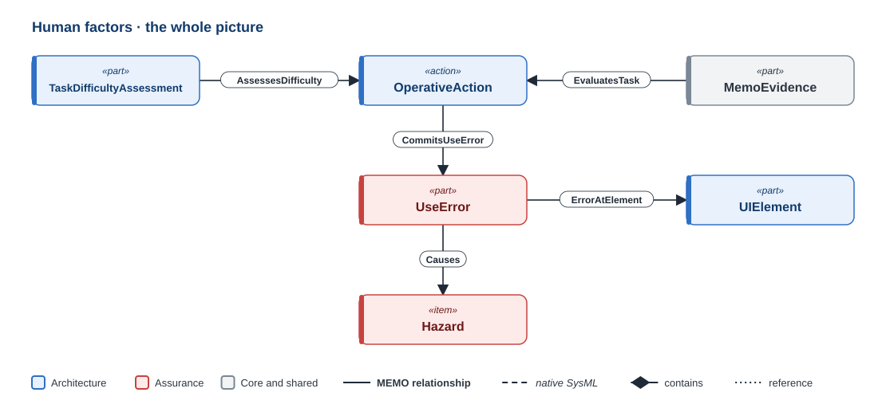
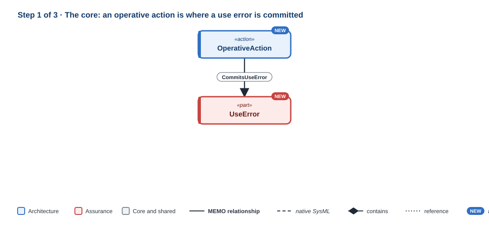
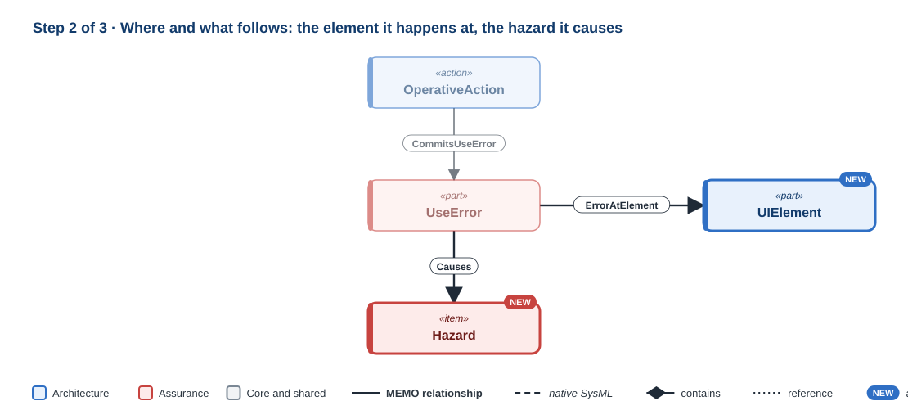
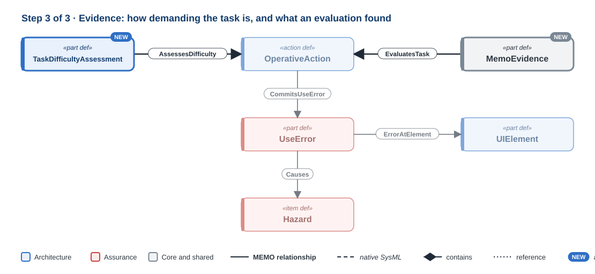

# Human factors

!!! question "The question this discipline answers"
    **Where can use go wrong?**

Human factors follows IEC 62366-1 and the FDA's human factors guidance. A user performs tasks. Some tasks are critical, and while performing one a user can commit a **use error** (`UseError`). A use error can lead to a hazard, a risk control addresses the hazard, and usability validation shows, with representative users, that the design works. Most of that chain belongs to other parts of MEMO: the user and the task are operational, the hazard and the control are safety, and the validation case is verification and validation. Human factors owns the use error, and the relationships that tie the usability argument together.

**Namespace:** `memo::assurance::human_factors` · **Source:** `src/assurance/human_factors/`

[{ .memo-presentation-graphic }](../assets/ontology/human-factors.svg){ title="Open full size" }

The colours say which part of MEMO an element belongs to: **blue** is
architecture, **red** is assurance. A solid line is one of MEMO's own
relationships, a dashed line is native SysML, a diamond is containment, and a
dotted line is a reference. [How to read the figures](index.md#how-to-read-the-figures)

## Building it up

### Step 1 · The core

[{ .memo-presentation-graphic }](../assets/ontology/human-factors-step1.svg){ title="Open full size" }

A `UseError` records a use error in the sense of IEC 62366-1. Its `errorCategory` classifies it as a perception, cognition, action, or memory and recall error, and it records its severity and the type of its root cause. A task is where an error is committed: `CommitsUseError` links an operative action to a use error.

### Step 2 · Where, and what follows

[{ .memo-presentation-graphic }](../assets/ontology/human-factors-step2.svg){ title="Open full size" }

An error happens at an element: `ErrorAtElement` links a use error to the design element it occurs at, such as a UI element (it is declared in the UI package). An error can lead to a hazard: `Causes`, with `causeKind = useErrorLeadsToHazard`.

### Step 3 · Evidence

[{ .memo-presentation-graphic }](../assets/ontology/human-factors-step3.svg){ title="Open full size" }

A `TaskDifficultyAssessment` records how demanding a task is in its context (`AssessesDifficulty`). Usability evidence evaluates a task (`EvaluatesTask`). A UI element or task is tested for usability (`TestedByUsability`), which links it to the usability test, a validation case, not the evidence it produces; `ProducesEvidence` links the two. A task is validated by the validation case that checks it (`Validates`).

## Where it leads

- **Operational:** the user and the task live in [Operational](operational.md).
- **Safety:** the hazard and the control live in [Safety and risk](safety-risk.md).
- **Implementation:** the element where the error happens lives in [Implementation](implementation.md).
- **Validation:** summative evaluation is a `ValidationCase` with `MemoEvidence` ([Verification and validation](verification-validation.md)).

## In the running example

The use error is silencing the alarm without assessing it, a memory and recall
error with serious severity. It is committed during the acknowledgement task, and
it leads to the hazard of an undetected deviation.

```sysml
--8<-- "examples/temperature-alarm/model/catalog/temperature_alarm.sysml:human-factors"
```

<details markdown="1">
<summary><strong>Every element and relationship in this discipline</strong> (generated from <code>src/assurance/human_factors/</code>)</summary>

--8<-- "docs/ontology/_generated/human-factors.md"

</details>

<details markdown="1">
<summary><strong>The detail behind the steps</strong>: every attribute and kind the discipline defines</summary>

### Every element in detail

**Use errors.** A `UseError` records a use error in the sense of IEC 62366-1.
Its `errorCategory` classifies it as a perception, cognition, action, or
memory and recall error. It also
records its severity and the type of its root cause.

**What it builds on.** The rest of the chain uses elements from elsewhere:

- `User` and `OperativeAction` for the user and the task (see
  [Operational](operational.md));
- `Hazard` and `RiskControlMeasure` for the risk (see
  [Safety and risk](safety-risk.md));
- `ValidationCase` and `MemoEvidence` for summative evaluation (see
  [Verification and validation](verification-validation.md));
- `UIElement` for where the error happens (see [Implementation](implementation.md)).

## How it connects

- **A task is where an error is committed.** `CommitsUseError` links an operative
  action to a use error.
- **An error happens at an element.** `ErrorAtElement` links a use error to the
  design element it occurs at, such as a UI element. It is declared in the UI
  package.
- **An error can lead to a hazard.** `Causes`, with
  `causeKind = useErrorLeadsToHazard`.
- **Usability evidence evaluates a task.** `EvaluatesTask` links evidence to the
  task it evaluates.
- **A UI element or task is tested for usability.** `TestedByUsability` links it
  to the usability test, which is a validation case, not the evidence it
  produces. `ProducesEvidence` links the two.
- **A task is validated.** `Validates` links a task to the validation case that
  checks it.

</details>

## Go deeper

- The GPCA infusion pump: [risk, cybersecurity, and assurance](../layers/risk-assurance.md).
- [The human factors API](../sysml-api/index.md#assurance).
