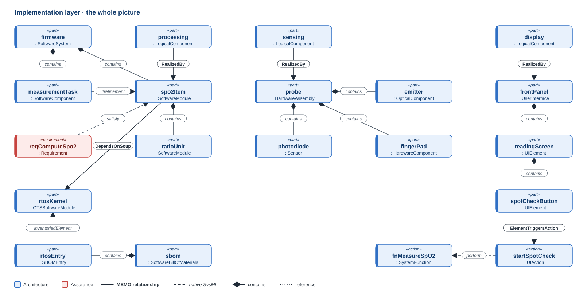
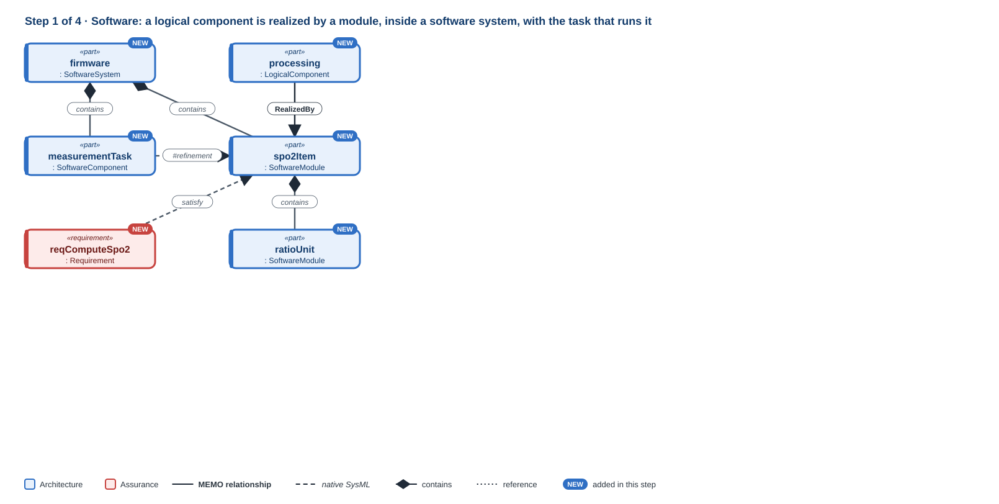
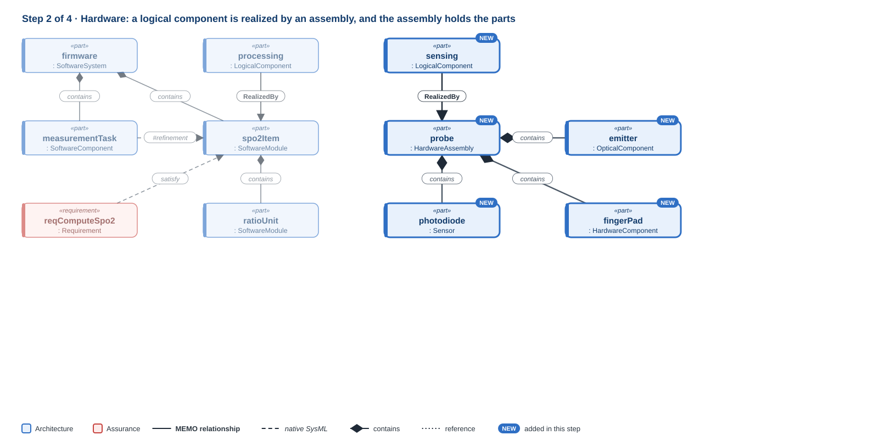
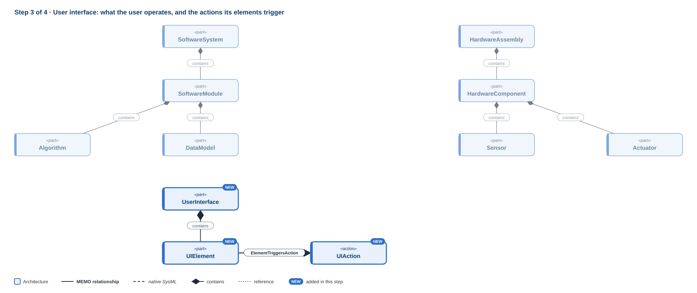
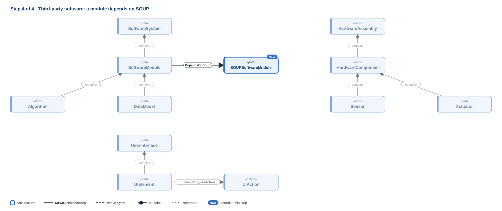

# Implementation layer

!!! question "The question this layer answers"
    **What is it built from?**

The implementation layer is where technology commitments live, and the only place they live. The logical layer said what blocks exist; this layer says what each one is made of: **software**, **hardware**, or the **user interface** that people touch. Each element here realises something in the logical design.

**Namespace:** `memo::architecture::implementation` · **Source:** `src/architecture/implementation/`

[{ .memo-presentation-graphic }](../assets/ontology/implementation.svg){ title="Open full size" }

The colours say which part of MEMO an element belongs to: **blue** is
architecture, **red** is assurance. A solid line is one of MEMO's own
relationships, a dashed line is native SysML, a diamond is containment, and a
dotted line is a reference. [How to read the figures](index.md#how-to-read-the-figures)

## Building it up

### Step 1 · Software

[{ .memo-presentation-graphic }](../assets/ontology/implementation-step1.svg){ title="Open full size" }

IEC 62304 calls any identifiable part of a program a *software item*. MEMO's base for that concept is `SoftwareElement`, named so because SysML reserves *item* for things that flow, which is what `DataItem` is. The module view (IEC 62304 5.3 to 5.4) has `SoftwareSystem` at the top and `SoftwareModule`s as the code units with design responsibility; `Algorithm`, `DataModel` and `ConfigurationArtifact` describe what they contain. The runtime view has the `SoftwareComponent`, with its concurrency, scheduling, health monitoring and fault containment; its `runtimeKind` says what kind: a process, thread, task, service, container, partition, data store, or message broker.

### Step 2 · Hardware

[{ .memo-presentation-graphic }](../assets/ontology/implementation-step2.svg){ title="Open full size" }

`PhysicalElement` is the root of a physical taxonomy: `PhysicalAssembly` and `PhysicalSubassembly`, `HardwareAssembly`, `PhysicalComponent` and `HardwareComponent`. Below them are electrical and electronic parts (`PowerSupply`, `Battery`, `Cable`, `NetworkMedium`), fluidic and pneumatic parts, mechanical parts and enclosures, optical, acoustic and thermal components, and the `Sensor`s and `Actuator`s that meet the physical world.

### Step 3 · User interface

[{ .memo-presentation-graphic }](../assets/ontology/implementation-step3.svg){ title="Open full size" }

A `UserInterface` is what the user operates, and a `UIElement` is one element of it, such as a banner or a button. A `UIElement` is a software element. A `UIAction` is an operative action, because clicking a button has a trigger, a precondition, a criticality and a potential harm, just as turning a knob does. A UI element triggers a UI action (`ElementTriggersAction`). `UIState` and `UIEvent` describe the interface's behaviour; an `InteractionFlow` is a reusable dialogue structure, and one path through it is an `OperativeScenario` of kind `ui`. `ScreenCapture` and `RegionBounds` tie the model to real screen layouts (`CapturesScreen`).

### Step 4 · Third-party software

[{ .memo-presentation-graphic }](../assets/ontology/implementation-step4.svg){ title="Open full size" }

A SOUP item (IEC 62304's software of unknown provenance) is a `SOUPSoftwareModule`; an `OTSSoftwareModule` is the off-the-shelf kind and adds the license, package URL and checksum. Any element can depend on a SOUP software element (`DependsOnSoup`). An `SBOMEntry` records a component in the software bill of materials.

## Where it leads

- **Up to [Logical](logical.md):** an implementation element realises a logical one, linked with `#refinement dependency`, written `<realizing> to <realized>`.
- **Up to [Functional](functional.md) and [Operational](operational.md):** a `UIAction` `perform`s a function, an interaction flow serves a use case (`FlowServesUseCase`), and the interface supports operational tasks with a native `dependency`.
- **Down to [Realization](realization.md):** modules build into deployment units (`BuildsInto`), runtime components bind to memory (`MemoryBinding`), and exchanges bind to a network medium (`ConnectionBinding`).
- **Across to assurance:** a risk control is implemented by an implementation element (`ControlImplementedBy`), and a use error happens at an element (`ErrorAtElement`) ([Safety and risk](safety-risk.md), [Human factors](human-factors.md)).

## In the running example

The bedside display carries the alarm banner. The banner triggers the
acknowledge action, which performs the detection function. A native dependency
records that the display supports the nurse's acknowledgement task.

```sysml
--8<-- "examples/temperature-alarm/model/catalog/temperature_alarm.sysml:implementation"
```

<details markdown="1">
<summary><strong>Every element and relationship in this layer</strong> (generated from <code>src/architecture/implementation/</code>)</summary>

--8<-- "docs/ontology/_generated/implementation.md"

</details>

<details markdown="1">
<summary><strong>The detail behind the steps</strong>: every attribute and kind the layer defines</summary>

### Every element in detail

**Software.** IEC 62304 calls any identifiable part of a program a *software
item*, and it decomposes software item by item. MEMO's base for that concept is
`SoftwareElement`. It is named so because SysML reserves *item* for things that
flow, which is what MEMO's `DataItem` is: software data or content that is
stored or exchanged. Software is described in two views:

- **The module view** (IEC 62304 5.3 to 5.4): `SoftwareSystem` is the top, and
  `SoftwareModule`s are the code units with design responsibility. `Algorithm`,
  `DataModel` and `ConfigurationArtifact` describe what they contain. An
  `SBOMEntry` records a component in the software bill of materials.
- **The runtime view**: a `SoftwareComponent` is a runtime component, with its
  concurrency, scheduling, health monitoring and fault containment. Its
  `runtimeKind` says what kind: a process, thread, task, service, container,
  partition, data store, or message broker.

**Hardware.** `PhysicalElement` is the root of a physical taxonomy:
`PhysicalAssembly` and `PhysicalSubassembly`, `HardwareAssembly`,
`PhysicalComponent` and `HardwareComponent`. Below them are electrical and
electronic parts (`PowerSupply`, `Battery`, `Cable`, `NetworkMedium`), fluidic
and pneumatic parts, mechanical parts and enclosures, optical, acoustic and
thermal components, and the `Sensor`s and `Actuator`s that meet the physical
world.

**User interface.** A `UserInterface` is what the user operates. A `UIElement`
is one element of it, such as a banner or a button. A `UIElement` is a software
element. A `UIAction` is an operative action, because clicking a button has a
trigger, a precondition, a criticality and a potential harm, just as turning a
knob does. `UIState` and `UIEvent` describe the interface's behaviour. An
`InteractionFlow` is a reusable dialogue structure through the interface; one
path through it is an `OperativeScenario` of kind `ui`. `ScreenCapture` and
`RegionBounds` tie the model to real screen layouts.

## How it connects

**Within the layer.** A UI element triggers a UI action
(`ElementTriggersAction`). A screen capture shows a UI element
(`CapturesScreen`). A SOUP item (IEC 62304's software of unknown provenance)
is a `SOUPSoftwareModule`; an `OTSSoftwareModule` is the off-the-shelf kind of
SOUP and adds the license, package URL and checksum. Any element can depend on a
SOUP software element (`DependsOnSoup`).

**To other layers and disciplines:**

- **It realises the logical design.** An implementation element is linked to the
  logical element it realises with `#refinement dependency`, written as
  `<realizing> to <realized>`. See [Logical](logical.md).
- **UI actions carry out functions**: a `UIAction` `perform`s a function. See
  [Functional](functional.md).
- **Interaction serves use**: an interaction flow serves a use case
  (`FlowServesUseCase`), and the interface supports operational tasks with a
  native `dependency`. See [Operational](operational.md).
- **It is where controls are built.** A risk control is implemented by an
  implementation element (`ControlImplementedBy`), and a use error happens at
  an element (`ErrorAtElement`). See [Safety and risk](safety-risk.md) and
  [Human factors](human-factors.md).
- **It is deployed in the realization layer.** Modules build into deployment
  units (`BuildsInto`), runtime components bind to memory (`MemoryBinding`),
  and exchanges bind to a network medium (`ConnectionBinding`). See
  [Realization](realization.md).

</details>

## Go deeper

- The GPCA infusion pump: [requirements and architecture](../layers/requirements-architecture.md).
- [The implementation API](../sysml-api/index.md#architecture).
