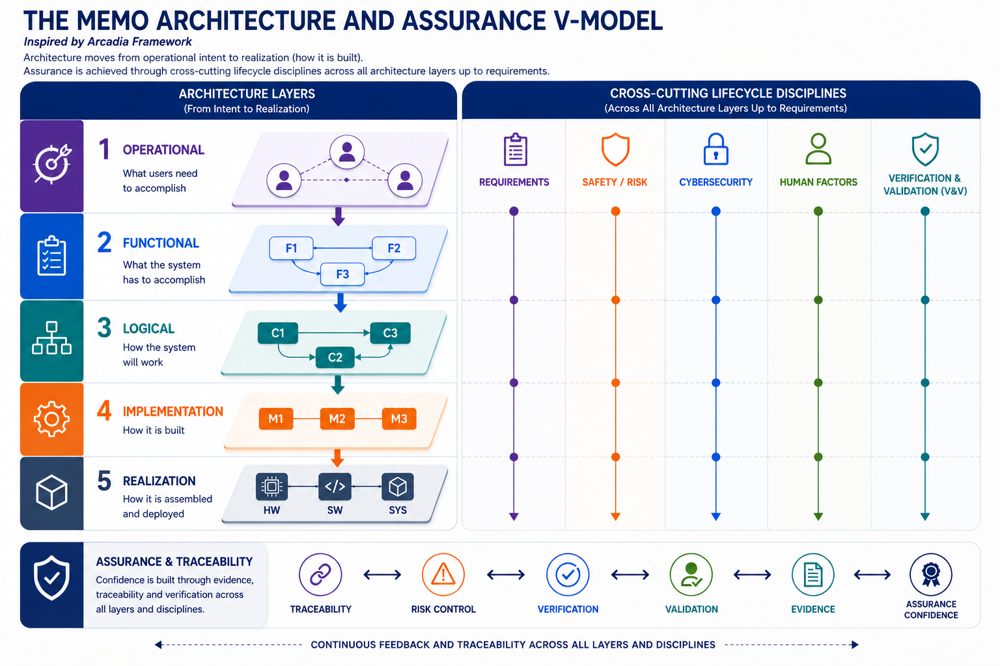
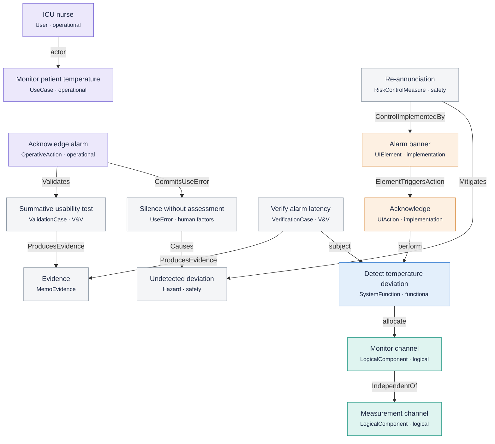

# MEMO in a nutshell

MEMO describes a medical device as **one SysML v2 model**. That model holds what
the device is for, what it does, how it is built, and the argument that it is
safe and effective.

MEMO organises the model on **two axes**:

- **The architecture layers** explain the device. Each layer answers one
  question, from purpose down to deployed hardware.
- **The assurance disciplines** test that explanation. They run across every
  layer and ask whether it is complete and supported by evidence.

{ .memo-zoomable aria-label="Open the architecture and assurance V-model" }

## The architecture layers

Read the layers top to bottom. Each one answers its question without borrowing
the answer of the layer below. For example, the operational layer never names
the device's parts, and the functional layer never names a technology.

| Layer | The question it answers | Key elements |
| --- | --- | --- |
| [Operational](operational.md) | Why does the device exist, for whom, and in what setting? | `User`, `UseCase`, `IntendedUse`, `UseContext`, `OperationalWorkflow`, `OperativeAction`, `OperativeScenario` |
| [Functional](functional.md) | What must the system do? | `SystemFunction`, `ComponentFunction`, `FunctionalFlow`, `FunctionalExchange`, `StateMachine` |
| [Logical](logical.md) | How is the solution organised, before choosing a technology? | `LogicalComponent`, `LogicalPort`, `LogicalInterface`, `ComponentExchange`, `IsolationBoundary` |
| [Implementation](implementation.md) | What is it built from? | `SoftwareSystem`, `SoftwareModule`, `HardwareComponent`, `Sensor`, `UserInterface`, `UIElement` |
| [Realization](realization.md) | Where does it run, and how do its parts reach each other? | `SoftwareDeploymentUnit`, `ProcessingNode`, `RuntimeEnvironment`, `EndToEndFlow` |

A `DesignDecision` (in `memo::architecture::decisions`) records a choice that
affects elements in any of these layers.

## The assurance disciplines

Each discipline owns its own elements and connects them to the architecture
elements they are about. A hazard stays a hazard; a function stays a function.
A relationship between them says how they meet.

| Discipline | The question it answers | Key elements |
| --- | --- | --- |
| [Requirements](requirements.md) | What must be true, and why? | `Need`, `Requirement`, `RiskDriver`, `SystemConstant` |
| [Safety and risk](safety-risk.md) | What could cause harm, and what keeps the risk acceptable? | `Hazard`, `HazardousSituation`, `Harm`, `Risk`, `RiskControlMeasure`, `FailureMode`, `FaultTree` |
| [Cybersecurity](cybersecurity.md) | What could an attacker do, and what stops them? | `CybersecurityAsset`, `Threat`, `Vulnerability`, `CyberRisk`, `CyberMitigation`, `TrustBoundary` |
| [Human factors](human-factors.md) | Where can use go wrong? | `UseError`, and the tasks it is committed in |
| [Verification and validation](verification-validation.md) | How do we know it works, and that it is the right device? | `VerificationCase`, `ValidationCase`, `TestStep`, `ClinicalEvaluation` |

Underneath both axes are the **foundations** that the layers build on:
[Core](../reference/areas/core.md) (the base definitions and shared
relationships), [Artifacts](../reference/areas/artifacts.md),
[Viewpoints](../reference/areas/viewpoints.md),
[Methodology](../reference/areas/methodology.md) and
[Rules](../reference/areas/rules.md).

## How the layers connect

MEMO connects elements with **native SysML v2 relationships** wherever the
language already has one. It defines **its own typed relationships** only where
the native form would lose meaning that a medical-device argument needs.

The native relationships do most of the connecting between architecture layers:

| Native SysML | Connects | Example |
| --- | --- | --- |
| `actor`, `subject` | a user to the use case they pursue, and the system the use case is about | the ICU nurse initiates *Monitor patient temperature* |
| `perform` | an action to the function or scenario it carries out | a UI action performs *Detect temperature deviation* |
| `allocate` | a function to the component responsible for it | *Detect temperature deviation* is allocated to the monitor channel |
| `allocation … : BuildsInto`, `: DeploysTo`, `: HostedBy` | software to the image it builds into, the node it runs on, the board that hosts it | the firmware image deploys to the main controller |
| `#refinement dependency` | a realizing element to the element it realizes (the realizing one first) | the sensor input interface realizes the hardware-software bus interface |
| `satisfy` | a requirement to the design element that satisfies it | a software module satisfies a system requirement |
| `dependency` | an element that supports or uses another | the bedside display supports the acknowledgement task |

The assurance disciplines mostly connect through MEMO's own relationships,
because they carry information the native forms do not. For example, `Causes`
records its kind of cause, and `Validates` keeps validation apart from
verification, as IEC 62304 does.

| MEMO relationship | Connects |
| --- | --- |
| `Motivates` | a need to the use case it motivates |
| `DerivesFrom` | a requirement to the need, hazard, threat or component it derives from |
| `CommitsUseError` | a task to a use error committed while performing it |
| `Causes` | a cause to its effect, such as a use error that leads to a hazard |
| `Mitigates` | a risk control to the hazard or vulnerability it reduces |
| `ControlImplementedBy` | a risk control to the design element that implements it |
| `Exploits`, `ThreatenedBy`, `ImpactsSafety` | threats to vulnerabilities, assets to threats, and security to safety |
| `Validates` | a use case, task or claim to the validation case that checks it |
| `ProducesEvidence` | a verification or validation case to the evidence it produced |

The page for each layer lists every relationship that touches it, generated
from the ontology source.

## One thread through every layer

The [temperature alarm](../examples/temperature-alarm.md) example is small
enough to read in one sitting, yet it reaches every layer. Each layer page
shows its part of the example.

Read the thread as one argument. The nurse must notice a deviation. The system
detects it on a monitor channel that is independent of the measurement channel.
The banner announces it. If the nurse silences it without assessing it, the
deviation can go undetected. The re-annunciation control, implemented by the
banner, reduces that hazard. A verification case and a usability validation
produce the evidence for both.

## Where to go next

- Read one layer page: each opens with its question, introduces its elements,
  shows how they connect, and lists the full inventory.
- [Choose an element](../modeling/elements.md) and
  [write a relationship](../modeling/relationships.md) when you model.
- [Browse the generated API](../sysml-api/index.md) for every definition.
