# MEMO in a nutshell

MEMO describes a medical device as **one SysML v2 model**. The model holds what
the device is for, what it does, how it is built, and the argument that it is
safe and effective.

The model is organised in two ways:

- **Five architecture layers** explain the device, from the work it supports
  down to the hardware it runs on. Each layer answers one question.
- **Five assurance disciplines** test that explanation: requirements, safety,
  cybersecurity, human factors, and verification and validation. They reach
  into every layer.

This page shows both, one picture at a time, and then the stakeholders the
model is written for. Every element name in the pictures
is read from the ontology itself, so nothing is left out and nothing is
invented.

## The map

[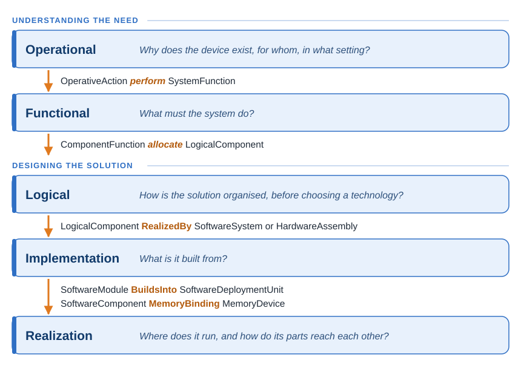{ .memo-presentation-graphic }](../assets/ontology/overview-layers.svg){ title="Open full size" }

Read it top to bottom. Each blue box is a layer and the question it answers.
The orange arrow is the link that carries the work down to the next layer,
written as a sentence: an operational action **performs** a system function, a
function is **allocated** to a logical component, that component is **realized
by** software or hardware, and software **builds into** what is deployed.

The first two layers are about **understanding the need**. The last three are
about **designing the solution**.

## The five layers

Each picture below lists every element the layer offers, grouped as the
ontology groups them. The red **ASSURANCE** line at the bottom names how the
assurance disciplines link into that layer. Open a layer's page to learn it
step by step.

### Operational

The work the device enters: who uses it, for what goal, in which setting, step by step. Nothing here names a part of the device.

[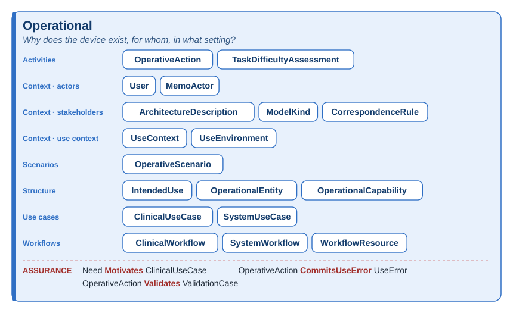{ .memo-presentation-graphic }](../assets/ontology/overview-operational.svg){ title="Open full size" }

[Learn the Operational layer →](operational.md)

### Functional

What the system must do to support that work, written as functions and the things they pass to each other. Nothing here names a technology.

[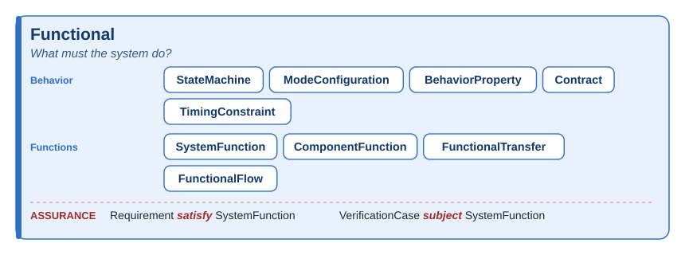{ .memo-presentation-graphic }](../assets/ontology/overview-functional.svg){ title="Open full size" }

[Learn the Functional layer →](functional.md)

### Logical

How the solution is organised: the components that carry the functions and the ports where they meet, still without choosing hardware or software.

[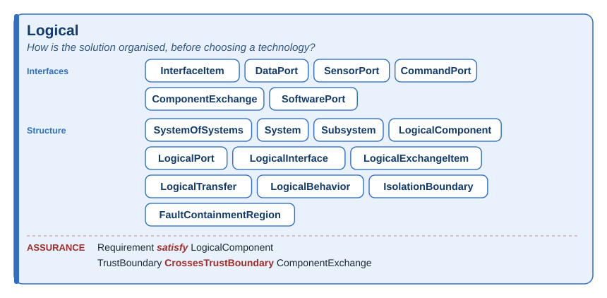{ .memo-presentation-graphic }](../assets/ontology/overview-logical.svg){ title="Open full size" }

[Learn the Logical layer →](logical.md)

### Implementation

What the device is built from: software modules, hardware assemblies, the user interface, and the third-party software they rely on.

[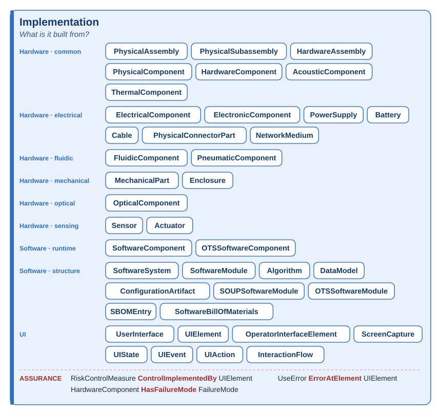{ .memo-presentation-graphic }](../assets/ontology/overview-implementation.svg){ title="Open full size" }

[Learn the Implementation layer →](implementation.md)

### Realization

Where it runs and how its parts reach each other: the images that are deployed, the processors and memory they run on, and the physical connections.

[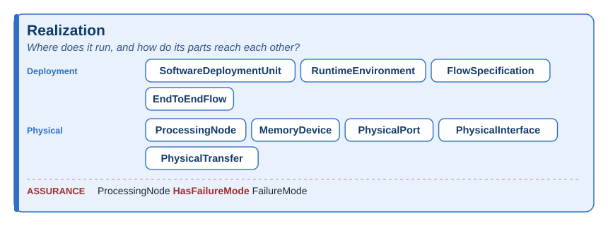{ .memo-presentation-graphic }](../assets/ontology/overview-realization.svg){ title="Open full size" }

[Learn the Realization layer →](realization.md)

## The assurance disciplines

The disciplines do not describe the device; they ask whether the description is
complete, safe and backed by evidence. Their elements link to the layers above
through the links shown on each layer's ASSURANCE line.

### Requirements

The needs of the people who use the device, and the requirements derived from them that the design must satisfy.

[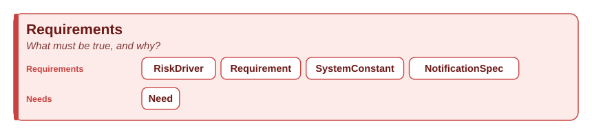{ .memo-presentation-graphic }](../assets/ontology/overview-requirements.svg){ title="Open full size" }

[Learn Requirements →](requirements.md)

### Safety and risk

What can cause harm, how likely and how bad it is, and the controls that reduce it (ISO 14971).

[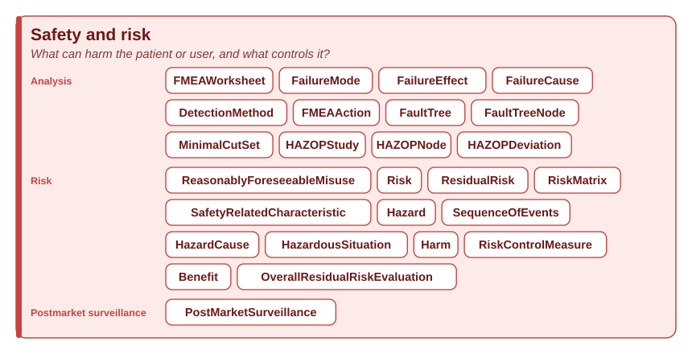{ .memo-presentation-graphic }](../assets/ontology/overview-safety-risk.svg){ title="Open full size" }

[Learn Safety and risk →](safety-risk.md)

### Cybersecurity

What an attacker could reach, the weaknesses they could use, and what stops them.

[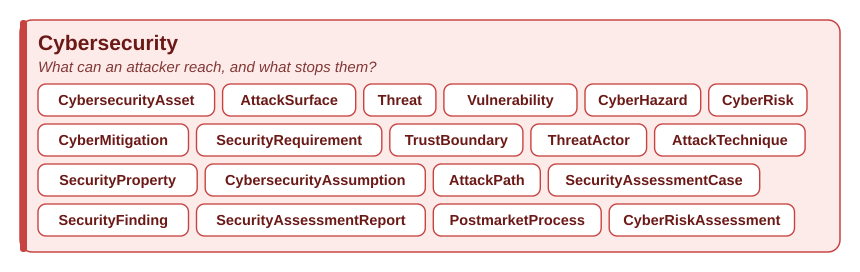{ .memo-presentation-graphic }](../assets/ontology/overview-cybersecurity.svg){ title="Open full size" }

[Learn Cybersecurity →](cybersecurity.md)

### Human factors

Where a user can get a task wrong, and what follows from it (IEC 62366-1).

[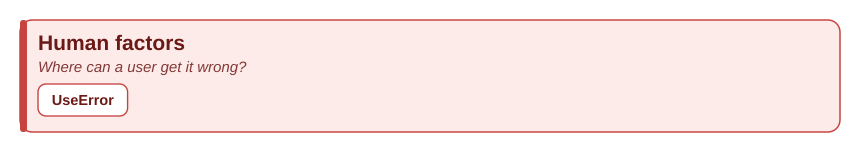{ .memo-presentation-graphic }](../assets/ontology/overview-human-factors.svg){ title="Open full size" }

[Learn Human factors →](human-factors.md)

### Verification and validation

The cases that show the device was built right and is the right device, and the evidence they produce.

[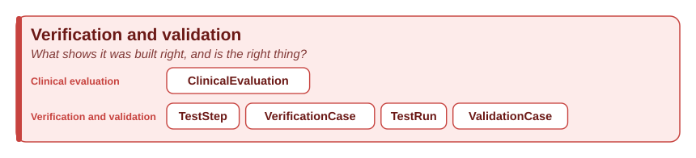{ .memo-presentation-graphic }](../assets/ontology/overview-verification-validation.svg){ title="Open full size" }

[Learn Verification and validation →](verification-validation.md)

## Stakeholders and concerns

The model is written for people. Each stakeholder has concerns, such as safety
or usability, and each view of the model is chosen to answer some of them
(ISO/IEC/IEEE 42010). A quality attribute is a property a concern asks about.

[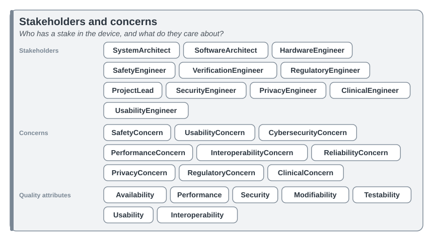{ .memo-presentation-graphic }](../assets/ontology/overview-stakeholders-concerns.svg){ title="Open full size" }

[Learn about viewpoints →](../reference/areas/viewpoints.md)

## One example through every layer

The [temperature alarm](../examples/temperature-alarm.md) example is small
enough to read in one sitting, yet it reaches every layer down to
Implementation and every assurance discipline except cybersecurity. It stops
before Realization: it deploys nothing.

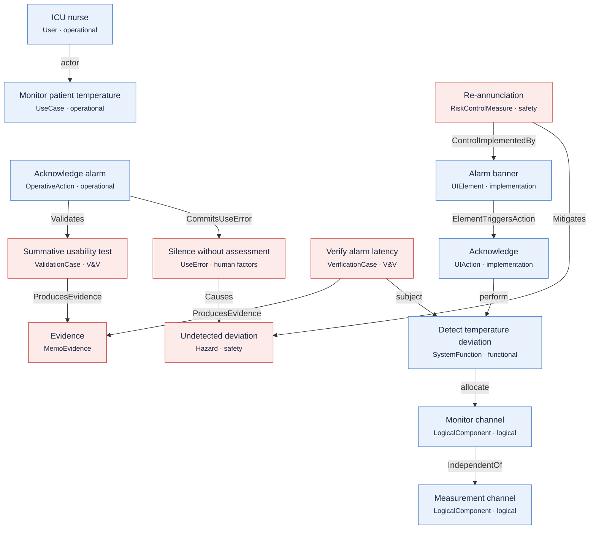

Read the thread as one argument. The nurse must notice a deviation. The system
detects it on a monitor channel that is independent of the measurement channel.
The banner announces it. If the nurse silences it without assessing it, the
deviation can go undetected. The re-annunciation control, implemented by the
banner, reduces that hazard. A verification case and a usability validation
produce the evidence for both.

## For modellers

The rest of this page is reference: how MEMO's library sits on SysML v2, and the
key to the figures on the layer pages.

### How MEMO builds on SysML

MEMO does not add new kinds of element to SysML v2. A MEMO model uses SysML's own `part`,
`action`, `port`, `item`, `requirement`, `state` and the rest, written the way the SysML
specification writes them. What MEMO adds is a **library of definitions**, the types those
elements are defined by.

Each definition in the library sits on one **base**: a definition MEMO declares for each SysML
kind, holding the attributes every element of that kind carries, such as `status`. Sitting on
a base does not change the kind: a `HardwareAssembly` is still a `part def`.

| SysML kind | MEMO base | Definitions you use, for example | Use the base directly? |
| --- | --- | --- | --- |
| `part def` | `MemoPart` (abstract) | `System`, `LogicalComponent`, `HardwareAssembly`, `SoftwareComponent` | no |
| `action def` | `MemoAction` | `OperativeAction`, `SystemFunction`, `ComponentFunction` | no |
| `port def` | `MemoPort` | `LogicalPort`, `PhysicalPort`, `DataPort` | no |
| `interface def` | `MemoInterface` (abstract) | `PhysicalInterface` | no |
| `item def` | `MemoItem` (abstract) | `InterfaceItem`, `Hazard`, `DataItem` | no |
| `use case def` | `MemoUseCase` (abstract) | `ClinicalUseCase`, `SystemUseCase` | no |
| `requirement def` | `MemoRequirementElement` (abstract) | `Need`, `Requirement` | no |
| `verification def` | `MemoVerificationCase` | `VerificationCase` | no |
| `state def` | `MemoState` | `StateMachine`, for the machine | **yes**, for the states inside a machine: `state standby : MemoState` with its `stateKind` set |
| `part def` | `MemoEvidence` | none: evidence is a `part x : MemoEvidence` with its `evidenceKind` set | **yes** |

Three things follow.

- **Define an element by the most specific definition that fits.** Rules read both. A rule on a
  base applies to every element of that kind (a rule on `MemoPort` checks every port's direction),
  while a rule on a specific definition carries the layer's meaning: CR-ONT-079 fires on
  `part x : HardwareAssembly`, never on a part defined by `MemoPart`. A base alone says only
  which SysML kind an element is. Mode states and evidence are the exceptions: the library has
  nothing more specific for them, so their kind attribute says what the element is.
- **A figure's «keyword» is the SysML kind, never a MEMO type.** SysML writes the kind in
  guillemets and the definition after a colon, so a usage box reads «part» over
  `oximeter : HardwareAssembly`, and a definition box reads «part def» over `HardwareAssembly`.
  `«MemoPart»` or `«HardwareAssembly»` is not SysML notation.
- **You will see a base used directly in small samples.** Some diagram samples type a payload as
  `item payload : MemoItem` to keep a picture short. That is a placeholder, not a pattern: in a
  real model the payload is defined by an `InterfaceItem` or by a definition that specializes
  `DataItem`.

### How to read the figures

Every figure in these pages uses the same key.

| You see | It means |
| --- | --- |
| «part def», «action def», … over a name | the SysML kind of the definition named below it ([why](#how-memo-builds-on-sysml)) |
|  blue box | an **architecture** element: it explains the device (`memo::architecture`) |
|  red box | an **assurance** element: it tests the explanation (`memo::assurance`) |
|  green box | a **methodology** element: how the work is planned and run (`memo::methodology`) |
|  grey box | a **core** element shared by everything (`memo::core`) |
| solid line, **bold** label | one of MEMO's own relationships, such as `Motivates` |
| dashed line, *italic* label | a native SysML v2 relationship, such as `actor` or `allocate` |
| line with a diamond | containment: the diamond end owns the other |
| dotted line | a reference feature, such as a scenario's `useContext` |
| bold box with **NEW** | in a step figure, what that step adds; faded boxes came earlier |

Each layer page opens with its whole picture and then builds it up in steps:
first the layer's core, then the elements that support it.

## Where to go next

- [Architecture layers](architecture/index.md) and
  [Assurance disciplines](assurance/index.md) give each axis on one page;
  [Foundations](foundations/index.md) covers what sits under both: core,
  artifacts, viewpoints, methodology and rules.
- Read one layer page: each opens with its question and its whole picture,
  builds the picture up step by step, and keeps the full inventory folded away.
- [Choose an element](../modeling/elements.md) and
  [write a relationship](../modeling/relationships.md) when you model.
- [Browse the generated API](../sysml-api/index.md) for every definition.
