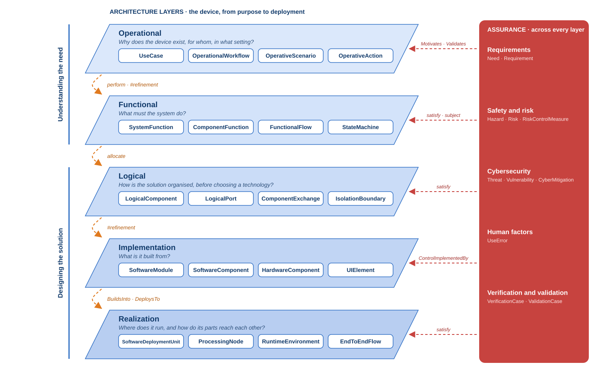
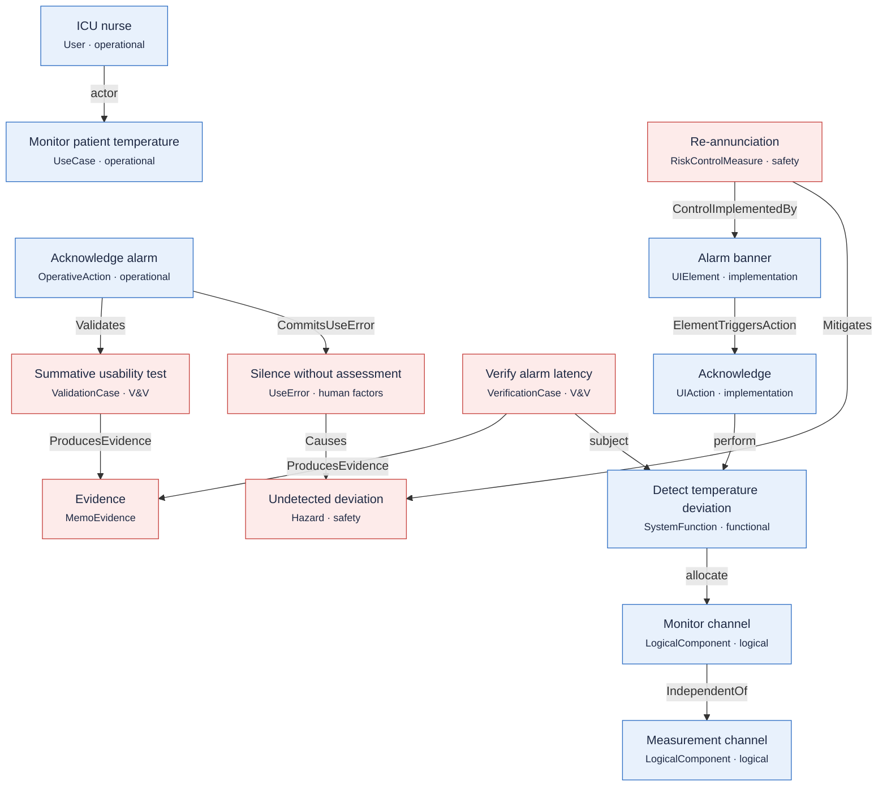

# MEMO in a nutshell

MEMO describes a medical device as **one SysML v2 model**. That model holds what
the device is for, what it does, how it is built, and the argument that it is
safe and effective.

MEMO organises the model on **two axes**:

- **The architecture layers** explain the device. Each layer answers one
  question, from purpose down to deployed hardware.
- **The assurance disciplines** test that explanation. They run across every
  layer and ask whether it is complete and supported by evidence.

[{ .memo-presentation-graphic }](../assets/ontology/overview-layers.svg){ title="Open full size" }

Read the picture top to bottom. Each blue plane is an architecture layer, with
the question it answers and its four core elements. The orange arrow between two
planes names the relationship that carries the work down: an operational action
`perform`s a function, a function is `allocate`d to a logical component, and so
on. The first two layers are about **understanding the need**; the last three
are about **designing the solution**. The red band on the right is assurance: each
discipline reaches into every layer, and the red dashed links name how.

## How to read the figures

Every figure in these pages uses the same key.

| You see | It means |
| --- | --- |
|  blue box | an **architecture** element: it explains the device (`memo::architecture`) |
|  red box | an **assurance** element: it tests the explanation (`memo::assurance`) |
|  green box | a **methodology** element: how the work is planned and run (`memo::methodology`) |
|  grey box | a **core** element shared by everything (`memo::core`) |
| solid line, **bold** label | one of MEMO's own relationships, such as `Motivates` |
| dashed line, *italic* label | a native SysML v2 relationship, such as `actor` or `allocate` |
| line with a diamond | containment: the diamond end owns the other |
| dotted line | a reference feature, such as a scenario's `useContext` |
| bold box with **NEW** | in a step figure, what that step adds; faded boxes came earlier |

Each layer page opens with its whole picture and then builds it up in steps:
first the layer's core, then the elements that support it.

## The two axes

- **[Architecture layers](architecture/index.md)** explain the device: Operational,
  Functional, Logical, Implementation, Realization. They connect mostly through
  native SysML relationships such as `perform`, `allocate` and `satisfy`.
- **[Assurance disciplines](assurance/index.md)** test that explanation: Requirements,
  Safety and risk, Cybersecurity, Human factors, Verification and validation.
  They connect mostly through MEMO's own relationships, such as `Causes`,
  `Mitigates` and `Validates`, because those carry meaning a medical-device
  argument needs.
- **[Foundations](foundations/index.md)** sit underneath both: Core, Artifacts,
  Viewpoints, Methodology, Rules.

## One thread through every layer

The [temperature alarm](../examples/temperature-alarm.md) example is small
enough to read in one sitting, yet it reaches every layer. Each layer page
shows its part of the example.

Read the thread as one argument. The nurse must notice a deviation. The system
detects it on a monitor channel that is independent of the measurement channel.
The banner announces it. If the nurse silences it without assessing it, the
deviation can go undetected. The re-annunciation control, implemented by the
banner, reduces that hazard. A verification case and a usability validation
produce the evidence for both.

## Where to go next

- Read one layer page: each opens with its question and its whole picture,
  builds the picture up step by step, and keeps the full inventory folded away.
- [Choose an element](../modeling/elements.md) and
  [write a relationship](../modeling/relationships.md) when you model.
- [Browse the generated API](../sysml-api/index.md) for every definition.
