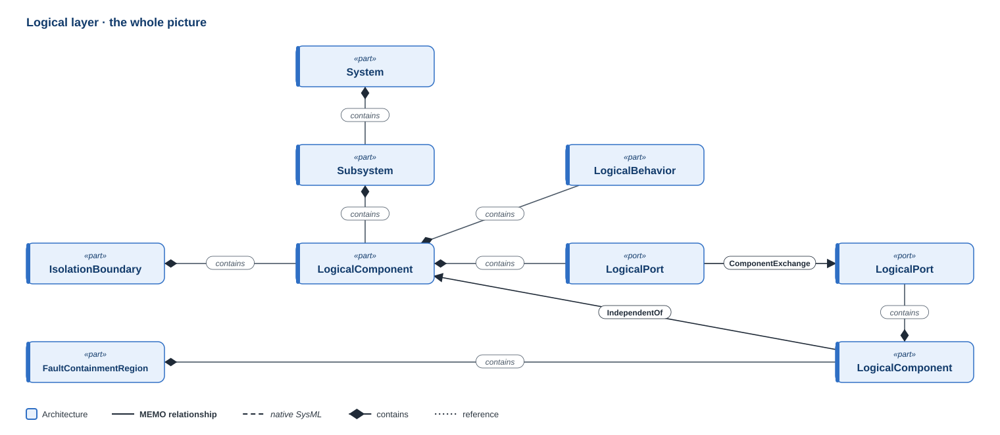
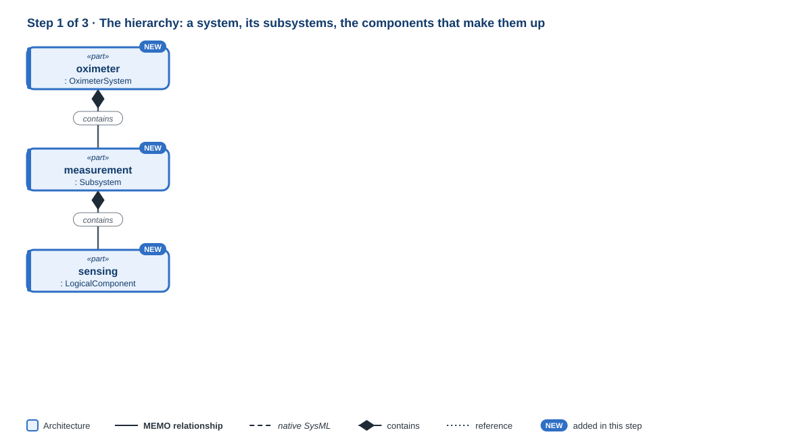
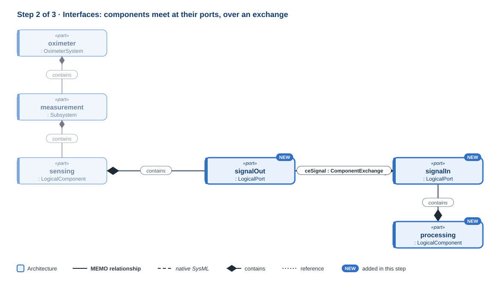
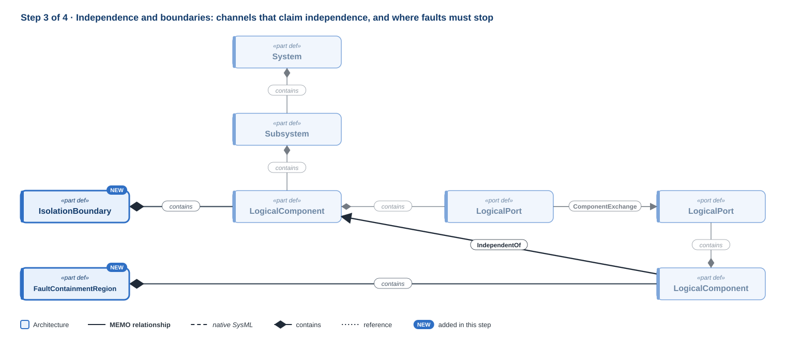
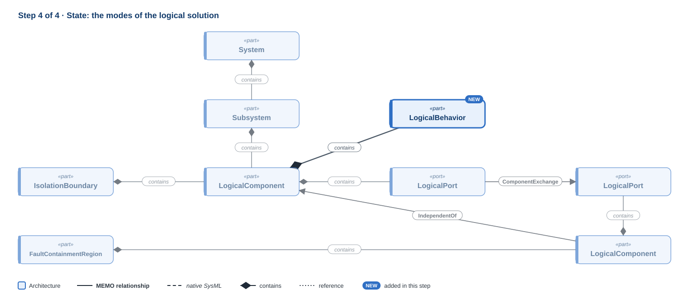

# Logical layer

!!! question "The question this layer answers"
    **How is the solution organised, before choosing a technology?**

The logical layer decides which parts of the solution exist and how they interact, before committing any of them to software, electronics or mechanics. It is where the big architectural decisions are made and compared: redundancy, monitoring, isolation, and how responsibilities are grouped. Its heart is the **component** (`LogicalComponent`) inside a **system hierarchy**, meeting other components at **ports** (`LogicalPort`) over an **exchange**. Because it stays technology-independent, it remains stable when the implementation technology changes.

**Namespace:** `memo::architecture::logical` · **Source:** `src/architecture/logical/`

[{ .memo-presentation-graphic }](../assets/ontology/logical.svg){ title="Open full size" }

The colours say which part of MEMO an element belongs to: **blue** is
architecture, **red** is assurance. A solid line is one of MEMO's own
relationships, a dashed line is native SysML, a diamond is containment, and a
dotted line is a reference. [How to read the figures](index.md#how-to-read-the-figures)

## How to read this page

Each step below introduces a few elements, then shows them in SysML and explains
every line: its **notation**, **what it says**, and **why** it is written that
way. One small example runs through all the steps: the logical architecture of a
pulse oximeter, which senses light through a finger and shows an oxygen
saturation reading. Each step's code adds to the previous one, and every stage
compiles and passes `memo validate`. The symbols are collected in
[Reading the notation](../tutorials/hardware/00-reading-the-notation.md); the
same port, interface and flow pattern is built for hardware in
[Connect them](../tutorials/hardware/05-connect-them.md).

## Building it up
### Step 1 · The hierarchy

[{ .memo-presentation-graphic }](../assets/ontology/logical-step1.svg){ title="Open full size" }

A `LogicalComponent` is one block of the solution, named for what it is
responsible for rather than what it is built from. Its `componentRole` says what
kind of block it is (a channel, a data store, a control element, a user
interface, an external system, or generic), and its `systemType` says what it
will be realised in: software, hardware, or still undecided (`logical`). Blocks
nest: a `System` contains `Subsystem`s and components, and a `Subsystem`
contains further subsystems and components. `SystemOfSystems`, `System` and
`Subsystem` are separate definitions rather than role values because each
admits different children. A system of systems is made of independently
operated and managed systems (ISO/IEC/IEEE 21841): a pump talking to a hospital
infusion-management server is one, while a pump and its own battery are not.

#### Write it

The package, the system, one subsystem with two channels, and the display:

```sysml
package layer_logical {
    private import memo::*;

    part def OximeterSystem specializes System;
    part oximeter : OximeterSystem {
        @MemoIdentity { :>> label = "Pulse oximeter"; }
        attribute :>> systemBoundaryDescription = "The handheld unit with its finger probe; the charger is outside";
        attribute :>> origin = SystemOriginKind::internal;

        part measurement : Subsystem {
            @MemoIdentity { :>> label = "Measurement"; }

            part sensing : LogicalComponent {
                @MemoIdentity { :>> label = "Sensing channel"; }
                attribute :>> componentRole = ComponentRoleKind::channel;
                attribute :>> systemType = SystemTypeKind::hardware;
                attribute :>> responsibility = "Turn the light through the finger into a signal";
            }
            part processing : LogicalComponent {
                @MemoIdentity { :>> label = "Processing channel"; }
                attribute :>> componentRole = ComponentRoleKind::channel;
                attribute :>> systemType = SystemTypeKind::software;
                attribute :>> responsibility = "Compute SpO2 from the signal";
            }
        }
        part display : LogicalComponent {
            @MemoIdentity { :>> label = "Display"; }
            attribute :>> componentRole = ComponentRoleKind::userInterface;
            attribute :>> systemType = SystemTypeKind::logical;
        }
    }
}
```

#### Line by line

```sysml
package layer_logical {
```

- **Notation.** `package` opens a namespace; everything up to its `}` belongs to it.
- **What it says.** A package for the logical model.

```sysml
private import memo::*;
```

- **Notation.** `import memo::*` makes every MEMO name usable here; `private` keeps them inside this package.
- **What it says.** MEMO's definitions can be written by short name.

```sysml
part def OximeterSystem specializes System;
```

- **Notation.** `part def` declares a definition; `specializes` makes it a kind of MEMO's `System`.
- **What it says.** The pulse oximeter is a kind of system.
- **Why.** Every model names its system (CR-ONT-084). A definition of its own, rather than a part typed by `System` directly, gives the product a type that other models and variants can reuse.

```sysml
part oximeter : OximeterSystem {
```

- **Notation.** `part` declares a usage; `:` reads "defined by".
- **What it says.** There is the oximeter, and the rest of this step is inside it.
- **Why.** Nesting is containment in SysML v2: what is written inside the oximeter's body is part of the oximeter, so no "contains" relation is needed.

```sysml
@MemoIdentity { :>> label = "Pulse oximeter"; }
```

- **Notation.** `@MemoIdentity { … }` attaches metadata to the element it sits in; `:>> label = "…";` gives a value to an attribute the metadata declares.
- **What it says.** Its display name.

```sysml
attribute :>> systemBoundaryDescription = "The handheld unit with its finger probe; the charger is outside";
```

- **Notation.** `attribute :>>` redefines an attribute the type declares and gives it a value.
- **What it says.** What is inside the system and what is not.
- **Why.** Everything the project must deliver and verify sits inside the boundary; what is outside is only interfaced with. Stating it is the first decision of a logical architecture.

```sysml
attribute :>> origin = SystemOriginKind::internal;
```

- **Notation.** An enumeration value: `internal` or `external`.
- **What it says.** This organisation builds the system.
- **Why.** An external system is one the project only interfaces with and relies on what its maker states, so what has to be verified differs.

```sysml
part measurement : Subsystem {
```

- **Notation.** A part usage **inside** the oximeter's body, defined by `Subsystem`.
- **What it says.** The oximeter has a measurement subsystem.
- **Why.** A subsystem groups components that work together and can be reasoned about as one: here, everything between the finger and the reading.

```sysml
@MemoIdentity { :>> label = "Measurement"; }
```

- **Notation.** `@MemoIdentity { … }` attaches metadata to the element it sits in; `:>> label = "…";` gives a value to an attribute the metadata declares.
- **What it says.** Its display name.

```sysml
part sensing : LogicalComponent {
```

- **Notation.** A part usage inside the subsystem.
- **What it says.** The measurement subsystem has a sensing channel.
- **Why.** A logical component is named by its responsibility, not its technology: "sensing channel", not "photodiode board". The technology is the Implementation and Realization layers' decision.

```sysml
@MemoIdentity { :>> label = "Sensing channel"; }
```

- **Notation.** `@MemoIdentity { … }` attaches metadata to the element it sits in; `:>> label = "…";` gives a value to an attribute the metadata declares.
- **What it says.** Its display name.

```sysml
attribute :>> componentRole = ComponentRoleKind::channel;
```

- **Notation.** An enumeration value: `channel`, `dataStore`, `controlElement`, `userInterface`, `externalSystem` or `generic`.
- **What it says.** It is a channel: a path a signal takes through the system.
- **Why.** One definition with a role attribute, rather than a definition per role, because the roles share the same relationships and differ only in a few attributes.

```sysml
attribute :>> systemType = SystemTypeKind::hardware;
```

- **Notation.** An enumeration value: `logical`, `software` or `hardware`.
- **What it says.** It will be realised in hardware.
- **Why.** This records a decision; it does not move the component out of the logical layer. Once the hardware exists, it refines this component.

```sysml
attribute :>> responsibility = "Turn the light through the finger into a signal";
```

- **Notation.** A text value.
- **What it says.** What the component is answerable for.
- **Why.** The responsibility is what functions are allocated against.

```sysml
}
```

- **Notation.** Closes the component.

```sysml
part processing : LogicalComponent {
    @MemoIdentity { :>> label = "Processing channel"; }
    attribute :>> componentRole = ComponentRoleKind::channel;
    attribute :>> systemType = SystemTypeKind::software;
    attribute :>> responsibility = "Compute SpO2 from the signal";
}
```

- **Notation.** As above.
- **What it says.** A second channel, realised in software, computes the saturation.

```sysml
}
```

- **Notation.** Closes the subsystem.

```sysml
part display : LogicalComponent {
```

- **Notation.** A part usage directly inside the oximeter, outside the subsystem.
- **What it says.** The oximeter has a display.
- **Why.** It is not part of measuring, so it is not in the measurement subsystem.

```sysml
@MemoIdentity { :>> label = "Display"; }
```

- **Notation.** `@MemoIdentity { … }` attaches metadata to the element it sits in; `:>> label = "…";` gives a value to an attribute the metadata declares.
- **What it says.** Its display name.

```sysml
attribute :>> componentRole = ComponentRoleKind::userInterface;
```

- **Notation.** An enumeration value: `channel`, `dataStore`, `controlElement`, `userInterface`, `externalSystem` or `generic`.
- **What it says.** It is a user interface.

```sysml
attribute :>> systemType = SystemTypeKind::logical;
```

- **Notation.** An enumeration value: `logical`, `software` or `hardware`.
- **What it says.** What it will be built in is not decided yet.
- **Why.** `logical` is a legitimate answer: the attribute is optional, and saying "undecided" is more useful than leaving it unset.

```sysml
}
```

- **Notation.** Closes the display.

```sysml
}
```

- **Notation.** Closes the oximeter.

```sysml
}
```

- **Notation.** Closes the package.

At this stage `memo validate` warns four times (AR-IBD-001): each nested block has
no connection yet, and a block nothing connects to is usually a block nobody has
thought through. Step 2 adds the connections and the warnings go.

### Step 2 · Interfaces

[{ .memo-presentation-graphic }](../assets/ontology/logical-step2.svg){ title="Open full size" }

Components meet only at **ports**. A `LogicalPort` is a component's boundary
feature, and it declares, with a direction, the **item** that crosses it. Two
ports are joined in two statements, because they say two different things. A
`ComponentExchange` is an `interface`: the path between the ports, with what kind
of exchange it is. A `LogicalTransfer` is a `flow`: what actually moves along the
path, from the item on one port to the item on the other, with what the
transfer must meet. Between an enclosing block's own port and the port of a block
inside it, nothing is exchanged: the inner port is simply exposed, which is a
`bind`.

#### Write it

Before `OximeterSystem`, what crosses the ports:

```sysml
item def PhotoSignal specializes LogicalExchangeItem {
    @MemoIdentity { :>> label = "Photodiode signal"; }
    attribute :>> contentKind = FlowContentKind::measurement;
}
item def Spo2Reading specializes LogicalExchangeItem {
    @MemoIdentity { :>> label = "SpO2 reading"; }
    attribute :>> contentKind = FlowContentKind::measurement;
}
```

The ports: in `measurement` after its label, in `sensing` and in `processing` after their responsibility, and in `display` after its system type:

```sysml
out port readingOut : LogicalPort { out item spo2 : Spo2Reading; }
    out port signalOut : LogicalPort { out item photoSignal : PhotoSignal; }
    in port signalIn : LogicalPort { in item photoSignal : PhotoSignal; }
    out port readingOut : LogicalPort { out item spo2 : Spo2Reading; }
in port readingIn : LogicalPort { in item spo2 : Spo2Reading; }
```

Inside `measurement`, after `processing`:

```sysml
interface ceSignal : ComponentExchange connect sensing.signalOut to processing.signalIn {
    @MemoIdentity { :>> label = "Signal to processing"; }
    attribute :>> exchangeKind = FlowKind::measurement;
}
flow fxSignal : LogicalTransfer from sensing.signalOut.photoSignal to processing.signalIn.photoSignal;
bind readingOut = processing.readingOut;
```

Inside `oximeter`, after `display`:

```sysml
interface ceReading : ComponentExchange connect measurement.readingOut to display.readingIn {
    @MemoIdentity { :>> label = "Reading to display"; }
    attribute :>> exchangeKind = FlowKind::measurement;
}
flow fxReading : LogicalTransfer from measurement.readingOut.spo2 to display.readingIn.spo2 {
    attribute :>> contentKind = FlowContentKind::measurement;
    attribute :>> latencyRequirement = "Shown within one second of the measurement";
}
```

#### Line by line

```sysml
item def PhotoSignal specializes LogicalExchangeItem {
```

- **Notation.** `item def` declares a definition of a thing that can cross a boundary; `specializes` makes it a kind of MEMO's `LogicalExchangeItem`.
- **What it says.** A photodiode signal is a kind of logical exchange item.
- **Why.** Defined once and used on every port it crosses, so both ends of a transfer name the same thing and a mismatch shows.

```sysml
@MemoIdentity { :>> label = "Photodiode signal"; }
```

- **Notation.** `@MemoIdentity { … }` attaches metadata to the element it sits in; `:>> label = "…";` gives a value to an attribute the metadata declares.
- **What it says.** Its display name.

```sysml
attribute :>> contentKind = FlowContentKind::measurement;
```

- **Notation.** An enumeration value: `information`, `command`, `status`, `measurement`, `alarm`, `configuration`, `energy`, `material`, `fluid` or `mechanicalForce`.
- **What it says.** It is a measurement.
- **Why.** A logical exchange can carry energy or a fluid as well as information, and each fails differently: a measurement is wrong, a command is lost, a fluid leaks.

```sysml
}
```

- **Notation.** Closes the definition.

```sysml
item def Spo2Reading specializes LogicalExchangeItem {
    @MemoIdentity { :>> label = "SpO2 reading"; }
    attribute :>> contentKind = FlowContentKind::measurement;
}
```

- **Notation.** As above.
- **What it says.** The computed reading is a second item.

```sysml
out port readingOut : LogicalPort { out item spo2 : Spo2Reading; }
```

- **Notation.** `out port` declares a port that sends; the `out item` in its body is what it sends. This one is in `measurement`.
- **What it says.** The measurement subsystem sends an SpO2 reading.
- **Why.** The subsystem's port is its boundary as the rest of the oximeter sees it. The reading does not start here; the `bind` below says where it comes from.

```sysml
out port readingOut : LogicalPort { out item spo2 : Spo2Reading; }
```

- **Notation.** The same line, in `processing`.
- **What it says.** The processing channel sends the reading.
- **Why.** This is where the reading actually comes from.

```sysml
out port signalOut : LogicalPort { out item photoSignal : PhotoSignal; }
```

- **Notation.** As above, in `sensing`.
- **What it says.** The sensing channel sends the photodiode signal.

```sysml
in port signalIn : LogicalPort { in item photoSignal : PhotoSignal; }
```

- **Notation.** `in port` declares a port that receives; its item is `in` too.
- **What it says.** The processing channel receives the signal.
- **Why.** The direction is written on the port and only there. Everything joined to the port is checked against it.

```sysml
in port readingIn : LogicalPort { in item spo2 : Spo2Reading; }
```

- **Notation.** As above, in `display`.
- **What it says.** The display receives the reading.

```sysml
interface ceSignal : ComponentExchange connect sensing.signalOut to processing.signalIn {
```

- **Notation.** `interface name : Type connect a to b` declares an interface usage between two ports. `.` reaches a port of a part: `sensing.signalOut` is the `signalOut` port of `sensing`.
- **What it says.** There is a path from the sensing channel to the processing channel.
- **Why.** The ends are ports, never the components: a path needs a place on each component where it enters and leaves. A component at an end is an error (CR-ONT-072, CR-ONT-073); some compilers reject it first. Written inside `measurement` because both ends are inside it.

```sysml
@MemoIdentity { :>> label = "Signal to processing"; }
```

- **Notation.** `@MemoIdentity { … }` attaches metadata to the element it sits in; `:>> label = "…";` gives a value to an attribute the metadata declares.
- **What it says.** Its display name.

```sysml
attribute :>> exchangeKind = FlowKind::measurement;
```

- **Notation.** An enumeration value: `information`, `command`, `status`, `telemetry`, `alarm`, `configuration`, `measurement`, …
- **What it says.** The path carries measurements.
- **Why.** It carries no direction: the ports already say which way.

```sysml
}
```

- **Notation.** Closes the interface.

```sysml
flow fxSignal : LogicalTransfer from sensing.signalOut.photoSignal to processing.signalIn.photoSignal;
```

- **Notation.** `flow name : Type from a to b`. The ends are the items on the two ports: `sensing.signalOut.photoSignal` is the `photoSignal` item of the `signalOut` port.
- **What it says.** The photodiode signal moves along that path.
- **Why.** The interface is the path and the flow is what moves; an interface with no flow over its ports is a path nothing uses (CR-ONT-076). A flow leaves an `out` and enters an `in`; written the other way round it is an error (AR-EXCH-002), and some compilers reject it first.

```sysml
bind readingOut = processing.readingOut;
```

- **Notation.** `bind a = b` says the two features are one and the same.
- **What it says.** The subsystem's reading port is the processing channel's reading port, seen from outside.
- **Why.** Nothing happens between them, so this is delegation, not an exchange. Use a `flow` instead only when the hop has something of its own to model, such as a delay or a protocol. A binding joins ports of the same direction (AR-EXCH-001).

```sysml
interface ceReading : ComponentExchange connect measurement.readingOut to display.readingIn {
```

- **Notation.** An interface, as above.
- **What it says.** There is a path from the measurement subsystem to the display.
- **Why.** Written inside `oximeter`, the smallest block that contains both ends. The display connects to the subsystem's port, never to `processing` inside it: a connection to a nested block goes through its parent.

```sysml
@MemoIdentity { :>> label = "Reading to display"; }
```

- **Notation.** `@MemoIdentity { … }` attaches metadata to the element it sits in; `:>> label = "…";` gives a value to an attribute the metadata declares.
- **What it says.** Its display name.

```sysml
attribute :>> exchangeKind = FlowKind::measurement;
```

- **Notation.** An enumeration value.
- **What it says.** It carries measurements.

```sysml
}
```

- **Notation.** Closes the interface.

```sysml
flow fxReading : LogicalTransfer from measurement.readingOut.spo2 to display.readingIn.spo2 {
```

- **Notation.** A flow with a body.
- **What it says.** The reading moves from the subsystem to the display.

```sysml
attribute :>> contentKind = FlowContentKind::measurement;
```

- **Notation.** An enumeration value.
- **What it says.** What moves is a measurement.

```sysml
attribute :>> latencyRequirement = "Shown within one second of the measurement";
```

- **Notation.** A text value.
- **What it says.** How quickly it must arrive.
- **Why.** The requirement belongs to the transfer, not to either end. It is text at this layer; a budget with a unit is set on the functional exchange.

```sysml
}
```

- **Notation.** Closes the flow.

### Step 3 · Independence

[{ .memo-presentation-graphic }](../assets/ontology/logical-step3.svg){ title="Open full size" }

Redundancy and monitoring are expressed by **channel roles** and **stated
independence**, never by copying a component under a similar name. A channel's
`channelRole` gives its safety role: primary, secondary, redundant, diverse,
monitor, watchdog, interlock, or independent protection, and `diversityBasis`
says how it differs. A channel that claims independence from another is linked
to it by `IndependentOf`, with the basis for the claim stated, because a safety
argument that relies on two channels failing separately has to say why they
would. A channel that watches another is a native `dependency`.

#### Write it

In `processing`, after its responsibility:

```sysml
attribute :>> channelRole = ChannelRoleKind::primary;
```

Inside `measurement`, after `processing`, a third channel:

```sysml
part monitor : LogicalComponent {
    @MemoIdentity { :>> label = "Signal-quality monitor"; }
    attribute :>> componentRole = ComponentRoleKind::channel;
    attribute :>> systemType = SystemTypeKind::software;
    attribute :>> responsibility = "Withhold a reading the raw signal cannot support";
    attribute :>> channelRole = ChannelRoleKind::monitor;
    attribute :>> diversityBasis = "Judges the raw signal against its own threshold, not by the processing algorithm";
    in port signalIn : LogicalPort { in item photoSignal : PhotoSignal; }
}
```

Inside `measurement`, after the `bind`:

```sysml
interface ceSignalToMonitor : ComponentExchange connect sensing.signalOut to monitor.signalIn {
    attribute :>> exchangeKind = FlowKind::measurement;
}
flow fxSignalToMonitor : LogicalTransfer from sensing.signalOut.photoSignal to monitor.signalIn.photoSignal;

connection : IndependentOf connect monitor to processing {
    attribute :>> independenceBasis = "Separate software partition and its own threshold; shares only the sensing channel";
}
dependency monitor to processing;
```

#### Line by line

```sysml
attribute :>> channelRole = ChannelRoleKind::primary;
```

- **Notation.** An enumeration value: `primary`, `secondary`, `redundant`, `diverse`, `monitor`, `watchdog`, `interlock` or `independentProtection`.
- **What it says.** The processing channel is the primary channel: it produces the reading.
- **Why.** The role is what the safety argument reasons about; it is set only on components that play one.

```sysml
part monitor : LogicalComponent {
```

- **Notation.** A third component in the subsystem.
- **What it says.** There is a signal-quality monitor.
- **Why.** A separate block with its own responsibility, not a second copy of the processing channel.

```sysml
@MemoIdentity { :>> label = "Signal-quality monitor"; }
```

- **Notation.** `@MemoIdentity { … }` attaches metadata to the element it sits in; `:>> label = "…";` gives a value to an attribute the metadata declares.
- **What it says.** Its display name.

```sysml
attribute :>> componentRole = ComponentRoleKind::channel;
attribute :>> systemType = SystemTypeKind::software;
attribute :>> responsibility = "Withhold a reading the raw signal cannot support";
```

- **Notation.** As in step 1.
- **What it says.** It is a software channel that stops a reading the signal cannot support.

```sysml
attribute :>> channelRole = ChannelRoleKind::monitor;
```

- **Notation.** An enumeration value.
- **What it says.** Its safety role is to monitor.

```sysml
attribute :>> diversityBasis = "Judges the raw signal against its own threshold, not by the processing algorithm";
```

- **Notation.** A text value.
- **What it says.** How it differs from the channel it monitors.
- **Why.** A monitor that runs the same algorithm fails in the same way, so the difference is the point and is written down.

```sysml
in port signalIn : LogicalPort { in item photoSignal : PhotoSignal; }
```

- **Notation.** A port, as in step 2.
- **What it says.** It receives the raw signal.

```sysml
}
```

- **Notation.** Closes the monitor.

```sysml
interface ceSignalToMonitor : ComponentExchange connect sensing.signalOut to monitor.signalIn {
    attribute :>> exchangeKind = FlowKind::measurement;
}
flow fxSignalToMonitor : LogicalTransfer from sensing.signalOut.photoSignal to monitor.signalIn.photoSignal;
```

- **Notation.** An interface and its flow, as in step 2.
- **What it says.** The sensing channel also sends its signal to the monitor.
- **Why.** One out port may feed several interfaces; each is its own path with its own flow.

```sysml
connection : IndependentOf connect monitor to processing {
```

- **Notation.** `connection : Type connect a to b` declares a connection usage; it has no name here because nothing refers to it. `IndependentOf` is MEMO's relationship between two channels.
- **What it says.** The monitor claims independence from the processing channel.
- **Why.** Independence is a claim the safety argument relies on, so it is an element that can be reviewed and challenged, not an adjective on either channel.

```sysml
attribute :>> independenceBasis = "Separate software partition and its own threshold; shares only the sensing channel";
```

- **Notation.** A text value.
- **What it says.** Why the two would not fail together, and what they still share.
- **Why.** An independence claim without its basis cannot be assessed. Naming what is shared (here, the sensing channel) is what a common-cause analysis starts from.

```sysml
}
```

- **Notation.** Closes the connection.

```sysml
dependency monitor to processing;
```

- **Notation.** `dependency a to b` is a native SysML dependency: `a` depends on `b`.
- **What it says.** The monitor watches the processing channel.
- **Why.** Watching is not an exchange, so it is not an interface; MEMO uses the native dependency for it.

#### Boundaries

`IsolationBoundary` and `FaultContainmentRegion` mark where faults and trust must
stop, and the figure draws each one around a component. They are not in the
example because MEMO cannot record that yet. Nothing relates a boundary to the
components it encloses, and nesting components inside one within the system is
rejected by CR-ONT-078, which admits only ports and logical components inside a
logical component.

### Step 4 · State

[{ .memo-presentation-graphic }](../assets/ontology/logical-step4.svg){ title="Open full size" }

`LogicalBehavior` is meant to hold the states and modes of the logical solution,
kept apart from UI state and from physical configuration. A state machine is
SysML's own way to write modes, and SysML lets a part own one. MEMO does not
accept it here today: CR-ONT-078 rejects a `state`, or a `LogicalBehavior` part,
inside a logical component, because it admits only ports and logical components
there. So this step has no code. A native `StateMachine` written outside the
components, the way the [Functional layer](functional.md) does, compiles and
validates.

## Where it leads

- **Up to [Functional](functional.md):** functions are allocated to components with native `allocate`.
- **Down to [Implementation](implementation.md) and [Realization](realization.md):** a logical component is allocated to the implementation element that realizes it (`allocation : RealizedBy allocate <logical> to <implementation>`), and an exchange is bound to the network medium that carries it (`ConnectionBinding`; `memo validate` does not read that binding correctly yet, see [Realization](realization.md#step-4-the-physical-boundary)).
- **Across to assurance:** requirements are satisfied by components with `satisfy`. Safety relies on channel roles and independence for its controls ([Safety and risk](safety-risk.md)), and cybersecurity's `TrustBoundary` marks where trust changes between these components ([Cybersecurity](cybersecurity.md)).

## Rules that check this layer

Each was triggered deliberately on a model like this one, under both supported
compilers, to confirm `memo validate` reports it:

| Mistake | Reported by |
|---|---|
| a nested block with no connection | AR-IBD-001 (warning) |
| an interface with no flow over its ports | CR-ONT-076 |
| a binding between an `out` and an `in` port | AR-EXCH-001 |
| an interface end on a component instead of a port | CR-ONT-072, CR-ONT-073 (some compilers reject it first) |
| a flow that leaves an `in` port | AR-EXCH-002 (some compilers reject it first) |
| a software or physical part inside a logical component | CR-ONT-078 |
| a model with no system | CR-ONT-084 |

<details markdown="1">
<summary><strong>The whole example</strong> (all three stages; compiles and validates)</summary>

```sysml
package layer_logical {
    private import memo::*;

    item def PhotoSignal specializes LogicalExchangeItem {
        @MemoIdentity { :>> label = "Photodiode signal"; }
        attribute :>> contentKind = FlowContentKind::measurement;
    }
    item def Spo2Reading specializes LogicalExchangeItem {
        @MemoIdentity { :>> label = "SpO2 reading"; }
        attribute :>> contentKind = FlowContentKind::measurement;
    }

    part def OximeterSystem specializes System;
    part oximeter : OximeterSystem {
        @MemoIdentity { :>> label = "Pulse oximeter"; }
        attribute :>> systemBoundaryDescription = "The handheld unit with its finger probe; the charger is outside";
        attribute :>> origin = SystemOriginKind::internal;

        part measurement : Subsystem {
            @MemoIdentity { :>> label = "Measurement"; }
            out port readingOut : LogicalPort { out item spo2 : Spo2Reading; }

            part sensing : LogicalComponent {
                @MemoIdentity { :>> label = "Sensing channel"; }
                attribute :>> componentRole = ComponentRoleKind::channel;
                attribute :>> systemType = SystemTypeKind::hardware;
                attribute :>> responsibility = "Turn the light through the finger into a signal";
                out port signalOut : LogicalPort { out item photoSignal : PhotoSignal; }
            }
            part processing : LogicalComponent {
                @MemoIdentity { :>> label = "Processing channel"; }
                attribute :>> componentRole = ComponentRoleKind::channel;
                attribute :>> systemType = SystemTypeKind::software;
                attribute :>> responsibility = "Compute SpO2 from the signal";
                attribute :>> channelRole = ChannelRoleKind::primary;
                in port signalIn : LogicalPort { in item photoSignal : PhotoSignal; }
                out port readingOut : LogicalPort { out item spo2 : Spo2Reading; }
            }
            part monitor : LogicalComponent {
                @MemoIdentity { :>> label = "Signal-quality monitor"; }
                attribute :>> componentRole = ComponentRoleKind::channel;
                attribute :>> systemType = SystemTypeKind::software;
                attribute :>> responsibility = "Withhold a reading the raw signal cannot support";
                attribute :>> channelRole = ChannelRoleKind::monitor;
                attribute :>> diversityBasis = "Judges the raw signal against its own threshold, not by the processing algorithm";
                in port signalIn : LogicalPort { in item photoSignal : PhotoSignal; }
            }

            interface ceSignal : ComponentExchange connect sensing.signalOut to processing.signalIn {
                @MemoIdentity { :>> label = "Signal to processing"; }
                attribute :>> exchangeKind = FlowKind::measurement;
            }
            flow fxSignal : LogicalTransfer from sensing.signalOut.photoSignal to processing.signalIn.photoSignal;
            bind readingOut = processing.readingOut;

            interface ceSignalToMonitor : ComponentExchange connect sensing.signalOut to monitor.signalIn {
                attribute :>> exchangeKind = FlowKind::measurement;
            }
            flow fxSignalToMonitor : LogicalTransfer from sensing.signalOut.photoSignal to monitor.signalIn.photoSignal;

            connection : IndependentOf connect monitor to processing {
                attribute :>> independenceBasis = "Separate software partition and its own threshold; shares only the sensing channel";
            }
            dependency monitor to processing;
        }
        part display : LogicalComponent {
            @MemoIdentity { :>> label = "Display"; }
            attribute :>> componentRole = ComponentRoleKind::userInterface;
            attribute :>> systemType = SystemTypeKind::logical;
            in port readingIn : LogicalPort { in item spo2 : Spo2Reading; }
        }

        interface ceReading : ComponentExchange connect measurement.readingOut to display.readingIn {
            @MemoIdentity { :>> label = "Reading to display"; }
            attribute :>> exchangeKind = FlowKind::measurement;
        }
        flow fxReading : LogicalTransfer from measurement.readingOut.spo2 to display.readingIn.spo2 {
            attribute :>> contentKind = FlowContentKind::measurement;
            attribute :>> latencyRequirement = "Shown within one second of the measurement";
        }
    }
}
```

</details>

## In the running example

The monitor channel detects deviations independently of the measurement
channel. It has its own sensing element and power rail. The detection function
is allocated to it.

```sysml
--8<-- "examples/temperature-alarm/model/catalog/temperature_alarm.sysml:logical"
```

<details markdown="1">
<summary><strong>Every element and relationship in this layer</strong> (generated from <code>src/architecture/logical/</code>)</summary>

--8<-- "docs/ontology/_generated/logical.md"

</details>

<details markdown="1">
<summary><strong>The detail behind the steps</strong>: every attribute and kind the layer defines</summary>

### Every element in detail

**Components.** A `LogicalComponent` is one block of the solution. Its
`componentRole` says what it is: a channel, a data store, a control element, a
user interface, an external system, or generic. Its `systemType` says what it
will be realised in: still logical, software, or hardware. That records a
decision of this layer; it does not move the block out of the layer.

**The system hierarchy.** `SystemOfSystems`, `System` and `Subsystem` are logical
components that differ in what they may contain, so they are types rather than
role values. A system of systems is made of independently operated and managed
systems (ISO/IEC/IEEE 21841): a pump talking to a hospital infusion-management
server is one, while a pump and its own battery are not.

**Channels and independence.** A channel's `channelRole` gives its safety role:
primary, secondary, redundant, diverse, monitor, watchdog, interlock, or
independent protection. A channel that claims independence from another is
linked to it by `IndependentOf`, with the basis for the claim stated; no rule
checks that the link exists.

**Boundaries.** An `IsolationBoundary` and a `FaultContainmentRegion` mark where
faults and trust must stop.

**Interfaces and exchanges.** A `LogicalPort` is a component's boundary feature.
A `ComponentExchange` is an `interface def` between two ports: the edge is the
path. A `LogicalExchange` is a typed `flow` between the same two ports: what
moves over the path, with its content kind (information, command, status,
measurement, alarm, configuration, energy, material, fluid, or mechanical
force). `Interface` is the abstract common contract; `LogicalInterface`, `SoftwareInterface` and (in realization) `PhysicalInterface` specialize it, one per layer, and `DataInterface`, and the port types
`DataPort`, `SensorPort`, `CommandPort` and `SoftwarePort`, are reusable
building blocks for these.

**State.** `LogicalBehavior` holds the states and modes of the logical solution,
kept apart from UI state and from physical configuration.

## How it connects

**Within the layer.** Components connect at their ports, through an interface
(the path) and a flow (the transfer). Between an enclosing part's boundary port
and an inner part's port, use a `flow` if the hop has something of its own to
model, such as a delay or a protocol. Use a `binding` if the inner port is
simply exposed. `IndependentOf` links channels.

**To other layers and disciplines:**

- **Functions are allocated to components** with native `allocate`. See
  [Functional](functional.md).
- **The implementation realises the logical design.** An implementation element
  is linked to the logical element it realises with a `RealizedBy` allocation,
  and an exchange is bound to the network medium that carries it
  (`ConnectionBinding`). See [Implementation](implementation.md) and
  [Realization](realization.md).
- **Requirements** are satisfied by components with `satisfy`.
- **Safety** relies on channel roles and independence for its controls.
  **Cybersecurity**'s `TrustBoundary` marks where trust changes between these
  components. See [Safety and risk](safety-risk.md) and
  [Cybersecurity](cybersecurity.md).

</details>

## Go deeper

- The GPCA infusion pump: [requirements and architecture](../layers/requirements-architecture.md).
- [Naming and native constructs](../reference/naming-and-native-constructs.md):
  `flow` transports, `bind` delegates.
- [The logical API](../sysml-api/index.md#architecture).
