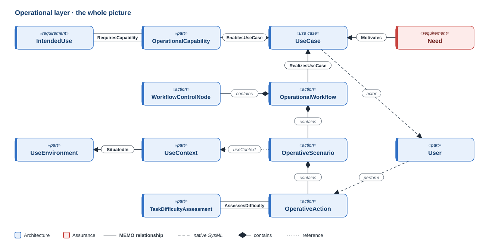
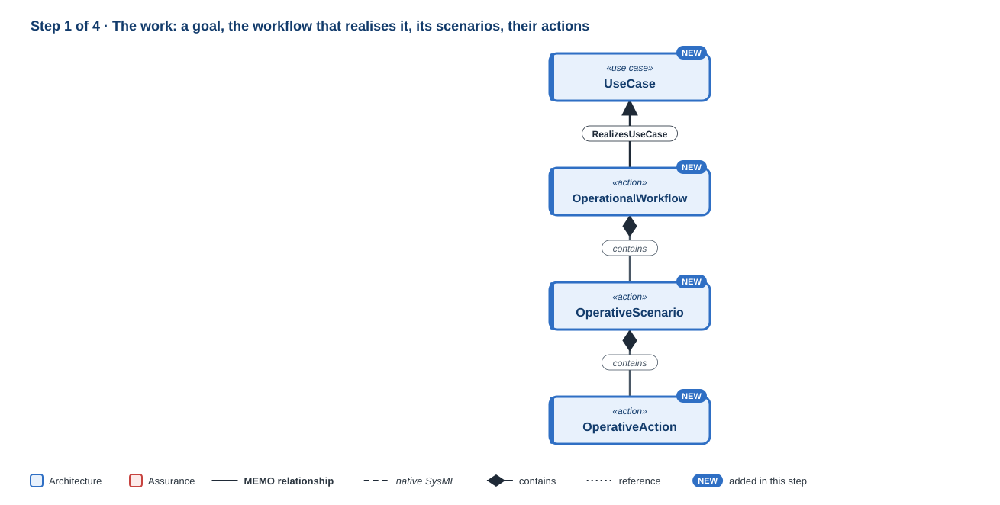
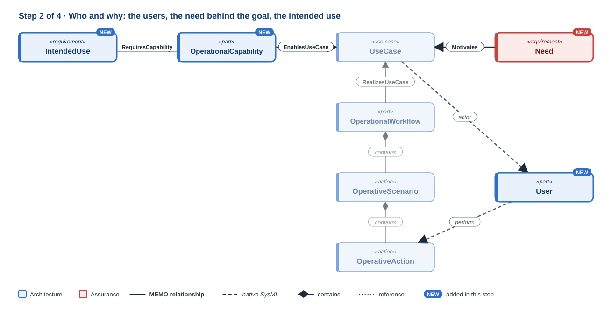
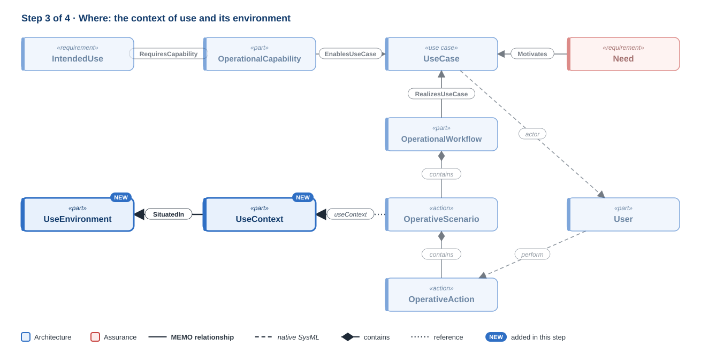
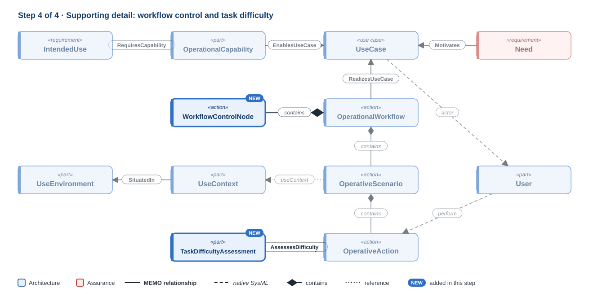

# Operational layer

!!! question "The question this layer answers"
    **Why does the device exist, for whom, and in what setting?**

The operational layer models the work the device enters, before it names any
part of the device. Its heart is four elements: the **goal** a user pursues
(`UseCase`), the **workflow** that realises it, the **scenarios** that are
paths through the workflow, and the **actions** those scenarios are made of.
Everything else on this page supports those four.

[{ .memo-presentation-graphic }](../assets/ontology/operational.svg){ title="Open full size" }

The colours say which part of MEMO an element belongs to: **blue** is
architecture, **red** is assurance. A solid line is one of MEMO's own
relationships, a dashed line is native SysML, a diamond is containment, and a
dotted line is a reference. [How to read the figures](index.md#how-to-read-the-figures)

## Building it up

### Step 1 · The work

[{ .memo-presentation-graphic }](../assets/ontology/operational-step1.svg){ title="Open full size" }

Start from the goal. A `UseCase` is a standard SysML use case: a goal held by an
actor, with the system as its subject. An `OperationalWorkflow` is how the work
toward that goal is organised, and it realises the use case
(`RealizesUseCase`). Many workflows can realise one use case.

A workflow contains its scenarios (`OperativeScenario`): one nominal path, and alternate
paths for exceptions and recovery, told apart by `scenarioKind`. Each scenario
contains the actions (`OperativeAction`) it is made of, ordered natively with
`first … then`, and an action can nest finer steps.

### Step 2 · Who and why

[{ .memo-presentation-graphic }](../assets/ontology/operational-step2.svg){ title="Open full size" }

A `User` pursues the use case as its native `actor`, and performs actions
(`perform`). Who performs an action is a relationship, not a type, so an action
can move from the user to the system without being remodelled.

The goal exists for reasons. A `Need`, from [Requirements](requirements.md),
motivates the use case (`Motivates`). Above it all, the `IntendedUse` is the
device's declared purpose (IEC 62366-1, ISO 14971). It requires
operational capabilities (`OperationalCapability`, via `RequiresCapability`), and each capability enables use
cases (`EnablesUseCase`).

### Step 3 · Where

[{ .memo-presentation-graphic }](../assets/ontology/operational-step3.svg){ title="Open full size" }

A scenario happens in a `UseContext`: its care setting, its jurisdiction, and
whether use is connected. The context is situated in a `UseEnvironment`, the
physical and organisational environment (IEC 62366-1, 3.20). Keeping the two
apart lets one environment serve several contexts.

### Step 4 · Supporting detail

[{ .memo-presentation-graphic }](../assets/ontology/operational-step4.svg){ title="Open full size" }

A workflow's decisions, forks, joins and handoffs are control nodes inside it
(`WorkflowControlNode`). A `TaskDifficultyAssessment` records how demanding an action is in
its context (`AssessesDifficulty`), which feeds the human-factors analysis.

## Where it leads

- **Down to [Functional](functional.md):** the functional layer answers this one.
  An action performs (`perform`) the function that carries it out, and functional steps
  refine operational actions (`#refinement`).
- **Across to assurance:** a task is where a use error is committed
  (`CommitsUseError`, [Human factors](human-factors.md)); risk items and threats
  play out in scenarios (`HazardRelatedScenario`, `RealizedByScenario`); and a
  validation case validates a use case or task (`Validates`,
  [Verification and validation](verification-validation.md)).

## In the running example

In the temperature alarm, the ICU nurse is the user. *Monitor patient
temperature* is the use case the nurse initiates, and *acknowledge alarm* is a
high-criticality task inside the work of reviewing an alarm.

```sysml
--8<-- "examples/temperature-alarm/model/catalog/temperature_alarm.sysml:operational"
```

The GPCA infusion pump shows the full shape: a workflow such as *manage active
therapy* contains a nominal scenario and alternates such as *bolus request
during lockout*. Read it [layer by layer](../layers/use-cases.md).

<details markdown="1">
<summary><strong>Every element and relationship in this layer</strong> (generated from <code>src/architecture/operational/</code>)</summary>

--8<-- "docs/ontology/_generated/operational.md"

</details>
