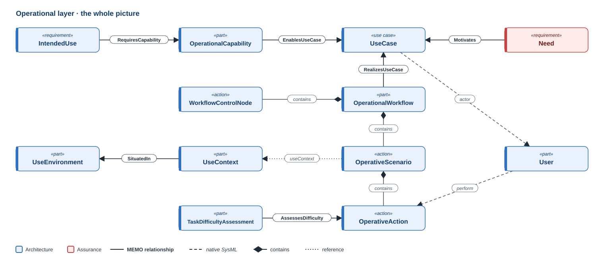
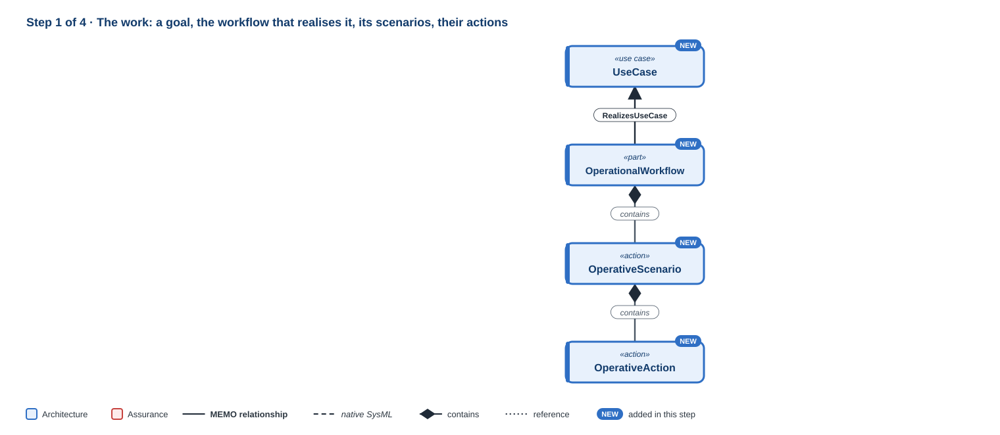
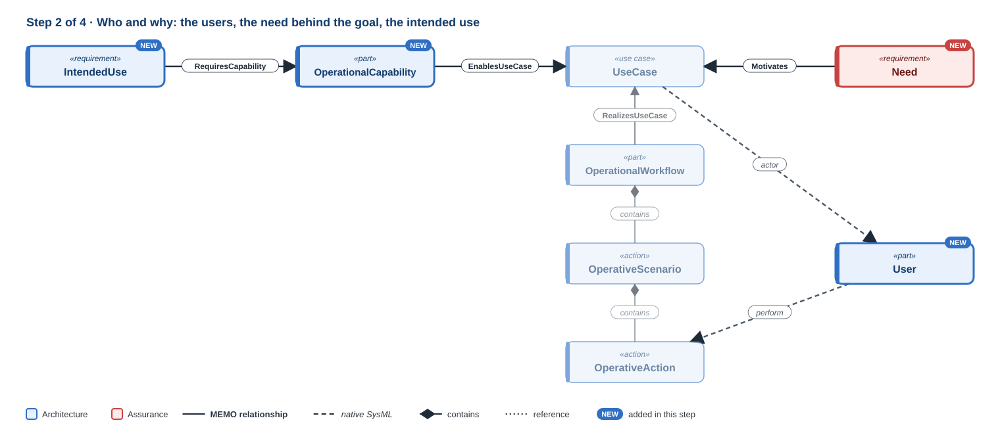
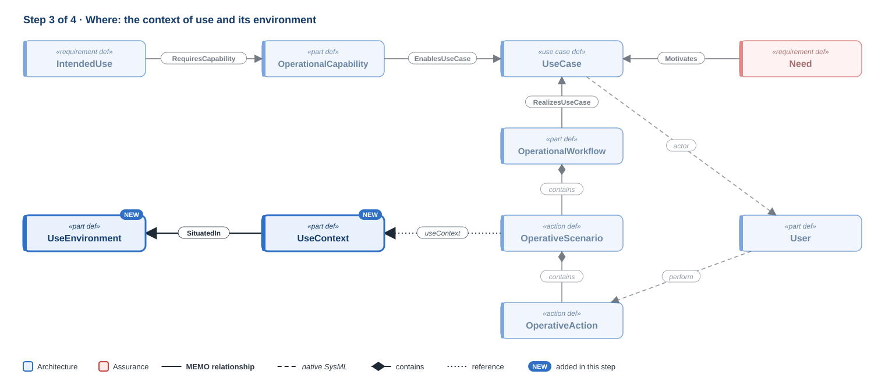
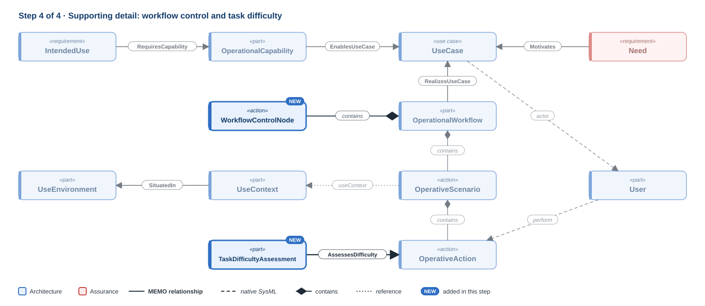

# Operational layer

!!! question "The question this layer answers"
    **Why does the device exist, for whom, and in what setting?**

The operational layer models the work the device enters, before it names any
part of the device. Its heart is four elements: the **goal** a user pursues
(`UseCase`), the **workflow** that realises it, the **scenarios** that are
paths through the workflow, and the **actions** those scenarios are made of.
Everything else on this page supports those four.

[{ .memo-presentation-graphic }](../assets/ontology/operational.svg){ title="Open full size" }

The colours say which part of MEMO an element belongs to: **blue** is
architecture, **red** is assurance. A solid line is one of MEMO's own
relationships, a dashed line is native SysML, a diamond is containment, and a
dotted line is a reference. [How to read the figures](index.md#how-to-read-the-figures)

## How to read this page

Each step below introduces a few elements, then shows them in SysML and explains
every line: its **notation**, **what it says**, and **why** it is written that
way. One small example runs through all the steps: a ward nurse spot-checking a
patient's oxygen saturation, and the pulse oximeter used for it. Each step's code
adds to the previous one, and every stage compiles and passes `memo validate`.
The symbols are collected in
[Reading the notation](../tutorials/hardware/00-reading-the-notation.md); the
same example is built as a story in
[Model the use, step by step](../tutorials/operational/index.md).

## Building it up

### Step 1 · The work

[{ .memo-presentation-graphic }](../assets/ontology/operational-step1.svg){ title="Open full size" }

Start from the goal. A `UseCase` is a standard SysML use case: a goal held by an
actor, with a subject it is pursued with. At the clinical level its subject is
the care team, not the device (`ClinicalUseCase`). An `OperationalWorkflow` is
how the work toward that goal is organised; it realises the use case
(`RealizesUseCase`), and many workflows can realise one use case.

A workflow contains its scenarios (`OperativeScenario`): one nominal path, and
alternate paths for exceptions and recovery, told apart by `scenarioKind`. Each
scenario contains the steps it is made of, ordered with `first … then`. A step is
an `OperativeAction`: define each step once and use it in every scenario it
appears in.

#### Write it

The package, with the system it is about and the work:

```sysml
package layer_operational {
    private import memo::*;

    part def OximeterSystem specializes System;

    part careTeam : OperationalEntity {
        @MemoIdentity { :>> label = "Ward nursing team"; }
    }
    use case ucCheckOxygenation : ClinicalUseCase {
        @MemoIdentity { :>> providedId = "UC-1"; :>> label = "Check a patient's oxygenation"; }
        attribute :>> goalStatement = "Know whether the patient is adequately oxygenated.";
        subject :>> supportingSystem = careTeam;
    }

    action def AttachProbe specializes OperativeAction;
    action def ReadSaturation specializes OperativeAction;
    action def RepositionProbe specializes OperativeAction;

    part wfSpotCheck : ClinicalWorkflow {
        @MemoIdentity { :>> providedId = "WF-1"; :>> label = "Spot-check oxygenation"; }
        attribute :>> entryCondition = "a patient needs an oxygenation check";
        attribute :>> completionCondition = "a value is recorded, or the check is escalated";
        action scNominal : OperativeScenario {
            @MemoIdentity { :>> label = "Reading obtained first time"; }
            action attach : AttachProbe;
            action read : ReadSaturation;
            first attach then read;
        }
        action scPoorSignal : OperativeScenario {
            @MemoIdentity { :>> label = "Poor signal, probe repositioned"; }
            attribute :>> scenarioKind = ScenarioKind::alternate;
            action attach : AttachProbe;
            action reposition : RepositionProbe;
            action read : ReadSaturation;
            first attach then reposition;
            first reposition then read;
        }
    }
    connection : RealizesUseCase connect wfSpotCheck to ucCheckOxygenation;
}
```

#### Line by line

```sysml
package layer_operational {
```

- **Notation.** `package` opens a namespace; everything up to its `}` belongs to it.
- **What it says.** A package for the operational model.
- **Why.** Every element needs an owner; a package owns what is not inside a part.

```sysml
private import memo::*;
```

- **Notation.** `import memo::*` makes every MEMO name usable here (`::*` is "every member of"); `private` keeps them inside this package.
- **What it says.** MEMO's definitions can be written by short name.

```sysml
part def OximeterSystem specializes System;
```

- **Notation.** `part def` declares a definition, a type; `specializes` makes it a kind of MEMO's `System`. With no body it ends in `;`.
- **What it says.** The model is about a system, the pulse oximeter.
- **Why.** Every model names the system it is about (rule CR-ONT-084); MEMO builds its workspaces from it. It is used at level 2, in step 5.

```sysml
part careTeam : OperationalEntity {
```

- **Notation.** `part` declares a part usage; `:` reads "defined by".
- **What it says.** There is an operational entity, the ward nursing team.
- **Why.** A clinical use case needs a subject that is not the device: the team whose work it is.

```sysml
@MemoIdentity { :>> label = "Ward nursing team"; }
```

- **Notation.** `@MemoIdentity { … }` attaches metadata to the element it sits in; `:>> label = "…";` gives a value to an attribute the metadata declares.
- **What it says.** Its display name.

```sysml
}
```

- **Notation.** Closes the part.

```sysml
use case ucCheckOxygenation : ClinicalUseCase {
```

- **Notation.** `use case` declares a use case usage, SysML's construct for a goal.
- **What it says.** There is a clinical-level goal: checking a patient's oxygenation.
- **Why.** `ClinicalUseCase` is level 1: no product, no numbers. The type declares the level, and the validator checks that the subject agrees (CR-ONT-093).

```sysml
@MemoIdentity { :>> providedId = "UC-1"; :>> label = "Check a patient's oxygenation"; }
```

- **Notation.** `@MemoIdentity { … }` attaches metadata to the element it sits in; `:>> label = "…";` gives a value to an attribute the metadata declares.
- **What it says.** Its id and display name.

```sysml
attribute :>> goalStatement = "Know whether the patient is adequately oxygenated.";
```

- **Notation.** `attribute :>>` redefines an attribute the type declares and gives it a value.
- **What it says.** The goal in one sentence.
- **Why.** There is no separate goal element: the use case is the goal.

```sysml
subject :>> supportingSystem = careTeam;
```

- **Notation.** `subject` is the use case's subject parameter; MEMO's `UseCase` names it `supportingSystem`, `:>>` redefines it and `=` binds it.
- **What it says.** The goal is pursued by the care team.
- **Why.** At level 1 the subject is an operational entity, never the device, so any product (or none) can be compared against the same goal.

```sysml
}
```

- **Notation.** Closes the use case.

```sysml
action def AttachProbe specializes OperativeAction;
```

- **Notation.** `action def` declares an action definition; `specializes` makes it a kind of `OperativeAction`.
- **What it says.** Attaching the probe is a kind of operational step.
- **Why.** Defined once, because the step occurs in more than one scenario. Each occurrence is then its own usage, which a test, a timing or a performer can name on its own.

```sysml
action def ReadSaturation specializes OperativeAction;
action def RepositionProbe specializes OperativeAction;
```

- **Notation.** As above.
- **What it says.** Two more steps.

```sysml
part wfSpotCheck : ClinicalWorkflow {
```

- **Notation.** A part usage.
- **What it says.** There is a clinical workflow, the spot check.
- **Why.** A workflow is a `part`, not an action: its scenarios are alternatives, and only one happens each time, whereas an action's nested actions all happen. `ClinicalWorkflow` is level 1 and must realize a level-1 use case (CR-ONT-103).

```sysml
@MemoIdentity { :>> providedId = "WF-1"; :>> label = "Spot-check oxygenation"; }
```

- **Notation.** `@MemoIdentity { … }` attaches metadata to the element it sits in; `:>> label = "…";` gives a value to an attribute the metadata declares.
- **What it says.** Its id and display name.

```sysml
attribute :>> entryCondition = "a patient needs an oxygenation check";
attribute :>> completionCondition = "a value is recorded, or the check is escalated";
```

- **Notation.** Two text values.
- **What it says.** Where the work starts and ends.
- **Why.** Every scenario of the workflow lies between these two.

```sysml
action scNominal : OperativeScenario {
```

- **Notation.** An action usage inside the workflow.
- **What it says.** The workflow has a nominal scenario.
- **Why.** A scenario is a behaviour, so an `action`; it is IEC 62366-1's use scenario. Nested in the workflow because it is one of that workflow's paths.

```sysml
@MemoIdentity { :>> label = "Reading obtained first time"; }
```

- **Notation.** `@MemoIdentity { … }` attaches metadata to the element it sits in; `:>> label = "…";` gives a value to an attribute the metadata declares.
- **What it says.** Its display name.

```sysml
action attach : AttachProbe;
action read : ReadSaturation;
```

- **Notation.** Action usages typed by the step definitions; no body, so `;`.
- **What it says.** On this path the probe is attached, then the saturation read.
- **Why.** Steps live inside scenarios. A step owned directly by the workflow belongs to no path and is reported (CR-ONT-102).

```sysml
first attach then read;
```

- **Notation.** `first a then b` is a succession.
- **What it says.** Reading starts after attaching ends.

```sysml
}
```

- **Notation.** Closes the scenario.

```sysml
action scPoorSignal : OperativeScenario {
```

- **Notation.** As above.
- **What it says.** A second scenario of the same workflow.

```sysml
@MemoIdentity { :>> label = "Poor signal, probe repositioned"; }
```

- **Notation.** `@MemoIdentity { … }` attaches metadata to the element it sits in; `:>> label = "…";` gives a value to an attribute the metadata declares.
- **What it says.** Its display name.

```sysml
attribute :>> scenarioKind = ScenarioKind::alternate;
```

- **Notation.** An enumeration value, written `EnumName::member`: `nominal` (the default) or `alternate`.
- **What it says.** This is an alternate path.
- **Why.** Alternate paths are where use errors and recovery are analysed.

```sysml
action attach : AttachProbe;
action reposition : RepositionProbe;
action read : ReadSaturation;
```

- **Notation.** Action usages.
- **What it says.** Attach, reposition, read.
- **Why.** The same definitions as the nominal path, as new usages: `scPoorSignal.attach` is a different occurrence from `scNominal.attach`, so the same name is fine.

```sysml
first attach then reposition;
first reposition then read;
```

- **Notation.** Successions.
- **What it says.** The order of the path.

```sysml
}
}
```

- **Notation.** Close the scenario, then the workflow.

```sysml
connection : RealizesUseCase connect wfSpotCheck to ucCheckOxygenation;
```

- **Notation.** `connection : T connect a to b;` is a connection typed by `T`, with no name of its own.
- **What it says.** The workflow realizes the use case.
- **Why.** Workflow first, use case second: the link points up, because one goal can be realized by several workflows and does not own them.

```sysml
}
```

- **Notation.** Closes the package.

### Step 2 · Who and why

[{ .memo-presentation-graphic }](../assets/ontology/operational-step2.svg){ title="Open full size" }

A `User` takes part in the use case as its native `actor`, and performs steps
(`perform`). Who performs a step is a relationship, not a type, so a step can
move from the user to the device without being remodelled.

The goal exists for reasons. A `Need`, from [Requirements](requirements.md),
motivates the use case (`Motivates`), and names the user who holds it
(`HeldBy`). Above it all, the `IntendedUse` is the device's declared purpose
(IEC 62366-1, ISO 14971). It requires operational capabilities
(`OperationalCapability`, via `RequiresCapability`), and each capability enables
use cases (`EnablesUseCase`).

#### Write it

Inside `ucCheckOxygenation`, after `subject`:

```sysml
actor clinicianActor = clinician;
```

After the `RealizesUseCase` connection:

```sysml
part clinician : User {
    @MemoIdentity { :>> label = "Ward clinician"; }
    attribute :>> userPopulation = "registered nurses on general wards";
    perform action attachFirstTime references wfSpotCheck.scNominal.attach;
    perform action readFirstTime references wfSpotCheck.scNominal.read;
}
requirement needTrustworthyReading : Need {
    @MemoIdentity { :>> providedId = "NEED-1"; :>> label = "Trustworthy oxygen reading"; }
    attribute :>> needKind = NeedKind::clinicalUser;
    doc /* A clinician needs an oxygen saturation reading they can act on. */
}
connection : HeldBy connect needTrustworthyReading to clinician;
connection : Motivates connect needTrustworthyReading to ucCheckOxygenation;

requirement intendedUse : IntendedUse {
    @MemoIdentity { :>> label = "Intended use"; }
    attribute :>> indication = "spot-check of functional oxygen saturation";
    attribute :>> patientPopulation = "adults on general wards";
}
part capSpotMeasurement : OperationalCapability {
    @MemoIdentity { :>> label = "Measure saturation at the bedside"; }
}
connection : RequiresCapability connect intendedUse to capSpotMeasurement;
connection : EnablesUseCase connect capSpotMeasurement to ucCheckOxygenation;
```

#### Line by line

```sysml
actor clinicianActor = clinician;
```

- **Notation.** `actor` declares an actor parameter of the use case; `= clinician` binds it to the user below.
- **What it says.** The clinician takes part in the goal.
- **Why.** The actor is the modelled `User`, so everything known about that user applies. SysML does not mark which actor initiates; say it in the actor's name if it matters.

```sysml
part clinician : User {
```

- **Notation.** A part usage.
- **What it says.** There is a user, the ward clinician.
- **Why.** `User` is MEMO's definition for a person who uses the device; IEC 62366-1 builds the usability file on who the users are.

```sysml
@MemoIdentity { :>> label = "Ward clinician"; }
```

- **Notation.** `@MemoIdentity { … }` attaches metadata to the element it sits in; `:>> label = "…";` gives a value to an attribute the metadata declares.
- **What it says.** Its display name.

```sysml
attribute :>> userPopulation = "registered nurses on general wards";
```

- **Notation.** A text value.
- **What it says.** Which people this user stands for.
- **Why.** The user profile (population, training, impairments) is what usability validation recruits against.

```sysml
perform action attachFirstTime references wfSpotCheck.scNominal.attach;
```

- **Notation.** `perform action <name> references <path>;` says the owner performs the action at the path. `.` steps into nested features: the `attach` step of the `scNominal` scenario of `wfSpotCheck`.
- **What it says.** The clinician attaches the probe on the nominal path.
- **Why.** A `perform` is written in the performer. The named form is needed when one performer does two steps with the same name (both scenarios have an `attach`): the short form `perform wfSpotCheck.scNominal.attach;` would name the member `attach` twice, which is a compile error.

```sysml
perform action readFirstTime references wfSpotCheck.scNominal.read;
```

- **Notation.** As above.
- **What it says.** And reads the saturation.

```sysml
}
```

- **Notation.** Closes the user.

```sysml
requirement needTrustworthyReading : Need {
```

- **Notation.** `requirement` declares a requirement usage.
- **What it says.** There is a need, a trustworthy oxygen reading.
- **Why.** A need is what someone needs, in their words, before any design; it is a `requirement def` in MEMO.

```sysml
@MemoIdentity { :>> providedId = "NEED-1"; :>> label = "Trustworthy oxygen reading"; }
```

- **Notation.** `@MemoIdentity { … }` attaches metadata to the element it sits in; `:>> label = "…";` gives a value to an attribute the metadata declares.
- **What it says.** Its id and display name.

```sysml
attribute :>> needKind = NeedKind::clinicalUser;
```

- **Notation.** An enumeration value.
- **What it says.** A clinical user holds it.
- **Why.** A user kind of need must name its user (CR-MED-024), which `HeldBy` does below.

```sysml
doc /* A clinician needs an oxygen saturation reading they can act on. */
```

- **Notation.** Documentation.
- **What it says.** The need in words.

```sysml
}
```

- **Notation.** Closes the need.

```sysml
connection : HeldBy connect needTrustworthyReading to clinician;
```

- **Notation.** A typed connection.
- **What it says.** The clinician holds the need.
- **Why.** Need first, holder second.

```sysml
connection : Motivates connect needTrustworthyReading to ucCheckOxygenation;
```

- **Notation.** A typed connection.
- **What it says.** The need motivates the goal.
- **Why.** This joins the requirements chain to the operational one. Need first, use case second.

```sysml
requirement intendedUse : IntendedUse {
```

- **Notation.** A requirement usage.
- **What it says.** There is the device's intended use.
- **Why.** The intended use is the top obligation design inputs derive from, and ISO 14971 5.2 starts the risk analysis from it, so it is a requirement.

```sysml
@MemoIdentity { :>> label = "Intended use"; }
```

- **Notation.** `@MemoIdentity { … }` attaches metadata to the element it sits in; `:>> label = "…";` gives a value to an attribute the metadata declares.
- **What it says.** Its display name.

```sysml
attribute :>> indication = "spot-check of functional oxygen saturation";
attribute :>> patientPopulation = "adults on general wards";
```

- **Notation.** Two text values.
- **What it says.** What it is for and for whom.
- **Why.** Indication and population bound every use case below them.

```sysml
}
```

- **Notation.** Closes the intended use.

```sysml
part capSpotMeasurement : OperationalCapability {
    @MemoIdentity { :>> label = "Measure saturation at the bedside"; }
}
```

- **Notation.** A part usage.
- **What it says.** There is an operational capability: measuring saturation at the bedside.
- **Why.** A capability is an ability the work needs, between the intended use and the goals; one capability can enable several use cases.

```sysml
connection : RequiresCapability connect intendedUse to capSpotMeasurement;
```

- **Notation.** A typed connection.
- **What it says.** The intended use requires that capability.
- **Why.** Intended use first, capability second.

```sysml
connection : EnablesUseCase connect capSpotMeasurement to ucCheckOxygenation;
```

- **Notation.** A typed connection.
- **What it says.** The capability enables the goal.
- **Why.** Capability first, use case second.

### Step 3 · Where

[{ .memo-presentation-graphic }](../assets/ontology/operational-step3.svg){ title="Open full size" }

A use case and its workflow happen in a `UseContext`: the care setting, the
jurisdiction, and whether use is connected. The context is situated in a
`UseEnvironment`, the physical and organisational environment (IEC 62366-1,
3.20): lighting, noise, vibration, temperature. Keeping the two apart lets one
environment serve several contexts.

#### Write it

Inside `ucCheckOxygenation`, after `actor`, and inside `wfSpotCheck`, after `completionCondition`:

```sysml
ref :>> useContext = generalWard;
ref :>> useContext = generalWard;
```

After the `EnablesUseCase` connection:

```sysml
part generalWard : UseContext {
    @MemoIdentity { :>> label = "General ward"; }
    attribute :>> careSetting = "general hospital ward";
    attribute :>> connectedUse = false;
}
part wardEnvironment : UseEnvironment {
    @MemoIdentity { :>> label = "Ward bedside"; }
    attribute :>> lighting = "normal ward lighting, dimmed at night";
    attribute :>> noise = "moderate, frequent alarms nearby";
}
connection : SituatedIn connect generalWard to wardEnvironment;
```

#### Line by line

```sysml
ref :>> useContext = generalWard;
ref :>> useContext = generalWard;
```

- **Notation.** `ref` declares a reference: it points at an element owned elsewhere. `:>>` redefines the `useContext` reference that `UseCase` and `OperationalWorkflow` each declare. The same line goes in each of the two.
- **What it says.** The goal and the workflow both happen in the general ward.
- **Why.** A reference, not ownership: the ward exists apart from any one use case.

```sysml
part generalWard : UseContext {
```

- **Notation.** A part usage.
- **What it says.** There is a context of use, the general ward.
- **Why.** IEC 62366-1 makes the context of use part of the use specification; as an element it can be referenced instead of repeated.

```sysml
@MemoIdentity { :>> label = "General ward"; }
```

- **Notation.** `@MemoIdentity { … }` attaches metadata to the element it sits in; `:>> label = "…";` gives a value to an attribute the metadata declares.
- **What it says.** Its display name.

```sysml
attribute :>> careSetting = "general hospital ward";
```

- **Notation.** A text value.
- **What it says.** The care setting.

```sysml
attribute :>> connectedUse = false;
```

- **Notation.** A Boolean value.
- **What it says.** Used without a network connection.
- **Why.** Connected use brings cybersecurity into scope, so the answer is stated.

```sysml
}
```

- **Notation.** Closes the context.

```sysml
part wardEnvironment : UseEnvironment {
```

- **Notation.** A part usage.
- **What it says.** There is a use environment, the ward bedside.
- **Why.** The physical conditions change how well a user perceives and acts; they are reused across contexts.

```sysml
@MemoIdentity { :>> label = "Ward bedside"; }
```

- **Notation.** `@MemoIdentity { … }` attaches metadata to the element it sits in; `:>> label = "…";` gives a value to an attribute the metadata declares.
- **What it says.** Its display name.

```sysml
attribute :>> lighting = "normal ward lighting, dimmed at night";
attribute :>> noise = "moderate, frequent alarms nearby";
```

- **Notation.** Two text values.
- **What it says.** The lighting and noise there.
- **Why.** Dim light and alarm noise are the conditions a display and an alarm must be designed for.

```sysml
}
```

- **Notation.** Closes the environment.

```sysml
connection : SituatedIn connect generalWard to wardEnvironment;
```

- **Notation.** A typed connection.
- **What it says.** The ward context is situated in that environment.
- **Why.** Context first, environment second.

### Step 4 · Supporting detail

[{ .memo-presentation-graphic }](../assets/ontology/operational-step4.svg){ title="Open full size" }

A scenario's decisions, forks, joins and merges are SysML's own control nodes
inside it, not an ontology type. A `TaskDifficultyAssessment` records how
demanding a step is for a user in an environment (`AssessesDifficulty`), which
feeds the human-factors analysis.

#### Write it

After the `SituatedIn` connection:

```sysml
part tdaAttachProbe : TaskDifficultyAssessment {
    @MemoIdentity { :>> label = "Difficulty of attaching the probe"; }
    attribute :>> overallDifficulty = DemandLevelKind::low;
    attribute :>> dexterityDemand = DemandLevelKind::moderate;
    attribute :>> perceptualDemand = DemandLevelKind::low;
    ref :>> userPopulation = clinician;
    ref :>> useEnvironment = wardEnvironment;
}
connection : AssessesDifficulty connect tdaAttachProbe to wfSpotCheck.scNominal.attach;
```

#### Line by line

```sysml
part tdaAttachProbe : TaskDifficultyAssessment {
```

- **Notation.** A part usage.
- **What it says.** There is an assessment of how hard attaching the probe is.
- **Why.** Difficulty belongs to a step done by a user in an environment, not to the step alone: the same step is harder at night or for a trainee. The assessment is evidence-bearing, so it is an element of its own.

```sysml
@MemoIdentity { :>> label = "Difficulty of attaching the probe"; }
```

- **Notation.** `@MemoIdentity { … }` attaches metadata to the element it sits in; `:>> label = "…";` gives a value to an attribute the metadata declares.
- **What it says.** Its display name.

```sysml
attribute :>> overallDifficulty = DemandLevelKind::low;
attribute :>> dexterityDemand = DemandLevelKind::moderate;
attribute :>> perceptualDemand = DemandLevelKind::low;
```

- **Notation.** Enumeration values: `minimal`, `low`, `moderate`, `high` or `extreme`.
- **What it says.** Low overall, with a moderate need for dexterity.
- **Why.** Each demand is rated separately because each points at a different design response: dexterity at the probe's shape, perception at the display.

```sysml
ref :>> userPopulation = clinician;
ref :>> useEnvironment = wardEnvironment;
```

- **Notation.** Two references.
- **What it says.** Assessed for the ward clinician, at the ward bedside.
- **Why.** These are what make the rating meaningful.

```sysml
}
```

- **Notation.** Closes the assessment.

```sysml
connection : AssessesDifficulty connect tdaAttachProbe to wfSpotCheck.scNominal.attach;
```

- **Notation.** A typed connection; the target is a path to the nested step.
- **What it says.** The assessment is of attaching the probe on the nominal path.
- **Why.** It names the step usage, not the definition: on the poor-signal path the same step may be harder.

### Step 5 · Two levels

Everything so far is **level 1**: the clinical work, with no product and no
numbers. It is the baseline every device is judged against. **Level 2** is the
same work done with one product. Only there do steps carry numbers, and only
there does a step reach the function the device performs, which is the link down
to the [Functional](functional.md) layer.

Each level-2 activity refines the level-1 step it carries out (`#refinement`),
so several products can be compared step by step against one baseline.

#### Write it

After `private import memo::*;` at the top of the package:

```sysml
private import ModelingMetadata::*;
```

After the `AssessesDifficulty` connection:

```sysml
action fnMeasureSpO2 : SystemFunction {
    @MemoIdentity { :>> label = "Measure oxygen saturation"; }
}
part oximeter : OximeterSystem {
    @MemoIdentity { :>> label = "Pulse oximeter"; }
    perform wfWithOximeter.scNominal.read;
}
allocate fnMeasureSpO2 to oximeter;
use case ucCheckWithOximeter : SystemUseCase {
    @MemoIdentity { :>> providedId = "UC-2"; :>> label = "Check oxygenation with the oximeter"; }
    subject :>> supportingSystem = oximeter;
    actor clinicianActor = clinician;
}
part wfWithOximeter : SystemWorkflow {
    @MemoIdentity { :>> providedId = "WF-2"; :>> label = "Spot-check with the oximeter"; }
    action scNominal : OperativeScenario {
        action attach : AttachProbe {
            attribute :>> expectedDuration = 10 [s];
        }
        action read : ReadSaturation {
            attribute :>> expectedDuration = 15 [s];
            perform fnMeasureSpO2;
        }
        first attach then read;
    }
}
connection : RealizesUseCase connect wfWithOximeter to ucCheckWithOximeter;
#refinement dependency wfWithOximeter::scNominal::attach to wfSpotCheck::scNominal::attach;
#refinement dependency wfWithOximeter::scNominal::read to wfSpotCheck::scNominal::read;
```

#### Line by line

```sysml
private import ModelingMetadata::*;
```

- **Notation.** Imports SysML's `ModelingMetadata` library.
- **What it says.** `#refinement` becomes available.
- **Why.** `refinement` is defined there, not in MEMO.

```sysml
action fnMeasureSpO2 : SystemFunction {
    @MemoIdentity { :>> label = "Measure oxygen saturation"; }
}
```

- **Notation.** An action usage typed by MEMO's `SystemFunction`.
- **What it says.** The device has a function, measuring oxygen saturation.
- **Why.** A function belongs to the [Functional](functional.md) layer; it appears here only so a level-2 step can reach it.

```sysml
part oximeter : OximeterSystem {
```

- **Notation.** A part **usage** of the system definition from step 1.
- **What it says.** There is the pulse oximeter.
- **Why.** A use case's subject is bound to a usage; a definition cannot be bound.

```sysml
@MemoIdentity { :>> label = "Pulse oximeter"; }
```

- **Notation.** `@MemoIdentity { … }` attaches metadata to the element it sits in; `:>> label = "…";` gives a value to an attribute the metadata declares.
- **What it says.** Its display name.

```sysml
perform wfWithOximeter.scNominal.read;
```

- **Notation.** The short `perform` form, fine because the oximeter performs one `read`.
- **What it says.** The oximeter carries out the reading activity.
- **Why.** A system-performed activity must perform the function behind it (CR-ONT-096); the `read` activity below does.

```sysml
}
```

- **Notation.** Closes the part.

```sysml
allocate fnMeasureSpO2 to oximeter;
```

- **Notation.** `allocate a to b`.
- **What it says.** The oximeter carries out the function.
- **Why.** A system function should be allocated somewhere (CR-MED-022).

```sysml
use case ucCheckWithOximeter : SystemUseCase {
```

- **Notation.** A use case usage.
- **What it says.** The same goal, pursued with the oximeter.
- **Why.** `SystemUseCase` is level 2; its subject must be a system (CR-ONT-093).

```sysml
@MemoIdentity { :>> providedId = "UC-2"; :>> label = "Check oxygenation with the oximeter"; }
```

- **Notation.** `@MemoIdentity { … }` attaches metadata to the element it sits in; `:>> label = "…";` gives a value to an attribute the metadata declares.
- **What it says.** Its id and display name.

```sysml
subject :>> supportingSystem = oximeter;
```

- **Notation.** As in step 1.
- **What it says.** The subject is the oximeter.

```sysml
actor clinicianActor = clinician;
```

- **Notation.** As in step 2.
- **What it says.** The same clinician takes part.

```sysml
}
```

- **Notation.** Closes the use case.

```sysml
part wfWithOximeter : SystemWorkflow {
```

- **Notation.** A part usage.
- **What it says.** There is a level-2 workflow.
- **Why.** `SystemWorkflow` realizes a system use case (CR-ONT-103).

```sysml
@MemoIdentity { :>> providedId = "WF-2"; :>> label = "Spot-check with the oximeter"; }
```

- **Notation.** `@MemoIdentity { … }` attaches metadata to the element it sits in; `:>> label = "…";` gives a value to an attribute the metadata declares.
- **What it says.** Its id and display name.

```sysml
action scNominal : OperativeScenario {
```

- **Notation.** A scenario.
- **What it says.** Its nominal path.

```sysml
action attach : AttachProbe {
    attribute :>> expectedDuration = 10 [s];
}
```

- **Notation.** `10 [s]` is a quantity: a number with its unit in brackets.
- **What it says.** With this probe, attaching takes about ten seconds.
- **Why.** A number belongs to one product, so it is allowed only at level 2; on a level-1 step it is reported (CR-ONT-094). As a quantity it can be summed into the workflow's duration.

```sysml
action read : ReadSaturation {
    attribute :>> expectedDuration = 15 [s];
```

- **Notation.** As above.
- **What it says.** Reading takes about fifteen seconds.

```sysml
perform fnMeasureSpO2;
```

- **Notation.** `perform` inside an action: the action carries out the function.
- **What it says.** Reading the saturation, with the oximeter, is the device measuring it.
- **Why.** The bridge to the functional layer. From a level-1 step it is reported (CR-ONT-097), because level 1 names no product.

```sysml
}
```

- **Notation.** Closes the activity.

```sysml
first attach then read;
```

- **Notation.** A succession.
- **What it says.** The same order as level 1.

```sysml
}
}
```

- **Notation.** Close the scenario and the workflow.

```sysml
connection : RealizesUseCase connect wfWithOximeter to ucCheckWithOximeter;
```

- **Notation.** As in step 1.
- **What it says.** The level-2 workflow realizes the level-2 use case.

```sysml
#refinement dependency wfWithOximeter::scNominal::attach to wfSpotCheck::scNominal::attach;
```

- **Notation.** `dependency a to b` relates two elements named by qualified names (`::`); `#refinement` in front marks it as a refinement.
- **What it says.** The level-2 attach refines the level-1 attach.
- **Why.** This ties each activity to the baseline step, so products can be compared step by step.

```sysml
#refinement dependency wfWithOximeter::scNominal::read to wfSpotCheck::scNominal::read;
```

- **Notation.** As above.
- **What it says.** The same for reading.

| | Level 1 | Level 2 |
|---|---|---|
| Use case | `ClinicalUseCase`, subject an `OperationalEntity` | `SystemUseCase`, subject a usage of your `System` |
| Workflow | `ClinicalWorkflow` | `SystemWorkflow` |
| Numbers | none | `expectedDuration`, `plannedSuccessProbability`, scenario `likelihood` |
| Functions | never performed | an activity `perform`s the function behind it |
| Link | — | `#refinement` from each activity to its level-1 step |

## Where it leads

- **Down to [Functional](functional.md):** the functional layer answers this one.
  A level-2 activity performs (`perform`) the function that carries it out, and
  each activity refines its level-1 step (`#refinement`).
- **Across to assurance:** a task is where a use error is committed
  (`CommitsUseError`, [Human factors](human-factors.md)); risk items and threats
  play out in scenarios (`HazardRelatedScenario`, `RealizedByScenario`); and a
  validation case validates a use case or task (`Validates`,
  [Verification and validation](verification-validation.md)).

## Rules that check this layer

Each was triggered deliberately on a model like this one to confirm `memo validate` reports it:

| Mistake | Rule |
|---|---|
| a user need that names no user | CR-MED-024 |
| clinical use case whose subject is a system | CR-ONT-093 |
| number on a level-1 step | CR-ONT-094 |
| system-performed activity that performs no function | CR-ONT-096 |
| function performed from a level-1 step | CR-ONT-097 |
| `likelihood` on a level-1 scenario | CR-ONT-099 |
| step owned by the workflow instead of a scenario | CR-ONT-102 |
| workflow realizing a use case of the other level | CR-ONT-103 |

<details markdown="1">
<summary><strong>The whole example</strong> (all five steps; compiles and validates)</summary>

```sysml
package layer_operational {
    private import memo::*;
    private import ModelingMetadata::*;

    part def OximeterSystem specializes System;

    part careTeam : OperationalEntity {
        @MemoIdentity { :>> label = "Ward nursing team"; }
    }
    use case ucCheckOxygenation : ClinicalUseCase {
        @MemoIdentity { :>> providedId = "UC-1"; :>> label = "Check a patient's oxygenation"; }
        attribute :>> goalStatement = "Know whether the patient is adequately oxygenated.";
        subject :>> supportingSystem = careTeam;
        actor clinicianActor = clinician;
        ref :>> useContext = generalWard;
    }

    action def AttachProbe specializes OperativeAction;
    action def ReadSaturation specializes OperativeAction;
    action def RepositionProbe specializes OperativeAction;

    part wfSpotCheck : ClinicalWorkflow {
        @MemoIdentity { :>> providedId = "WF-1"; :>> label = "Spot-check oxygenation"; }
        attribute :>> entryCondition = "a patient needs an oxygenation check";
        attribute :>> completionCondition = "a value is recorded, or the check is escalated";
        ref :>> useContext = generalWard;
        action scNominal : OperativeScenario {
            @MemoIdentity { :>> label = "Reading obtained first time"; }
            action attach : AttachProbe;
            action read : ReadSaturation;
            first attach then read;
        }
        action scPoorSignal : OperativeScenario {
            @MemoIdentity { :>> label = "Poor signal, probe repositioned"; }
            attribute :>> scenarioKind = ScenarioKind::alternate;
            action attach : AttachProbe;
            action reposition : RepositionProbe;
            action read : ReadSaturation;
            first attach then reposition;
            first reposition then read;
        }
    }
    connection : RealizesUseCase connect wfSpotCheck to ucCheckOxygenation;

    part clinician : User {
        @MemoIdentity { :>> label = "Ward clinician"; }
        attribute :>> userPopulation = "registered nurses on general wards";
        perform action attachFirstTime references wfSpotCheck.scNominal.attach;
        perform action readFirstTime references wfSpotCheck.scNominal.read;
    }
    requirement needTrustworthyReading : Need {
        @MemoIdentity { :>> providedId = "NEED-1"; :>> label = "Trustworthy oxygen reading"; }
        attribute :>> needKind = NeedKind::clinicalUser;
        doc /* A clinician needs an oxygen saturation reading they can act on. */
    }
    connection : HeldBy connect needTrustworthyReading to clinician;
    connection : Motivates connect needTrustworthyReading to ucCheckOxygenation;

    requirement intendedUse : IntendedUse {
        @MemoIdentity { :>> label = "Intended use"; }
        attribute :>> indication = "spot-check of functional oxygen saturation";
        attribute :>> patientPopulation = "adults on general wards";
    }
    part capSpotMeasurement : OperationalCapability {
        @MemoIdentity { :>> label = "Measure saturation at the bedside"; }
    }
    connection : RequiresCapability connect intendedUse to capSpotMeasurement;
    connection : EnablesUseCase connect capSpotMeasurement to ucCheckOxygenation;

    part generalWard : UseContext {
        @MemoIdentity { :>> label = "General ward"; }
        attribute :>> careSetting = "general hospital ward";
        attribute :>> connectedUse = false;
    }
    part wardEnvironment : UseEnvironment {
        @MemoIdentity { :>> label = "Ward bedside"; }
        attribute :>> lighting = "normal ward lighting, dimmed at night";
        attribute :>> noise = "moderate, frequent alarms nearby";
    }
    connection : SituatedIn connect generalWard to wardEnvironment;

    part tdaAttachProbe : TaskDifficultyAssessment {
        @MemoIdentity { :>> label = "Difficulty of attaching the probe"; }
        attribute :>> overallDifficulty = DemandLevelKind::low;
        attribute :>> dexterityDemand = DemandLevelKind::moderate;
        attribute :>> perceptualDemand = DemandLevelKind::low;
        ref :>> userPopulation = clinician;
        ref :>> useEnvironment = wardEnvironment;
    }
    connection : AssessesDifficulty connect tdaAttachProbe to wfSpotCheck.scNominal.attach;

    action fnMeasureSpO2 : SystemFunction {
        @MemoIdentity { :>> label = "Measure oxygen saturation"; }
    }
    part oximeter : OximeterSystem {
        @MemoIdentity { :>> label = "Pulse oximeter"; }
        perform wfWithOximeter.scNominal.read;
    }
    allocate fnMeasureSpO2 to oximeter;
    use case ucCheckWithOximeter : SystemUseCase {
        @MemoIdentity { :>> providedId = "UC-2"; :>> label = "Check oxygenation with the oximeter"; }
        subject :>> supportingSystem = oximeter;
        actor clinicianActor = clinician;
    }
    part wfWithOximeter : SystemWorkflow {
        @MemoIdentity { :>> providedId = "WF-2"; :>> label = "Spot-check with the oximeter"; }
        action scNominal : OperativeScenario {
            action attach : AttachProbe {
                attribute :>> expectedDuration = 10 [s];
            }
            action read : ReadSaturation {
                attribute :>> expectedDuration = 15 [s];
                perform fnMeasureSpO2;
            }
            first attach then read;
        }
    }
    connection : RealizesUseCase connect wfWithOximeter to ucCheckWithOximeter;
    #refinement dependency wfWithOximeter::scNominal::attach to wfSpotCheck::scNominal::attach;
    #refinement dependency wfWithOximeter::scNominal::read to wfSpotCheck::scNominal::read;
}
```

</details>

## In the running example

In the temperature alarm, the ICU nurse is the user. *Monitor patient
temperature* is the use case the nurse initiates, and *acknowledge alarm* is a
high-criticality task inside the work of reviewing an alarm.

```sysml
--8<-- "examples/temperature-alarm/model/catalog/temperature_alarm.sysml:operational"
```

The GPCA infusion pump shows the full shape: a workflow such as *manage active
therapy* contains a nominal scenario and alternates such as *bolus request
during lockout*. Read it [layer by layer](../layers/use-cases.md).

<details markdown="1">
<summary><strong>Every element and relationship in this layer</strong> (generated from <code>src/architecture/operational/</code>)</summary>

--8<-- "docs/ontology/_generated/operational.md"

</details>
