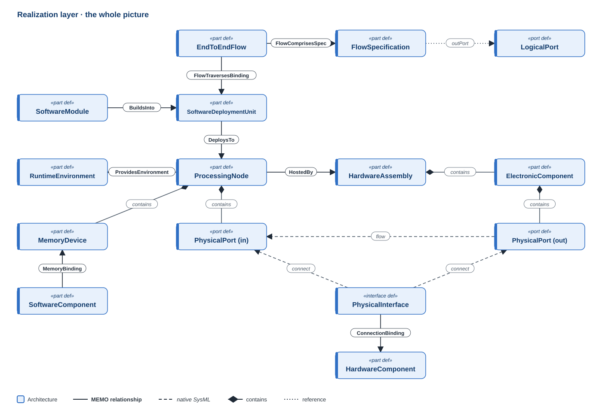
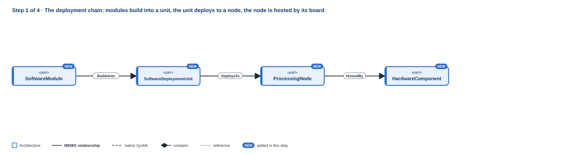
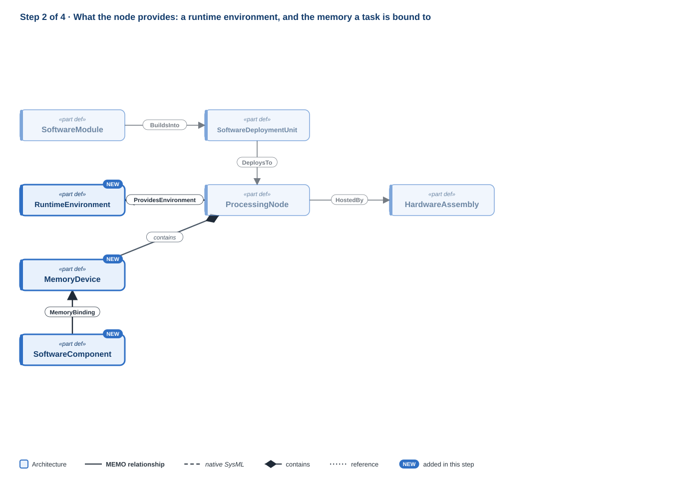
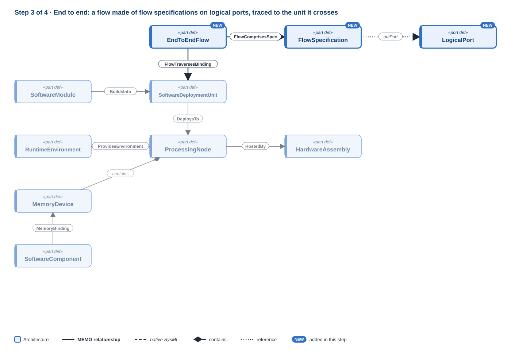
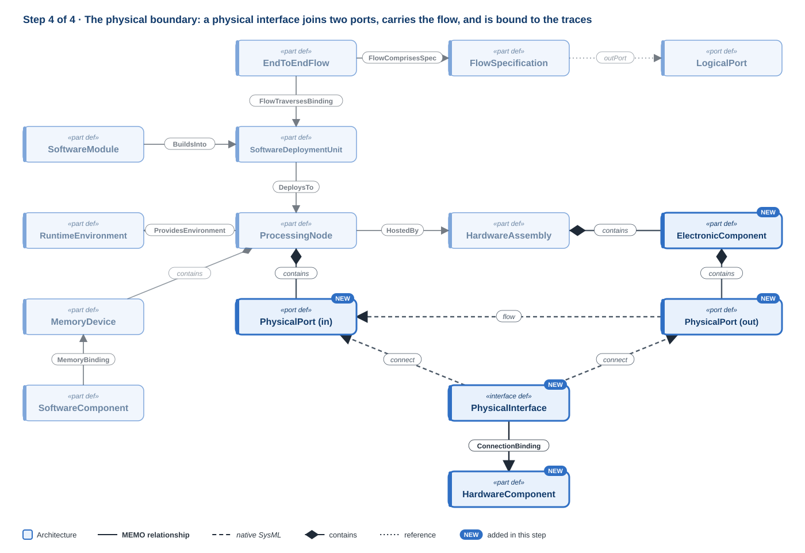

# Realization layer

!!! question "The question this layer answers"
    **Where does it run, and how do its parts reach each other?**

The realization layer closes the architecture path. Software is built into images, the images are deployed onto processors, the processors sit on boards, and data travels end to end across the result. Its heart is that **deployment chain**, the one a reviewer follows to check that a timing budget, a fault-containment claim or a security boundary holds in the device that actually ships.

**Namespace:** `memo::architecture::realization` · **Source:** `src/architecture/realization/`

[{ .memo-presentation-graphic }](../assets/ontology/realization.svg){ title="Open full size" }

The colours say which part of MEMO an element belongs to: **blue** is
architecture, **red** is assurance. A solid line is one of MEMO's own
relationships, a dashed line is native SysML, a diamond is containment, and a
dotted line is a reference. [How to read the figures](index.md#how-to-read-the-figures)

## How to read this page

Each step below introduces a few elements, then shows them in SysML and explains
every line: its **notation**, **what it says**, and **why** it is written that
way. The example is the pulse oximeter again: the logical blocks of the
[Logical](logical.md) page and the firmware and hardware of the
[Implementation](implementation.md) page, now given somewhere to run. It is a
third file beside those two, which it imports. Each step's code adds to the
previous one, and every stage compiles and passes `memo validate`. The symbols
are collected in [Reading the notation](../tutorials/hardware/00-reading-the-notation.md).

## Building it up
### Step 1 · The deployment chain

[{ .memo-presentation-graphic }](../assets/ontology/realization-step1.svg){ title="Open full size" }

A `SoftwareDeploymentUnit` is what is actually deployed, such as a firmware
image. A `ProcessingNode` is a processor that software runs on. The chain is a
sequence of typed native allocations, each a SysML `allocation` with a MEMO
definition: software modules build into a unit (`BuildsInto`), the unit deploys
to a processing node (`DeploysTo`, whose `deploymentKind` says how: native,
containerised, cloud-hosted, embedded, or partitioned), and the node is hosted
by the board it is mounted on (`HostedBy`, from Core). Each allocation's ends
are typed, so `memo validate` reports one that joins the wrong kinds of element.
`HostedBy` takes any part; a board that carries other parts is an assembly, so
the host is a `HardwareAssembly`.

#### Write it

A new file, beside the Logical and Implementation ones:

```sysml
package layer_realization {
    private import memo::*;
    private import layer_logical::*;
    private import layer_implementation::*;

    part firmwareImage : SoftwareDeploymentUnit {
        @MemoIdentity { :>> label = "Firmware image"; }
        attribute :>> unitKind = "Signed firmware image";
        attribute :>> version = "1.0.0";
        attribute :>> integrityProtection = "Signature checked by the bootloader before it runs";
        attribute :>> installationMechanism = "Programmed at the factory; updated over USB";
    }
    allocation : BuildsInto allocate firmware.spo2Item to firmwareImage;
    allocation : BuildsInto allocate firmware.rtosKernel to firmwareImage;

    part mcu : ProcessingNode {
        @MemoIdentity { :>> label = "Main microcontroller"; }
        attribute :>> nodeKind = ProcessingNodeKind::microcontroller;
        attribute :>> processorArchitecture = "Arm Cortex-M4";
        attribute :>> realTimeCapable = true;
        attribute :>> supportsContainerization = false;
    }
    allocation imageOnMcu : DeploysTo allocate firmwareImage to mcu {
        attribute :>> deploymentKind = DeploymentKind::embedded;
    }

    part mainBoard : HardwareAssembly {
        @MemoIdentity { :>> label = "Main board"; }
        attribute :>> responsibility = "Carry the processor and the analog front end";
    }
    allocation : HostedBy allocate mcu to mainBoard;
}
```

#### Line by line

```sysml
package layer_realization {
```

- **Notation.** `package` opens a namespace; everything up to its `}` belongs to it.
- **What it says.** A package for the realization model.

```sysml
private import memo::*;
```

- **Notation.** `import memo::*` makes every MEMO name usable here; `private` keeps them inside this package.
- **What it says.** MEMO's definitions can be written by short name.

```sysml
private import layer_logical::*;
private import layer_implementation::*;
```

- **Notation.** The same import, of the two earlier pages' packages.
- **What it says.** The logical blocks and the firmware and hardware can be named here.
- **Why.** Realization says where the implementation runs. It refers to the other two models rather than adding to them, so the same firmware could be deployed differently in another product.

```sysml
part firmwareImage : SoftwareDeploymentUnit {
```

- **Notation.** `part` declares a usage; `:` reads "defined by".
- **What it says.** There is a firmware image.
- **Why.** The image is what is versioned, signed, installed and recalled. It is a separate element from the modules it is built from, because one module can go into several images and one image holds many modules.

```sysml
@MemoIdentity { :>> label = "Firmware image"; }
```

- **Notation.** `@MemoIdentity { … }` attaches metadata to the element it sits in; `:>> label = "…";` gives a value to an attribute the metadata declares.
- **What it says.** Its display name.

```sysml
attribute :>> unitKind = "Signed firmware image";
```

- **Notation.** `attribute :>>` redefines an attribute the type declares and gives it a value.
- **What it says.** What kind of unit it is.

```sysml
attribute :>> version = "1.0.0";
```

- **Notation.** `attribute :>>` redefines an attribute the type declares and gives it a value.
- **What it says.** The version that ships.
- **Why.** The image version is what configuration management and a field recall identify.

```sysml
attribute :>> integrityProtection = "Signature checked by the bootloader before it runs";
```

- **Notation.** `attribute :>>` redefines an attribute the type declares and gives it a value.
- **What it says.** How tampering is detected.
- **Why.** A cybersecurity assessment asks how the device knows its code is its own.

```sysml
attribute :>> installationMechanism = "Programmed at the factory; updated over USB";
```

- **Notation.** `attribute :>>` redefines an attribute the type declares and gives it a value.
- **What it says.** How it gets onto the device.

```sysml
}
```

- **Notation.** Closes the image.

```sysml
allocation : BuildsInto allocate firmware.spo2Item to firmwareImage;
allocation : BuildsInto allocate firmware.rtosKernel to firmwareImage;
```

- **Notation.** `allocation : BuildsInto` declares an unnamed allocation defined by MEMO's `BuildsInto`; `allocate a to b` gives its two ends, source first.
- **What it says.** The SpO2 module and the kernel are built into the image.
- **Why.** A module building into an image is an allocation, and SysML has one; `BuildsInto` only fixes its end types, so a runtime task in place of a module is reported.

```sysml
part mcu : ProcessingNode {
```

- **Notation.** A part usage defined by MEMO's `ProcessingNode`.
- **What it says.** There is the main microcontroller.
- **Why.** A processing node is a physical thing, a chip, but it is the target software is deployed to, so its definition carries what deployment needs to know about it.

```sysml
@MemoIdentity { :>> label = "Main microcontroller"; }
```

- **Notation.** `@MemoIdentity { … }` attaches metadata to the element it sits in; `:>> label = "…";` gives a value to an attribute the metadata declares.
- **What it says.** Its display name.

```sysml
attribute :>> nodeKind = ProcessingNodeKind::microcontroller;
```

- **Notation.** `attribute :>>` redefines an attribute the type declares and gives it a value. Other values include `SoC`, `FPGA`, `DSP`, `gateway` and `cloudServer`.
- **What it says.** It is a microcontroller.

```sysml
attribute :>> processorArchitecture = "Arm Cortex-M4";
```

- **Notation.** `attribute :>>` redefines an attribute the type declares and gives it a value.
- **What it says.** Its processor core.

```sysml
attribute :>> realTimeCapable = true;
attribute :>> supportsContainerization = false;
```

- **Notation.** `attribute :>>` redefines an attribute the type declares and gives it a value.
- **What it says.** It can meet real-time deadlines and cannot run containers.
- **Why.** These say which software the node can take. No rule compares them with what is deployed to it yet, so a reviewer reads them.

```sysml
}
```

- **Notation.** Closes the node.

```sysml
allocation imageOnMcu : DeploysTo allocate firmwareImage to mcu {
```

- **Notation.** As above, with `DeploysTo`; this allocation has a name, `imageOnMcu`, and a body.
- **What it says.** The image is deployed to the microcontroller.
- **Why.** Deployment is the link a timing or fault-containment claim is checked against: the code's deadline only means something on the processor it runs on.

```sysml
attribute :>> deploymentKind = DeploymentKind::embedded;
```

- **Notation.** `attribute :>>` redefines an attribute the type declares and gives it a value.
- **What it says.** It is deployed as embedded firmware.
- **Why.** The kind belongs to the deployment, not to the image or the node: the same image could run natively in a test rig.

```sysml
}
```

- **Notation.** Closes the allocation.

```sysml
part mainBoard : HardwareAssembly {
```

- **Notation.** A part usage defined by `HardwareAssembly`.
- **What it says.** There is the main board.

```sysml
@MemoIdentity { :>> label = "Main board"; }
```

- **Notation.** `@MemoIdentity { … }` attaches metadata to the element it sits in; `:>> label = "…";` gives a value to an attribute the metadata declares.
- **What it says.** Its display name.

```sysml
attribute :>> responsibility = "Carry the processor and the analog front end";
```

- **Notation.** `attribute :>>` redefines an attribute the type declares and gives it a value.
- **What it says.** What the board is for.

```sysml
}
```

- **Notation.** Closes the board.

```sysml
allocation : HostedBy allocate mcu to mainBoard;
```

- **Notation.** As above, with `HostedBy`.
- **What it says.** The microcontroller is mounted on the main board.
- **Why.** This closes the chain from module to board, the path a reviewer follows to find which hardware a piece of code depends on.

```sysml
}
```

- **Notation.** Closes the package.

### Step 2 · What the node provides

[{ .memo-presentation-graphic }](../assets/ontology/realization-step2.svg){ title="Open full size" }

A node provides a `RuntimeEnvironment`, the operating system or runtime it offers
(`ProvidesEnvironment`), and has `MemoryDevice`s, written inside it. Both nodes and memory are
physical things, a chip and a board, that live in this layer because of their
role as deployment targets. A runtime software component is bound to the memory
its code and data occupy (`MemoryBinding`), which is what turns a memory budget
into a claim about a device.

#### Write it

Inside the microcontroller, after its attributes:

```sysml
part sram : MemoryDevice {
    @MemoIdentity { :>> label = "Internal SRAM"; }
    attribute :>> memoryKind = "SRAM";
    attribute :>> capacityMB = 0.25 [mega*B];
    attribute :>> nonVolatile = false;
}
```

After the board:

```sysml
part kernelRuntime : RuntimeEnvironment {
    @MemoIdentity { :>> label = "Kernel runtime"; }
    attribute :>> environmentKind = "RTOS";
    attribute :>> osOrRtos = "Real-time kernel 10.6.2";
    attribute :>> providedServices = "Fixed-priority scheduling, timers, message queues";
}
connection : ProvidesEnvironment connect mcu to kernelRuntime;
allocation : MemoryBinding allocate firmware.measurementTask to mcu.sram {
    attribute :>> bindingKind = "Stack and data";
}
```

#### Line by line

```sysml
part sram : MemoryDevice {
```

- **Notation.** A part usage inside the node's body, defined by `MemoryDevice`.
- **What it says.** The microcontroller has internal SRAM.
- **Why.** The memory is on the chip, so it is written inside the node: a physical element contains physical elements (CR-ONT-079).

```sysml
@MemoIdentity { :>> label = "Internal SRAM"; }
```

- **Notation.** `@MemoIdentity { … }` attaches metadata to the element it sits in; `:>> label = "…";` gives a value to an attribute the metadata declares.
- **What it says.** Its display name.

```sysml
attribute :>> memoryKind = "SRAM";
```

- **Notation.** `attribute :>>` redefines an attribute the type declares and gives it a value.
- **What it says.** What kind of memory it is.

```sysml
attribute :>> capacityMB = 0.25 [mega*B];
```

- **Notation.** A quantity value; `mega*B` is megabytes, `B` the byte.
- **What it says.** It holds a quarter of a megabyte.
- **Why.** A capacity is a storage quantity, not a string, so it can be compared with what is bound to it.

```sysml
attribute :>> nonVolatile = false;
```

- **Notation.** `attribute :>>` redefines an attribute the type declares and gives it a value.
- **What it says.** Its contents are lost at power-off.

```sysml
}
```

- **Notation.** Closes the memory.

```sysml
part kernelRuntime : RuntimeEnvironment {
```

- **Notation.** A part usage defined by `RuntimeEnvironment`.
- **What it says.** There is the runtime the node offers.
- **Why.** This is the kernel as the platform software runs on: what it provides. The kernel as shipped code, with its supplier and anomaly list, is the SOUP module of the Implementation page. One thing seen from two sides.

```sysml
@MemoIdentity { :>> label = "Kernel runtime"; }
```

- **Notation.** `@MemoIdentity { … }` attaches metadata to the element it sits in; `:>> label = "…";` gives a value to an attribute the metadata declares.
- **What it says.** Its display name.

```sysml
attribute :>> environmentKind = "RTOS";
```

- **Notation.** `attribute :>>` redefines an attribute the type declares and gives it a value.
- **What it says.** It is a real-time operating system.

```sysml
attribute :>> osOrRtos = "Real-time kernel 10.6.2";
```

- **Notation.** `attribute :>>` redefines an attribute the type declares and gives it a value.
- **What it says.** Which one.

```sysml
attribute :>> providedServices = "Fixed-priority scheduling, timers, message queues";
```

- **Notation.** `attribute :>>` redefines an attribute the type declares and gives it a value.
- **What it says.** What it offers the software.
- **Why.** The services are what the measurement task relies on, so a change of kernel can be judged against them.

```sysml
}
```

- **Notation.** Closes the runtime.

```sysml
connection : ProvidesEnvironment connect mcu to kernelRuntime;
```

- **Notation.** `connection : ProvidesEnvironment` declares an unnamed connection; `connect a to b` gives its ends.
- **What it says.** The microcontroller provides the kernel runtime.

```sysml
allocation : MemoryBinding allocate firmware.measurementTask to mcu.sram {
```

- **Notation.** As in step 1, with `MemoryBinding`.
- **What it says.** The measurement task occupies the SRAM.
- **Why.** This is AADL's memory binding. Without it, a runtime component's memory budget names no memory to be checked against.

```sysml
attribute :>> bindingKind = "Stack and data";
```

- **Notation.** `attribute :>>` redefines an attribute the type declares and gives it a value.
- **What it says.** What of the task is held there.

```sysml
}
```

- **Notation.** Closes the binding.

### Step 3 · End to end

[{ .memo-presentation-graphic }](../assets/ontology/realization-step3.svg){ title="Open full size" }

A `FlowSpecification` is a flow declared at a logical component's boundary: a
**source** that starts at an out port, a **sink** that ends at an in port, or a
**path** from an in port to an out port. An `EndToEndFlow` is a complete
source-to-sink flow traced across the layers. It is made of ordered flow
specifications (`FlowComprisesSpec`), names the logical blocks, runtime
components and nodes it passes through, and records the deployment units it
traverses (`FlowTraversesBinding`). Its latency budget and analysis purpose
(latency, fault propagation, or security) are what AADL-style analysis reads;
no `memo validate` rule checks the budget.

#### Write it

After the memory binding:

```sysml
part fsSensing : FlowSpecification {
    attribute :>> flowKind = FlowSpecKind::source;
    ref :>> outPort = oximeter.measurement.sensing.signalOut;
}
part fsProcessing : FlowSpecification {
    attribute :>> flowKind = FlowSpecKind::path;
    ref :>> inPort = oximeter.measurement.processing.signalIn;
    ref :>> outPort = oximeter.measurement.processing.readingOut;
}
part fsDisplay : FlowSpecification {
    attribute :>> flowKind = FlowSpecKind::sink;
    ref :>> inPort = oximeter.display.readingIn;
}

part e2eReading : EndToEndFlow {
    @MemoIdentity { :>> label = "Light to displayed reading"; }
    attribute :>> latencyBudgetMs = 1000 [milli*s];
    attribute :>> analysisPurpose = "latency";
    ref :>> logicalSegments = (oximeter.measurement.sensing, oximeter.measurement.processing, oximeter.display);
    ref :>> softwareSegments = firmware.measurementTask;
    ref :>> hostNodes = mcu;
}
connection : FlowComprisesSpec connect e2eReading to fsSensing { attribute :>> segmentOrder = 1; }
connection : FlowComprisesSpec connect e2eReading to fsProcessing { attribute :>> segmentOrder = 2; }
connection : FlowComprisesSpec connect e2eReading to fsDisplay { attribute :>> segmentOrder = 3; }
allocation : FlowTraversesBinding allocate e2eReading to firmwareImage;
```

#### Line by line

```sysml
part fsSensing : FlowSpecification {
```

- **Notation.** A part usage defined by `FlowSpecification`.
- **What it says.** A flow specification for the sensing channel.
- **Why.** AADL separates what a component declares at its boundary from how a whole flow is routed; the specification is the first.

```sysml
attribute :>> flowKind = FlowSpecKind::source;
```

- **Notation.** `attribute :>>` redefines an attribute the type declares and gives it a value. The values are `source`, `sink` and `path`.
- **What it says.** The flow starts in the sensing channel.

```sysml
ref :>> outPort = oximeter.measurement.sensing.signalOut;
```

- **Notation.** `ref :>>` redefines a reference the type declares; `=` binds it to the feature chain that follows.
- **What it says.** It leaves through the channel's signal port.
- **Why.** The specification points at the logical port, so it moves with the logical design rather than restating it.

```sysml
}
```

- **Notation.** Closes the specification.

```sysml
part fsProcessing : FlowSpecification {
```

- **Notation.** As above.
- **What it says.** A flow specification for the processing channel.

```sysml
attribute :>> flowKind = FlowSpecKind::path;
```

- **Notation.** `attribute :>>` redefines an attribute the type declares and gives it a value.
- **What it says.** The flow passes through it.

```sysml
ref :>> inPort = oximeter.measurement.processing.signalIn;
ref :>> outPort = oximeter.measurement.processing.readingOut;
```

- **Notation.** As above.
- **What it says.** It enters at the signal port and leaves at the reading port.

```sysml
}
```

- **Notation.** Closes the specification.

```sysml
part fsDisplay : FlowSpecification {
```

- **Notation.** As above.
- **What it says.** A flow specification for the display.

```sysml
attribute :>> flowKind = FlowSpecKind::sink;
```

- **Notation.** `attribute :>>` redefines an attribute the type declares and gives it a value.
- **What it says.** The flow ends at the display.

```sysml
ref :>> inPort = oximeter.display.readingIn;
```

- **Notation.** As above.
- **What it says.** It arrives at the display's reading port.

```sysml
}
```

- **Notation.** Closes the specification.

```sysml
part e2eReading : EndToEndFlow {
```

- **Notation.** A part usage defined by `EndToEndFlow`.
- **What it says.** The flow from light at the finger to the number on the screen.
- **Why.** A latency claim is about the whole path, not about any one component, so it needs an element of its own.

```sysml
@MemoIdentity { :>> label = "Light to displayed reading"; }
```

- **Notation.** `@MemoIdentity { … }` attaches metadata to the element it sits in; `:>> label = "…";` gives a value to an attribute the metadata declares.
- **What it says.** Its display name.

```sysml
attribute :>> latencyBudgetMs = 1000 [milli*s];
```

- **Notation.** A quantity value in milliseconds.
- **What it says.** The whole flow has one second.
- **Why.** The budget answers the system requirement "updated once per second". It is a quantity so an analysis can add up the segments against it; no rule in `memo validate` does that yet.

```sysml
attribute :>> analysisPurpose = "latency";
```

- **Notation.** `attribute :>>` redefines an attribute the type declares and gives it a value.
- **What it says.** The flow is traced to check latency.
- **Why.** The same path can be traced for fault propagation or security, which ask different questions of it.

```sysml
ref :>> logicalSegments = (oximeter.measurement.sensing, oximeter.measurement.processing, oximeter.display);
```

- **Notation.** `( a, b, c )` is a sequence; the reference can hold several elements.
- **What it says.** The flow crosses the sensing channel, the processing channel and the display.

```sysml
ref :>> softwareSegments = firmware.measurementTask;
ref :>> hostNodes = mcu;
```

- **Notation.** As above, with one element each.
- **What it says.** In software it runs through the measurement task, on the microcontroller.
- **Why.** These tie the logical path to what executes it and where, which is where latency actually accrues.

```sysml
}
```

- **Notation.** Closes the flow.

```sysml
connection : FlowComprisesSpec connect e2eReading to fsSensing { attribute :>> segmentOrder = 1; }
connection : FlowComprisesSpec connect e2eReading to fsProcessing { attribute :>> segmentOrder = 2; }
connection : FlowComprisesSpec connect e2eReading to fsDisplay { attribute :>> segmentOrder = 3; }
```

- **Notation.** Unnamed connections defined by `FlowComprisesSpec`, each with a body that gives `segmentOrder`.
- **What it says.** The flow is the three specifications, in this order.
- **Why.** The order is stated because a set of connections has none, and a path does.

```sysml
allocation : FlowTraversesBinding allocate e2eReading to firmwareImage;
```

- **Notation.** As in step 1, with `FlowTraversesBinding`.
- **What it says.** The flow passes through the firmware image.
- **Why.** The image's deployment is where software meets hardware on this path.

### Step 4 · The physical boundary

[{ .memo-presentation-graphic }](../assets/ontology/realization-step4.svg){ title="Open full size" }

Hardware is wired as parts with ports. A `PhysicalPort` is a physical boundary
feature, a pin, a socket, a connector, and the port usage says `in`, `out` or
`inout` itself. A `PhysicalInterface` joins two physical ports and states how
the link is signalled (`signalingKind`: analog, digital, discrete, pulse or power
transfer) and over what medium (`mediumKind`). A `PhysicalTransfer`, a
`PhysicalFlow`, is what crosses it. A `ConnectionBinding` allocates the
interface to the cable, connector, trace or medium that carries it. The
[hardware series](../tutorials/hardware/11-interfaces.md) builds the same
pattern for the probe cable.

A `ConnectionBinding` can also bind a logical `ComponentExchange` to its medium,
for example the Logical page's signal exchange to the probe cable. The valid
SysML for that names the exchange with a feature chain,
`allocate oximeter.measurement.ceSignal to probeCable`, and `memo validate`
today reads that end as the `measurement` subsystem rather than the exchange and
reports a wrong end type. So the example binds only the physical interface.

#### Write it

Inside the microcontroller, after the SRAM:

```sysml
in port spiIn : PhysicalPort {
    attribute :>> portKind = InterfaceKind::digitalSignal;
    in item samples;
}
```

Inside the main board, after its responsibility:

```sysml
part frontEnd : ElectronicComponent {
    @MemoIdentity { :>> label = "Analog front end"; }
    attribute :>> componentFamily = "Photodiode amplifier and ADC";
    attribute :>> patientContact = false;
    out port spiOut : PhysicalPort {
        attribute :>> portKind = InterfaceKind::digitalSignal;
        out item samples;
    }
}
part spiTraces : HardwareComponent {
    @MemoIdentity { :>> label = "SPI traces"; }
    attribute :>> materialSummary = "Copper traces on the board";
    attribute :>> patientContact = false;
}
```

At the end of the package:

```sysml
interface spiLink : PhysicalInterface connect mainBoard.frontEnd.spiOut to mcu.spiIn {
    @MemoIdentity { :>> label = "Front end to MCU"; }
    attribute :>> signalingKind = SignalingKind::digital;
    attribute :>> mediumKind = PhysicalMediumKind::electrical;
    attribute :>> electricalStandard = "SPI, 3.3 V logic";
    attribute :>> nominalVoltageV = 3.3 [V];
    attribute :>> direction = DirectionKind::output;
}
flow : PhysicalTransfer from mainBoard.frontEnd.spiOut.samples to mcu.spiIn.samples {
    attribute :>> quantity = "Digitised photodiode samples";
}
allocation : ConnectionBinding allocate spiLink to mainBoard.spiTraces;
```

#### Line by line

```sysml
in port spiIn : PhysicalPort {
```

- **Notation.** `in port` declares a port usage with a direction; `PhysicalPort` is MEMO's physical port definition.
- **What it says.** The microcontroller has an SPI input.
- **Why.** Direction is written on the port, in the language's own keyword, and the exchange rules check every interface and flow against it (AR-EXCH-002).

```sysml
attribute :>> portKind = InterfaceKind::digitalSignal;
```

- **Notation.** `attribute :>>` redefines an attribute the type declares and gives it a value.
- **What it says.** It carries a digital signal.

```sysml
in item samples;
```

- **Notation.** `in item` declares what crosses the port, and which way.
- **What it says.** Samples come in through it.
- **Why.** A flow joins items on ports, so the port must say what it carries. The item has no type here because only its quantity matters on this page.

```sysml
}
```

- **Notation.** Closes the port.

```sysml
part frontEnd : ElectronicComponent {
```

- **Notation.** A part usage inside the board, defined by `ElectronicComponent`.
- **What it says.** The board carries the analog front end.

```sysml
@MemoIdentity { :>> label = "Analog front end"; }
```

- **Notation.** `@MemoIdentity { … }` attaches metadata to the element it sits in; `:>> label = "…";` gives a value to an attribute the metadata declares.
- **What it says.** Its display name.

```sysml
attribute :>> componentFamily = "Photodiode amplifier and ADC";
```

- **Notation.** `attribute :>>` redefines an attribute the type declares and gives it a value.
- **What it says.** What kind of electronic part it is.

```sysml
attribute :>> patientContact = false;
```

- **Notation.** `attribute :>>` redefines an attribute the type declares and gives it a value.
- **What it says.** It does not touch the patient.
- **Why.** CR-ONT-032 counts an unstated contact as failing, as on the Implementation page.

```sysml
out port spiOut : PhysicalPort {
```

- **Notation.** As above, with `out`.
- **What it says.** The front end has an SPI output.

```sysml
attribute :>> portKind = InterfaceKind::digitalSignal;
```

- **Notation.** As above.
- **What it says.** It too carries a digital signal.

```sysml
out item samples;
```

- **Notation.** As above.
- **What it says.** Samples go out through it.

```sysml
}
```

- **Notation.** Closes the port.

```sysml
}
```

- **Notation.** Closes the front end.

```sysml
part spiTraces : HardwareComponent {
```

- **Notation.** A part usage inside the board.
- **What it says.** The board has the traces that carry SPI.
- **Why.** The medium is a part of its own. The interface is the contract between two ports; what physically carries it is something you can inspect, damage and replace.

```sysml
@MemoIdentity { :>> label = "SPI traces"; }
```

- **Notation.** `@MemoIdentity { … }` attaches metadata to the element it sits in; `:>> label = "…";` gives a value to an attribute the metadata declares.
- **What it says.** Its display name.

```sysml
attribute :>> materialSummary = "Copper traces on the board";
```

- **Notation.** `attribute :>>` redefines an attribute the type declares and gives it a value.
- **What it says.** What they are.

```sysml
attribute :>> patientContact = false;
```

- **Notation.** As above.
- **What it says.** They do not touch the patient.

```sysml
}
```

- **Notation.** Closes the traces.

```sysml
interface spiLink : PhysicalInterface connect mainBoard.frontEnd.spiOut to mcu.spiIn {
```

- **Notation.** `interface` declares an interface usage defined by `PhysicalInterface`; `connect a to b` joins two ports, written as feature chains.
- **What it says.** The front end's output is joined to the microcontroller's input.
- **Why.** An interface end must be a port, and the interface must leave a port that sends and enter one that receives (AR-EXCH-002).

```sysml
@MemoIdentity { :>> label = "Front end to MCU"; }
```

- **Notation.** `@MemoIdentity { … }` attaches metadata to the element it sits in; `:>> label = "…";` gives a value to an attribute the metadata declares.
- **What it says.** Its display name.

```sysml
attribute :>> signalingKind = SignalingKind::digital;
attribute :>> mediumKind = PhysicalMediumKind::electrical;
```

- **Notation.** `attribute :>>` redefines an attribute the type declares and gives it a value.
- **What it says.** It is a digital, electrical link.
- **Why.** The signalling kind decides which descriptors the link needs: a protocol and logic level for digital, a range and accuracy for analog.

```sysml
attribute :>> electricalStandard = "SPI, 3.3 V logic";
```

- **Notation.** `attribute :>>` redefines an attribute the type declares and gives it a value.
- **What it says.** The electrical standard it follows.

```sysml
attribute :>> nominalVoltageV = 3.3 [V];
```

- **Notation.** A quantity value in volts.
- **What it says.** Its logic level.

```sysml
attribute :>> direction = DirectionKind::output;
```

- **Notation.** `attribute :>>` redefines an attribute the type declares and gives it a value.
- **What it says.** Seen from its source end, the link is an output.
- **Why.** CR-MED-050 asks every interface to state a direction, although the ports already say it. MEMO does not define from which end the value is read (gpca reads it from the device boundary, `input` meaning into the device); this example states it from the sending end. Nothing checks that it agrees with the ports.

```sysml
}
```

- **Notation.** Closes the interface.

```sysml
flow : PhysicalTransfer from mainBoard.frontEnd.spiOut.samples to mcu.spiIn.samples {
```

- **Notation.** `flow : PhysicalTransfer` declares an unnamed flow; `from … to …` names the item on each port.
- **What it says.** The samples travel from the front end to the microcontroller.
- **Why.** The interface is the path; the flow is what moves along it. The two are separate statements, as on the Logical page.

```sysml
attribute :>> quantity = "Digitised photodiode samples";
```

- **Notation.** `attribute :>>` redefines an attribute the type declares and gives it a value.
- **What it says.** What the flow carries.

```sysml
}
```

- **Notation.** Closes the flow.

```sysml
allocation : ConnectionBinding allocate spiLink to mainBoard.spiTraces;
```

- **Notation.** As in step 1, with `ConnectionBinding`.
- **What it says.** The traces carry the interface.
- **Why.** This is AADL's connection binding: the medium is where bandwidth and latency of the link are accounted.

## Where it leads

- **Up to [Implementation](implementation.md):** software modules build into units (`BuildsInto`), and runtime software components bind to memory (`MemoryBinding`).
- **Up to [Logical](logical.md):** a component exchange is bound to the network medium that carries it (`ConnectionBinding`); see step 4 for why the example does not do it yet.
- **Across to assurance:** an end-to-end flow is where latency, fault-propagation and security claims from the assurance disciplines are checked against the deployed structure.

## Rules that check this layer

Each was triggered deliberately on a model like this one, under both supported
compilers, to confirm `memo validate` reports it:

| Mistake | Reported by |
|---|---|
| an allocation whose end is the wrong kind of element: a task built into an image, an image deployed to a board, an interface bound to something not physical | `memo validate`'s relation end check |
| an interface that states no direction | CR-MED-050 |
| an interface or flow that leaves an `in` port or enters an `out` port | AR-EXCH-002 |
| anything not physical inside a node or a board | CR-ONT-079 |

Nothing reports these yet, so a reviewer checks them: an interface direction that
disagrees with its ports, a deployment unit deployed nowhere, a module built into
no unit, software deployed to a node that cannot run it, and an end-to-end flow
over its latency budget.

<details markdown="1">
<summary><strong>The whole example</strong> (all four stages; compiles and validates beside the
Logical and Implementation pages' whole examples)</summary>

```sysml
package layer_realization {
    private import memo::*;
    private import layer_logical::*;
    private import layer_implementation::*;

    part firmwareImage : SoftwareDeploymentUnit {
        @MemoIdentity { :>> label = "Firmware image"; }
        attribute :>> unitKind = "Signed firmware image";
        attribute :>> version = "1.0.0";
        attribute :>> integrityProtection = "Signature checked by the bootloader before it runs";
        attribute :>> installationMechanism = "Programmed at the factory; updated over USB";
    }
    allocation : BuildsInto allocate firmware.spo2Item to firmwareImage;
    allocation : BuildsInto allocate firmware.rtosKernel to firmwareImage;

    part mcu : ProcessingNode {
        @MemoIdentity { :>> label = "Main microcontroller"; }
        attribute :>> nodeKind = ProcessingNodeKind::microcontroller;
        attribute :>> processorArchitecture = "Arm Cortex-M4";
        attribute :>> realTimeCapable = true;
        attribute :>> supportsContainerization = false;

        part sram : MemoryDevice {
            @MemoIdentity { :>> label = "Internal SRAM"; }
            attribute :>> memoryKind = "SRAM";
            attribute :>> capacityMB = 0.25 [mega*B];
            attribute :>> nonVolatile = false;
        }
        in port spiIn : PhysicalPort {
            attribute :>> portKind = InterfaceKind::digitalSignal;
            in item samples;
        }
    }
    allocation imageOnMcu : DeploysTo allocate firmwareImage to mcu {
        attribute :>> deploymentKind = DeploymentKind::embedded;
    }

    part mainBoard : HardwareAssembly {
        @MemoIdentity { :>> label = "Main board"; }
        attribute :>> responsibility = "Carry the processor and the analog front end";

        part frontEnd : ElectronicComponent {
            @MemoIdentity { :>> label = "Analog front end"; }
            attribute :>> componentFamily = "Photodiode amplifier and ADC";
            attribute :>> patientContact = false;
            out port spiOut : PhysicalPort {
                attribute :>> portKind = InterfaceKind::digitalSignal;
                out item samples;
            }
        }
        part spiTraces : HardwareComponent {
            @MemoIdentity { :>> label = "SPI traces"; }
            attribute :>> materialSummary = "Copper traces on the board";
            attribute :>> patientContact = false;
        }
    }
    allocation : HostedBy allocate mcu to mainBoard;

    part kernelRuntime : RuntimeEnvironment {
        @MemoIdentity { :>> label = "Kernel runtime"; }
        attribute :>> environmentKind = "RTOS";
        attribute :>> osOrRtos = "Real-time kernel 10.6.2";
        attribute :>> providedServices = "Fixed-priority scheduling, timers, message queues";
    }
    connection : ProvidesEnvironment connect mcu to kernelRuntime;
    allocation : MemoryBinding allocate firmware.measurementTask to mcu.sram {
        attribute :>> bindingKind = "Stack and data";
    }

    part fsSensing : FlowSpecification {
        attribute :>> flowKind = FlowSpecKind::source;
        ref :>> outPort = oximeter.measurement.sensing.signalOut;
    }
    part fsProcessing : FlowSpecification {
        attribute :>> flowKind = FlowSpecKind::path;
        ref :>> inPort = oximeter.measurement.processing.signalIn;
        ref :>> outPort = oximeter.measurement.processing.readingOut;
    }
    part fsDisplay : FlowSpecification {
        attribute :>> flowKind = FlowSpecKind::sink;
        ref :>> inPort = oximeter.display.readingIn;
    }

    part e2eReading : EndToEndFlow {
        @MemoIdentity { :>> label = "Light to displayed reading"; }
        attribute :>> latencyBudgetMs = 1000 [milli*s];
        attribute :>> analysisPurpose = "latency";
        ref :>> logicalSegments = (oximeter.measurement.sensing, oximeter.measurement.processing, oximeter.display);
        ref :>> softwareSegments = firmware.measurementTask;
        ref :>> hostNodes = mcu;
    }
    connection : FlowComprisesSpec connect e2eReading to fsSensing { attribute :>> segmentOrder = 1; }
    connection : FlowComprisesSpec connect e2eReading to fsProcessing { attribute :>> segmentOrder = 2; }
    connection : FlowComprisesSpec connect e2eReading to fsDisplay { attribute :>> segmentOrder = 3; }
    allocation : FlowTraversesBinding allocate e2eReading to firmwareImage;

    interface spiLink : PhysicalInterface connect mainBoard.frontEnd.spiOut to mcu.spiIn {
        @MemoIdentity { :>> label = "Front end to MCU"; }
        attribute :>> signalingKind = SignalingKind::digital;
        attribute :>> mediumKind = PhysicalMediumKind::electrical;
        attribute :>> electricalStandard = "SPI, 3.3 V logic";
        attribute :>> nominalVoltageV = 3.3 [V];
        attribute :>> direction = DirectionKind::output;
    }
    flow : PhysicalTransfer from mainBoard.frontEnd.spiOut.samples to mcu.spiIn.samples {
        attribute :>> quantity = "Digitised photodiode samples";
    }
    allocation : ConnectionBinding allocate spiLink to mainBoard.spiTraces;
}
```

</details>

## In the running example

The temperature alarm stops at the logical and UI layers, so this layer's
example comes from the GPCA infusion pump. The pump's software modules build
into one firmware image. The image deploys, embedded, to the main controller,
which is hosted by the controller board. Two `#refinement` dependencies record
which interfaces realise which.

```sysml
--8<-- "examples/gpca-pump/model/catalog/gpca_trace.sysml:deployment"
```

<details markdown="1">
<summary><strong>Every element and relationship in this layer</strong> (generated from <code>src/architecture/realization/</code>)</summary>

--8<-- "docs/ontology/_generated/realization.md"

</details>

<details markdown="1">
<summary><strong>The detail behind the steps</strong>: every attribute and kind the layer defines</summary>

### Every element in detail

**The execution platform.** A `ProcessingNode` is a processor that software runs
on, and a `MemoryDevice` is the memory it uses. Both are physical things, a chip
and a board; they live in this layer because of their role as deployment
targets. Hardware is wired as parts with ports. A `PhysicalInterface` joins two `PhysicalPort`s and states how the link is signalled (`signalingKind`: analog, digital, discrete, pulse or power transfer) and over what medium (`mediumKind`), with the electrical descriptors that kind needs. A `PhysicalFlow` is what crosses it, as a quantity. A `ConnectionBinding` allocates the interface to the cable, connector or medium that carries it. A `PhysicalPort` is a physical boundary feature: the connector the
outside world plugs into. A `RuntimeEnvironment` is the operating system or
runtime a node provides.

**Deployment.** A `SoftwareDeploymentUnit` is what is actually deployed, such as
a firmware image. Its `deploymentKind` says how: native, containerised,
cloud-hosted, embedded, or partitioned.

**End-to-end flows.** A `FlowSpecification` is a flow declared at a logical
component's boundary, from an in-port to an out-port, as a source, a sink or a
path. An `EndToEndFlow` is a complete source-to-sink flow traced across the
layers, with the software-to-hardware bindings it crosses. Its latency budget
and analysis purpose (latency, fault propagation, or security) drive
AADL-style analysis.

## How it connects

**Within the layer.** The deployment chain is a sequence of typed native
allocations:

- software modules build into a deployment unit (`allocation … : BuildsInto`);
- the unit deploys to a processing node (`allocation … : DeploysTo`);
- the node is hosted by its board (`allocation … : HostedBy`, from Core).

A node provides a runtime environment (`ProvidesEnvironment`). An end-to-end
flow comprises flow specifications (`FlowComprisesSpec`) and traverses
deployment units (`FlowTraversesBinding`).

**To other layers:**

- **Implementation elements are bound here.** Software modules build into units
  (`BuildsInto`), and runtime software components bind to memory
  (`MemoryBinding`). See [Implementation](implementation.md).
- **Logical exchanges get a medium.** A component exchange is bound to the
  network medium that carries it (`ConnectionBinding`). See [Logical](logical.md), and step 4 for why the example does not do it yet.
- **Analysis reads across.** An end-to-end flow is where latency,
  fault-propagation and security claims from the assurance disciplines are
  checked against the deployed structure.

</details>

## Go deeper

- [Naming and native constructs](../reference/naming-and-native-constructs.md):
  the extension pattern behind `allocation … : DeploysTo allocate …`.
- [The realization API](../sysml-api/index.md#architecture).
