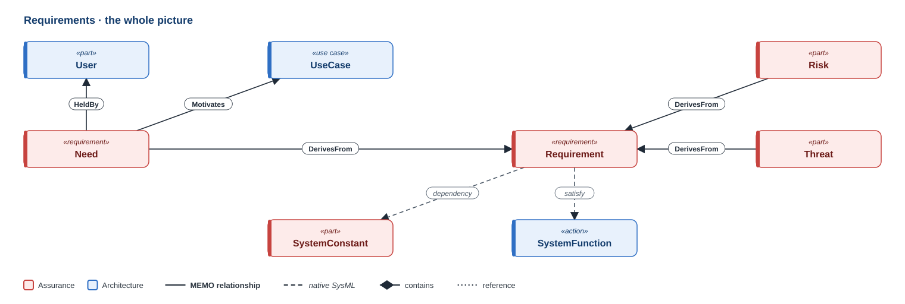
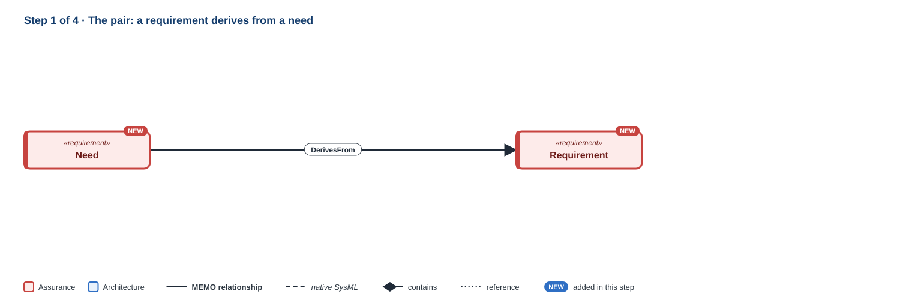
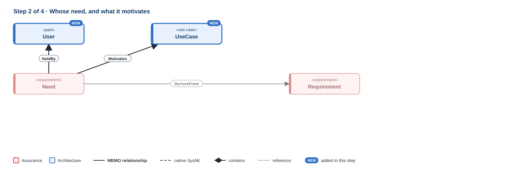
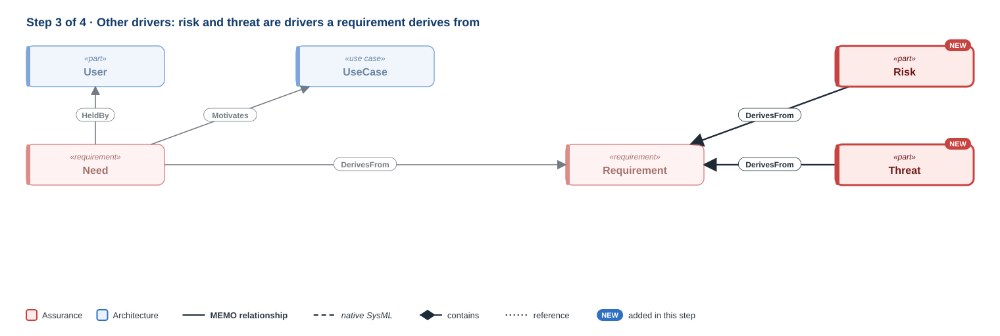
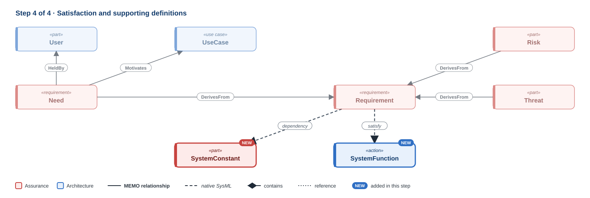

# Requirements

!!! question "The question this discipline answers"
    **What must be true, and why?**

Requirements connect the problem to the solution. A **need** (`Need`) says what someone expects, in their own language. A **requirement** (`Requirement`) is an obligation the solution must meet, and it exists because something drove it: a need, a hazard, a threat, or an existing component's limits. MEMO records that driver as a typed relationship, so every requirement can answer "why does this exist?" and every need can answer "what did we do about it?". Requirements run across the architecture layers: a requirement can be about the whole system, the software, the hardware, or the instructions for use, and it is satisfied by elements in any layer.

**Namespace:** `memo::assurance::requirements` · **Source:** `src/assurance/requirements/`

[{ .memo-presentation-graphic }](../assets/ontology/requirements.svg){ title="Open full size" }

The colours say which part of MEMO an element belongs to: **blue** is
architecture, **red** is assurance. A solid line is one of MEMO's own
relationships, a dashed line is native SysML, a diamond is containment, and a
dotted line is a reference. [How to read the figures](index.md#how-to-read-the-figures)

## Building it up

### Step 1 · The pair

[{ .memo-presentation-graphic }](../assets/ontology/requirements-step1.svg){ title="Open full size" }

A `Need` is a problem-space expectation stated in stakeholder language. Its `needKind` classifies it as a design input in ISO 13485 and IEC 62366-1 terms: stakeholder, user, clinical user, patient user, business, service, regulatory, operational, or design control. A `Requirement` is a solution-space obligation, and it derives from its driver (`DerivesFrom`). It records `requirementType` (the system, the software, the hardware, or the instructions for use), `sourceKind` and `concernKind`, a `doc` with an authoring `notation` such as EARS and an `obligation` (shall, should, will), a `safetyClass` for a software requirement (IEC 62304), and `acceptanceCriteria`, which a verification case checks.

### Step 2 · Whose need, and what it motivates

[{ .memo-presentation-graphic }](../assets/ontology/requirements-step2.svg){ title="Open full size" }

A user need says whose need it is with `HeldBy`. The user's characteristics live on the `User`, not restated on the need. A need motivates a use case (`Motivates`), which is how the problem reaches the operational layer.

### Step 3 · Other drivers

[{ .memo-presentation-graphic }](../assets/ontology/requirements-step3.svg){ title="Open full size" }

A `RiskDriver` is a requirement driver that comes from risk. `Risk` and `Threat` both specialise it, which is what lets a hazard or a threat be the source a requirement derives from. The driver end of `DerivesFrom` accepts any element, because drivers are of many kinds: needs, operational activities, risks, threats, components.

### Step 4 · Satisfaction and supporting definitions

[{ .memo-presentation-graphic }](../assets/ontology/requirements-step4.svg){ title="Open full size" }

A requirement is satisfied by a design element with native `satisfy`: a function, a hardware component, a software module, or a UI element. A `SystemConstant` is a named constant from a source requirements document, such as a tolerance, that requirement statements refer to. A `NotificationSpec` is one row of an alarm and notification table: a named notification, its priority, and the actions the system must take.

## Where it leads

- **Satisfied by design:** see the layer pages from [Functional](functional.md) to [Implementation](implementation.md).
- **Checked by evidence:** a requirement is checked by verification cases and the evidence they produce ([Verification and validation](verification-validation.md)).
- **Security:** a security requirement is derived from a threat or a risk (`DerivesCyberRequirement`, in Core). `SecurityRequirement` itself is defined in [Cybersecurity](cybersecurity.md).

## In the running example

The temperature alarm carries no requirements, so this example comes from the
GPCA infusion pump. Here is a need, a hardware requirement, the needs it
derives from, and requirements satisfied by software.

```sysml
--8<-- "examples/gpca-pump/model/catalog/gpca_requirements.sysml:need"
```

```sysml
--8<-- "examples/gpca-pump/model/catalog/gpca_requirements.sysml:requirement"
```

```sysml
--8<-- "examples/gpca-pump/model/catalog/gpca_trace.sysml:derives"
```

```sysml
--8<-- "examples/gpca-pump/model/catalog/gpca_architecture.sysml:satisfy"
```

<details markdown="1">
<summary><strong>Every element and relationship in this discipline</strong> (generated from <code>src/assurance/requirements/</code>)</summary>

--8<-- "docs/ontology/_generated/requirements.md"

</details>

<details markdown="1">
<summary><strong>The detail behind the steps</strong>: every attribute and kind the discipline defines</summary>

### Every element in detail

**Needs.** A `Need` is a problem-space expectation stated in stakeholder
language. Its `needKind` classifies it as a design input in ISO 13485 and
IEC 62366-1 terms: stakeholder, user, clinical user, patient user, business,
service, regulatory, operational, or design control. A user need says whose
need it is with `HeldBy`. The user's characteristics live on the `User`, not
restated on the need.

**Requirements.** A `Requirement` is a solution-space obligation. It records:

- `requirementType`: what it is about, which is the system, the software, the
  hardware, or the instructions for use (EU MDR Annex I §23.4, ISO 20417).
- `sourceKind` and `concernKind`: where it came from and which concern it serves.
- the requirement text in native `doc`, with an authoring `notation` such as EARS, an `obligation`
  (shall, should, will), and the parsed condition and response clauses, so
  tools can check the pattern.
- `safetyClass` for a software requirement (IEC 62304).
- `acceptanceCriteria`, which a verification case checks.

**Drivers and supporting definitions.** A `RiskDriver` is a requirement driver
that comes from risk: `Risk` and `Threat` both specialise it, which is what lets
a hazard or a threat be the source a requirement derives from. A
`SystemConstant` is a named constant from a source requirements document, such
as a tolerance, that requirement statements refer to. A `NotificationSpec` is
one row of an alarm and notification table: a named notification, its
priority, and the actions the system must take.

## How it connects

- **Needs motivate use cases** (`Motivates`) and are held by participants
  (`HeldBy`). See [Operational](operational.md).
- **Requirements derive from their drivers** (`DerivesFrom`): from needs, from
  operational activities, from risks and threats, from components. The driver
  end accepts any element, because drivers are of many kinds.
- **Requirements are satisfied by design elements** with native `satisfy`: a
  function, a hardware component, a software module, or a UI element. See the layer
  pages from [Functional](functional.md) to [Implementation](implementation.md).
- **Requirements are checked** by verification cases, and the evidence they
  produce. See [Verification and validation](verification-validation.md).
- **A security requirement is derived from a threat or a risk**
  (`DerivesCyberRequirement`, in Core). `SecurityRequirement` itself is defined
  in [Cybersecurity](cybersecurity.md).

</details>

## Go deeper

- The GPCA infusion pump: [requirements and architecture](../layers/requirements-architecture.md).
- [The requirements API](../sysml-api/index.md#assurance).
