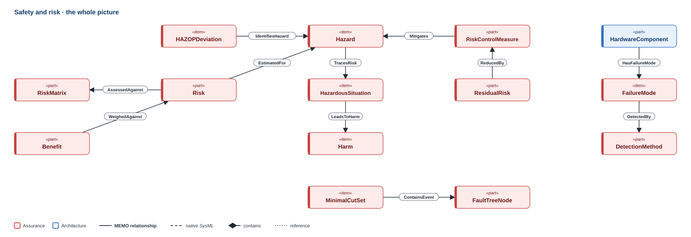
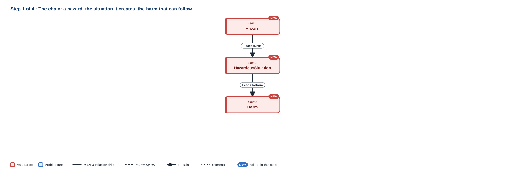
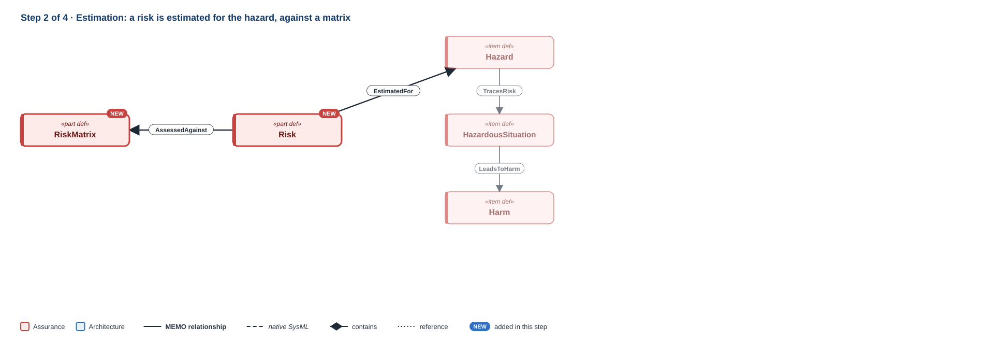
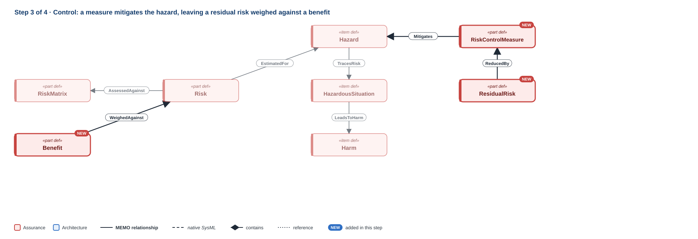
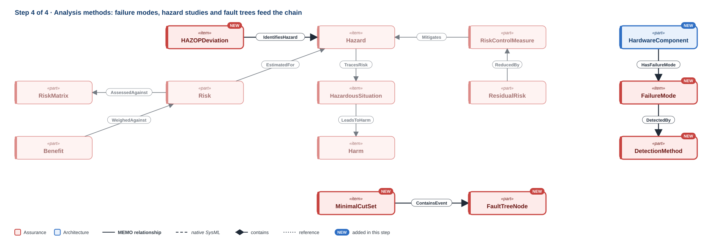

# Safety and risk

!!! question "The question this discipline answers"
    **What could cause harm, and what keeps the risk acceptable?**

Safety and risk follows ISO 14971. A **hazard** is a potential source of harm. A sequence of events turns it into a **hazardous situation**, which can lead to **harm**. Each **risk** is estimated and evaluated, reduced by **risk controls**, and what remains is the **residual risk**, judged once more against the device's benefit. MEMO models that chain as elements and relationships rather than rows in a spreadsheet, so a risk control is tied to the design element that implements it. When that element changes, the control's evidence is visibly at stake.

**Namespace:** `memo::assurance::safety_risk` · **Source:** `src/assurance/safety_risk/`

[{ .memo-presentation-graphic }](../assets/ontology/safety-risk.svg){ title="Open full size" }

The colours say which part of MEMO an element belongs to: **blue** is
architecture, **red** is assurance. A solid line is one of MEMO's own
relationships, a dashed line is native SysML, a diamond is containment, and a
dotted line is a reference. [How to read the figures](index.md#how-to-read-the-figures)

## Building it up

### Step 1 · The chain

[{ .memo-presentation-graphic }](../assets/ontology/safety-risk-step1.svg){ title="Open full size" }

`Hazard`, `HazardCause`, `SequenceOfEvents`, `HazardousSituation` and `Harm` are the chain's risk items. Risk items trace to each other along the sequence of events (`TracesRisk`), and a hazardous situation leads to a harm (`LeadsToHarm`), carrying the conditional probability that it does. A `ReasonablyForeseeableMisuse` records misuse the manufacturer must consider, and a `SafetyRelatedCharacteristic` a characteristic of the device that can affect safety.

### Step 2 · Estimation

[{ .memo-presentation-graphic }](../assets/ontology/safety-risk-step2.svg){ title="Open full size" }

A `Risk` is estimated for a risk item (`EstimatedFor`) and assessed against a `RiskMatrix` (`AssessedAgainst`).

### Step 3 · Control and residual risk

[{ .memo-presentation-graphic }](../assets/ontology/safety-risk-step3.svg){ title="Open full size" }

A `RiskControlMeasure` mitigates a risk item (`Mitigates`, with `mitigationKind` hazard or vulnerability). Its `controlKind` says what kind of control it is (inherent safe design, a protective measure, information for safety, an alarm, an interlock, monitoring, or a plausibility check) and its `implementationKind` how it is built (hardware design, software design, labelling, training, or a procedural control). A `ResidualRisk` is what remains, reduced by controls (`ReducedBy`) and evaluated in the `OverallResidualRiskEvaluation` (`EvaluatedIn`), which weighs it against the device's `Benefit` (`WeighedAgainst`). `ControlImplementedBy` links a control to the design element that implements it, in any architecture layer.

### Step 4 · Analysis techniques

[{ .memo-presentation-graphic }](../assets/ontology/safety-risk-step4.svg){ title="Open full size" }

*FMEA* (`FMEAWorksheet`, `FailureMode`, `FailureEffect`, `FailureCause`, `DetectionMethod`, `FMEAAction`): an element has failure modes (`HasFailureMode`), and a failure mode is detected by a detection method (`DetectedBy`). *Fault tree analysis* (`FaultTree`, `FaultTreeNode`, `MinimalCutSet`): nodes feed gates and produce events (`InputToGate`, `ProducesEvent`), and a minimal cut set contains events (`ContainsEvent`). *HAZOP* (`HAZOPStudy`, `HAZOPNode`, `HAZOPDeviation`): a deviation identifies a hazard (`IdentifiesHazard`). After release, `PostMarketSurveillance` feeds field information back into the design (`FeedsBackTo`).

## Where it leads

- **Operational:** a risk item is related to the operative scenario it occurs in (`HazardRelatedScenario`) ([Operational](operational.md)).
- **Human factors:** a use error causes a hazard (`Causes`), with `causeKind` saying what kind of causation it is ([Human factors](human-factors.md)).
- **Cybersecurity:** a security element can impact safety (`ImpactsSafety`), and a cyber risk is a `Risk` ([Cybersecurity](cybersecurity.md)).
- **Requirements:** a risk is a requirement driver, so a safety requirement can derive from it ([Requirements](requirements.md)).

## In the running example

A nurse who silences the alarm without assessing it commits a use error. That
use error leads to the hazard of an undetected deviation. Re-announcing the alarm
after silence is the control, and the alarm banner implements it.

```sysml
--8<-- "examples/temperature-alarm/model/catalog/temperature_alarm.sysml:safety-risk"
```

<details markdown="1">
<summary><strong>Every element and relationship in this discipline</strong> (generated from <code>src/assurance/safety_risk/</code>)</summary>

--8<-- "docs/ontology/_generated/safety-risk.md"

</details>

<details markdown="1">
<summary><strong>The detail behind the steps</strong>: every attribute and kind the discipline defines</summary>

### Every element in detail

**The ISO 14971 chain.** `Hazard`, `HazardCause`, `SequenceOfEvents`,
`HazardousSituation` and `Harm` are the chain's risk items. A
`ReasonablyForeseeableMisuse` records misuse the manufacturer must consider. A
`SafetyRelatedCharacteristic` records a characteristic of the device that can
affect safety.

**Risk and its evaluation.** A `Risk` is estimated for a risk item and assessed
against a `RiskMatrix`. A `ResidualRisk` is what remains after control. An
`OverallResidualRiskEvaluation` weighs all residual risk, together with the
device's `Benefit`.

**Controls.** A `RiskControlMeasure` reduces a risk. Its `controlKind` says what
kind of control it is: inherent safe design, a protective measure, information
for safety, an alarm, an interlock, monitoring, or a plausibility check. Its
`implementationKind` says how it is built: in hardware design, in software
design, in labelling, in training, or as a procedural control.

**Analysis techniques.**

- *FMEA*: `FMEAWorksheet`, `FailureMode`, `FailureEffect`, `FailureCause`,
  `DetectionMethod` and `FMEAAction`.
- *Fault tree analysis*: `FaultTree`, `FaultTreeNode` and `MinimalCutSet`.
- *HAZOP*: `HAZOPStudy`, `HAZOPNode` and `HAZOPDeviation`.

**After release.** `PostMarketSurveillance` feeds field information back into
the design.

## How it connects

**The chain itself.** Risk items trace to each other along the sequence of
events (`TracesRisk`). A hazardous situation leads to a harm (`LeadsToHarm`),
carrying the conditional probability that it does. A risk is estimated for a
risk item (`EstimatedFor`) and assessed against a matrix (`AssessedAgainst`). A
residual risk is reduced by controls (`ReducedBy`) and evaluated in the overall
evaluation (`EvaluatedIn`).

**Causes and controls:**

- `Causes` links a cause to its effect. Its `causeKind` says what kind of
  causation it is, for example a failure that causes an effect, or a use error
  that leads to a hazard.
- `Mitigates` links a control to the risk item it reduces. Its `mitigationKind`
  is `hazard` or `vulnerability`.
- `ControlImplementedBy` links a control to the design element that implements
  it, in any architecture layer.

**Analysis.** An element has failure modes (`HasFailureMode`). A failure mode is
detected by a detection method (`DetectedBy`). Fault-tree nodes feed gates and
produce events (`InputToGate`, `ProducesEvent`), and a minimal cut set contains
events (`ContainsEvent`). A HAZOP deviation identifies a hazard
(`IdentifiesHazard`).

**To other layers and disciplines:**

- **Operational**: a risk item is related to the operative scenario it occurs in
  (`HazardRelatedScenario`). See [Operational](operational.md).
- **Human factors**: a use error causes a hazard (`Causes`). See
  [Human factors](human-factors.md).
- **Cybersecurity**: a security element can impact safety (`ImpactsSafety`), and
  a cyber risk is a `Risk`. See [Cybersecurity](cybersecurity.md).
- **Requirements**: a risk is a requirement driver, so a safety requirement can
  derive from it (`DerivesFrom`). See [Requirements](requirements.md).
- **Post-market**: surveillance feeds back to a design element (`FeedsBackTo`).

</details>

## Go deeper

- The GPCA infusion pump: [risk, cybersecurity, and assurance](../layers/risk-assurance.md).
- [The safety and risk API](../sysml-api/index.md#assurance).
