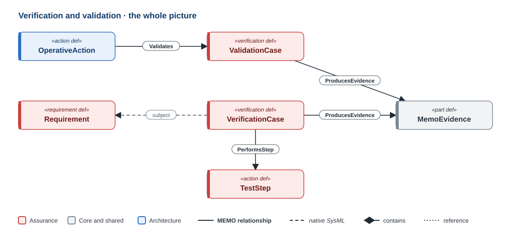
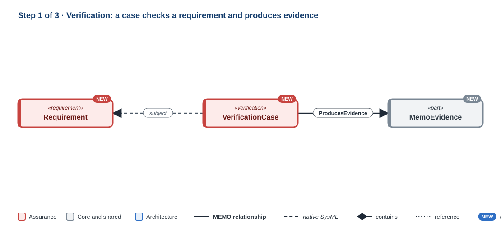
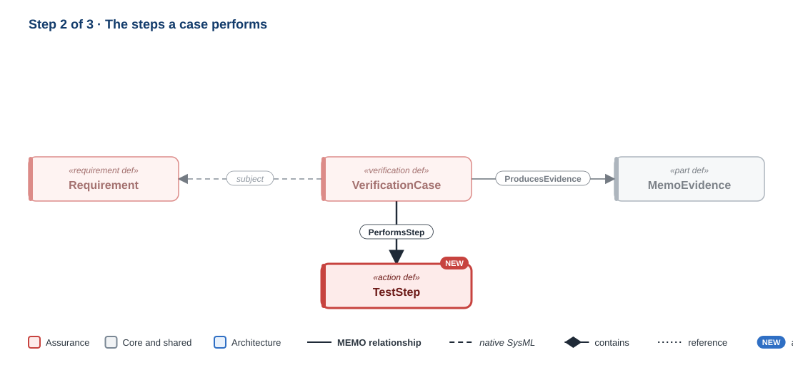
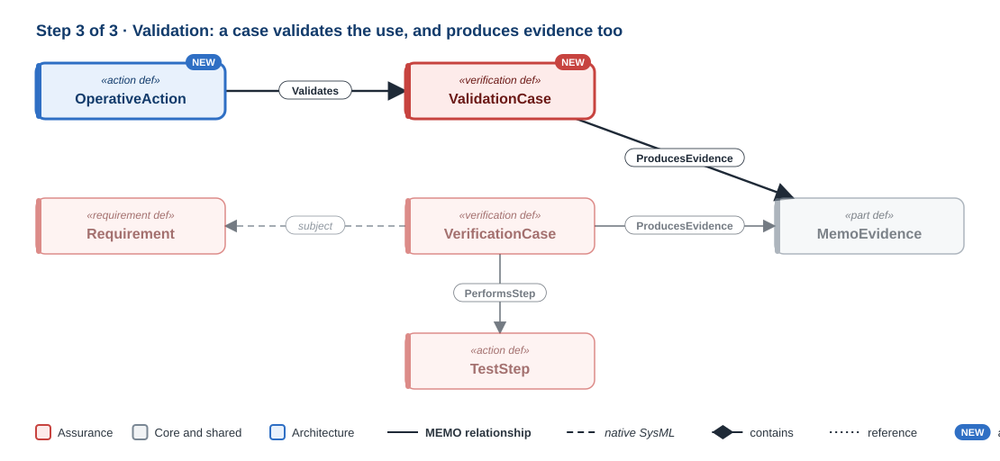

# Verification and validation

!!! question "The question this discipline answers"
    **How do we know it works, and that it is the right device?**

Verification asks whether the design meets its specification: was the system built right? Validation asks whether the device meets its users' needs in its intended use: was the right system built? IEC 62304 and the design-control regulations keep the two apart, and so does MEMO. Both end in **evidence**, the record a reviewer or an auditor reads.

**Namespace:** `memo::assurance::verification_validation` · **Source:** `src/assurance/verification_validation/`

[{ .memo-presentation-graphic }](../assets/ontology/verification-validation.svg){ title="Open full size" }

The colours say which part of MEMO an element belongs to: **blue** is
architecture, **red** is assurance. A solid line is one of MEMO's own
relationships, a dashed line is native SysML, a diamond is containment, and a
dotted line is a reference. [How to read the figures](index.md#how-to-read-the-figures)

## Building it up

### Step 1 · Verification

[{ .memo-presentation-graphic }](../assets/ontology/verification-validation-step1.svg){ title="Open full size" }

A `VerificationCase` is a standard SysML v2 verification case. It names what it checks as its `subject`, natively (a function, component or requirement), records its `methodKind` (inspection, analysis, demonstration, test, simulation, formal proof, or model checking), and states its `acceptanceCriteria`. A case `perform`s an operative scenario, which is an `action def`. It produces evidence (`ProducesEvidence`). `MemoEvidence`, from Core, is the record a case produces; its `evidenceKind` says what kind of record it is: a test artifact, general evidence, a formative evaluation, a usability validation, or a security claim.

### Step 2 · Procedures

[{ .memo-presentation-graphic }](../assets/ontology/verification-validation-step2.svg){ title="Open full size" }

A `TestStep` is a reusable step, with its action, expected result, and the item it refers to. A verification or validation case performs its steps in order (`PerformsStep`).

### Step 3 · Validation

[{ .memo-presentation-graphic }](../assets/ontology/verification-validation-step3.svg){ title="Open full size" }

A `ValidationCase` checks a use case or task with users in a clinical context. It records its `validationMethod` (a clinical trial, a summative usability test, a comparative study, a benchmark test, or simulated use), who took part, and the acceptance criteria. `Validates` links a use case, task or claim to the case that checks it. It is a MEMO relationship because native `verify` requires a requirement on the verified end, and because validation is not verification. A `ClinicalEvaluation` records a clinical evaluation: its stage, the source of its clinical data, and its conclusion.

## Where it leads

- **[Functional](functional.md) and [Requirements](requirements.md):** a verification case names a function, component or requirement as its `subject`.
- **[Operational](operational.md):** validation checks a use case or task.
- **[Human factors](human-factors.md):** `TestedByUsability` links a UI element or task to its usability test, and `EvaluatesTask` links evidence to a task.

## In the running example

A verification case checks the detection function by running the alarm-latency
scenario, against an acceptance criterion of annunciation within 2 s. A
summative usability test with 15 ICU nurses validates the acknowledgement task.
Each produces its evidence.

```sysml
--8<-- "examples/temperature-alarm/model/catalog/temperature_alarm.sysml:verification-validation"
```

<details markdown="1">
<summary><strong>Every element and relationship in this discipline</strong> (generated from <code>src/assurance/verification_validation/</code>)</summary>

--8<-- "docs/ontology/_generated/verification-validation.md"

</details>

<details markdown="1">
<summary><strong>The detail behind the steps</strong>: every attribute and kind the discipline defines</summary>

### Every element in detail

**Verification.** A `VerificationCase` is a standard SysML v2 verification case.
It names what it checks as its `subject`, records its `methodKind`, and states
its `acceptanceCriteria`. The methods are inspection, analysis, demonstration,
test, simulation, formal proof, and model checking.

**Validation.** A `ValidationCase` checks a use case or task with users in a
clinical context. It records its `validationMethod`: a clinical trial, a
summative usability test, a comparative study, a benchmark test, or simulated
use. It also records who took part and the acceptance criteria.

**Procedures.** A `TestStep` is a reusable step, with its action, expected result,
and the item it refers to. A verification or validation case performs its steps
in order.

**Clinical evaluation.** A `ClinicalEvaluation` records a clinical evaluation:
its stage, the source of its clinical data, and its conclusion.

**Evidence** comes from Core. `MemoEvidence` is the record a case produces. Its
`evidenceKind` says what kind of record it is: a test artifact, general
evidence, a formative evaluation, a usability validation, or a security claim.

## How it connects

- **A case checks its subject.** A verification case names a function,
  component, or requirement as its `subject`, natively. See
  [Functional](functional.md) and [Requirements](requirements.md).
- **A case runs a scenario.** A case `perform`s an operative scenario, which is
  an `action def`. See [Operational](operational.md).
- **A case performs its steps.** `PerformsStep` links a case to its test steps,
  in sequence.
- **Validation checks use.** `Validates` links a use case, task, or claim to the
  validation case that checks it. It is a MEMO relationship because native
  `verify` requires a requirement on the verified end, and because validation is
  not verification.
- **A case produces evidence.** `ProducesEvidence` links a case to the evidence
  it produced.
- **Usability is tested.** `TestedByUsability` links a UI element or task to its
  usability test, and `EvaluatesTask` links evidence to a task. See
  [Human factors](human-factors.md).

</details>

## Go deeper

- The GPCA infusion pump: [risk, cybersecurity, and assurance](../layers/risk-assurance.md).
- [The verification and validation API](../sysml-api/index.md#assurance).
