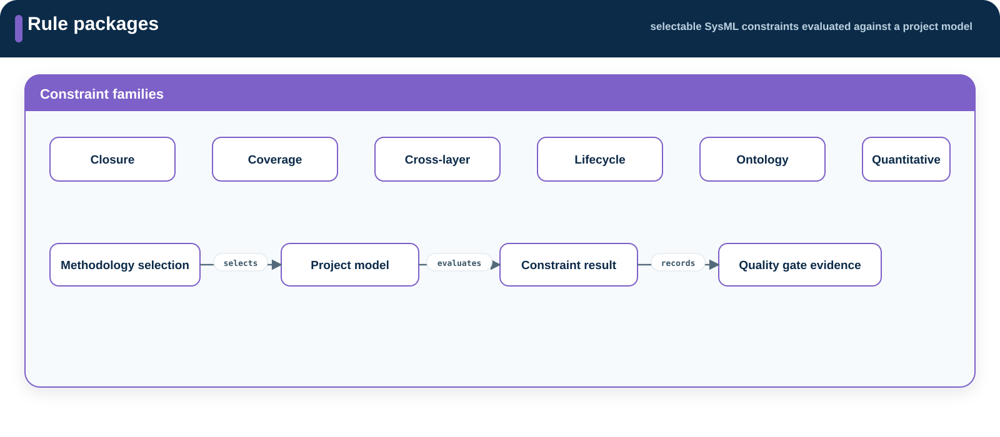

# Rules

**Source:** `src/rules/`  
**Namespace:** `memo::rules`

[Source layout](../index.md#source-layout)

Rules contains selectable SysML `constraint def` declarations. Importing
`memo::*` does not automatically apply every rule; a methodology selects the
packages appropriate to its scope and gates.

{ .memo-presentation-graphic }

## Namespace structure

```text
rules/
├── closure/
├── coverage/
├── crosslayer/
├── lifecycle/
├── ontology/
└── quantitative/
```

## Rule definitions

| Namespace | Checks |
| --- | --- |
| `closure` | Required trace paths and argument closure |
| `coverage` | Presence of model content required by a selected standard or method |
| `crosslayer` | Connections across architecture and assurance |
| `lifecycle` | Permitted lifecycle state and ordering |
| `ontology` | MEMO ownership and semantic invariants |
| `quantitative` | Configured structural bounds |

## Relationships

Rules inspect the typed relationships declared by Core and the source areas.
They do not define a replacement relationship vocabulary.

## Tracing a rule to a clause

A rule enforces zero or more clauses of a standard or guidance. The trace is a
SysML `dependency` marked `#EnforcesClause`, written beside the rule, with the
rule as client and the clauses as suppliers:

```sysml
constraint def HazardMitigationRule :> MemoConsistencyRule { ... }
#EnforcesClause dependency from HazardMitigationRule
    to iso14971::iso14971Clause7::iso14971Clause7_1;
```

A rule may trace to several clauses, from several standards, or to none; a rule
MEMO or a user keeps for its own reasons needs no clause. `EnforcesClause` is
declared in `memo_artifacts_standards_traceability`. Before 0.15.0 the trace was
a `ref enforces` member of the rule; see the [release notes](../../release-notes.md).

## Obligation

`obligation` states how firmly the rule's source asks for what the rule checks:

| Obligation | Meaning | Severity when the rule states none |
| --- | --- | --- |
| `required` | A clause that says "shall" | `error` |
| `recommended` | A clause that says "should", or a practice the ontology holds as sound | `warning` |
| `bestPractice` | Advice with no clause behind it | `info` |

Obligation is separate from severity (what a finding costs) and from tailoring
class (how far a methodology may change the rule). `memo validate --rules
--rules-obligation <obligation>` lists the rules of one obligation, and
`memo-architect new rule --obligation <obligation>` writes it into a new rule.
To change a rule's obligation, edit its `attribute obligation`.

## Enumerations

Rule metadata uses `RuleCategoryKind`, `RulePredicateKind`,
`RuleSeverityKind`, `RuleObligationKind`, and `RuleStrengthKind` from Core.

## SysML source

[Browse the generated rules API](../../sysml-api/index.md#rules).
