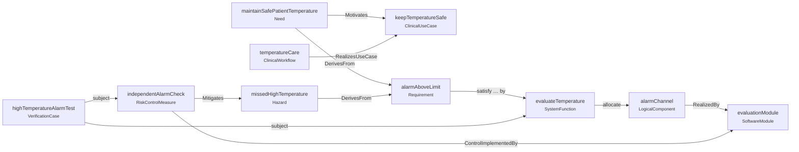
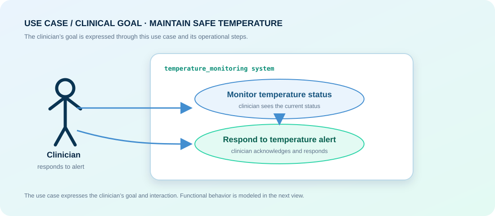

# Tutorial: model a temperature alarm

This tutorial assumes MEMO is already available in your SysML project. Confirm
that the import below resolves; [Installing MEMO](../how-to/install/index.md)
provides the setup steps.

You will create one file: `temperature_alarm.sysml`. Start with the small file
below, then add each following snippet immediately above the final `}` of
`package temperature_alarm`. The final section shows the whole completed file.
Every stage of it has been compiled and run through `memo validate`, and each
section says what `memo validate` reports at that point.

## What you will build

You will build one connected engineering slice for a temperature alarm. The
slice starts with the clinician's need, follows the clinical workflow into an
operational scenario, and identifies the functions the system must perform.
From those functions you will write an EARS requirement, assign the work to a
logical component realized in software and hardware, record a hazard and the
control that reduces it, and define a verification case.



The diagram is the destination. Read it from the need on the left to the test
on the right, and use the system function in the middle as the anchor when you
review requirements, architecture, risk, and tests.

<div class="memo-tutorial-overview" markdown>
  <div class="memo-tutorial-copy">
    <p class="memo-kicker">First model · about 20 minutes</p>
    <h2>One small device, one connected argument</h2>
    <p>A bedside temperature alarm warns a clinician when a measured temperature is too high. You will make its clinical reason, system obligation, design response, safety control, and test explicit.</p>
  </div>
  <div class="memo-device-card" aria-label="Temperature alarm concept">
    <span class="memo-device-label">Simple device</span>
    <strong>Temperature<br>alarm</strong>
    <span class="memo-device-display">38.7 °C</span>
    <span class="memo-device-alert">ALARM</span>
  </div>
</div>

<div class="memo-tutorial-flow" aria-label="Tutorial model flow">
  <div><span>01</span><strong>Need</strong><small>Who needs what?</small></div>
  <i>→</i>
  <div><span>02</span><strong>Requirement</strong><small>What must it do?</small></div>
  <i>→</i>
  <div><span>03</span><strong>Response + control</strong><small>How is it handled safely?</small></div>
  <i>→</i>
  <div><span>04</span><strong>Verification</strong><small>How will we check?</small></div>
</div>

## The use case you are modeling

Before writing elements, make the interaction clear: a clinician relies on the
device to observe a temperature and raise an audible alert. This small use-case
view sets the scope for the first model.



The use case is the clinician’s goal in context: maintaining patient
temperature within a safe range. “Evaluate temperature” and “notify clinician”
are functions that later support the goal.

## Modeling route

Use the clinical story to discover the system behavior, then use the functions
as the anchor for the technical model. Read this path from left to right.

<div class="memo-model-stages" aria-label="Function-anchored modeling path">
  <div class="memo-stage-goal"><span>1</span><strong>Use case / goal</strong><small>Maintain safe patient temperature</small></div>
  <i>→</i>
  <div class="memo-stage-operational"><span>2</span><strong>Workflow + scenario</strong><small>Observe status, respond to alert</small></div>
  <i>→</i>
  <div class="memo-stage-function"><span>3</span><strong>Functional flow</strong><small>Evaluate temperature → notify clinician</small></div>
  <i>→</i>
  <div class="memo-stage-evidence"><span>4</span><strong>Connected engineering</strong><small>Requirements, architecture, risk, verification</small></div>
</div>

For a real device, revisit this route for each important scenario. A functional
flow can reveal a new requirement, hazard, control, test, or allocation as the
model becomes more detailed.

## 1. Clinical need

Create `temperature_alarm.sysml` with this content.

```sysml
// temperature_alarm.sysml
package temperature_alarm {
    private import memo::*;

    part def TemperatureAlarm specializes System {
        attribute :>> systemBoundaryDescription = "A bedside temperature alarm: the probe, the firmware, and the audible alert.";
    }

    part clinician : User {
        attribute :>> actorKind = ActorKind::clinician;
    }
    requirement maintainSafePatientTemperature : Need {
        attribute :>> needKind = NeedKind::clinicalUser;
        doc /* The clinician needs to keep the patient's temperature within a safe range. */
    }
    connection : HeldBy connect maintainSafePatientTemperature to clinician;
}
```

- `part def TemperatureAlarm specializes System` declares the device the model
  is about. Everything else in the file is linked back to it.
- `clinician` is a `User`: a person who uses the device.
- The `Need` records that person's desired clinical outcome in clinical
  language, before any of it becomes a measurable system claim. `needKind`
  says whose need it is, and `HeldBy` names who holds it.

Every element has a plain name and nothing else. MEMO shows that name wherever
the element appears. If your project gives elements identifiers such as
`NEED-001`, add them later with `@MemoIdentity { :>> providedId = "NEED-001"; }`
inside the element; nothing requires it.

`memo validate` reports nothing at this point.

## 2. Use case, workflow and scenario

Add this snippet above the closing `}`.

```sysml
    use case keepTemperatureSafe : ClinicalUseCase {
        attribute :>> useCaseKind = UseCaseKind::care;
        attribute :>> goalStatement = "Keep the monitored patient's temperature within a safe range.";
        subject supportingSystem;
        actor clinicianActor = clinician;
    }
    connection : Motivates connect maintainSafePatientTemperature to keepTemperatureSafe;

    action monitorTemperatureStatus : OperativeAction;
    action respondToTemperatureAlert : OperativeAction;
    part temperatureCare : ClinicalWorkflow {
        action highTemperatureScenario : OperativeScenario {
            attribute :>> scenarioKind = ScenarioKind::nominal;
            attribute :>> pathSummary = "The clinician observes status and responds to a high-temperature alert.";
            perform monitorTemperatureStatus;
            perform respondToTemperatureAlert;
            first monitorTemperatureStatus then respondToTemperatureAlert;
        }
    }
    connection : RealizesUseCase connect temperatureCare to keepTemperatureSafe;
```

- The use case is the clinician's goal. The clinician is its native SysML
  `actor`, and `Motivates` records that the need is the reason for it.
- The two `OperativeAction`s are clinical work: observing the temperature and
  responding to an alert.
- The workflow `temperatureCare` organises that work, and `RealizesUseCase`
  says which goal it serves. Its scenario is one path through it: it
  `perform`s the two actions, and `first … then` gives their order.

This describes people and clinical work. It gives the next layer a clear source
for the behaviour the system must provide. `memo validate` still reports
nothing.

## 3. Functions

Add this snippet above the closing `}`. These functions are the anchor for the
rest of the model: requirements specify them, architecture realizes them, risk
analysis challenges them, and verification checks them.

```sysml
    action evaluateTemperature : SystemFunction;
    action notifyClinician : SystemFunction;
    action alarmChain : FunctionalFlow {
        action evaluate :> evaluateTemperature;
        action notify :> notifyClinician;
        first evaluate then notify;
    }
```

- A `SystemFunction` is a technology-independent responsibility. It is an
  `action`, because a function is behaviour.
- The `FunctionalFlow` `alarmChain` puts them in order: each step is a
  function performed at one position (`action evaluate :> evaluateTemperature`),
  and `first … then` orders the steps.

The functions say nothing about whether the alarm is a microcontroller, a
mobile app, a display or a buzzer.

`memo validate` now warns twice with **CR-MED-022**: neither function is
allocated to anything that carries it out yet. Section 5 does that.

## 4. Requirement

The need explains why the model matters, and the functions say what the system
does. Now turn that into a precise, testable system claim. Add this snippet
above the closing `}`. It uses the **event-driven EARS** form: **When** a
trigger occurs, **the system shall** provide a defined response.

```sysml
    requirement alarmAboveLimit : Requirement {
        attribute :>> requirementType = RequirementTypeKind::system;
        doc /* When the measured temperature exceeds 38.0 °C, the temperature alarm shall issue an audible alert within 2 seconds. */
        attribute :>> notation = RequirementNotationKind::ears;
        attribute :>> earsPattern = EarsPatternKind::eventDriven;
        attribute :>> obligation = ObligationKind::shall;
        attribute :>> conditionClause = "When the measured temperature exceeds 38.0 °C";
        attribute :>> systemResponse = "issue an audible alert within 2 seconds";
        attribute :>> acceptanceCriteria = "At 38.1 °C, an audible alert begins within 2 seconds.";
    }
    connection : DerivesFrom connect maintainSafePatientTemperature to alarmAboveLimit;
    satisfy alarmAboveLimit by evaluateTemperature;
```

- `doc` is the requirement's text. The attributes after it record the same
  sentence in its EARS parts, so a tool can check each part is present.
- `DerivesFrom` records the clinical rationale: the requirement comes from
  the need.
- `satisfy alarmAboveLimit by evaluateTemperature` is SysML's own
  relationship: the function is the design response that meets it.

EARS creates a consistent sentence pattern. SOPHIST adds a quality check:
state the condition, the system subject, the `shall` obligation, the response,
and an observable acceptance criterion. This requirement has all five.

<div class="memo-requirement-craft">
  <div><span>EARS statement</span><strong>When the measured temperature exceeds 38.0 °C, the temperature alarm shall issue an audible alert within 2 seconds.</strong></div>
  <div><span>SOPHIST check</span><strong>Condition + subject + shall + response + measurable acceptance criterion</strong></div>
</div>

`memo validate` still reports the two CR-MED-022 warnings from section 3.

## 5. Architecture and risk

Add this snippet above the closing `}`. It assigns the work, says what builds
it, and records what could go wrong.

```sysml
    part alarmChannel : LogicalComponent {
        attribute :>> responsibility = "Decide when the temperature is out of range and raise the alert";
    }
    allocate evaluateTemperature to alarmChannel;
    allocate notifyClinician to alarmChannel;

    part alarmFirmware : SoftwareSystem {
        attribute :>> safetyClass = SafetyClassKind::B;
        part evaluationModule : SoftwareModule {
            attribute :>> moduleKind = ModuleKind::unit;
            attribute :>> safetyClass = SafetyClassKind::B;
            attribute :>> responsibility = "Compare the measured temperature with the limit";
        }
    }
    part sensorProbe : HardwareAssembly {
        attribute :>> responsibility = "Measure the patient's temperature";
        part thermistor : Sensor {
            attribute :>> measurand = "Skin temperature";
            attribute :>> patientContact = true;
            attribute :>> contactNature = "Intact skin";
            attribute :>> contactDuration = "Prolonged, up to 30 days";
        }
    }
    allocation : RealizedBy allocate alarmChannel to alarmFirmware.evaluationModule;
    allocation : RealizedBy allocate alarmChannel to sensorProbe;
    satisfy alarmAboveLimit by alarmFirmware.evaluationModule;

    item missedHighTemperature : Hazard {
        attribute :>> hazardType = HazardTypeKind::informationError;
        attribute :>> severity = SeverityKind::serious;
    }
    part independentAlarmCheck : RiskControlMeasure {
        attribute :>> controlKind = RiskControlKind::alarm;
        attribute :>> implementationKind = RiskControlImplementationKind::softwareDesign;
    }
    connection : Mitigates connect independentAlarmCheck to missedHighTemperature {
        attribute :>> mitigationKind = MitigationKind::hazard;
    }
    connection : ControlImplementedBy connect independentAlarmCheck to alarmFirmware.evaluationModule;

    item feverUnnoticed : HazardousSituation {
        attribute :>> exposedPersons = "patient";
        attribute :>> operatingCondition = "The patient's temperature is above the limit and no alert sounds.";
    }
    connection : TracesRisk connect missedHighTemperature to feverUnnoticed;
    item heatInjury : Harm {
        attribute :>> clinicalImpact = "Untreated fever or hyperthermia that needs clinical intervention.";
    }
    connection : LeadsToHarm connect feverUnnoticed to heatInjury;
    connection : DerivesFrom connect missedHighTemperature to alarmAboveLimit;
```

- **Responsibility.** Both functions are allocated, with SysML's own
  `allocate`, to `alarmChannel`, a `LogicalComponent`: the part of the design
  answerable for deciding and alerting, before any technology is chosen.
- **Realization.** The channel is `RealizedBy` the firmware module that runs
  the comparison and by the probe that measures. `safetyClass` is the IEC 62304
  class of the software; `patientContact` and its details say the sensor
  touches the patient. The module also satisfies the requirement.
- **Risk.** The `Hazard` is what could cause harm; `TracesRisk` and
  `LeadsToHarm` carry it to the hazardous situation and the harm. The
  `RiskControlMeasure` `Mitigates` the hazard and is implemented by the module
  (`ControlImplementedBy`). The hazard also drives the requirement
  (`DerivesFrom`): the alarm exists because a missed fever can hurt.

The function, hazard, and control are separate elements because they answer
separate review questions: what the system does, what can cause harm, and which
measure reduces it.

The CR-MED-022 warnings are gone. `memo validate` now reports **CR-MED-003**:
the risk control has not been verified yet, which ISO 14971 clause 7.2
requires. Section 6 adds the test. It also warns **CR-MED-006**, which stays:
see the note after the complete file.

## 6. Verification

Add this snippet above the closing `}`.

```sysml
    verification highTemperatureAlarmTest : VerificationCase {
        attribute :>> methodKind = MemoVerificationMethodKind::test;
        attribute :>> acceptanceCriteria = "With a simulated temperature of 38.1 °C, an audible alert starts within 2 seconds.";
        subject verified : Base::Anything[*] = (evaluateTemperature, independentAlarmCheck);
        objective { verify alarmAboveLimit; }
    }
    part alarmTestReport : MemoEvidence {
        attribute :>> evidenceKind = EvidenceKind::testArtifact;
        attribute :>> evidenceType = "test report";
    }
    connection : ProducesEvidence connect highTemperatureAlarmTest to alarmTestReport;
```

- A `verification` case names what it checks as its `subject`: here the
  evaluation function and the risk control. Its `objective` names the
  requirement it verifies.
- The acceptance criterion repeats the requirement's, so the expected result is
  the same from specification to test.
- `ProducesEvidence` links the case to the record its run produces, a
  `MemoEvidence` whose `evidenceKind` says it is a test artifact.

CR-MED-003 is gone.

## Complete file

Your finished `temperature_alarm.sysml`:

```sysml
// temperature_alarm.sysml
package temperature_alarm {
    private import memo::*;

    part def TemperatureAlarm specializes System {
        attribute :>> systemBoundaryDescription = "A bedside temperature alarm: the probe, the firmware, and the audible alert.";
    }

    part clinician : User {
        attribute :>> actorKind = ActorKind::clinician;
    }
    requirement maintainSafePatientTemperature : Need {
        attribute :>> needKind = NeedKind::clinicalUser;
        doc /* The clinician needs to keep the patient's temperature within a safe range. */
    }
    connection : HeldBy connect maintainSafePatientTemperature to clinician;

    use case keepTemperatureSafe : ClinicalUseCase {
        attribute :>> useCaseKind = UseCaseKind::care;
        attribute :>> goalStatement = "Keep the monitored patient's temperature within a safe range.";
        subject supportingSystem;
        actor clinicianActor = clinician;
    }
    connection : Motivates connect maintainSafePatientTemperature to keepTemperatureSafe;

    action monitorTemperatureStatus : OperativeAction;
    action respondToTemperatureAlert : OperativeAction;
    part temperatureCare : ClinicalWorkflow {
        action highTemperatureScenario : OperativeScenario {
            attribute :>> scenarioKind = ScenarioKind::nominal;
            attribute :>> pathSummary = "The clinician observes status and responds to a high-temperature alert.";
            perform monitorTemperatureStatus;
            perform respondToTemperatureAlert;
            first monitorTemperatureStatus then respondToTemperatureAlert;
        }
    }
    connection : RealizesUseCase connect temperatureCare to keepTemperatureSafe;

    action evaluateTemperature : SystemFunction;
    action notifyClinician : SystemFunction;
    action alarmChain : FunctionalFlow {
        action evaluate :> evaluateTemperature;
        action notify :> notifyClinician;
        first evaluate then notify;
    }

    requirement alarmAboveLimit : Requirement {
        attribute :>> requirementType = RequirementTypeKind::system;
        doc /* When the measured temperature exceeds 38.0 °C, the temperature alarm shall issue an audible alert within 2 seconds. */
        attribute :>> notation = RequirementNotationKind::ears;
        attribute :>> earsPattern = EarsPatternKind::eventDriven;
        attribute :>> obligation = ObligationKind::shall;
        attribute :>> conditionClause = "When the measured temperature exceeds 38.0 °C";
        attribute :>> systemResponse = "issue an audible alert within 2 seconds";
        attribute :>> acceptanceCriteria = "At 38.1 °C, an audible alert begins within 2 seconds.";
    }
    connection : DerivesFrom connect maintainSafePatientTemperature to alarmAboveLimit;
    satisfy alarmAboveLimit by evaluateTemperature;

    part alarmChannel : LogicalComponent {
        attribute :>> responsibility = "Decide when the temperature is out of range and raise the alert";
    }
    allocate evaluateTemperature to alarmChannel;
    allocate notifyClinician to alarmChannel;

    part alarmFirmware : SoftwareSystem {
        attribute :>> safetyClass = SafetyClassKind::B;
        part evaluationModule : SoftwareModule {
            attribute :>> moduleKind = ModuleKind::unit;
            attribute :>> safetyClass = SafetyClassKind::B;
            attribute :>> responsibility = "Compare the measured temperature with the limit";
        }
    }
    part sensorProbe : HardwareAssembly {
        attribute :>> responsibility = "Measure the patient's temperature";
        part thermistor : Sensor {
            attribute :>> measurand = "Skin temperature";
            attribute :>> patientContact = true;
            attribute :>> contactNature = "Intact skin";
            attribute :>> contactDuration = "Prolonged, up to 30 days";
        }
    }
    allocation : RealizedBy allocate alarmChannel to alarmFirmware.evaluationModule;
    allocation : RealizedBy allocate alarmChannel to sensorProbe;
    satisfy alarmAboveLimit by alarmFirmware.evaluationModule;

    item missedHighTemperature : Hazard {
        attribute :>> hazardType = HazardTypeKind::informationError;
        attribute :>> severity = SeverityKind::serious;
    }
    part independentAlarmCheck : RiskControlMeasure {
        attribute :>> controlKind = RiskControlKind::alarm;
        attribute :>> implementationKind = RiskControlImplementationKind::softwareDesign;
    }
    connection : Mitigates connect independentAlarmCheck to missedHighTemperature {
        attribute :>> mitigationKind = MitigationKind::hazard;
    }
    connection : ControlImplementedBy connect independentAlarmCheck to alarmFirmware.evaluationModule;

    item feverUnnoticed : HazardousSituation {
        attribute :>> exposedPersons = "patient";
        attribute :>> operatingCondition = "The patient's temperature is above the limit and no alert sounds.";
    }
    connection : TracesRisk connect missedHighTemperature to feverUnnoticed;
    item heatInjury : Harm {
        attribute :>> clinicalImpact = "Untreated fever or hyperthermia that needs clinical intervention.";
    }
    connection : LeadsToHarm connect feverUnnoticed to heatInjury;
    connection : DerivesFrom connect missedHighTemperature to alarmAboveLimit;

    verification highTemperatureAlarmTest : VerificationCase {
        attribute :>> methodKind = MemoVerificationMethodKind::test;
        attribute :>> acceptanceCriteria = "With a simulated temperature of 38.1 °C, an audible alert starts within 2 seconds.";
        subject verified : Base::Anything[*] = (evaluateTemperature, independentAlarmCheck);
        objective { verify alarmAboveLimit; }
    }
    part alarmTestReport : MemoEvidence {
        attribute :>> evidenceKind = EvidenceKind::testArtifact;
        attribute :>> evidenceType = "test report";
    }
    connection : ProducesEvidence connect highTemperatureAlarmTest to alarmTestReport;
}
```

`memo validate` reports one warning on this file, **CR-MED-006**: "a hazardous
situation is described by the harm it can cause". The model does link the
situation to its harm, with `LeadsToHarm`, the relationship MEMO declares for
exactly that pair. The rule reads only `TracesRisk` today, so it does not see
the link. That is a known MEMO issue; writing `TracesRisk` there instead would
silence the warning.

Use your editor's reference navigation and check that you can follow the need
to its requirement, the requirement to the function that satisfies it, the
function to the component that carries it, and the hazard to the test that
checks its control. Next, the step-by-step series take one area in depth:
[hardware](hardware/index.md), [operational](operational/index.md) and
[functional flow](functional-flow/index.md). [MEMO in a nutshell](../ontology/index.md)
shows every element MEMO offers.

