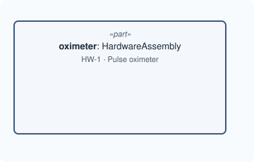

# Lesson 1 · One part

[Series overview](index.md) · Previous: [Reading the notation](00-reading-the-notation.md) · Next: [A port](02-a-port.md)

## The idea

Start with the thing you are building, as one part. In SysML v2 that is a
`part` usage typed by a `part def`. In MEMO you rarely write the `part def`
yourself: MEMO already has one for each kind of thing a device is made of, and
you type your part by the one that says what it is. (The one exception, your
system's own definition, comes in lesson 7.)

The oximeter is a physical unit that other physical things go inside, so its
type is `HardwareAssembly`.



## Write it

```sysml
package pulse_oximeter {
    private import memo::*;

    part oximeter : HardwareAssembly {
        @MemoIdentity {
            :>> providedId = "HW-1";
            :>> label = "Pulse oximeter";
        }
        doc /* The handheld unit: case, battery, display and electronics. */
    }
}
```

## Line by line

Each line or small group from the snippet above, with its notation, what it says, and why it is written that way. The symbols are collected in [Reading the notation](00-reading-the-notation.md).

```sysml
package pulse_oximeter {
```

- **Notation.** `package` starts a namespace; `{` opens its body, and everything up to the matching `}` belongs to it.
- **What it says.** A package named `pulse_oximeter` holds the whole model.
- **Why.** Every element needs an owner, and a package is the owner for things that are not inside a part. Other files reach these elements as `pulse_oximeter::oximeter`, so the name should say what the package groups.

```sysml
private import memo::*;
```

- **Notation.** `import` makes names from another namespace usable here. `memo::*` means "every member of `memo`" (`::` is "member of", `*` is "all"). `private` limits the effect to this package. `;` ends the statement.
- **What it says.** Every MEMO definition can be written by its short name in this package.
- **Why.** Without the import you would write each definition's full path, such as `memo_architecture_implementation_hardware_common::HardwareAssembly`. `private` because a package that imports `pulse_oximeter` should get your model, not a second copy of MEMO's names.

```sysml
part oximeter : HardwareAssembly {
```

- **Notation.** `part` declares a part **usage**, one actual thing in this design. `oximeter` is its name. `:` reads "defined by" (the long form is `defined by`). `{` opens its body.
- **What it says.** The design contains one thing called `oximeter`, and it is a `HardwareAssembly`.
- **Why.** It is a `part` because it is a physical thing, not a behaviour (`action`) or a requirement. The type decides which attributes the part has and which MEMO rules check it; [Why `HardwareAssembly`](#why-hardwareassembly) below goes through the choice.

```sysml
@MemoIdentity {
    :>> providedId = "HW-1";
    :>> label = "Pulse oximeter";
}
```

- **Notation.** `@MemoIdentity { … }` attaches metadata to the element whose body it is in. Inside it, `:>> providedId = "…";` gives a value (`=`) to an attribute the metadata already declares (`:>>`, "redefines"); each assignment ends with `;`.
- **What it says.** This element's engineering id and the name people read.
- **Why.** Metadata is description, not design: an id and a label say nothing about how the device works, so they are kept out of its attributes. Three names stay separate on purpose: the usage name is what other lines point at, `providedId` is what your process and documents track, `label` is what a diagram shows. Renaming one never breaks the others.

```sysml
doc /* The handheld unit: case, battery, display and electronics. */
```

- **Notation.** `doc` followed by a `/* … */` comment is the element's documentation.
- **What it says.** The description of the oximeter.
- **Why.** MEMO keeps prose in `doc`, not in a "description" attribute, so every SysML tool shows it as documentation and MEMO has no second place for the same text.

```sysml
}
}
```

- **Notation.** Each `}` closes the nearest open body: first the part's, then the package's.
- **Why.** An unclosed body is a compile error, and the compiler names the line where it noticed.

## Why `HardwareAssembly`

Four questions take you from "the oximeter" to `HardwareAssembly`. Each one
rules out a different set of MEMO definitions.

**1. Is it a thing or a behaviour?** A thing you can hold, so a `part`. If it
were something the device *does*, such as measuring, it would be an `action`
(lesson 8).

**2. Is it the product, a design block, or the built hardware?** MEMO has a
definition for each, in different layers:

| You mean | Use | Layer |
|---|---|---|
| the product as a whole, the thing the model is about | your own `part def … specializes System` (lesson 7) | logical |
| a block of the design, before choosing how to build it | `LogicalComponent` | logical |
| the actual unit that gets built, with a case and a battery | the physical family | implementation |

The oximeter in this series is the real unit, so it belongs to the physical
family. A `LogicalComponent` would say *a measuring block exists* without
committing to hardware.

**3. Assembly or component?** This is **not** about whether it has parts. Both
can contain parts: a printed circuit board modelled as a component can contain
its chips. The difference is what you need to state about it, because each
brings different attributes:

| | Physical assembly | Physical component |
|---|---|---|
| Attributes | `responsibility`, `safetyRole`, `mtbfHours`, `protectionClass`, `ipRating` | `materialSummary`, `patientContact`, `contactNature`, `contactDuration` |
| Questions it answers | how reliable is the unit, which electrical protection class, how well sealed | what is it made of, does it touch the patient |
| In this series | the oximeter, the finger probe | the front-end board, the LEDs, the photodiode, the finger pad, the cable |

Protection class (IEC 60601-1) and IP rating (IEC 60529) are properties of a
whole enclosed unit, which is why the oximeter is an assembly. Biocompatibility
(ISO 10993-1) is judged per material in contact, which is why the finger pad is
a component.

**4. Which assembly?**

| Use | When |
|---|---|
| `PhysicalAssembly` | any physical unit, for example a purely mechanical instrument |
| `HardwareAssembly` | a physical assembly that is electronic hardware; it adds no attributes, the name says what it is |
| `PhysicalSubassembly` | an assembly that is itself part of a larger assembly |

The oximeter is an electronic unit at the top of its own tree, so
`HardwareAssembly`.

**What the choice changes.** The type decides which attributes the part has: an
assembly has `ipRating`, a component has `patientContact`. Set only attributes
the part's own type declares; `:>>` is meant to redefine an attribute the part
inherits. The type also decides which rules check the part. Every physical
part, assembly or component, may contain only physical things: put a
`SoftwareComponent` inside the oximeter and `memo validate` reports rule
CR-ONT-079. Software runs *on* hardware and is related to it by allocation, not
by nesting. Every physical component must answer the patient-contact question
(CR-ONT-032, lesson 4).

## Good to know

!!! tip "Usage name, id and label"
    `oximeter` is the SysML name: lowerCamelCase, and what other lines point
    at. `HW-1` is the id your engineering process tracks. `Pulse oximeter` is
    what a diagram or table shows. Keep them separate; none replaces another.

## The model so far

The file above is the whole model. Check it with the selected compiler before
going on.

Next: [Lesson 2 · A port](02-a-port.md)
