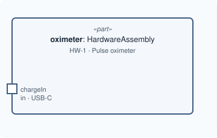

# Lesson 2 · A port

[Series overview](index.md) · Previous: [One part](01-one-part.md) · Next: [A nested port](03-a-nested-port.md)

## The idea

A port is a point on a part's boundary where something gets in or out. The
oximeter is charged through a USB-C socket, so the socket is a port.

A hardware port in MEMO is a `PhysicalPort`. Its direction is SysML's own
`in`, `out` or `inout`, written before `port`; MEMO adds no direction attribute.



## Write it

Inside `part oximeter`, after the `doc`:

```sysml
        in port chargeIn : PhysicalPort {
            @MemoIdentity { :>> label = "Charging socket"; }
            attribute :>> connectorType = "USB-C";
        }
```

## Line by line

Each line or small group from the snippet above, with its notation, what it says, and why it is written that way. The symbols are collected in [Reading the notation](00-reading-the-notation.md).

```sysml
in port chargeIn : PhysicalPort {
```

- **Notation.** `port` declares a port usage. `in` before it is the direction. `: PhysicalPort` is the port's type, as `:` was for the part.
- **What it says.** The oximeter has a boundary point called `chargeIn`, and charge comes in through it.
- **Why.** A port is written inside the part's body because it belongs to that part: it is where the part meets the outside. Direction is SysML's own `in`/`out`/`inout`, so MEMO adds no direction attribute: a flow can then be checked against it (lesson 6). `PhysicalPort` because the part is hardware; a software part would use `SoftwarePort`.

```sysml
@MemoIdentity { :>> label = "Charging socket"; }
```

- **Notation.** The same metadata as on the part, written on one line.
- **What it says.** Its display name.
- **Why.** No `providedId`: a port is usually tracked through the part that owns it. Add one when your process numbers connectors.

```sysml
attribute :>> connectorType = "USB-C";
```

- **Notation.** `attribute` introduces an attribute; `:>>` ("redefines") says it is one the type already declares; `= "USB-C"` gives it a value; `"…"` is a text value.
- **What it says.** This port's connector is USB-C.
- **Why.** `PhysicalPort` declares `connectorType`, so the value goes on that existing attribute instead of a new one. Because `:>>` must name something that exists, a typo such as `conectorType` is a compile error rather than a silent new attribute.

```sysml
}
```

- **Notation.** `}` closes the port's body.

## Good to know

Pick the port type by the layer the part is in, not by what travels through it:

| The part is | Its ports are |
|---|---|
| hardware (`HardwareAssembly`, `Sensor`, …) | `PhysicalPort` |
| software (`SoftwareComponent`, …) | `SoftwarePort` |
| logical (`LogicalComponent`) | `LogicalPort`, or one of `DataPort`, `SensorPort`, `CommandPort` |

What travels (power, a signal, a fluid) is said later, by the flow and the
interface, not by the port.

## The model so far

```sysml
package pulse_oximeter {
    private import memo::*;

    part oximeter : HardwareAssembly {
        @MemoIdentity {
            :>> providedId = "HW-1";
            :>> label = "Pulse oximeter";
        }
        doc /* The handheld unit: case, battery, display and electronics. */

        in port chargeIn : PhysicalPort {
            @MemoIdentity { :>> label = "Charging socket"; }
            attribute :>> connectorType = "USB-C";
        }
    }
}
```

Next: [Lesson 3 · A nested port](03-a-nested-port.md)
