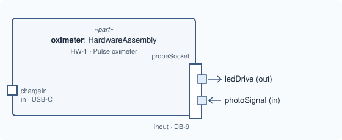

# Lesson 3 · A nested port

[Series overview](index.md) · Previous: [A port](02-a-port.md) · Next: [Parts inside parts](04-a-second-part.md)

## The idea

The finger probe plugs into one socket, but two different things cross it: the
unit drives the probe's LEDs, and the probe's photodiode sends a signal back.
One connector, two groups of pins, travelling in opposite directions.

Model that as a port that owns ports. The socket is the outer port; each group
of pins is a port inside it, with its own direction. SysML v2 allows a port
usage to contain port usages, and MEMO uses that as it is.



## Write it

Inside `part oximeter`, after `chargeIn`:

```sysml
        inout port probeSocket : PhysicalPort {
            @MemoIdentity { :>> label = "Probe socket"; }
            attribute :>> connectorType = "DB-9";

            out port ledDrive : PhysicalPort {
                @MemoIdentity { :>> label = "LED drive pins"; }
            }
            in port photoSignal : PhysicalPort {
                @MemoIdentity { :>> label = "Photodiode signal pins"; }
            }
        }
```

## Line by line

Each line or small group from the snippet above, with its notation, what it says, and why it is written that way. The symbols are collected in [Reading the notation](00-reading-the-notation.md).

```sysml
inout port probeSocket : PhysicalPort {
```

- **Notation.** `inout` is the third direction: both ways.
- **What it says.** A second port on the oximeter, through which traffic goes both in and out.
- **Why.** The socket as a whole carries a drive current out and a signal back, so neither `in` nor `out` is true of it. The single-direction parts are the pins inside it, next.

```sysml
@MemoIdentity { :>> label = "Probe socket"; }
```

- **Notation.** As before.
- **What it says.** Its display name.

```sysml
attribute :>> connectorType = "DB-9";
```

- **Notation.** As before.
- **What it says.** The socket is a DB-9 connector.
- **Why.** The probe's plug will name the same connector type, so a reviewer can see that the two sides match.

```sysml
out port ledDrive : PhysicalPort {
    @MemoIdentity { :>> label = "LED drive pins"; }
}
```

- **Notation.** A `port` declared **inside a port's body** is a nested port. Its full name is `probeSocket.ledDrive` (`.` reads "the feature of").
- **What it says.** One group of the socket's pins: the LED drive, going out.
- **Why.** Each flow needs an `out` end and an `in` end. Splitting the socket into pin groups gives each flow (lesson 6) a single-direction port to start or end at, while the socket stays one connector.

```sysml
in port photoSignal : PhysicalPort {
    @MemoIdentity { :>> label = "Photodiode signal pins"; }
}
```

- **Notation.** As above, with `in`.
- **What it says.** The other pin group: the photodiode signal, coming in.

```sysml
}
```

- **Notation.** Closes `probeSocket`.

## Good to know

!!! tip "When to nest"
    Nest when the pins share one physical connector and are plugged and
    unplugged together. If they are separate connectors on the case, they are
    separate ports on the part, side by side like `chargeIn`.

In a diagram, a port drawn on the frame of a part is a port of that part, and
a port drawn on another port is a nested port.

## The model so far

```sysml
package pulse_oximeter {
    private import memo::*;

    part oximeter : HardwareAssembly {
        @MemoIdentity {
            :>> providedId = "HW-1";
            :>> label = "Pulse oximeter";
        }
        doc /* The handheld unit: case, battery, display and electronics. */

        in port chargeIn : PhysicalPort {
            @MemoIdentity { :>> label = "Charging socket"; }
            attribute :>> connectorType = "USB-C";
        }

        inout port probeSocket : PhysicalPort {
            @MemoIdentity { :>> label = "Probe socket"; }
            attribute :>> connectorType = "DB-9";

            out port ledDrive : PhysicalPort {
                @MemoIdentity { :>> label = "LED drive pins"; }
            }
            in port photoSignal : PhysicalPort {
                @MemoIdentity { :>> label = "Photodiode signal pins"; }
            }
        }
    }
}
```

Next: [Lesson 4 · Parts inside parts](04-a-second-part.md)
