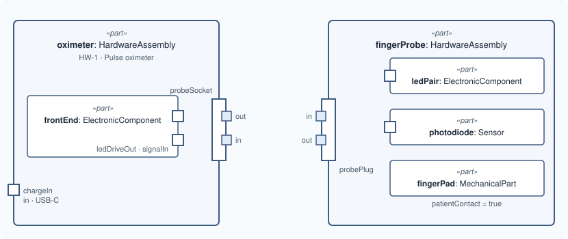

# Lesson 4 · Parts inside parts

[Series overview](index.md) · Previous: [A nested port](03-a-nested-port.md) · Next: [Connect them](05-connect-them.md)

## The idea

A real unit is built from smaller parts. In SysML v2 a part that sits inside
another is written **inside** it: containment is nesting, nothing else. MEMO
adds no "composed of" relation for this.

Two things change in this lesson:

- the oximeter gets an analog front end inside it, the board that drives the
  LEDs and reads the photodiode;
- the finger probe appears as a second top-level part, with a plug that
  mirrors the socket and three parts of its own.



## Write it

Inside `part oximeter`, after `probeSocket`:

```sysml
        part frontEnd : ElectronicComponent {
            @MemoIdentity { :>> providedId = "HW-2"; :>> label = "Analog front end"; }
            attribute :>> patientContact = false;
            out port ledDriveOut : PhysicalPort;
            in port signalIn : PhysicalPort;
        }
```

After the closing `}` of `part oximeter`, a second top-level part:

```sysml
    part fingerProbe : HardwareAssembly {
        @MemoIdentity { :>> providedId = "HW-3"; :>> label = "Finger probe"; }

        inout port probePlug : PhysicalPort {
            attribute :>> connectorType = "DB-9";
            in port ledDrive : PhysicalPort;
            out port photoSignal : PhysicalPort;
        }

        part ledPair : ElectronicComponent {
            @MemoIdentity { :>> providedId = "HW-4"; :>> label = "Red and infrared LEDs"; }
            attribute :>> patientContact = false;
            in port driveIn : PhysicalPort;
        }
        part photodiode : Sensor {
            @MemoIdentity { :>> providedId = "HW-5"; :>> label = "Photodiode"; }
            attribute :>> measurand = "red and infrared light through the finger";
            attribute :>> patientContact = false;
            out port signalOut : PhysicalPort;
        }
        part fingerPad : MechanicalPart {
            @MemoIdentity { :>> providedId = "HW-6"; :>> label = "Finger pad"; }
            attribute :>> patientContact = true;
            attribute :>> contactNature = "intact skin, surface device";
            attribute :>> contactDuration = "limited, up to 24 h";
        }
    }
```

## Line by line

Each line or small group from the snippet above, with its notation, what it says, and why it is written that way. The symbols are collected in [Reading the notation](00-reading-the-notation.md).

```sysml
part frontEnd : ElectronicComponent {
```

- **Notation.** A `part` declared **inside another part's body** is a part of it. Its full name is `oximeter.frontEnd`.
- **What it says.** The oximeter contains an electronic component called `frontEnd`.
- **Why.** Nesting is the complete statement of containment, so MEMO adds no "composed of" relation. `ElectronicComponent` and not an assembly because what you need to state about this board are component facts: its material and whether it touches the patient. It could still contain parts of its own, such as its chips.

```sysml
@MemoIdentity { :>> providedId = "HW-2"; :>> label = "Analog front end"; }
```

- **Notation.** `@MemoIdentity { … }` attaches metadata to the element whose body it is in. Inside it, `:>> providedId = "…";` gives a value (`=`) to an attribute the metadata already declares (`:>>`, "redefines"); each assignment ends with `;`.
- **What it says.** This element's engineering id and the name people read.

```sysml
attribute :>> patientContact = false;
```

- **Notation.** `false` is a Boolean value.
- **What it says.** The front end does not touch the patient.
- **Why.** Every `PhysicalComponent` declares `patientContact`, and MEMO's rule CR-ONT-032 needs either `false` or a described contact. Leaving it unset is not "no": the validator reports it, because a biocompatibility review has to know the answer was considered.

```sysml
out port ledDriveOut : PhysicalPort;
```

- **Notation.** A port with no body ends with `;` instead of `{ … }`.
- **What it says.** The front end has an output for the LED drive.
- **Why.** The front end is where the drive current really comes from. Its port will be bound to the socket's pins in lesson 5.

```sysml
in port signalIn : PhysicalPort;
```

- **Notation.** As above, with `in`.
- **What it says.** And an input for the photodiode signal.

```sysml
}
```

- **Notation.** Closes `frontEnd`. The `}` you already have after it still closes `oximeter`.

```sysml
part fingerProbe : HardwareAssembly {
```

- **Notation.** Declared at package level, after the oximeter's closing `}`, not inside it.
- **What it says.** A second top-level part: the finger probe.
- **Why.** The probe is a separate unit that plugs in. Nesting it in the oximeter would claim the oximeter contains it. `HardwareAssembly` for the same reasons as the oximeter: it is an electronic unit you integrate and qualify as a whole.

```sysml
@MemoIdentity { :>> providedId = "HW-3"; :>> label = "Finger probe"; }
```

- **Notation.** `@MemoIdentity { … }` attaches metadata to the element whose body it is in. Inside it, `:>> providedId = "…";` gives a value (`=`) to an attribute the metadata already declares (`:>>`, "redefines"); each assignment ends with `;`.
- **What it says.** This element's engineering id and the name people read.

```sysml
inout port probePlug : PhysicalPort {
```

- **Notation.** As for the socket.
- **What it says.** The probe's connector.
- **Why.** The partner of `probeSocket`. Lesson 5 joins the two.

```sysml
attribute :>> connectorType = "DB-9";
```

- **Notation.** As before.
- **What it says.** The same connector type as the socket.

```sysml
in port ledDrive : PhysicalPort;
```

- **Notation.** A nested port without a body.
- **What it says.** The drive current enters the probe here.
- **Why.** It is the mirror of the socket: what leaves the socket (`out`) enters the plug (`in`). The name `ledDrive` can repeat because its owner differs: `probePlug.ledDrive` is not `probeSocket.ledDrive`.

```sysml
out port photoSignal : PhysicalPort;
```

- **Notation.** As above.
- **What it says.** The signal leaves the probe here.

```sysml
}
```

- **Notation.** Closes `probePlug`.

```sysml
part ledPair : ElectronicComponent {
    @MemoIdentity { :>> providedId = "HW-4"; :>> label = "Red and infrared LEDs"; }
    attribute :>> patientContact = false;
    in port driveIn : PhysicalPort;
}
```

- **Notation.** Nothing new.
- **What it says.** The probe contains the LEDs, which do not touch the patient and take the drive current in.
- **Why.** The LEDs sit behind the finger pad, so `false`.

```sysml
part photodiode : Sensor {
```

- **Notation.** As before.
- **What it says.** The probe contains a sensor called `photodiode`.
- **Why.** `Sensor` rather than plain `ElectronicComponent` because it adds `measurand`, `rangeSummary` and `accuracySummary`, the facts a reviewer asks of anything that measures.

```sysml
@MemoIdentity { :>> providedId = "HW-5"; :>> label = "Photodiode"; }
```

- **Notation.** `@MemoIdentity { … }` attaches metadata to the element whose body it is in. Inside it, `:>> providedId = "…";` gives a value (`=`) to an attribute the metadata already declares (`:>>`, "redefines"); each assignment ends with `;`.
- **What it says.** This element's engineering id and the name people read.

```sysml
attribute :>> measurand = "red and infrared light through the finger";
```

- **Notation.** A text value for a `Sensor` attribute.
- **What it says.** What it measures.
- **Why.** The requirement on accuracy (lesson 9) only makes sense once you know what the sensor measures.

```sysml
attribute :>> patientContact = false;
```

- **Notation.** As before.
- **What it says.** No contact.

```sysml
out port signalOut : PhysicalPort;
```

- **Notation.** As before.
- **What it says.** Its output.

```sysml
}
```

- **Notation.** Closes `photodiode`.

```sysml
part fingerPad : MechanicalPart {
```

- **Notation.** As before.
- **What it says.** The probe contains a mechanical part, the pad the finger rests on.
- **Why.** It is the part that touches the patient, so it is modelled even though it has no ports: ISO 10993 evaluates materials in contact, and this is where the contact is.

```sysml
@MemoIdentity { :>> providedId = "HW-6"; :>> label = "Finger pad"; }
```

- **Notation.** `@MemoIdentity { … }` attaches metadata to the element whose body it is in. Inside it, `:>> providedId = "…";` gives a value (`=`) to an attribute the metadata already declares (`:>>`, "redefines"); each assignment ends with `;`.
- **What it says.** This element's engineering id and the name people read.

```sysml
attribute :>> patientContact = true;
```

- **What it says.** It touches the patient…

```sysml
attribute :>> contactNature = "intact skin, surface device";
attribute :>> contactDuration = "limited, up to 24 h";
```

- **Notation.** Two text values.
- **What it says.** …on intact skin, for up to 24 hours.
- **Why.** With `true`, CR-ONT-032 needs both. They are the two inputs ISO 10993-1 uses to choose which biocompatibility tests apply.

```sysml
}
}
```

- **Notation.** Close `fingerPad`, then `fingerProbe`.

## Good to know

!!! note "Why `patientContact = false` everywhere?"
    MEMO's validator asks every physical component whether it touches the
    patient, and to describe the contact when it does. Saying `false` is an
    answer; leaving it out is not. Only the finger pad touches the skin here.

Assembly or component is decided by what you need to say about the part, not by
whether it has parts ([lesson 1](01-one-part.md#why-hardwareassembly)):

| Use | When you need to state |
|---|---|
| `HardwareAssembly` | unit-level facts: reliability, protection class, IP rating (the oximeter, the probe) |
| a `PhysicalComponent` kind (`ElectronicComponent`, `Sensor`, `Actuator`, `MechanicalPart`, `Cable`, …) | item-level facts: material, patient contact, and what the kind adds, such as a sensor's `measurand` |

A component can still contain parts. To model the front end's chips, nest them
inside `frontEnd` exactly as `frontEnd` is nested inside `oximeter`.

## The model so far

```sysml
package pulse_oximeter {
    private import memo::*;

    part oximeter : HardwareAssembly {
        @MemoIdentity {
            :>> providedId = "HW-1";
            :>> label = "Pulse oximeter";
        }
        doc /* The handheld unit: case, battery, display and electronics. */

        in port chargeIn : PhysicalPort {
            @MemoIdentity { :>> label = "Charging socket"; }
            attribute :>> connectorType = "USB-C";
        }

        inout port probeSocket : PhysicalPort {
            @MemoIdentity { :>> label = "Probe socket"; }
            attribute :>> connectorType = "DB-9";

            out port ledDrive : PhysicalPort {
                @MemoIdentity { :>> label = "LED drive pins"; }
            }
            in port photoSignal : PhysicalPort {
                @MemoIdentity { :>> label = "Photodiode signal pins"; }
            }
        }

        part frontEnd : ElectronicComponent {
            @MemoIdentity { :>> providedId = "HW-2"; :>> label = "Analog front end"; }
            attribute :>> patientContact = false;
            out port ledDriveOut : PhysicalPort;
            in port signalIn : PhysicalPort;
        }
    }

    part fingerProbe : HardwareAssembly {
        @MemoIdentity { :>> providedId = "HW-3"; :>> label = "Finger probe"; }

        inout port probePlug : PhysicalPort {
            attribute :>> connectorType = "DB-9";
            in port ledDrive : PhysicalPort;
            out port photoSignal : PhysicalPort;
        }

        part ledPair : ElectronicComponent {
            @MemoIdentity { :>> providedId = "HW-4"; :>> label = "Red and infrared LEDs"; }
            attribute :>> patientContact = false;
            in port driveIn : PhysicalPort;
        }
        part photodiode : Sensor {
            @MemoIdentity { :>> providedId = "HW-5"; :>> label = "Photodiode"; }
            attribute :>> measurand = "red and infrared light through the finger";
            attribute :>> patientContact = false;
            out port signalOut : PhysicalPort;
        }
        part fingerPad : MechanicalPart {
            @MemoIdentity { :>> providedId = "HW-6"; :>> label = "Finger pad"; }
            attribute :>> patientContact = true;
            attribute :>> contactNature = "intact skin, surface device";
            attribute :>> contactDuration = "limited, up to 24 h";
        }
    }
}
```

Next: [Lesson 5 · Connect them](05-connect-them.md)
