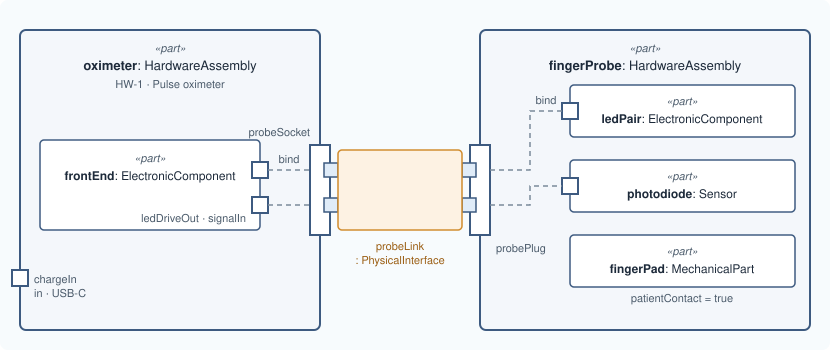

# Lesson 5 · Connect them

[Series overview](index.md) · Previous: [Parts inside parts](04-a-second-part.md) · Next: [What flows](06-what-flows.md)

## The idea

There are two different kinds of line in this picture, and SysML v2 has a
different keyword for each.

- **Between the two units**: the probe's plug goes into the oximeter's socket.
  That is a real connection with a contract (a connector, a signal type), so
  MEMO writes it as an `interface` typed by `PhysicalInterface`.
- **From a boundary port to a part inside**: the socket's LED pins *are* the
  front end's drive output, carried to the edge of the case. Nothing travels
  between them; they are the same thing seen from outside and inside. SysML v2
  writes that as `bind`.

The rule that follows: **a line never reaches into another part.** To connect to
`fingerProbe.photodiode` from outside, go to a port on `fingerProbe` and let
`fingerProbe` bind that port to its photodiode.



## Write it

Inside `part oximeter`, after `frontEnd`:

```sysml
        bind probeSocket.ledDrive = frontEnd.ledDriveOut;
        bind probeSocket.photoSignal = frontEnd.signalIn;
```

Inside `part fingerProbe`, after `fingerPad`:

```sysml
        bind probePlug.ledDrive = ledPair.driveIn;
        bind probePlug.photoSignal = photodiode.signalOut;
```

After `part fingerProbe`, at package level:

```sysml
    interface probeLink : PhysicalInterface
        connect oximeter.probeSocket to fingerProbe.probePlug {
        @MemoIdentity { :>> providedId = "IF-1"; :>> label = "Probe interface"; }
        attribute :>> direction = DirectionKind::inputOutput;
    }
```

## Line by line

Each line or small group from the snippet above, with its notation, what it says, and why it is written that way. The symbols are collected in [Reading the notation](00-reading-the-notation.md).

```sysml
bind probeSocket.ledDrive = frontEnd.ledDriveOut;
```

- **Notation.** `bind a = b` is a binding: `=` here means "is the same feature as". The paths use `.` and start from the part the line is written in, `oximeter`.
- **What it says.** The socket's LED pins are the front end's drive output.
- **Why.** Nothing travels between them: the pins are the board's output brought to the edge of the case. A `flow` would need an `out` end and an `in` end, but both of these are `out`, so `bind` is the only form that fits. Written inside `oximeter` because both ends belong to it.

```sysml
bind probeSocket.photoSignal = frontEnd.signalIn;
```

- **Notation.** As above.
- **What it says.** The socket's signal pins are the front end's input.
- **Why.** Both `in`, so again a binding.

```sysml
bind probePlug.ledDrive = ledPair.driveIn;
```

- **Notation.** Written inside `fingerProbe`.
- **What it says.** The plug's drive pins are the LEDs' input.

```sysml
bind probePlug.photoSignal = photodiode.signalOut;
```

- **Notation.** As above.
- **What it says.** The plug's signal pins are the photodiode's output.
- **Why.** These two binds are why the link between the units can stop at the plug. Anything outside talks to `probePlug`; the probe itself says where that goes inside. That keeps the probe's boundary meaningful: its plug lists everything that enters or leaves it.

```sysml
interface probeLink : PhysicalInterface
```

- **Notation.** `interface` declares an interface usage, named `probeLink`, typed by `PhysicalInterface`. The declaration continues on the next line.
- **What it says.** There is a hardware interface called `probeLink`…
- **Why.** An interface rather than a plain connection, because two units plugged together have a contract (signal kind, medium, connector) that each side is built to. `PhysicalInterface` holds those attributes (lesson 11). SysML requires an interface's ends to be ports, and `PhysicalInterface` narrows them to `PhysicalPort`, so an interface drawn to a part is invalid.

```sysml
connect oximeter.probeSocket to fingerProbe.probePlug {
```

- **Notation.** `connect a to b` names its two ends. Written at package level, so the paths start at the top-level parts. `{` opens the interface's body.
- **What it says.** …between the socket and the plug.
- **Why.** The ends bind **by position**: the first is the interface's source end, the second its target. Write them in the order you mean; naming them differently changes nothing.

```sysml
@MemoIdentity { :>> providedId = "IF-1"; :>> label = "Probe interface"; }
```

- **Notation.** `@MemoIdentity { … }` attaches metadata to the element whose body it is in. Inside it, `:>> providedId = "…";` gives a value (`=`) to an attribute the metadata already declares (`:>>`, "redefines"); each assignment ends with `;`.
- **What it says.** This element's engineering id and the name people read.
- **Why.** Interfaces are usually controlled items with their own id, often an interface control document number.

```sysml
attribute :>> direction = DirectionKind::inputOutput;
```

- **Notation.** `DirectionKind::inputOutput` is an enumeration value: `::` picks the member `inputOutput` of the enumeration `DirectionKind`.
- **What it says.** Traffic crosses the interface both ways.
- **Why.** The ports already have directions, pin by pin; this states the interface's direction as a whole, for integration analysis, and MEMO's rule CR-MED-050 asks every interface for it. MEMO accepts only the qualified spelling, because a bare `inputOutput` could belong to another enumeration.

```sysml
}
```

- **Notation.** Closes the interface.

## Good to know

Pick the connection by the layer of the ports it joins:

| The ports are | Write |
|---|---|
| `PhysicalPort` | `interface … : PhysicalInterface` |
| `SoftwarePort` | `interface …` typed by an `interface def` that specializes `SoftwareInterface`, such as the messaging extension's `MessagingTopicInterface` |
| `LogicalPort` | `interface … : LogicalInterface` |

!!! warning "Order matters"
    `connect a to b` binds by position: the first end is the source, the second
    the target. Naming the ends does not change that, so write them in the
    order you mean.

## The model so far

```sysml
package pulse_oximeter {
    private import memo::*;

    part oximeter : HardwareAssembly {
        @MemoIdentity {
            :>> providedId = "HW-1";
            :>> label = "Pulse oximeter";
        }
        doc /* The handheld unit: case, battery, display and electronics. */

        in port chargeIn : PhysicalPort {
            @MemoIdentity { :>> label = "Charging socket"; }
            attribute :>> connectorType = "USB-C";
        }

        inout port probeSocket : PhysicalPort {
            @MemoIdentity { :>> label = "Probe socket"; }
            attribute :>> connectorType = "DB-9";

            out port ledDrive : PhysicalPort {
                @MemoIdentity { :>> label = "LED drive pins"; }
            }
            in port photoSignal : PhysicalPort {
                @MemoIdentity { :>> label = "Photodiode signal pins"; }
            }
        }

        part frontEnd : ElectronicComponent {
            @MemoIdentity { :>> providedId = "HW-2"; :>> label = "Analog front end"; }
            attribute :>> patientContact = false;
            out port ledDriveOut : PhysicalPort;
            in port signalIn : PhysicalPort;
        }

        bind probeSocket.ledDrive = frontEnd.ledDriveOut;
        bind probeSocket.photoSignal = frontEnd.signalIn;
    }

    part fingerProbe : HardwareAssembly {
        @MemoIdentity { :>> providedId = "HW-3"; :>> label = "Finger probe"; }

        inout port probePlug : PhysicalPort {
            attribute :>> connectorType = "DB-9";
            in port ledDrive : PhysicalPort;
            out port photoSignal : PhysicalPort;
        }

        part ledPair : ElectronicComponent {
            @MemoIdentity { :>> providedId = "HW-4"; :>> label = "Red and infrared LEDs"; }
            attribute :>> patientContact = false;
            in port driveIn : PhysicalPort;
        }
        part photodiode : Sensor {
            @MemoIdentity { :>> providedId = "HW-5"; :>> label = "Photodiode"; }
            attribute :>> measurand = "red and infrared light through the finger";
            attribute :>> patientContact = false;
            out port signalOut : PhysicalPort;
        }
        part fingerPad : MechanicalPart {
            @MemoIdentity { :>> providedId = "HW-6"; :>> label = "Finger pad"; }
            attribute :>> patientContact = true;
            attribute :>> contactNature = "intact skin, surface device";
            attribute :>> contactDuration = "limited, up to 24 h";
        }

        bind probePlug.ledDrive = ledPair.driveIn;
        bind probePlug.photoSignal = photodiode.signalOut;
    }

    interface probeLink : PhysicalInterface
        connect oximeter.probeSocket to fingerProbe.probePlug {
        @MemoIdentity { :>> providedId = "IF-1"; :>> label = "Probe interface"; }
        attribute :>> direction = DirectionKind::inputOutput;
    }
}
```

Next: [Lesson 6 · What flows](06-what-flows.md)
