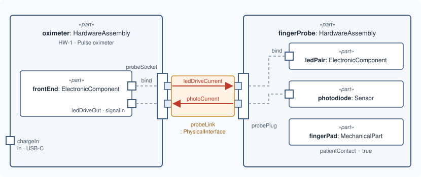

# Lesson 6 · What flows

[Series overview](index.md) · Previous: [Connect them](05-connect-them.md) · Next: [Recap: the hardware](07-recap-hardware.md)

## The idea

The interface says the two units are connected. A **flow** says what moves
across it, and which way. Two things cross the probe interface: a drive current
out to the LEDs, and the photodiode's current back.

A flow goes from an `out` port to an `in` port. That is why the socket's pins got
directions in lesson 3: the flow can only be written once they have them.



## Write it

After `interface probeLink`:

```sysml
    flow ledDriveCurrent : PhysicalTransfer
        from oximeter.probeSocket.ledDrive to fingerProbe.probePlug.ledDrive {
        attribute :>> quantity = "LED drive current";
        attribute :>> unit = "mA";
        attribute :>> nominalValue = "50";
    }
    flow photoCurrent : PhysicalTransfer
        from fingerProbe.probePlug.photoSignal to oximeter.probeSocket.photoSignal {
        attribute :>> quantity = "photodiode current";
        attribute :>> unit = "uA";
    }
```

## Line by line

Each line or small group from the snippet above, with its notation, what it says, and why it is written that way. The symbols are collected in [Reading the notation](00-reading-the-notation.md).

```sysml
flow ledDriveCurrent : PhysicalTransfer
```

- **Notation.** `flow` declares a flow usage, named `ledDriveCurrent`, typed by `PhysicalTransfer`.
- **What it says.** Something called `ledDriveCurrent` moves…
- **Why.** A flow, not a bind, because something does travel: a current from one unit to the other. `PhysicalTransfer` is MEMO's concrete flow type for hardware: its parent `PhysicalFlow` is abstract and declares no ends, and `PhysicalTransfer` adds them.

```sysml
from oximeter.probeSocket.ledDrive to fingerProbe.probePlug.ledDrive {
```

- **Notation.** `from a to b`: the source, then the target.
- **What it says.** …from the socket's LED pins to the plug's LED pins.
- **Why.** The source is an `out` port and the target an `in` port, which is what a flow requires; this is why lesson 3 gave the pins directions. The flow ends at the plug, not at the LEDs inside the probe: the bind from lesson 5 carries it on.

```sysml
attribute :>> quantity = "LED drive current";
```

- **Notation.** As before.
- **What it says.** What moves is the LED drive current.
- **Why.** `PhysicalFlow` declares `quantity`, `unit` and `nominalValue`, so a reviewer can read what crosses the interface without opening a schematic.

```sysml
attribute :>> unit = "mA";
attribute :>> nominalValue = "50";
```

- **Notation.** Two text values.
- **What it says.** Nominally 50 mA.

```sysml
}
```

- **Notation.** Closes the flow.

```sysml
flow photoCurrent : PhysicalTransfer
    from fingerProbe.probePlug.photoSignal to oximeter.probeSocket.photoSignal {
```

- **Notation.** As above.
- **What it says.** The photodiode current moves the other way, from the plug back to the socket.
- **Why.** `from` and `to` swap because the direction swaps: the plug's `photoSignal` is the `out` end here.

```sysml
attribute :>> quantity = "photodiode current";
attribute :>> unit = "uA";
}
```

- **Notation.** As above; `}` closes the flow.
- **What it says.** Measured in microamps.
- **Why.** No nominal value: every attribute is optional, and an unknown value is better left out than guessed.

## Good to know

`flow` and `bind` are easy to confuse. Ask whether anything travels:

| | `flow` | `bind` |
|---|---|---|
| Something moves | yes | no |
| Directions | `out` to `in` | `in` to `in`, `out` to `out` |
| Typical place | between two parts | between a boundary port and a part inside |

For functions and logical components the same idea uses a different
`flow def`: `FunctionalTransfer` between functions, `LogicalTransfer` between
logical components.

## The model so far

```sysml
package pulse_oximeter {
    private import memo::*;

    part oximeter : HardwareAssembly {
        @MemoIdentity {
            :>> providedId = "HW-1";
            :>> label = "Pulse oximeter";
        }
        doc /* The handheld unit: case, battery, display and electronics. */

        in port chargeIn : PhysicalPort {
            @MemoIdentity { :>> label = "Charging socket"; }
            attribute :>> connectorType = "USB-C";
        }

        inout port probeSocket : PhysicalPort {
            @MemoIdentity { :>> label = "Probe socket"; }
            attribute :>> connectorType = "DB-9";

            out port ledDrive : PhysicalPort {
                @MemoIdentity { :>> label = "LED drive pins"; }
            }
            in port photoSignal : PhysicalPort {
                @MemoIdentity { :>> label = "Photodiode signal pins"; }
            }
        }

        part frontEnd : ElectronicComponent {
            @MemoIdentity { :>> providedId = "HW-2"; :>> label = "Analog front end"; }
            attribute :>> patientContact = false;
            out port ledDriveOut : PhysicalPort;
            in port signalIn : PhysicalPort;
        }

        bind probeSocket.ledDrive = frontEnd.ledDriveOut;
        bind probeSocket.photoSignal = frontEnd.signalIn;
    }

    part fingerProbe : HardwareAssembly {
        @MemoIdentity { :>> providedId = "HW-3"; :>> label = "Finger probe"; }

        inout port probePlug : PhysicalPort {
            attribute :>> connectorType = "DB-9";
            in port ledDrive : PhysicalPort;
            out port photoSignal : PhysicalPort;
        }

        part ledPair : ElectronicComponent {
            @MemoIdentity { :>> providedId = "HW-4"; :>> label = "Red and infrared LEDs"; }
            attribute :>> patientContact = false;
            in port driveIn : PhysicalPort;
        }
        part photodiode : Sensor {
            @MemoIdentity { :>> providedId = "HW-5"; :>> label = "Photodiode"; }
            attribute :>> measurand = "red and infrared light through the finger";
            attribute :>> patientContact = false;
            out port signalOut : PhysicalPort;
        }
        part fingerPad : MechanicalPart {
            @MemoIdentity { :>> providedId = "HW-6"; :>> label = "Finger pad"; }
            attribute :>> patientContact = true;
            attribute :>> contactNature = "intact skin, surface device";
            attribute :>> contactDuration = "limited, up to 24 h";
        }

        bind probePlug.ledDrive = ledPair.driveIn;
        bind probePlug.photoSignal = photodiode.signalOut;
    }

    interface probeLink : PhysicalInterface
        connect oximeter.probeSocket to fingerProbe.probePlug {
        @MemoIdentity { :>> providedId = "IF-1"; :>> label = "Probe interface"; }
        attribute :>> direction = DirectionKind::inputOutput;
    }

    flow ledDriveCurrent : PhysicalTransfer
        from oximeter.probeSocket.ledDrive to fingerProbe.probePlug.ledDrive {
        attribute :>> quantity = "LED drive current";
        attribute :>> unit = "mA";
        attribute :>> nominalValue = "50";
    }
    flow photoCurrent : PhysicalTransfer
        from fingerProbe.probePlug.photoSignal to oximeter.probeSocket.photoSignal {
        attribute :>> quantity = "photodiode current";
        attribute :>> unit = "uA";
    }
}
```

Next: [Lesson 7 · Recap: the hardware](07-recap-hardware.md)
