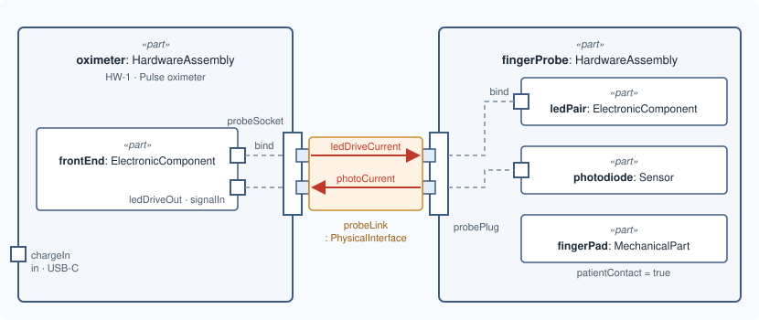

# Lesson 7 · Recap: the hardware

[Series overview](index.md) · Previous: [What flows](06-what-flows.md) · Next: [Functions](08-functions.md)

## What you have

Two units, each with parts inside, joined through a socket and a plug:



| Step | MEMO element or relation | SysML keyword |
|---|---|---|
| The unit | `HardwareAssembly` | `part` |
| A component | `ElectronicComponent`, `Sensor`, `MechanicalPart`, … | `part` |
| A connector | `PhysicalPort`, nested for its pins | `port` |
| Inside a part | nesting | (none) |
| Between two units | `PhysicalInterface` | `interface … connect` |
| Boundary to inside | binding | `bind` |
| What crosses | `PhysicalTransfer` | `flow` |

## Name the system

One definition you do write yourself: the **system** the model is about. MEMO's
validator expects every model to declare one, as a `part def` that specializes
`System`. Add it after the `private import`:

```sysml
    part def PulseOximeterSystem specializes System {
        attribute :>> systemBoundaryDescription =
            "The handheld pulse oximeter and its finger probe.";
    }
```

It is a definition rather than a usage because it names the product, not one
part in it: the hardware, the functions and the requirements you add next all
belong to this system.

### Line by line

Each line or small group from the snippet above, with its notation, what it says, and why it is written that way. The symbols are collected in [Reading the notation](00-reading-the-notation.md).

```sysml
part def PulseOximeterSystem specializes System {
```

- **Notation.** `part def` declares a **definition**, a type, not a part in the design. `specializes` (also written `:>`) makes it a kind of `System`. Definitions are PascalCase.
- **What it says.** Pulse oximeter system is a kind of MEMO `System`.
- **Why.** This is the one definition you write yourself, because it names your product. MEMO builds its workspaces from what is linked to a `System` definition, so a model without one cannot be scoped and every element is reported as unassigned (rule CR-ONT-084). A definition and not a usage because it names the product, not one instance of it.

```sysml
attribute :>> systemBoundaryDescription =
    "The handheld pulse oximeter and its finger probe.";
```

- **Notation.** A value can continue on the next line; the `;` ends it.
- **What it says.** What is inside the system boundary.
- **Why.** The boundary decides what counts as the system and what is its environment. Stating it stops a reviewer guessing whether, say, the charger is in scope.

```sysml
}
```

- **Notation.** Closes the definition.

If your project was created with `memo-architect init`, it already has one:
`ProductSystem` in `model/catalog/architecture/system.sysml`. Rename that to
`PulseOximeterSystem` instead of adding a second.

## Validate it

The compiler checks that the file is valid SysML. MEMO's validator checks the
MEMO rules: completeness, required attributes, legal relations. It runs on a
project, so if you have been working in a lone file, create one and put
`pulse_oximeter.sysml` in its `model/catalog/` folder:

```bash
npx memo-architect init pulse-oximeter
```

Then tell the project about your package. Open `model/methodology/project.sysml`,
the project's entrypoint, and add an import of your package beside the ones
already there:

```sysml
    private import pulse_oximeter::*;
```

The entrypoint is how MEMO decides which packages are the project's model. A
package it does not import is only partly checked: its elements are counted,
but some rules never see it, so a missing finding would not mean a correct
model. Every file you add later needs its package imported the same way.

Then, in the project folder:

```bash
npx memo validate .
```

With the system named, the model so far has no rule findings. (The selected
compiler may also print warnings located in MEMO's own library files; those are
not about your model.) Each of these would have been a finding:

| Leave out | The validator reports |
|---|---|
| `patientContact` on a physical component | patient-contact components must identify contact nature and duration (ISO 10993-1) |
| `direction` on `probeLink` | interface direction required for integration analysis |
| `PulseOximeterSystem` | a model declares at least one System |

## Common mistakes

| Mistake | Instead |
|---|---|
| A relation to say a part is inside another | write it inside |
| A flow from outside straight to `fingerProbe.photodiode.signalOut` | flow to `fingerProbe.probePlug`, then `bind` inside the probe |
| `flow` between a boundary port and its inner port | `bind`: nothing travels |
| A direction attribute on a port | `in`, `out` or `inout` before `port` |
| Typing a port by a part, or a part by a port def | ports are typed by a `port def` (`PhysicalPort`), parts by a `part def` |

## The model so far

```sysml
package pulse_oximeter {
    private import memo::*;

    part def PulseOximeterSystem specializes System {
        attribute :>> systemBoundaryDescription =
            "The handheld pulse oximeter and its finger probe.";
    }

    part oximeter : HardwareAssembly {
        @MemoIdentity {
            :>> providedId = "HW-1";
            :>> label = "Pulse oximeter";
        }
        doc /* The handheld unit: case, battery, display and electronics. */

        in port chargeIn : PhysicalPort {
            @MemoIdentity { :>> label = "Charging socket"; }
            attribute :>> connectorType = "USB-C";
        }

        inout port probeSocket : PhysicalPort {
            @MemoIdentity { :>> label = "Probe socket"; }
            attribute :>> connectorType = "DB-9";

            out port ledDrive : PhysicalPort {
                @MemoIdentity { :>> label = "LED drive pins"; }
            }
            in port photoSignal : PhysicalPort {
                @MemoIdentity { :>> label = "Photodiode signal pins"; }
            }
        }

        part frontEnd : ElectronicComponent {
            @MemoIdentity { :>> providedId = "HW-2"; :>> label = "Analog front end"; }
            attribute :>> patientContact = false;
            out port ledDriveOut : PhysicalPort;
            in port signalIn : PhysicalPort;
        }

        bind probeSocket.ledDrive = frontEnd.ledDriveOut;
        bind probeSocket.photoSignal = frontEnd.signalIn;
    }

    part fingerProbe : HardwareAssembly {
        @MemoIdentity { :>> providedId = "HW-3"; :>> label = "Finger probe"; }

        inout port probePlug : PhysicalPort {
            attribute :>> connectorType = "DB-9";
            in port ledDrive : PhysicalPort;
            out port photoSignal : PhysicalPort;
        }

        part ledPair : ElectronicComponent {
            @MemoIdentity { :>> providedId = "HW-4"; :>> label = "Red and infrared LEDs"; }
            attribute :>> patientContact = false;
            in port driveIn : PhysicalPort;
        }
        part photodiode : Sensor {
            @MemoIdentity { :>> providedId = "HW-5"; :>> label = "Photodiode"; }
            attribute :>> measurand = "red and infrared light through the finger";
            attribute :>> patientContact = false;
            out port signalOut : PhysicalPort;
        }
        part fingerPad : MechanicalPart {
            @MemoIdentity { :>> providedId = "HW-6"; :>> label = "Finger pad"; }
            attribute :>> patientContact = true;
            attribute :>> contactNature = "intact skin, surface device";
            attribute :>> contactDuration = "limited, up to 24 h";
        }

        bind probePlug.ledDrive = ledPair.driveIn;
        bind probePlug.photoSignal = photodiode.signalOut;
    }

    interface probeLink : PhysicalInterface
        connect oximeter.probeSocket to fingerProbe.probePlug {
        @MemoIdentity { :>> providedId = "IF-1"; :>> label = "Probe interface"; }
        attribute :>> direction = DirectionKind::inputOutput;
    }

    flow ledDriveCurrent : PhysicalTransfer
        from oximeter.probeSocket.ledDrive to fingerProbe.probePlug.ledDrive {
        attribute :>> quantity = "LED drive current";
        attribute :>> unit = "mA";
        attribute :>> nominalValue = "50";
    }
    flow photoCurrent : PhysicalTransfer
        from fingerProbe.probePlug.photoSignal to oximeter.probeSocket.photoSignal {
        attribute :>> quantity = "photodiode current";
        attribute :>> unit = "uA";
    }
}
```

Next: [Lesson 8 · Functions](08-functions.md)
