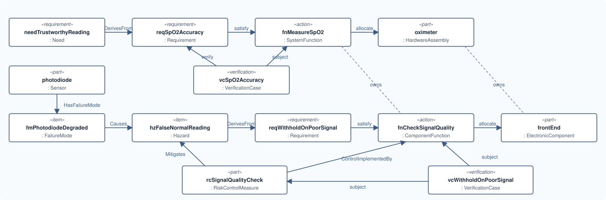

# Lesson 13 · Recap: the whole slice

[Series overview](index.md) · Previous: [Verify it](12-verify.md)

## What you built

One file holds a connected slice of a device: hardware, what it does, why, what
can go wrong, and how each claim will be checked. Every path between them runs
through a function.



Read it two ways:

- **Top row, left to right:** a clinician's need becomes an accuracy
  requirement, which the measuring function satisfies, which the oximeter
  carries out. VC-1 verifies the requirement by testing the function.
- **Bottom row:** the photodiode can degrade, which contributes to a falsely
  normal reading. A safety requirement derives from that hazard; the
  signal-quality function satisfies it and implements the risk control; the
  front end carries the function. VC-2 tests both the control and the function.

## Every element and relation in the series

| Area | Elements | Relations |
|---|---|---|
| Hardware | `HardwareAssembly`, `ElectronicComponent`, `Sensor`, `MechanicalPart`, `Cable`, `PhysicalPort` | nesting, `bind`, `interface … : PhysicalInterface`, `flow … : PhysicalTransfer`, `ConnectionBinding` |
| System | `System` (your `part def`) | — |
| Functions | `SystemFunction`, `ComponentFunction` | nesting, `first … then`, `allocate` |
| Requirements | `User`, `Need`, `Requirement` | `HeldBy`, `DerivesFrom`, `satisfy` |
| Risk | `Hazard`, `HazardousSituation`, `Harm`, `FailureMode`, `RiskControlMeasure` | `TracesRisk`, `HasFailureMode`, `Causes`, `Mitigates`, `ControlImplementedBy` |
| Verification | `VerificationCase`, `MemoEvidence` | `verify`, `subject`, `ProducesEvidence` |
| Every element | `@MemoIdentity` (`providedId`, `label`), `doc` | — |

Where SysML v2 already has the construct (`part`, `port`, `bind`, `flow`,
`allocate`, `satisfy`, `verify`), MEMO uses it as it is. MEMO adds the
definitions to type it by, and named relations only where SysML has no
keyword for the claim.

## The finished model

```sysml
package pulse_oximeter {
    private import memo::*;

    part def PulseOximeterSystem specializes System {
        attribute :>> systemBoundaryDescription =
            "The handheld pulse oximeter and its finger probe.";
    }

    part oximeter : HardwareAssembly {
        @MemoIdentity {
            :>> providedId = "HW-1";
            :>> label = "Pulse oximeter";
        }
        doc /* The handheld unit: case, battery, display and electronics. */

        in port chargeIn : PhysicalPort {
            @MemoIdentity { :>> label = "Charging socket"; }
            attribute :>> connectorType = "USB-C";
        }

        inout port probeSocket : PhysicalPort {
            @MemoIdentity { :>> label = "Probe socket"; }
            attribute :>> connectorType = "DB-9";

            out port ledDrive : PhysicalPort {
                @MemoIdentity { :>> label = "LED drive pins"; }
            }
            in port photoSignal : PhysicalPort {
                @MemoIdentity { :>> label = "Photodiode signal pins"; }
            }
        }

        part frontEnd : ElectronicComponent {
            @MemoIdentity { :>> providedId = "HW-2"; :>> label = "Analog front end"; }
            attribute :>> patientContact = false;
            out port ledDriveOut : PhysicalPort;
            in port signalIn : PhysicalPort;
        }

        bind probeSocket.ledDrive = frontEnd.ledDriveOut;
        bind probeSocket.photoSignal = frontEnd.signalIn;
    }

    part fingerProbe : HardwareAssembly {
        @MemoIdentity { :>> providedId = "HW-3"; :>> label = "Finger probe"; }

        inout port probePlug : PhysicalPort {
            attribute :>> connectorType = "DB-9";
            in port ledDrive : PhysicalPort;
            out port photoSignal : PhysicalPort;
        }

        part ledPair : ElectronicComponent {
            @MemoIdentity { :>> providedId = "HW-4"; :>> label = "Red and infrared LEDs"; }
            attribute :>> patientContact = false;
            in port driveIn : PhysicalPort;
        }
        part photodiode : Sensor {
            @MemoIdentity { :>> providedId = "HW-5"; :>> label = "Photodiode"; }
            attribute :>> measurand = "red and infrared light through the finger";
            attribute :>> patientContact = false;
            out port signalOut : PhysicalPort;
        }
        part fingerPad : MechanicalPart {
            @MemoIdentity { :>> providedId = "HW-6"; :>> label = "Finger pad"; }
            attribute :>> patientContact = true;
            attribute :>> contactNature = "intact skin, surface device";
            attribute :>> contactDuration = "limited, up to 24 h";
        }

        bind probePlug.ledDrive = ledPair.driveIn;
        bind probePlug.photoSignal = photodiode.signalOut;
    }

    interface probeLink : PhysicalInterface
        connect oximeter.probeSocket to fingerProbe.probePlug {
        @MemoIdentity { :>> providedId = "IF-1"; :>> label = "Probe interface"; }
        attribute :>> direction = DirectionKind::inputOutput;
        attribute :>> signalingKind = SignalingKind::analog;
        attribute :>> mediumKind = PhysicalMediumKind::electrical;
        attribute :>> connectorStandard = "DB-9, 6 pins used";
    }

    flow ledDriveCurrent : PhysicalTransfer
        from oximeter.probeSocket.ledDrive to fingerProbe.probePlug.ledDrive {
        attribute :>> quantity = "LED drive current";
        attribute :>> unit = "mA";
        attribute :>> nominalValue = "50";
    }
    flow photoCurrent : PhysicalTransfer
        from fingerProbe.probePlug.photoSignal to oximeter.probeSocket.photoSignal {
        attribute :>> quantity = "photodiode current";
        attribute :>> unit = "uA";
    }

    action fnMeasureSpO2 : SystemFunction {
        @MemoIdentity { :>> providedId = "FN-1"; :>> label = "Measure oxygen saturation"; }
        attribute :>> criticality = CriticalityKind::high;

        action fnIlluminate : ComponentFunction {
            @MemoIdentity { :>> providedId = "FN-2"; :>> label = "Illuminate the finger"; }
        }
        action fnSenseLight : ComponentFunction {
            @MemoIdentity { :>> providedId = "FN-3"; :>> label = "Sense transmitted light"; }
        }
        action fnCheckSignalQuality : ComponentFunction {
            @MemoIdentity { :>> providedId = "FN-4"; :>> label = "Check signal quality"; }
        }
        first fnIlluminate then fnSenseLight;
        first fnSenseLight then fnCheckSignalQuality;
    }

    allocate fnMeasureSpO2 to oximeter;
    allocate fnMeasureSpO2.fnIlluminate to fingerProbe.ledPair;
    allocate fnMeasureSpO2.fnSenseLight to fingerProbe.photodiode;
    allocate fnMeasureSpO2.fnCheckSignalQuality to oximeter.frontEnd;

    requirement needTrustworthyReading : Need {
        @MemoIdentity { :>> providedId = "NEED-1"; :>> label = "Trustworthy oxygen reading"; }
        attribute :>> needKind = NeedKind::clinicalUser;
        doc /* A clinician needs an oxygen saturation reading they can act on. */
    }
    requirement reqSpO2Accuracy : Requirement {
        @MemoIdentity { :>> providedId = "REQ-1"; :>> label = "SpO2 accuracy"; }
        attribute :>> requirementType = RequirementTypeKind::system;
        doc /* The oximeter shall report SpO2 within 2 percentage points of the
             * reference value over the range 70 % to 100 %. */
    }
    part clinician : User {
        @MemoIdentity { :>> providedId = "USR-1"; :>> label = "Ward clinician"; }
    }
    connection : HeldBy connect needTrustworthyReading to clinician;
    connection : DerivesFrom connect needTrustworthyReading to reqSpO2Accuracy;
    satisfy reqSpO2Accuracy by fnMeasureSpO2;

    item hzFalseNormalReading : Hazard {
        @MemoIdentity { :>> providedId = "HAZ-1"; :>> label = "Falsely normal SpO2 reading"; }
        attribute :>> hazardType = HazardTypeKind::informationError;
        attribute :>> severity = SeverityKind::serious;
    }
    item hsHypoxiaMissed : HazardousSituation {
        @MemoIdentity { :>> providedId = "HS-1"; :>> label = "Hypoxic patient reads as normal"; }
        attribute :>> exposedPersons = "patient";
    }
    item harmHypoxicInjury : Harm {
        @MemoIdentity { :>> providedId = "HARM-1"; :>> label = "Hypoxic injury"; }
    }
    connection : TracesRisk connect hzFalseNormalReading to hsHypoxiaMissed;
    connection : TracesRisk connect hsHypoxiaMissed to harmHypoxicInjury;

    item fmPhotodiodeDegraded : FailureMode {
        @MemoIdentity { :>> providedId = "FM-1"; :>> label = "Photodiode signal degraded"; }
        attribute :>> failureModeKind = FailureModeKind::degradedFunction;
    }
    connection : HasFailureMode connect fingerProbe.photodiode to fmPhotodiodeDegraded;
    connection : Causes connect fmPhotodiodeDegraded to hzFalseNormalReading {
        attribute :>> causeKind = CauseKind::contributesToHazard;
    }

    part rcSignalQualityCheck : RiskControlMeasure {
        @MemoIdentity { :>> providedId = "RC-1"; :>> label = "Withhold reading on poor signal"; }
        attribute :>> controlKind = RiskControlKind::plausibilityCheck;
        attribute :>> implementationKind = RiskControlImplementationKind::hardwareDesign;
    }
    connection : Mitigates connect rcSignalQualityCheck to hzFalseNormalReading {
        attribute :>> mitigationKind = MitigationKind::hazard;
    }
    connection : ControlImplementedBy connect rcSignalQualityCheck to fnMeasureSpO2.fnCheckSignalQuality;

    requirement reqWithholdOnPoorSignal : Requirement {
        @MemoIdentity { :>> providedId = "REQ-2"; :>> label = "Withhold reading on poor signal"; }
        attribute :>> requirementType = RequirementTypeKind::system;
        doc /* When the photodiode signal is below the quality threshold, the
             * oximeter shall show no SpO2 value and indicate poor signal. */
    }
    connection : DerivesFrom connect hzFalseNormalReading to reqWithholdOnPoorSignal;
    satisfy reqWithholdOnPoorSignal by fnMeasureSpO2.fnCheckSignalQuality;

    part probeCable : Cable {
        @MemoIdentity { :>> providedId = "HW-7"; :>> label = "Probe cable"; }
        attribute :>> patientContact = false;
        attribute :>> conductorCount = "6";
        attribute :>> shielding = "braided screen";
    }
    allocation : ConnectionBinding allocate probeLink to probeCable;

    verification vcSpO2Accuracy : VerificationCase {
        @MemoIdentity { :>> providedId = "VC-1"; :>> label = "Verify SpO2 accuracy"; }
        attribute :>> methodKind = MemoVerificationMethodKind::test;
        attribute :>> acceptanceCriteria =
            "Against a reference over 70 % to 100 %, every reading is within 2 points.";

        objective { verify reqSpO2Accuracy; }
        subject verified : Base::Anything[*] = (fnMeasureSpO2);
    }
    verification vcWithholdOnPoorSignal : VerificationCase {
        @MemoIdentity { :>> providedId = "VC-2"; :>> label = "Verify reading withheld on poor signal"; }
        attribute :>> methodKind = MemoVerificationMethodKind::test;
        attribute :>> acceptanceCriteria =
            "With the probe signal attenuated below the threshold, no SpO2 value is shown.";

        objective { verify reqWithholdOnPoorSignal; }
        subject verified : Base::Anything[*] = (rcSignalQualityCheck, fnMeasureSpO2.fnCheckSignalQuality);
    }
    part evSpO2AccuracyReport : MemoEvidence {
        @MemoIdentity { :>> providedId = "EV-1"; :>> label = "SpO2 accuracy test report"; }
        attribute :>> evidenceKind = EvidenceKind::evidence;
    }
    connection : ProducesEvidence connect vcSpO2Accuracy to evSpO2AccuracyReport;
}
```

## Where to go next

- The same slice for software: a `SoftwareComponent` with `SoftwarePort`s,
  allocated functions and a software requirement (`requirementType = software`).
- The layers in depth: [Functional](../../ontology/functional.md),
  [Logical](../../ontology/logical.md),
  [Implementation](../../ontology/implementation.md),
  [Safety and risk](../../ontology/safety-risk.md).
- [Choose an element](../../modeling/elements.md) when you are unsure which
  definition fits.
